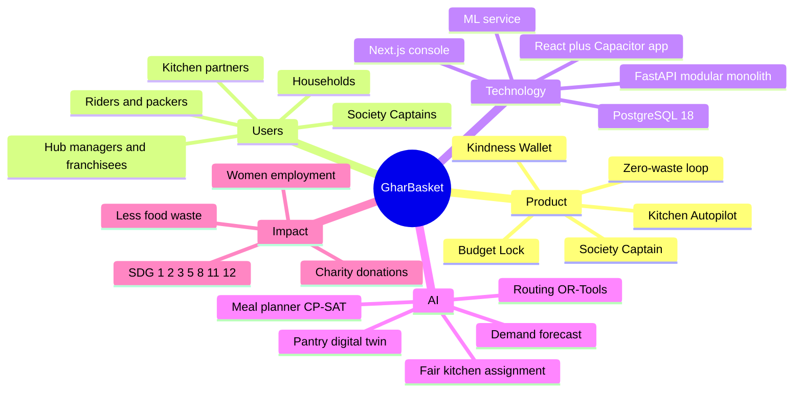

# Chapter 00 — GharBasket Project Handbook: Start Here

> **In short:**
> - This handbook is the **single source of truth** for GharBasket: product, business, architecture, data, AI, design, process and plan.
> - It supersedes the older documents in `Major project/` (files `01`–`07` and `04_UML_Diagrams.md`), which assumed Flutter and 18 microservices. Those files are kept only for history.
> - Every behaviour-changing pull request must update the relevant chapter (this is a checklist item in the PR template).
> - AI coding assistants used by the team (Claude Code, Cursor, Gemini, etc.) are pointed here via `AGENTS.md`, so every session starts with full context.
> - Status: **v1, October 2026**, written at the end of Phase 0 planning. Decisions D1–D17 are final unless changed through an ADR.

---

## 1. Project at a glance

| Item | Detail |
|---|---|
| Project | **GharBasket (घरBasket)** — AI-Driven Predictive Household Management Platform with Hyperlocal Community Commerce, Women Empowerment and Sustainable Charity Integration |
| Institution | SIES Graduate School of Technology, Nerul, Navi Mumbai — Department of Computer Engineering |
| Guide | Prof. Kranti Bade (project accepted 13 August 2026) |
| Associated organisation | United Brothers Global (role and IP terms to be confirmed) |
| Academic year | 2026–2027 |
| One-line positioning | A **Kitchen Autopilot** for Indian families: AI plans the family's food week, women in the same housing society prepare and deliver it, and the monthly vegetable bill stays predictable. |
| Headline USPs | **Kitchen Autopilot** (meal-plan-first AI) and **Society Captain ("Ghar Saathi")** network |
| Supporting features | Budget Lock (fixed monthly sabzi bill), zero-waste loop, Kindness Wallet (charity credits) |
| Pilot geography | Panvel / Kharghar, Navi Mumbai |
| Architecture style | Service-based: modular monolith + ML/optimisation service + background workers (not microservices) |
| Main technologies | React 19 + Vite + Capacitor 8 (mobile, Android + PWA), Next.js 16 (console), FastAPI (Python 3.13), PostgreSQL 18, OR-Tools, StatsForecast, LightGBM, Claude API |

*Figure 0.1 — Project mind map*

## 2. How to read this handbook

| If you are… | Read first |
|---|---|
| New to the project | 00 → 01 → 03 → 04 |
| Building backend modules | 04 → 05 → 06 → 10 → your module spec in `docs/modules/` |
| Building the mobile app or console | 03 → 09 → 10 |
| Working on AI/ML | 05 → 07 → 08 |
| Writing the report or paper | 01 → 02 → 08 → 14 |
| Preparing for the viva | 01 → 04 → 08 → 15 |

Conventions used throughout:
- **D-numbers** (D1–D17) refer to agreed decisions; each has an ADR in `docs/adr/` (`0001` = D1 … `0017` = D17).
- **M-numbers** (M0–M13) refer to software modules; each has a spec in `docs/modules/`.
- **P-numbers** (P0–P7) are project phases; **S-numbers** (S0–S12) are two-week sprints.
- Money is always in **₹**; inside the system it is stored as integer **paise**.
- Figures are numbered per chapter (e.g. *Figure 4.2*). All diagrams are written in Mermaid and render on GitHub and in VS Code.

## 3. Team and ownership

| Member | Tracks | Owns |
|---|---|---|
| **Yash Salunkhe** | A — Customer Experience; B — Commerce Core | Mobile app (`apps/mobile`), design system (`packages/ui`), modules M1 Identity, M2 Catalog, M3 Subscriptions, M4 Orders, M5 Billing, M11 Notifications |
| **Prathamesh Relekar** | C — Operations; D — Intelligence | Console (`apps/console`), modules M6 Hub Operations, M7 Logistics, M8 Partners, M9 Community (backend), M10 Intelligence (ML service), M12 Analytics, M13 Assistant, data simulator, IEEE paper results |
| **Rhythm Thakur** | Documentation, QA, pilot | Handbook and report upkeep, UML, test plans and E2E tests (Playwright), translations and copy review, UX interviews, pilot operations, presentation |
| **Manish Raje** | Documentation, QA, pilot | Same as Rhythm (shared ownership), assistant evaluation dataset, load and accessibility testing, research-paper writing |
| **Prof. Kranti Bade** | Guide | Reviews every phase gate and milestone demo |

Cross-review rule: Yash reviews Prathamesh's backend pull requests and vice versa, so that both can explain the whole system in the viva.

## 4. Chapter index

| # | Chapter | What it answers |
|---|---|---|
| 00 | [Start here](00-README.md) | What GharBasket is, who owns what, how to read |
| 01 | [Vision and scope](01-vision-and-scope.md) | Why we are building it, for whom, what is in and out |
| 02 | [Market and business](02-market-and-business.md) | Competitors, international lessons, business model, profit levers |
| 03 | [Product and features](03-product-and-features.md) | Roles, features, modules, use cases |
| 04 | [System architecture](04-system-architecture.md) | How the system is structured and why not microservices |
| 05 | [Data architecture](05-data-architecture.md) | Database schemas, tables, ledger, simulator |
| 06 | [Domain lifecycles](06-domain-lifecycles.md) | State machines for orders, tiffins, payments, partners, donations |
| 07 | [Workflows](07-workflows.md) | The 12 core workflows step by step |
| 08 | [AI and ML](08-ai-and-ml.md) | Every model, where it is trained, how it is evaluated |
| 09 | [Frontend and design](09-frontend-and-design.md) | Design system, screens, navigation, libraries |
| 10 | [API and integration](10-api-and-integration.md) | API conventions, auth, events, jobs, external services |
| 11 | [Engineering process](11-engineering-process.md) | Repository, Git rules, CI/CD, testing |
| 12 | [Deployment and operations](12-deployment-and-operations.md) | AWS Mumbai + Neon topology, monitoring, runbooks |
| 13 | [Security and compliance](13-security-and-compliance.md) | Auth, DPDP, RBI wallet rules, FSSAI, KYC |
| 14 | [Project plan](14-project-plan.md) | Phases, milestones, sprints, responsibilities, budget |
| 15 | [Risks and decisions](15-risks-and-decisions.md) | Risk register, decision log, open questions |
| A | [Diagram index](appendix-diagram-index.md) | Every diagram in one list |

Companion documents: `docs/TDD.md` (technical design document), `docs/FRONTEND_DESIGN.md`, `docs/adr/`, `docs/modules/`.

## 5. Glossary

| Term | Meaning |
|---|---|
| **Kitchen Autopilot** | The AI feature that plans a household's meals for the week and derives the vegetable box, cut-veg kits and tiffins from that plan |
| **Society Captain / Ghar Saathi** | A trained woman resident of a housing society who receives the bulk drop for her society, sorts it by flat, handles the last 50 metres, returns and donation bags, and earns commission |
| **Parchi** | Hindi for a handwritten shopping slip; used as the visual metaphor for the weekly box screen |
| **Thali calendar** | The weekly meal-plan view, one "thali" per day |
| **Budget Lock** | Optional fixed monthly vegetable budget; the AI swaps items when prices spike to stay within it |
| **Cut-off** | The time (default 21:00 the day before delivery) after which orders are locked, paid and sent to procurement |
| **Hub** | A local fulfilment centre serving a 3–5 km radius; a franchise is a hub run by a franchise owner |
| **Pantry digital twin** | A model of each household's consumption that predicts when items run out |
| **Newsvendor model** | Classic operations-research model for deciding how much perishable stock to buy under uncertain demand |
| **CP-SAT** | Google OR-Tools constraint-programming solver, used for the meal planner and kitchen assignment |
| **CVRPTW** | Capacitated Vehicle Routing Problem with Time Windows — the delivery routing problem |
| **Surplus cascade** | Order in which unsold stock is used: discounted "Imperfect Sabzi" box → home kitchens → NGO → compost |
| **Kindness Wallet / points** | Loyalty points (not money) earned by donating reusable items; redeemable as discounts |
| **Closed-loop wallet** | Prepaid balance usable only for GharBasket purchases; no cash-out or transfers |
| **data_source** | Tag on every household and order: `synthetic` (simulator), `pilot` or `live` |
| **Modular monolith** | One deployable backend application divided into strictly separated modules |
| **Outbox** | Database table used to publish events reliably in the same transaction as the business change |
| **ADR** | Architecture Decision Record — a one-page record of a decision and its reasons |
| **PWA** | Progressive Web App — a website installable on a phone's home screen |
| **Capacitor** | Tool that packages our web app as a native Android app with access to camera, GPS and push notifications |
| **DPDP** | India's Digital Personal Data Protection Act, 2023 |
| **FSSAI** | Food Safety and Standards Authority of India |

## Decisions & open questions

- All decisions D1–D17 are summarised in [Chapter 15](15-risks-and-decisions.md) and recorded in `docs/adr/0001`–`0017`.
- Open (non-blocking): exam dates and final submission deadline; United Brothers Global's role and IP terms; whether the pilot database stays on Neon or moves to Mumbai (decide before Phase 6).

Related: [01 Vision and scope](01-vision-and-scope.md) · [14 Project plan](14-project-plan.md) · [Appendix: diagram index](appendix-diagram-index.md)
