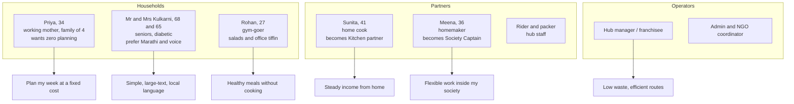
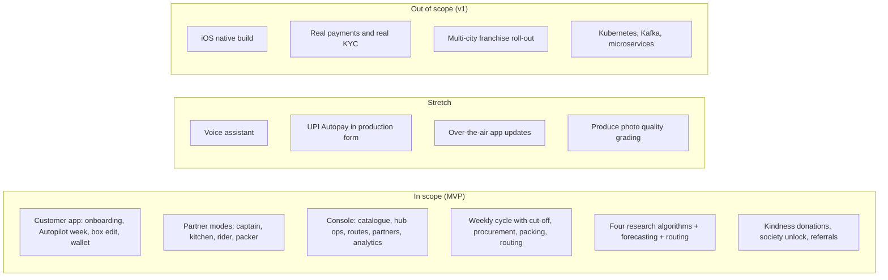

# Chapter 01 — Vision and Scope

> **In short:**
> - Urban Indian families don't really need tomatoes in 10 minutes. They need someone to **think about the week's food for them** at a predictable cost.
> - GharBasket is a **Kitchen Autopilot**: AI plans the family's meals, derives the vegetable box, cut-veg kits and tiffins, and the family approves with one tap.
> - Delivery runs on **fixed society delivery days**, and the last 50 metres is handled by a **Society Captain**, a woman resident who earns commission.
> - Women's employment, zero-waste procurement and charity are built into operations, not added on as CSR.
> - The prototype targets Panvel/Kharghar (Navi Mumbai) with simulated data first and a small real pilot later.

---

## 1. Problem

Urban households — working couples, nuclear families, senior citizens, health-conscious individuals — repeat the same food chores every week:

1. **Decision fatigue.** What vegetables to buy, what to cook, what fits the budget — every week, from scratch.
2. **Unpredictable cost.** Vegetable prices in India swing sharply (tomato and onion spikes), so the monthly food bill is hard to plan.
3. **Food waste at home.** Unplanned buying means items rot before they are used.
4. **No time to cook on busy days**, and limited access to hygienic, home-style tiffin food.
5. **Reactive platforms.** Quick-commerce apps compete on speed. The customer must search and decide every single time. Platforms recommend products, not household plans.
6. **Unused skills.** Many women in the same societies can cook, pack and organise, but lack an organised channel to earn.
7. **No community value.** Delivery platforms take value out of neighbourhoods without giving back.

**The insight** (from the team's 2020–21 COVID-era manual vegetable subscription in Panvel): families preferred planned weekly boxes, building-level batch delivery was very cheap, neighbourhood women helped willingly, and demand continued after lockdown. This was an informal experience, not a measured study; the pilot in Phase 6 will measure it properly.

## 2. Vision

> **GharBasket is a Kitchen Autopilot for Indian families: AI plans your family's food week, women in your own society prepare and deliver it, and your monthly sabzi bill stays fixed.**

Taglines: *"Ghar ka khana, bina tension."* · *"Your kitchen, planned."*

Design philosophy:
- **Plan-first, not shop-first.** The home screen shows "your family's week", not a catalogue grid.
- **Prediction over search.** The system proposes; the customer approves or edits.
- **Batch over instant.** Scheduled routes and cut-offs make zero-waste buying and cheap delivery possible.
- **Community as infrastructure.** Captains and home kitchens are the operating model, not a side programme.

## 3. Unique selling propositions

| # | USP | Status | Why it is hard to copy |
|---|---|---|---|
| 1 | **Kitchen Autopilot** — meal-plan-first AI; plans meals (fasting days, Jain mode, diabetic needs, kids, no-cook days), then derives box, kits and tiffins; pantry digital twin predicts run-outs; one-tap approval | **Headline** | Competitors predict products; we predict meals → ingredients. Needs a recipe graph, an Indian festival/fasting calendar and a constraint solver |
| 2 | **Society Captain ("Ghar Saathi")** — one trained woman per society or tower receives the bulk drop, sorts by flat, handles last 50 m, returns, crates and donation bags, and onboards neighbours | **Headline** | One role solves women's employment, the gated-society last mile, trust and customer acquisition at once |
| 3 | **Budget Lock** — fixed monthly vegetable bill; AI swaps nutritionally similar items when prices spike | Supporting | Needs a price-aware substitution graph and a portfolio view of margin |
| 4 | **Zero-waste loop** — buy only what is ordered plus a forecast buffer; surplus cascade; return-trip pickups of crates and donations | Supporting | Only possible with scheduled routes and cut-offs |
| 5 | **Kindness Wallet** — donate reusable items, earn loyalty points | Supporting | Uses the empty return leg of delivery vans |

## 4. Personas

*Figure 1.1 — Persona map*

## 5. Social impact and SDG alignment

| SDG | Contribution |
|---|---|
| 1 No Poverty | Income for Society Captains and kitchen partners |
| 2 Zero Hunger | Planned food, less waste, nutrition-aware meal plans |
| 3 Good Health | Diet-aware plans (diabetic, fitness, seniors, kids) |
| 5 Gender Equality | Women-run captain and kitchen network with training and income records |
| 8 Decent Work | Transparent earnings statements, fair-assignment algorithm |
| 11 Sustainable Cities | Society-level community commerce, fewer delivery trips |
| 12 Responsible Consumption | Order-before-we-buy procurement, surplus cascade, reusable crates, donations |

## 6. Scope

*Figure 1.2 — Scope: in, stretch, out*

**In scope (MVP):** everything in the MVP column of the module map ([Chapter 03](03-product-and-features.md)).

**Constraints:**
- 4 members.
- About 6 months of build time (October 2026 to April 2027).
- Student budget (₹3,800–18,000 per the accepted proposal).
- Synthetic or consented data only.
- Android + PWA only (no iOS build).

**Assumptions to validate in the pilot (hypotheses, not facts):**
- Households accept at least 70% of an Autopilot box without major edits after four weeks.
- Clustered society delivery costs a small fraction of single-order delivery.
- Order-before-we-buy keeps hub waste well below typical perishable-retail levels.
- Captains can earn a meaningful part-time income.

## 7. Demo-day story (north star)

Every module must serve this end-to-end story:

1. Priya onboards in under two minutes: picks her society, family of four, vegetarian with "Shravan Mondays fasting", ₹3,000/month Budget Lock.
2. Thursday 18:00: Autopilot shows next week's meal plan → box, with reasons ("Methi is in season"; "Tomato +40% this week → swapped for lauki in two meals").
3. She swaps one item and approves; a pre-debit notice is sent.
4. Saturday 21:00 cut-off → the console shows the procurement list (committed demand + forecast buffer) per vendor.
5. Sunday 05:00 packing queue → QR-labelled bags → OR-Tools builds routes for three vans across six societies.
6. Meena (Captain) receives the drop and scans bags to flats; Priya is notified.
7. The van's return trip collects crates and Priya's donated school bag; Kindness points are credited after verification.
8. Monday lunch: Sunita's tiffin is assigned by the fairness-aware matcher; Rohan rates it.
9. Admin dashboard: waste per 100 kg, cost per order, captain and partner earnings, forecast accuracy, impact counters.

## Decisions & open questions

- D1 Headline USPs: Autopilot + Society Captain — [ADR-0001](../adr/0001-headline-usps-autopilot-and-society-captain.md) (`docs/adr/0001-*.md`).
- D8 Simulator first, real data added as it arrives — [ADR-0008](../adr/0008-simulator-first-data-source-tagging.md).
- D10 Plan for April 2027 with a floating buffer sprint — [ADR-0010](../adr/0010-timeline-april-2027-floating-buffer.md).
- D12 Android + PWA, no iOS — [ADR-0012](../adr/0012-android-and-pwa-platforms.md).
- Open: exam dates and final deadline; United Brothers Global's role and IP terms.

Related: [00 Start here](00-README.md) · [02 Market and business](02-market-and-business.md) · [03 Product and features](03-product-and-features.md) · [14 Project plan](14-project-plan.md)
