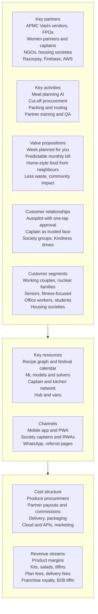
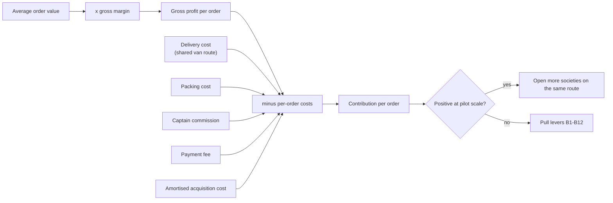
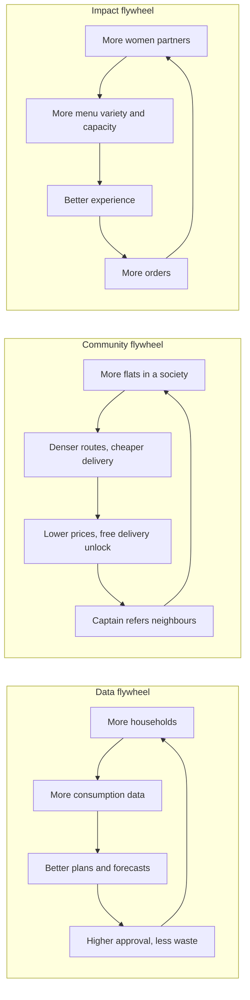

# Chapter 02 — Market and Business

> **In short:**
> - Quick commerce (Blinkit, Zepto, Instamart and others) dominates mindshare in Indian grocery, but it competes on **speed**. We compete on **planning, price predictability, trust and community**.
> - Subscriptions exist in India but are single-category (dairy, some produce). Nobody plans a family's whole food week end-to-end at a predictable cost through a neighbourhood network.
> - Our model borrows proven ideas from abroad: Picnic's fixed route-days (Netherlands), China's community group-buying "group leader", Too Good To Go's surplus sales, and Shef's home-chef profiles.
> - Revenue comes from product margins, value-added food (kits, salads, tiffins), plan fees, franchise royalties and B2B tiffins. Unit economics are **hypotheses** we will measure in the pilot.
> - Twelve business algorithms (density pricing, newsvendor buying, surplus cascade and others) turn the operating model into profit.

---

## 1. Indian market (October 2026)

| Segment | Players | What they do well | Gap we address |
|---|---|---|---|
| Quick commerce | Blinkit, Zepto, Swiggy Instamart, Flipkart Minutes, BB Now, Amazon Now | 10-minute delivery, wide catalogue; expanding into 10-minute food (Blinkit Bistro, Zepto Café, Swiggy Snacc) | Reactive: customer decides every time; one rider per order; no household-level planning |
| Subscriptions | Country Delight, BB Daily, Milkbasket (absorbed into Reliance/JioMart) | Scheduled morning delivery, habit formation | Single category; no meal planning; no community model |
| Home-style meals | Local tiffin services, WhatsApp-run home kitchens, aggregator experiments | Home taste, low price | Fragmented; trust and hygiene vary; no planning link to groceries |
| Community group-buying in India | CityMall, DealShare | Resident leaders, low last-mile cost | Grew on deep discounts and low order values, which hurt their economics |

> We do not claim that competitors have "none" of our features. Our claim is narrower and defensible: **no one combines meal-plan-first AI + predictable monthly cost + a women-run society network + scheduled zero-waste operations.**

## 2. International references — what we copy and what we avoid

| Reference | Country | Lesson | What GharBasket takes |
|---|---|---|---|
| **Picnic** | Netherlands / Germany | "Milkman model": fixed neighbourhood route-days, order the day before, free delivery, very low waste from just-in-time buying | Fixed society delivery days + cut-off-based buying |
| **Duoduo Maicai / Meituan Youxuan** (community group-buying) | China | A resident "group leader", often a homemaker, collects her building's orders, receives one bulk drop, distributes, earns commission; pre-sale means almost no inventory risk | Society Captain ("Ghar Saathi") model |
| **CityMall, DealShare** | India | Community commerce struggled when it relied on deep discounts | Win on subscription commitment and higher-margin prepared food, not discounts |
| **Too Good To Go** | Denmark / EU | Surplus food sold at the end of the day | Evening "Bachat Box" for unsold tiffins and salads |
| **Oddbox / Misfits Market** | UK / US | "Imperfect" produce boxes cut waste and cost | "Imperfect Sabzi" discounted box |
| **HelloFresh / Marley Spoon** | Germany / global | Meal kits work, but churn is high when customers feel locked in | Recipe kits plus easy skip/pause; plan-first experience |
| **Shef / CookUnity** | US | Home-chef marketplaces with permits, profiles and ratings | "Know your cook" profiles with FSSAI registration and hygiene score |
| **Instacart / Amazon Subscribe & Save** | US | ML replacements and "buy it again" increase basket size | Substitution graph and predicted reorders |
| **Getir / Gorillas** | Turkey / Germany | Ultra-fast delivery retreated from most markets outside home countries on unit economics | Supports our scheduled-delivery thesis |
| **Mumbai Dabbawalas** | India | Very high reliability through simple coding and relays | QR/colour-coded bags; tiffin relay design |
| **Careem / Grab** | Middle East / SE Asia | Super-apps lift retention | Long-term vision only, not v1 scope |

## 3. Business Model Canvas

*Figure 2.1 — Business Model Canvas*

## 4. Revenue streams and plans

| Stream | Notes (all prices are proposals, to be validated in the pilot) |
|---|---|
| Fresh vegetable and fruit margins | Lower margin, high frequency |
| Value-added food: cut-veg kits, salads, tiffins | Higher margin; home kitchens paid per portion |
| Plan fees | Proposed tiers carried from the earlier proposal (Free / Silver ₹99 / Gold ₹299 / Family+ ₹499 per month) — to be re-tested; Autopilot and Budget Lock may become the paid features |
| Delivery fees | Only for non-plan users or off-route slots (see green slots) |
| Festival hampers and B2B corporate tiffins | Use the same kitchens and routes off-peak |
| Franchise royalty | Percentage of hub revenue once franchises exist |
| Later: retail media, anonymised demand insights | Only after scale; privacy-preserving and consented |

## 5. Unit economics (hypotheses)

Contribution per order:

**Contribution = AOV × gross margin − (delivery + packing + captain commission + payment fee + amortised CAC)**

*Figure 2.2 — Unit economics flow*

The console includes a **unit-economics calculator** where every assumption is editable. Pilot data replaces assumptions as it arrives. Earlier documents quoted precise figures (for example a fixed ₹ cost per order and margin comparisons with Blinkit). Those were not measured and are **not** used as facts in this handbook.

## 6. Business algorithms that increase profit

| # | Lever | Mechanism | KPI it moves |
|---|---|---|---|
| B1 | Density pricing / green slots | Price each slot by its marginal route insertion cost: "Your neighbours already get delivery Tue 8–10 — choose it and save ₹15" | Cost per order down |
| B2 | Society unlock | Free delivery unlocks when N flats subscribe; N computed from the route-cost model | Acquisition cost down, density up |
| B3 | Order-before-we-buy + newsvendor | Buy committed quantity plus a forecast quantile at the mandi | Waste down, gross margin up |
| B4 | Surplus cascade | Imperfect box → kitchens → NGO → compost | Waste down, revenue from surplus |
| B5 | Margin-aware substitutions | Among substitutes the customer is equally likely to accept, prefer higher margin — never raise the customer's cost | Gross margin up |
| B6 | Surplus-driven kit promotion | Optimiser picks tomorrow's featured kits to use up predicted surplus | Waste down, order value up |
| B7 | Prepaid wallet bonus | Top up ₹2,000 → get ₹2,100 (closed-loop wallet) | Cash float, retention |
| B8 | Budget Lock portfolio | Fixed fee per household; margin balanced across households and weeks | Retention, predictable revenue |
| B9 | Uplift-targeted retention | Offers only to households the offer actually changes | Churn down at lower discount spend |
| B10 | Value-added mix shift | Autopilot suggests kits on busy days | Blended margin up |
| B11 | Captain-led acquisition | Captain referral bonus instead of paid ads | Acquisition cost down |
| B12 | B2B tiffins and festival hampers | Same kitchens and routes at off-peak capacity | Utilisation up |

## 7. Flywheels

*Figure 2.3 — Three reinforcing flywheels*

## 8. Go-to-market (pilot)

1. **Society-first:** approach RWAs in Panvel/Kharghar; recruit one Captain per society before launch.
2. **Trial week:** first Autopilot week at an introductory price; referral page per society (`gharbasket.in/s/<society>`).
3. **Unlock mechanic:** show the progress towards free delivery for the society.
4. **Kitchens:** onboard a small number of home kitchens with FSSAI basic registration; "Know your cook" profiles.
5. **Measure everything** (acceptance, waste, cost per order, captain earnings) for the report and paper.

## Decisions & open questions

- D1 Headline USPs — [ADR-0001](../adr/0001-headline-usps-autopilot-and-society-captain.md). D4 Payments: closed-loop wallet + UPI Autopay — [ADR-0004](../adr/0004-closed-loop-wallet-and-upi-autopay.md).
- Open: final plan pricing (validate in the pilot); United Brothers Global's commercial role; franchise terms are a later-phase decision.

Related: [01 Vision and scope](01-vision-and-scope.md) · [07 Workflows](07-workflows.md) · [08 AI and ML](08-ai-and-ml.md) · [14 Project plan](14-project-plan.md)
