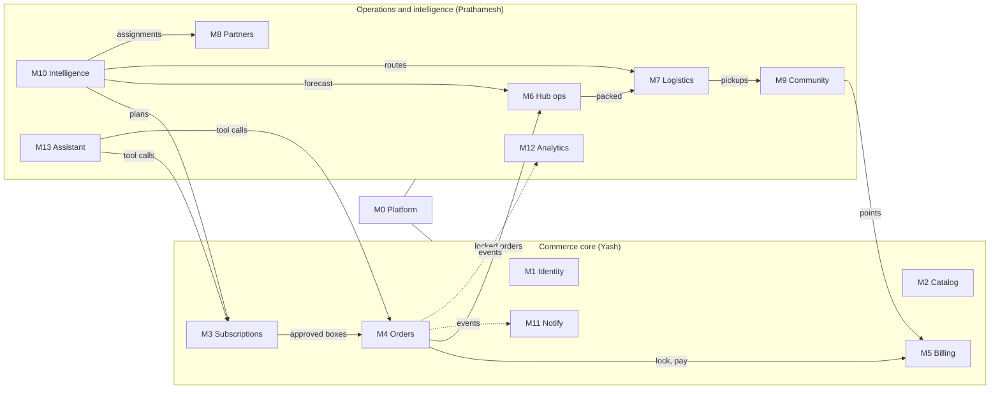
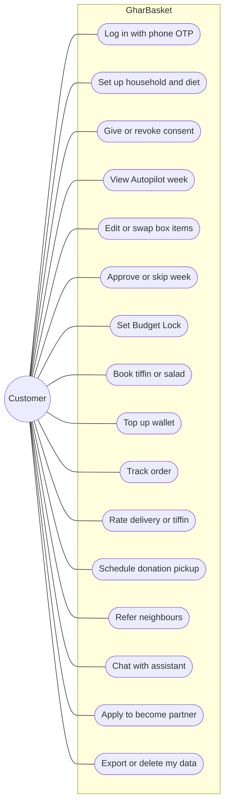
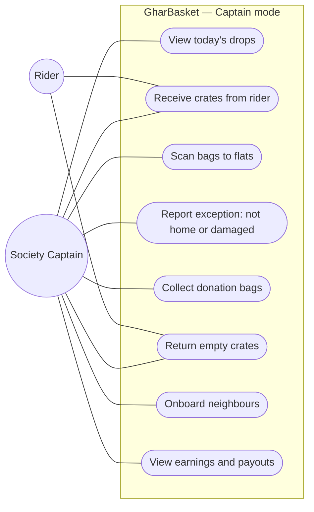
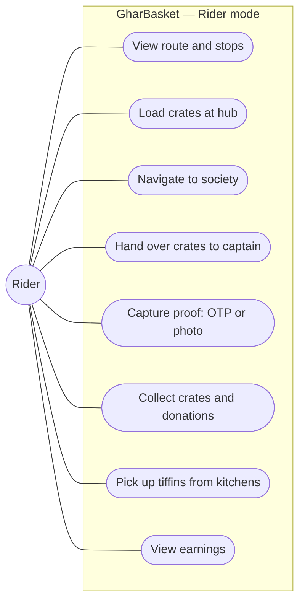
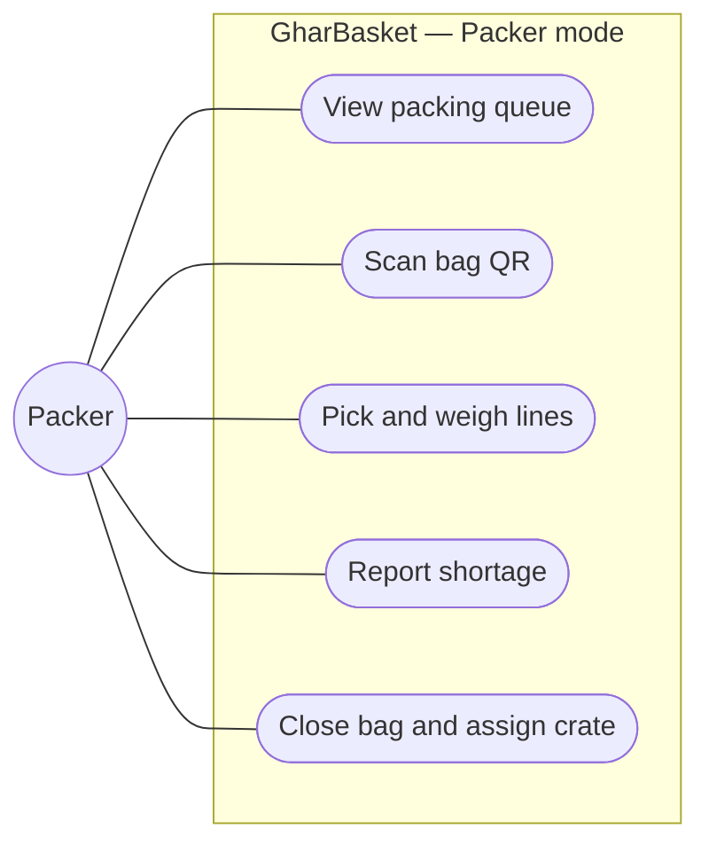
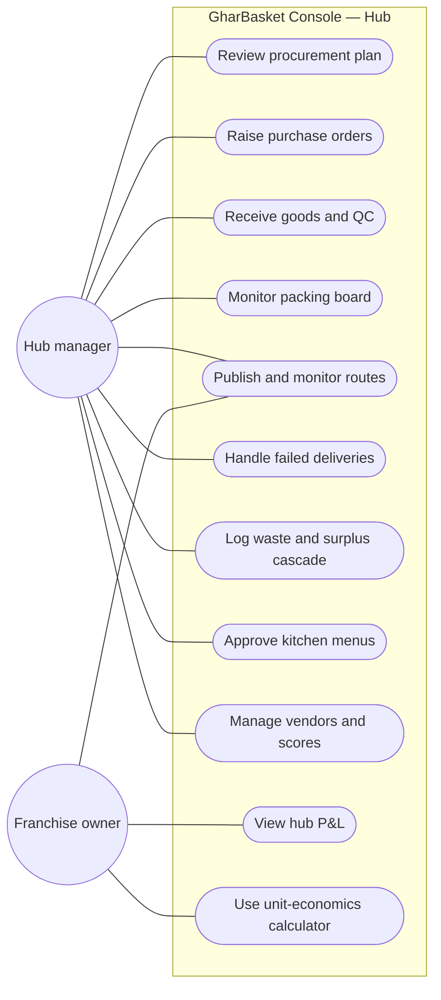
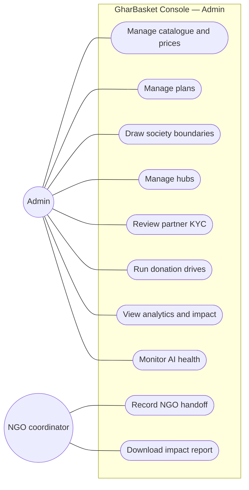

# Chapter 03 — Product and Features

> **In short:**
> - Three applications: the **GharBasket mobile app** (one app for all field roles), the **GharBasket Console** (web, for admin, hub and franchise) and the **public website** (served by the console app).
> - Five field roles share one mobile app: **customer, Society Captain, kitchen partner, rider, packer**. After login the user picks a role; partner roles activate only after KYC approval.
> - The backend is split into **14 modules (M0–M13)**, each owned by one person. The table in §4 marks what is MVP and what is stretch.
> - Seven use-case diagrams below show what each actor can do.

---

## 1. Applications

| App | Technology | Users | Notes |
|---|---|---|---|
| **GharBasket** (mobile) | React 19 + Vite SPA → PWA + Capacitor 8 (Android) | Customer, Captain, Kitchen partner, Rider, Packer | One app; role chooser after login; partner roles gated by KYC; offline-tolerant field flows |
| **GharBasket Console** | Next.js 16 (web) | Admin, Hub manager, Franchise owner, NGO coordinator | Dense tables, maps, route planning, KYC review, analytics; never shipped inside the mobile app |
| **Public website** | Next.js 16 (same app as the console) | Anyone | Landing page, society referral pages (`/s/<society>`), "Know your cook" profiles, privacy notice |

## 2. Roles and login

1. User logs in with a phone OTP.
2. The backend returns the user's list of roles, each with a scope (for example "Captain of Sunrise Towers").
3. One role → straight to that home screen. Several roles → the role chooser ("Continue as: Customer · Captain (Sunrise Towers)"). The last choice is remembered; switching is possible from the profile.
4. A coloured accent bar shows the active role (customer leaf green, captain turmeric, kitchen chilli, rider indigo, packer slate).
5. Partner roles go through: applied → KYC pending → training → verified → active. "Become a partner" is a button inside the customer app.
6. The server checks permissions on every request; switching role only changes the screens.

## 3. Features by role

| Role | Key features (MVP) |
|---|---|
| **Customer** | Onboarding (society, household, diet, fasting/Jain, budget, consent) · Autopilot week (thali calendar) · Weekly box (parchi) with reasons · swap via substitute sheet · skip week · add-ons · tiffin and salad booking · Budget Lock · wallet top-up and statements · order tracking · Kindness donations · society unlock and referrals · text assistant (stretch-tier MVP) · become a partner · data export/delete |
| **Society Captain** | Today's drops · crate handover scan · flat checklist and bag scanning · exceptions (not home, damaged) · donation bags and crate returns · earnings and payout statements |
| **Kitchen partner** | Today's portion counts · menu editor (approved by hub) · prep status (preparing, ready) · training modules · ratings · earnings |
| **Rider** | Route map with stops · crate counts · proof of handover/delivery · pickups on return leg · earnings |
| **Packer** | Packing queue · pick-and-pack with bag QR scanning · shortage reporting |
| **Hub manager / Franchise owner** (console) | Ops board · procurement plan review and POs · goods receiving and QC · packing board · live routes · deliveries · waste and surplus cascade · vendors · franchise P&L · unit-economics calculator |
| **Admin** (console) | Catalogue and prices · plans · societies (map polygon editor) · hubs · partner KYC review · donation drives and NGOs · analytics · AI health · settings |
| **NGO coordinator** (console) | Handoff schedule, items received, photo proof, impact reports |

## 4. Module map

| ID | Module | Owner | MVP | Stretch |
|---|---|---|---|---|
| M0 | Platform (repo, CI, auth middleware, config, outbox, design tokens) | Yash + Prathamesh | Yes | — |
| M1 | Identity & Household (OTP, roles, household, members, addresses, consents) | Yash | Yes | — |
| M2 | Catalog & Pricing (products, kits, recipes, menus, prices, substitution graph, festival calendar) | Yash | Yes | — |
| M3 | Plans & Subscriptions (plans, society delivery days, skip/pause, Budget Lock, weekly cycles) | Yash | Yes | — |
| M4 | Orders & Checkout (cart, order state machine, slots, cut-off lock) | Yash | Yes | — |
| M5 | Billing & Ledger (Razorpay test, wallet, double-entry ledger, Kindness points, refunds) | Yash | Yes | UPI Autopay |
| M6 | Hub Operations (inventory, procurement, vendors, packing, QC, waste) | Prathamesh | Yes | Produce photo grading |
| M7 | Logistics (vehicles, OR-Tools routes, proofs, captain handover, reverse pickups) | Prathamesh | Yes | Live GPS on map |
| M8 | Partner Network (onboarding, KYC, FSSAI, training, kitchen assignment, earnings, payouts) | Prathamesh | Yes | Micro-loans |
| M9 | Community & Kindness (societies, unlock, referrals, drives, donations, NGO handoff) | Prathamesh (backend), Yash (screens) | Basic | Leaderboards |
| M10 | Intelligence (ML service: consumption model, ranker, meal planner, forecast, procurement, routing, assignment, slot pricing, churn) | Prathamesh | v1 | Fridge-photo input |
| M11 | Notifications (push, WhatsApp, templates, preferences) | Yash | Yes | — |
| M12 | Console & Analytics (KPIs, unit economics, impact, AI health) | Prathamesh | Yes | — |
| M13 | Assistant (text chat with tool calls; voice later) | Prathamesh | Text | Voice |

*Figure 3.1 — Module map and dependencies*

## 5. Feature → module traceability (selected)

| Feature | Modules |
|---|---|
| Autopilot weekly plan | M10 (planner, pantry twin, ranker) → M3 (cycle, box lines) → M11 (notify) |
| Box edit and approval | M3, M2 (substitutes), M10 (feedback signals) |
| Cut-off and payment | M4, M5 |
| Procurement list | M6, M10 (forecast + newsvendor) |
| Packing and shortages | M6, M4, M5 (refunds) |
| Routing and captain handover | M7, M10 (solver), M9 (societies) |
| Tiffin day | M2 (menus), M4, M8, M10 (fair assignment) |
| Kindness donation | M9, M7 (pickup), M5 (points) |
| Society unlock and referrals | M9, M10 (route-cost model), M5 (rewards) |
| Assistant | M13 → M3, M4 APIs |

## 6. Use-case diagrams

*Figure 3.2 — Use cases: Customer*

*Figure 3.3 — Use cases: Society Captain*

*Figure 3.4 — Use cases: Kitchen partner*

```mermaid
flowchart LR
  K((Kitchen partner))
  H((Hub manager))
  subgraph SYS["GharBasket — Kitchen mode"]
    U1(["Complete training modules"])
    U2(["Set daily capacity and menu skills"])
    U3(["Propose weekly menu"])
    U4(["Accept today's portion counts"])
    U5(["Update prep status"])
    U6(["Mark ready for pickup"])
    U7(["View ratings"])
    U8(["View earnings"])
  end
  K --- U1 & U2 & U3 & U4 & U5 & U6 & U7 & U8
  H --- U3
```

*Figure 3.5 — Use cases: Rider*

*Figure 3.6 — Use cases: Packer*

*Figure 3.7 — Use cases: Hub manager and Franchise owner*

*Figure 3.8 — Use cases: Admin and NGO coordinator*

## Decisions & open questions

- D2 One TypeScript/React codebase; single mobile app for field roles; Next.js console — [ADR-0002](../adr/0002-react-capacitor-mobile-nextjs-console.md).
- D5 Assistant: text MVP, voice stretch — [ADR-0005](../adr/0005-text-assistant-mvp-voice-stretch.md).
- D9 Team ownership — [ADR-0009](../adr/0009-team-ownership-and-tracks.md).
- D12 Android + PWA only — [ADR-0012](../adr/0012-android-and-pwa-platforms.md).
- Open: final plan tiers and which features are paid; leaderboard and micro-loan features stay stretch.

Related: [01 Vision and scope](01-vision-and-scope.md) · [04 System architecture](04-system-architecture.md) · [07 Workflows](07-workflows.md) · [09 Frontend and design](09-frontend-and-design.md)
