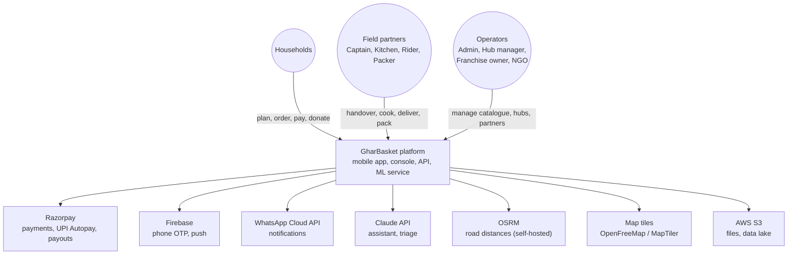
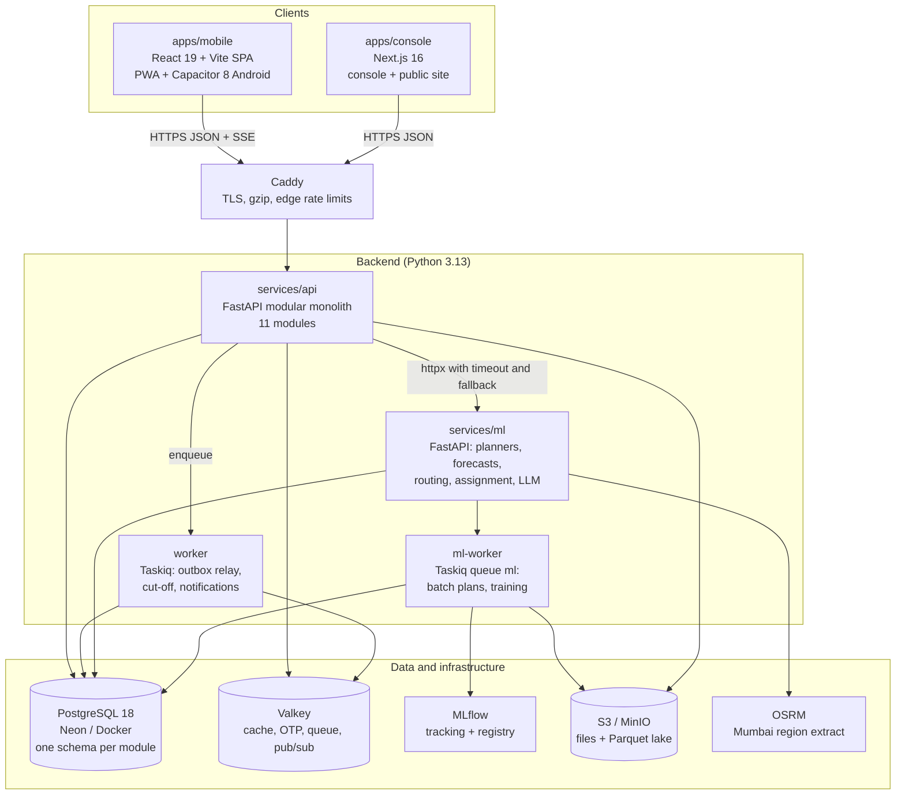
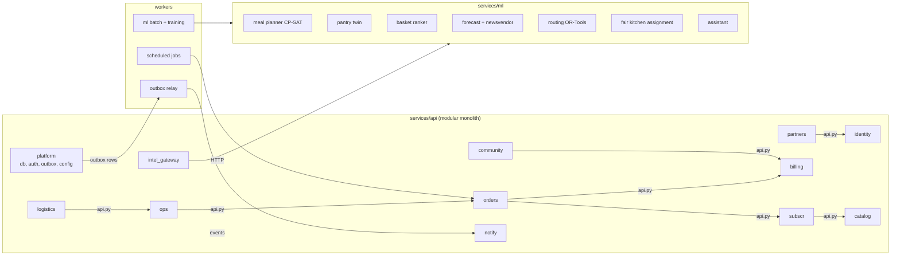
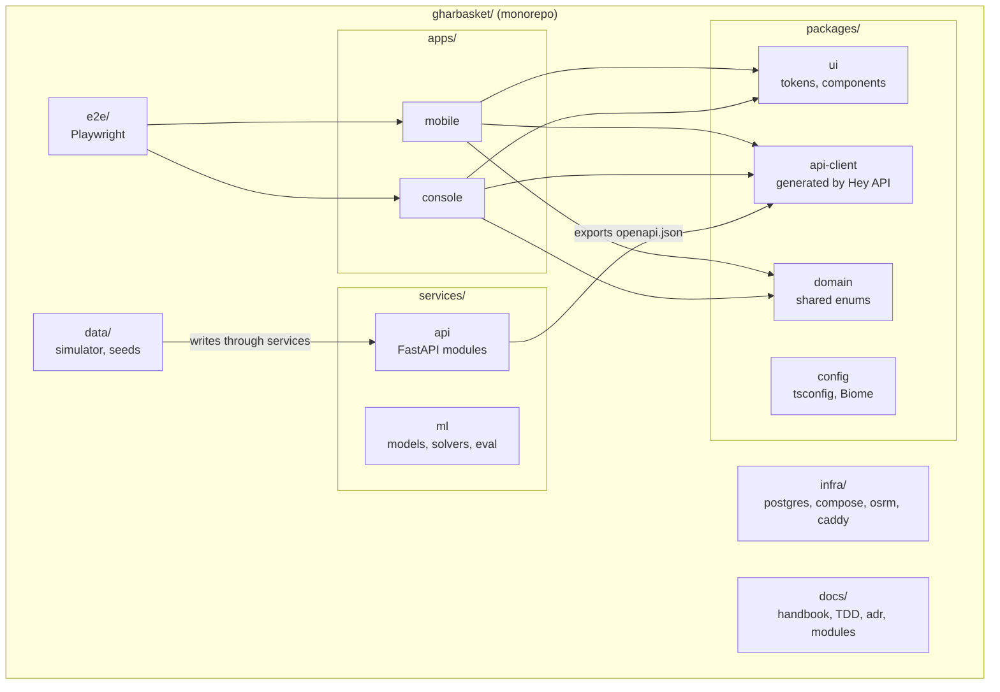
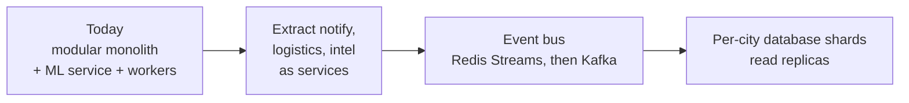

# Chapter 04 — System Architecture

> **In short:**
> - GharBasket uses a **service-based architecture**: one **FastAPI modular monolith** (11 business modules), one **ML/optimisation service**, background **workers**, and two frontends. It is **not** microservices.
> - Modules are strictly separated: each owns one Postgres schema, exposes only `api.py`, and talks to others through that facade or through outbox events. CI enforces this with import-linter.
> - Six principles: modular monolith first; ML never blocks a customer; solvers decide, statistics predict, LLMs talk; every write is idempotent and every money movement is a ledger entry; contract-first APIs; boring tech, sharp product.
> - The full technology stack is in §7 and is final (D14).

---

## 1. Design principles

1. **Modular monolith first.** One deployable API with hard internal boundaries, so four people never fight over microservice plumbing. Any module can be extracted later because modules already talk only through `api.py` facades and events.
2. **ML never blocks a customer.** Heavy AI runs in batch and writes results into `intel.*` tables. Online ML calls have timeouts and rule-based fallbacks. If the ML service is down, Autopilot falls back to last week's box adjusted by family-size rules.
3. **Solvers decide, statistics predict, LLMs talk.** The LLM never computes money or quantities.
4. **Every write is idempotent; every money movement is a ledger entry.**
5. **Contract-first.** The OpenAPI specification is the boundary between teammates; frontends use generated clients only.
6. **Boring tech, sharp product.** Choose well-documented libraries; spend the innovation budget on algorithms and UX.

## 2. C4 level 1 — system context

*Figure 4.1 — C4 context diagram*

## 3. C4 level 2 — containers

*Figure 4.2 — C4 container diagram*

## 4. C4 level 3 — components

*Figure 4.3 — Component diagram: API modules, ML service and workers*

Each module folder contains `api.py` (the only file other modules may import), `router.py` (HTTP endpoints), `service.py` (business logic), `models.py` (SQLAlchemy tables in its own schema), `schemas.py` (Pydantic), `events.py` and `tests/`.

## 5. Package view — the monorepo

*Figure 4.4 — Package diagram of the monorepo*

## 6. Are we using microservices? No — decision record

**We use a service-based architecture**: one modular monolith plus a small number of separately deployed services, each split for a real technical reason.

| Deployable | Why it is separate |
|---|---|
| `api` (FastAPI modular monolith, 11 modules) | All transactional business logic. One database transaction can safely span order + ledger + inventory |
| `worker` (same code as api, Taskiq) | Background jobs must not slow API requests |
| `ml` (FastAPI) | Different dependencies (torch, OR-Tools, LightGBM, NumPyro), different CPU/RAM profile; can crash or retrain without touching orders |
| `ml-worker` (same code as ml) | Long batch jobs (weekly plans, training) |
| `console` (Next.js), `mobile` (static bundle) | Frontends |
| Postgres, Valkey, MLflow, OSRM, Caddy | Off-the-shelf infrastructure |

**Why not full microservices:**
- **Team and time.** Four students, about six months.
- **Money needs one transaction.** Wallet debit + order lock + stock reservation must be ACID. Across microservices they would become sagas with distributed failure handling.
- **Cost of every extra service.** Each one multiplies CI pipelines, deployments, monitoring and local setup.
- **Common practice.** Industry practice (for example Shopify's modular monolith) is "monolith first, extract when proven".

**Why it is still microservice-ready:**
- Each module owns its Postgres schema, exposes only `api.py`, and communicates via outbox events — the same contracts a microservice would use.
- import-linter enforces those boundaries in CI.
- Extracting `notify` or `logistics` later means moving a folder and switching an in-process call to HTTP or a queue.

*Figure 4.5 — Scale path*

## 7. Final technology stack (D14)

| Layer | Final choice | Why this, not the alternative |
|---|---|---|
| Mobile app | React 19 + Vite + TanStack Router → PWA + Capacitor 8 (Android) | One TypeScript codebase with the console. Flutter dropped (second language, no shared UI). React Native/Expo rejected (no UI sharing with web) |
| Web console + public site | Next.js 16 | Server rendering for dashboards and SEO landing/referral pages; route groups; `proxy.ts` auth gate. A Vite SPA cannot do SEO pages well |
| Backend API | FastAPI (Python 3.13) modular monolith | The ML/optimisation ecosystem is Python; async + Pydantic + automatic OpenAPI → generated TypeScript clients. NestJS rejected (second backend language); Django rejected (sync-first, heavier) |
| ML / optimisation | Separate FastAPI service: OR-Tools, StatsForecast/MLForecast, LightGBM, NumPyro, Chronos-2, MLflow | Isolated heavy dependencies; CPU-only training on the server |
| Background jobs | Taskiq + Valkey | Async-native; Celery rejected (sync-first) |
| Database | PostgreSQL 18 (+ PostGIS, pgvector, pg_trgm), Valkey, S3-compatible storage, DuckDB | Relational integrity for money and orders; geo, vector and fuzzy search in one database |
| API contract | OpenAPI → Hey API (TypeScript client + TanStack Query hooks + zod) | Type-safe contract between Yash and Prathamesh |
| LLM | Claude via the Anthropic SDK (model chosen after the Sprint 8 evaluation) | Tool calling, multilingual |
| Auth / push | Firebase Phone Auth + FCM; our own JWT sessions | |
| Payments | Razorpay (Checkout, UPI Autopay, Route) — test mode | |
| Maps / routing | MapLibre + OpenFreeMap/MapTiler; OSRM self-hosted | No Google Maps bills |
| Hosting | AWS Mumbai (EC2 + Docker Compose, S3) + Neon (database branch per PR) | Student credits; per-PR databases for safe collaboration |
| CI/CD | GitHub Actions, GHCR, Docker Compose | |
| Observability | Sentry, OpenTelemetry → Grafana Cloud, PostHog | |
| Architecture | Service-based: modular monolith + ML service + workers | Not microservices (§6) |

Detailed library lists per layer are in `docs/TDD.md` (Part 2) and [Chapter 09](09-frontend-and-design.md) for the frontend.

## Decisions & open questions

- D2 Frontend codebase — [ADR-0002](../adr/0002-react-capacitor-mobile-nextjs-console.md). D3 Python-only backend — [ADR-0003](../adr/0003-python-fastapi-backend-and-ml-service.md). D6 Postgres-centric database — [ADR-0006](../adr/0006-postgresql-centric-data-platform.md).
- D14 Final stack and service-based architecture — [ADR-0014](../adr/0014-final-stack-and-service-based-architecture.md). D15 AWS Mumbai + Neon — [ADR-0015](../adr/0015-aws-mumbai-topology-with-neon-postgres.md).
- Open: before the pilot (Phase 6), decide whether the production database stays on Neon (no India region; about 60 ms per round-trip to Singapore, to be verified) or moves to Postgres in Mumbai.

Related: [03 Product and features](03-product-and-features.md) · [05 Data architecture](05-data-architecture.md) · [10 API and integration](10-api-and-integration.md) · [12 Deployment and operations](12-deployment-and-operations.md)
