# Chapter 05 — Data Architecture

> **In short:**
> - One **PostgreSQL 18** database is the single source of truth, with **one schema per module** (platform, identity, catalog, subscriptions, orders, billing, hub_ops, logistics, partners, community, intel, notifications, analytics, assistant).
> - Extensions: **PostGIS** (geo), **pgvector** (similarity), **pg_trgm + unaccent** (Hinglish fuzzy search), **pgcrypto** (field encryption). JSONB covers flexible attributes.
> - Money is always **integer paise (BIGINT)**; every rupee or Kindness point moves through a **double-entry ledger**.
> - Every household-derived row carries `data_source ∈ {synthetic, pilot, live}`, so models can train on mixed data while we report real-data accuracy separately.
> - A deterministic **household simulator** writes through the module services and keeps ground truth for honest ML evaluation.

---

## 5.1 Why PostgreSQL (summary of the analysis)

| Need | How it is covered |
|---|---|
| Atomic money and order flows (wallet debit + order lock + stock reservation) | ACID transactions in one database |
| Highly connected entities (user → household → society → hub → route) | Relational joins, foreign keys |
| Geo (society polygons, hub service areas, routing) | PostGIS `geography` |
| Flexible attributes (nutrition, recipe steps, KYC metadata) | JSONB, indexed with GIN |
| Hinglish search ("bhindi", "bhendi", "okra") | `pg_trgm` + full-text + synonym table |
| Substitutes, similar recipes | pgvector HNSW on bge-m3 embeddings |
| Franchise isolation | `hub_id` + Row-Level Security |
| Team collaboration | Schema + Alembic migrations act as a contract between four developers |

MongoDB, Firestore, Elasticsearch and Neo4j were evaluated and rejected (see D6, [ADR-0006](../adr/0006-postgresql-centric-data-platform.md)). Supporting stores: **Valkey** (short-lived data only: rate-limit counters, the sign-out deny-list, cache, live rider positions; the free Render Key Value is not durable, so it never holds the only copy of anything), **S3-compatible object storage** (media, data lake, MLflow artifacts; Cloudflare R2 when deployed, SeaweedFS locally; code uses the S3 API only) and **DuckDB + Parquet** (ML training and heavy analytics).

## 5.2 Global data rules

1. Primary keys are `uuidv7()` (built into PostgreSQL 18; time-ordered and index-friendly).
2. `created_at` / `updated_at` are `timestamptz`. Business dates are `date` in Asia/Kolkata.
3. Money is `BIGINT` paise. Quantities are `NUMERIC(10,3)` plus a `unit` enum (`kg`, `g`, `pc`, `bunch`, `ml`, `l`).
4. Every tenant-owned row has `hub_id`; every household-derived row has `data_source`.
5. **One schema per module.** A module writes only to its own schema. Other modules read through its `api.py` facade. Foreign keys are allowed only to stable identifiers (users, households, hubs, products, societies).
6. Soft delete only where the law needs history; personal data is hard-deleted on request (DPDP).
7. Migrations: one Alembic migration per pull request, named `YYYYMMDD_HHMM_<module>_<desc>`. CI enforces a single head and an upgrade/downgrade round trip.
8. Translatable names are JSONB `{en, hi, mr}`.

## 5.3 Schema map

| Schema | Owner module | Owner (backend, ADR-0023) | Purpose |
|---|---|---|---|
| `identity` | M1 | Prathamesh Relekar | Users, roles with scopes, households, members, addresses, consents |
| `catalog` | M2 | Prathamesh Relekar | Products, recipes, substitutions, prices, festival calendar |
| `subscriptions` | M3 | Prathamesh Relekar | Plans, subscriptions, delivery days, Budget Lock, weekly cycles, box lines |
| `orders` | M4 | Prathamesh Relekar | Orders, lines, events, slots |
| `billing` | M5 | Prathamesh Relekar | Ledger, payments, mandates, webhooks |
| `ops` | M6 | Prathamesh Relekar | Hubs, vendors, procurement, inventory lots, packing, waste |
| `logistics` | M7 | Prathamesh Relekar | Vehicles, routes, stops, handovers, deliveries, reverse pickups, GPS pings |
| `partners` | M8 | Prathamesh Relekar | Partners, KYC, capacity, assignments, earnings, trainings |
| `community` | M9 | Prathamesh Relekar | Societies, captains, referrals, donation drives, donations, NGO handoffs |
| `intel` | M10 | Prathamesh Relekar | Feature snapshots, predictions, experiments |
| `notify` | M11 | Prathamesh Relekar | Templates, messages, preferences |
| `platform` | M0 | shared | Outbox, idempotency keys, audit log |

## 5.4 Core cross-schema ERD

*Figure 5.1 — Core cross-schema entity relationships*

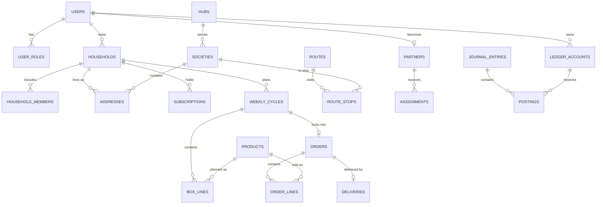

## 5.5 Schemas in detail

### 5.5.1 identity

*Figure 5.2 — ERD: identity*

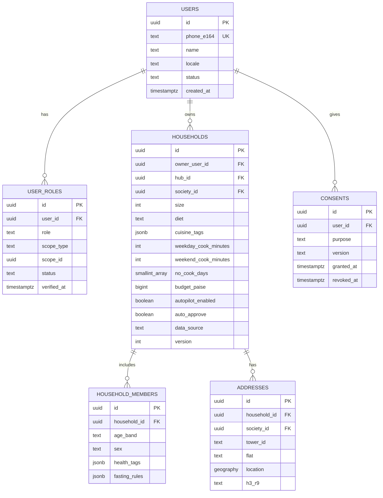

Roles: `customer`, `captain` (scope: society), `kitchen_partner`, `rider`, `packer`, `hub_manager`, `franchise_owner` (scope: hub), `ngo_coordinator` (scope: NGO), `admin` (global). Role status: `applied → kyc_pending → verified → suspended`. `health_tags` are stored only after consent purpose `health_personalisation` is granted.

### 5.5.2 catalog

*Figure 5.3 — ERD: catalog*

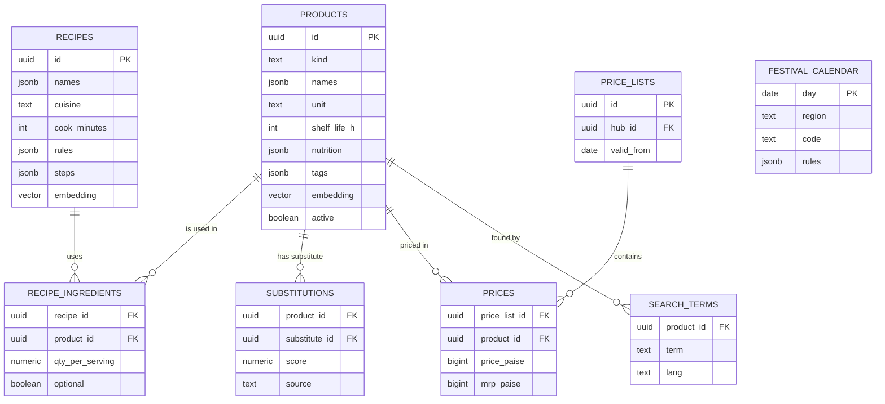

`kind` ∈ {veg, fruit, kit, tiffin, salad, staple}. `rules` on recipes encode Jain, fasting and diabetic suitability. `substitutions.source` ∈ {nutrition, cooccur, embedding, learned}.

### 5.5.3 subscriptions

*Figure 5.4 — ERD: subscriptions*

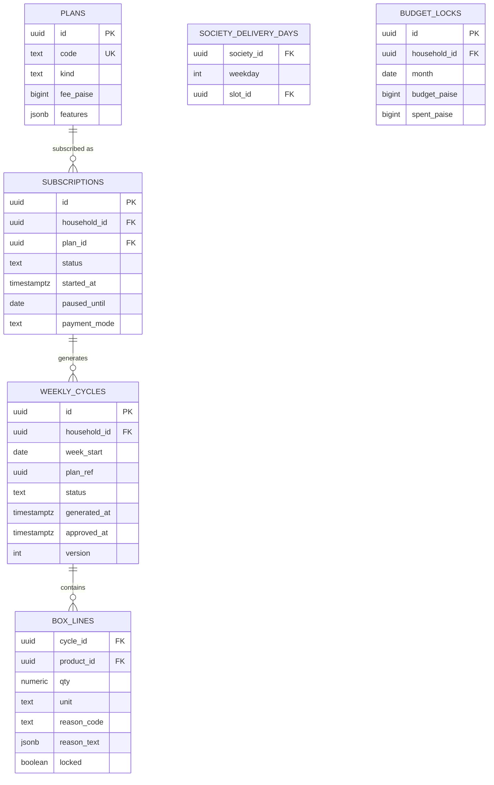

`payment_mode` ∈ {wallet, autopay}. `version` is used for optimistic locking when a customer edits a box.

### 5.5.4 orders

*Figure 5.5 — ERD: orders*

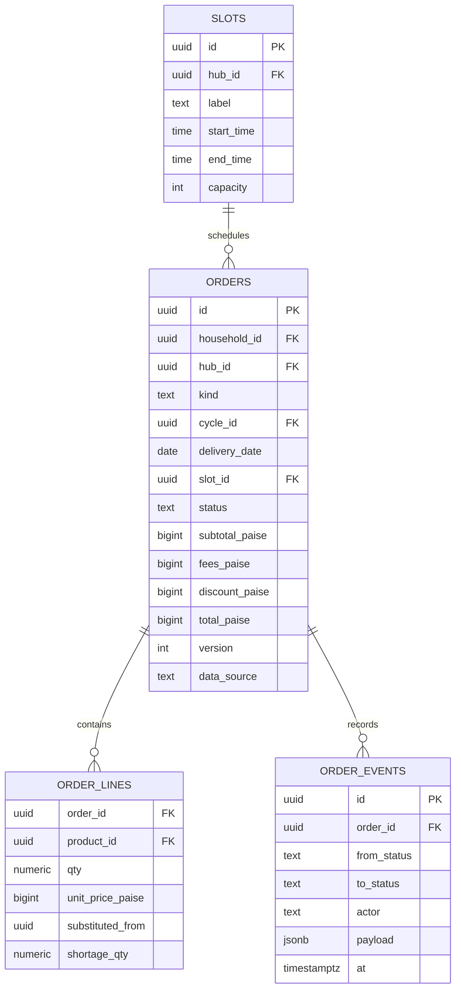

`kind` ∈ {box, tiffin, addon}. Every status change writes an `order_events` row (full audit trail).

### 5.5.5 billing

*Figure 5.6 — ERD: billing*

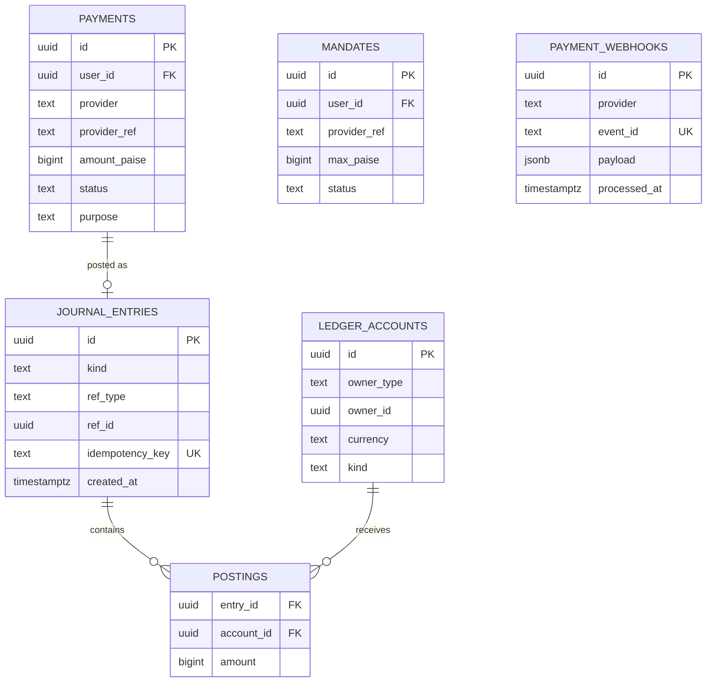

`currency` ∈ {INR, KINDNESS_PTS}. A deferred constraint trigger checks that the postings of every journal entry sum to zero per currency.

### 5.5.6 ops

*Figure 5.7 — ERD: ops*

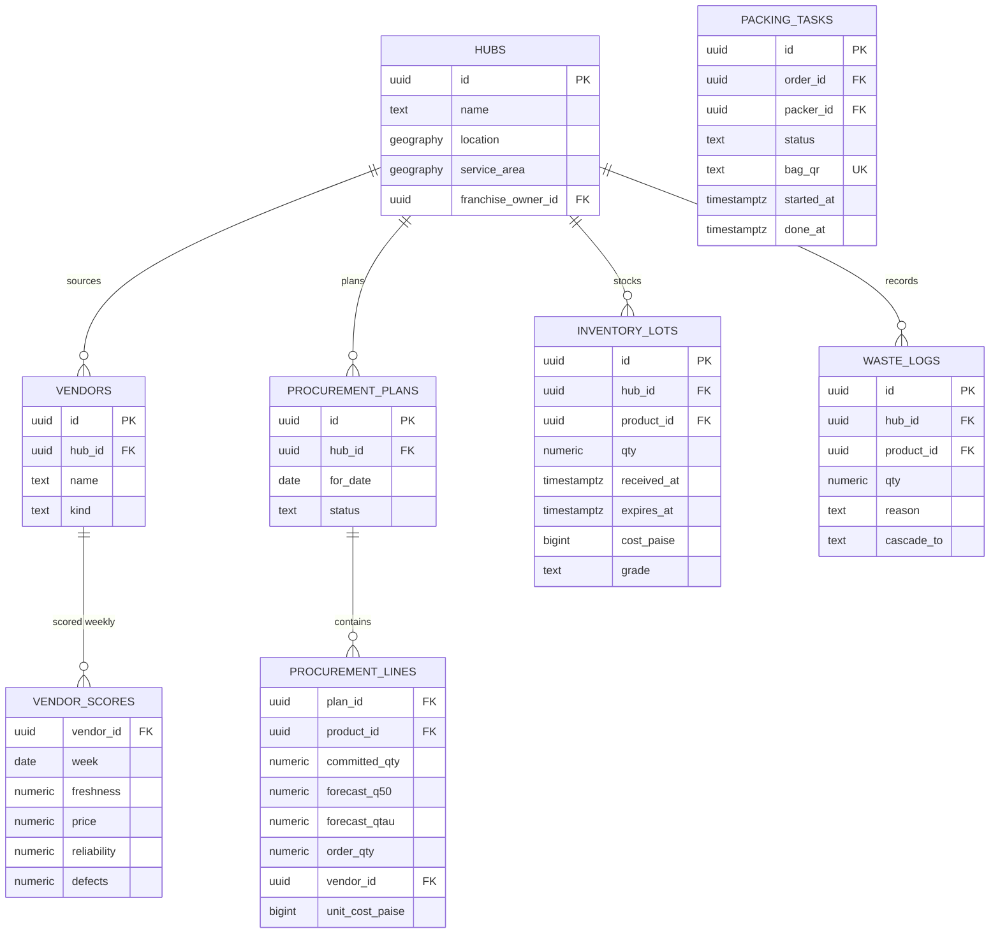

`cascade_to` ∈ {imperfect, kitchen, ngo, bin} — this is how the zero-waste loop is measured.

### 5.5.7 logistics

*Figure 5.8 — ERD: logistics*

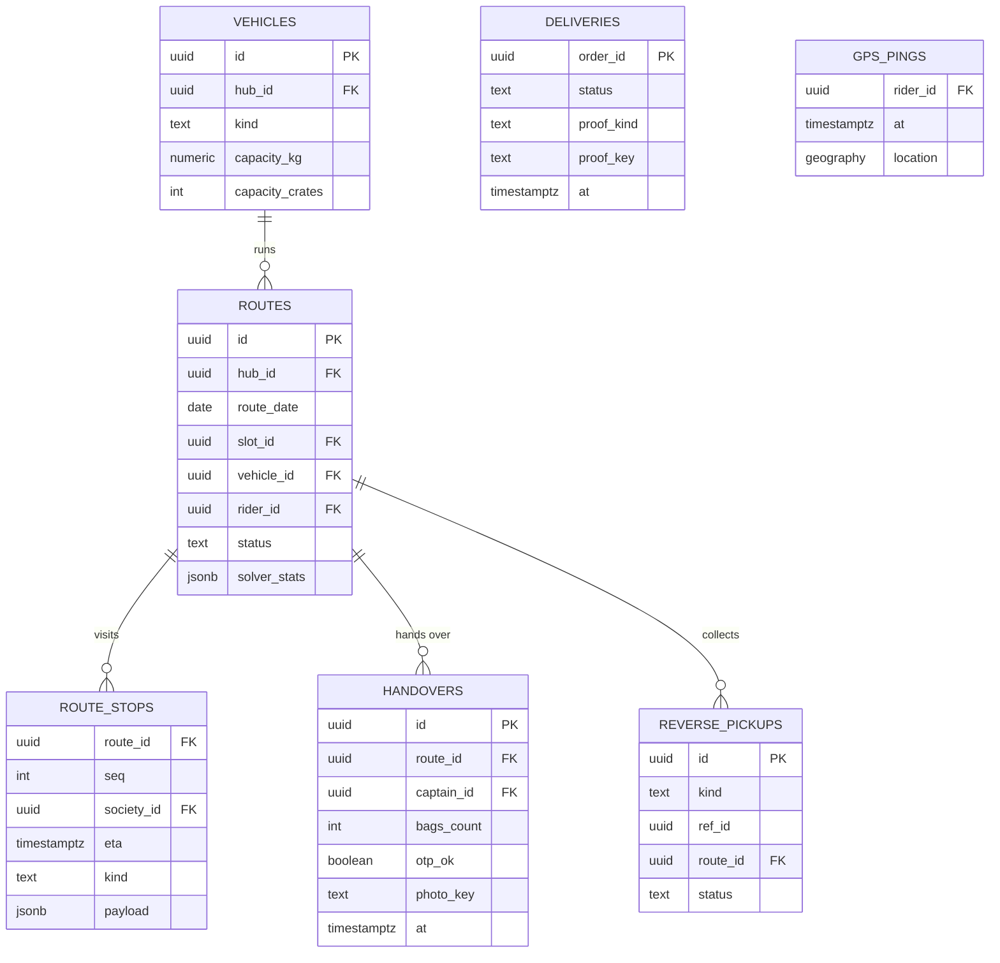

`gps_pings` is partitioned by month (`PARTITION BY RANGE (at)`) with a BRIN index on `at`.

### 5.5.8 partners

*Figure 5.9 — ERD: partners*

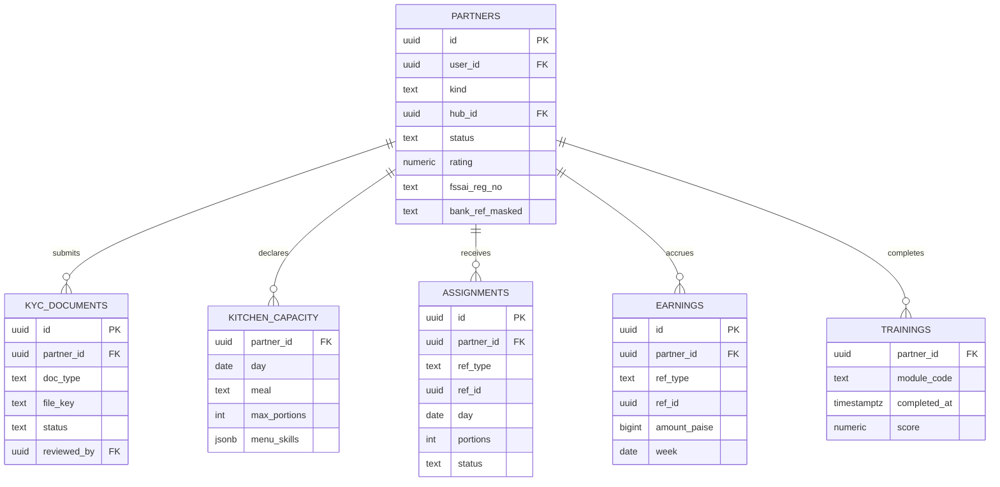

`kind` ∈ {kitchen, captain, rider, packer}. KYC numbers are encrypted at application level and only masked values are displayed. Aadhaar is never stored.

### 5.5.9 community

*Figure 5.10 — ERD: community*

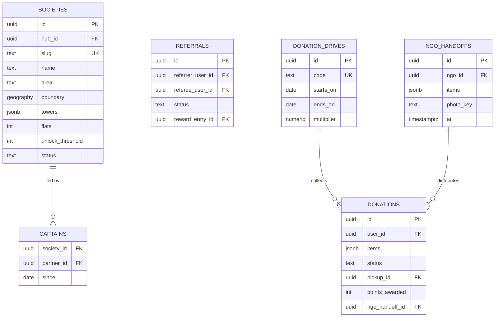

Society `status` ∈ {prospect, unlocking, live, paused}.

### 5.5.10 intel

*Figure 5.11 — ERD: intel*

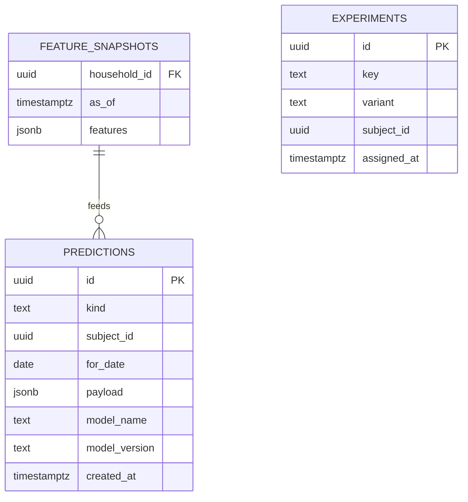

`feature_snapshots` are stored "as of" the cut-off time to prevent data leakage. `predictions.kind` ∈ {weekly_plan, pantry, basket_rank, forecast, route, assignment, slot_price, churn}, with `subject_type`, `subject_id`, `for_date` and `source` (ml or fallback). Each row records the exact model name and version. `model_metrics` keeps one row per metric, split and data source for every evaluation run.

### 5.5.11 notify and platform (summary)

- `notifications.templates(event, locale, channel, body)`, `notifications.messages(id, user_id, channel, status, sent_at)`, `notifications.preferences(user_id, channel, quiet_hours)`.
- `platform.outbox(id, event_type, payload, created_at, sent_at)`, `platform.idempotency_keys(key, user_id, request_hash, response, expires_at)`, `platform.audit_log(id, actor, action, target, diff, at)`.

## 5.6 Core domain model (UML class diagram)

*Figure 5.12 — UML class diagram: core domain*

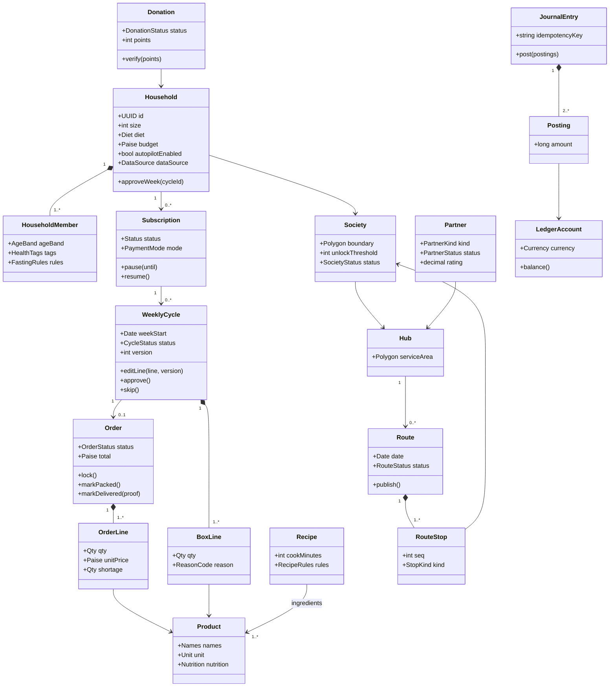

## 5.7 The ledger

### 5.7.1 Account kinds

| Account | Type | Currency | Owner |
|---|---|---|---|
| `wallet:<user>` | liability (we owe the customer) | INR | customer |
| `kindness:<user>` | liability (points) | KINDNESS_PTS | customer |
| `partner_payable:<partner>` | liability | INR | partner |
| `razorpay_clearing`, `payout_clearing` | asset / clearing | INR | platform |
| `unearned_revenue` | liability (boxes paid for, not yet delivered) | INR | platform |
| `sales_revenue` | revenue | INR | platform |
| `promo_expense`, `fulfilment_expense`, `kindness_expense` | expense | INR / PTS | platform |

### 5.7.2 Posting examples (amounts in paise)

| Event | Debit | Credit |
|---|---|---|
| Wallet top-up ₹1,000 | razorpay_clearing 100000 | wallet:U 100000 |
| Top-up bonus ₹100 | promo_expense 10000 | wallet:U 10000 |
| Box locked at cut-off, ₹450 | wallet:U 45000 | unearned_revenue 45000 |
| Box delivered | unearned_revenue 45000 | sales_revenue 45000 |
| Captain commission ₹6 | fulfilment_expense 600 | partner_payable:P 600 |
| Weekly partner payout | partner_payable:P | payout_clearing |
| Shortage refund ₹30 | unearned_revenue 3000 | wallet:U 3000 |
| Kindness credit, 300 points | kindness_expense 300 PTS | kindness:U 300 PTS |
| Redeem 200 points as ₹40 off | kindness:U 200 PTS; promo_expense 4000 | kindness_expense 200 PTS; unearned_revenue 4000 |

### 5.7.3 Invariants (property-tested with Hypothesis)

1. The postings of every journal entry sum to zero **per currency**.
2. A `wallet:` balance can never go below zero; the wallet balance can never exceed the ₹10,000 cap (closed-loop wallet rule, D4).
3. Replaying a request with the same `idempotency_key` never creates a second entry.
4. Balances are derived from postings; no code updates a balance column directly.

*Figure 5.13 — Money flow through the ledger*

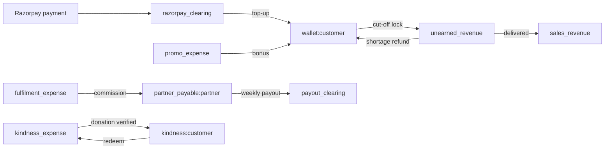

## 5.8 Indexing and performance

| Index | Purpose |
|---|---|
| GiST on every `geography` column | "Which hub serves this point?", society containment |
| HNSW on `products.embedding`, `recipes.embedding` | Substitute and similar-recipe search |
| GIN trigram on `catalog.search_terms.term` | Fuzzy multilingual search |
| Partial index `orders(hub_id, delivery_date) WHERE status IN ('APPROVED','AWAITING_APPROVAL')` | Fast cut-off locking |
| BRIN on `logistics.gps_pings.at` | Cheap time-range scans on large append-only data |
| Unique `billing.journal_entries.idempotency_key`, `billing.payment_webhooks.event_id` | Exactly-once money effects |

Cut-off locks about 2,000 orders using batched `UPDATE … RETURNING` inside one job guarded by a PostgreSQL advisory lock. Target: under 60 seconds.

## 5.9 Multi-tenancy and security in data

- Every hub-scoped table has `hub_id`. Row-Level Security policies compare it with `current_setting('app.hub_ids')`, which the API sets with `SET LOCAL` per transaction for hub managers and franchise owners.
- KYC numbers are encrypted with pgcrypto using a key kept in Infisical and passed to the API as a secret; only masked forms are returned.
- No Aadhaar storage; health tags only with consent; `DELETE /me` hard-deletes personal data and keeps anonymised aggregates.
- The lake's nightly snapshots (`snapshots/date=<day>/`, M10 §6) hold no names, contacts, addresses or users; quasi-identifiers are coarsened (no society, only the hub; the budget as a band). Partitions are deleted after 180 days (proposed: a bucket lifecycle rule). An erased household is left out of every later snapshot and feature run; older partitions lose its random id as they age out.

## 5.10 The `data_source` tag

| Value | Origin | Used for |
|---|---|---|
| `synthetic` | Household simulator | Development, demos, model pre-training, ground-truth evaluation |
| `pilot` | Consented pilot households in Panvel | Real-data evaluation reported separately in the paper |
| `live` | Production users after launch | Future |

Training jobs take all sources; every evaluation report shows metrics per source so real-world performance is never hidden by simulated data (D8, [ADR-0008](../adr/0008-simulator-first-data-source-tagging.md)).

## 5.11 Household simulator

Owned by Prathamesh Relekar, reviewed by Rhythm Thakur and Manish Raje. Located in `data/simulator`, deterministic with `--seed`.

It generates:
1. Hubs and societies (real Panvel and Kharghar society names with hand-drawn polygons).
2. Households sampled from cohort distributions (size, diet, region, fasting practice, budget).
3. **Latent per-item consumption rates** — the ground truth the pantry digital twin must recover.
4. Weekly meal choices and accept / edit / skip behaviour.
5. Festivals and price shocks (for example, tomato +80% for three weeks).
6. Churn, partners with kitchen capacities, and donations.

It writes **through the module services**, so ledger and state-machine rules hold, with `data_source='synthetic'`. Ground truth is saved to `data/sim_truth/*.parquet` for evaluation.

**Status (v0, Oct 2026):**
- **Done:** items 2–4, through `just sim`.
  - Households from `data/simulator/cohorts.json` are onboarded through M1 in the seed societies.
  - The truth files hold latent daily-use rates and tastes, weekly CP-SAT plans with accept/edit/skip, and consumption.
- **Next:**
  - item 1 (real society polygons) and items 5–6;
  - writing the weeks through M3/M4 once they exist.
- See M10 §3.2 and `data/simulator/README.md`.

*Figure 5.14 — Simulator data flow*

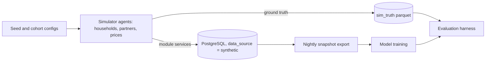

## Decisions & open questions

- **D6** Postgres-centric database ([ADR-0006](../adr/0006-postgresql-centric-data-platform.md)).
- **D20** Neon Postgres (Singapore) as one shared `dev`/`staging` database, with no per-PR branches; day-to-day work uses local Docker Postgres; files on Cloudflare R2 ([ADR-0020](../adr/0020-free-tier-hosting-render-vercel-neon-r2.md), supersedes ADR-0011 and ADR-0015).
- **D4** Closed-loop wallet and KYC scope ([ADR-0004](../adr/0004-closed-loop-wallet-and-upi-autopay.md)).
- **D8** `data_source` tagging and simulator-first data ([ADR-0008](../adr/0008-simulator-first-data-source-tagging.md)).
- Open (Q3): Neon has no India region. Before the pilot (Phase P6), decide whether the pilot database stays on Neon Singapore or moves to a paid Postgres in Mumbai.

Related: [04 — System architecture](04-system-architecture.md) · [06 — Domain lifecycles](06-domain-lifecycles.md) · [08 — AI and ML](08-ai-and-ml.md) · [13 — Security and compliance](13-security-and-compliance.md)
