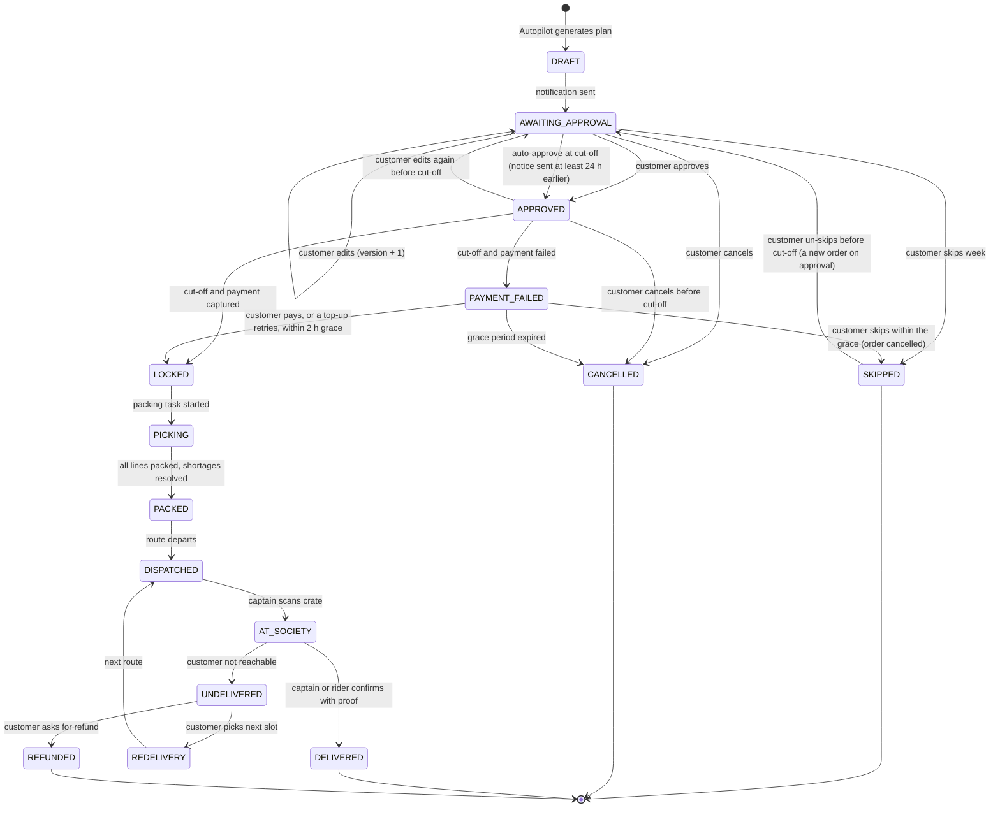
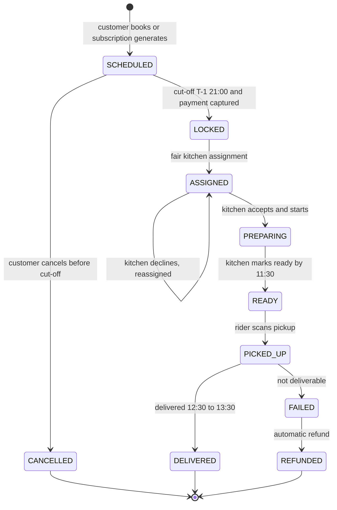
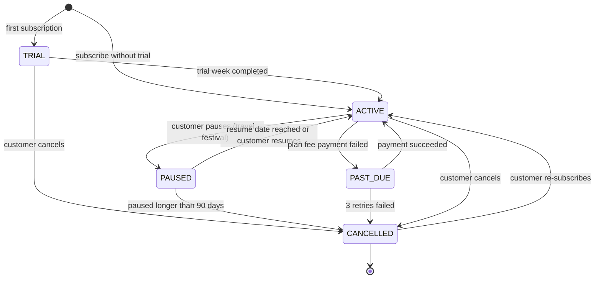
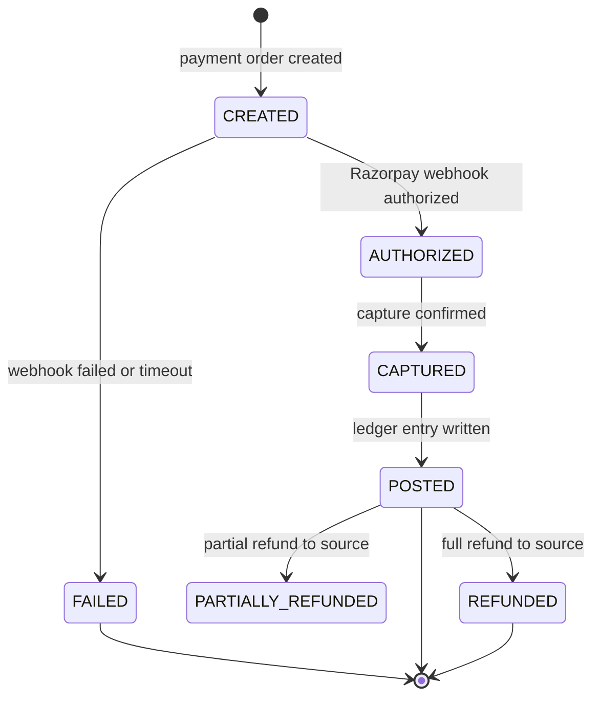
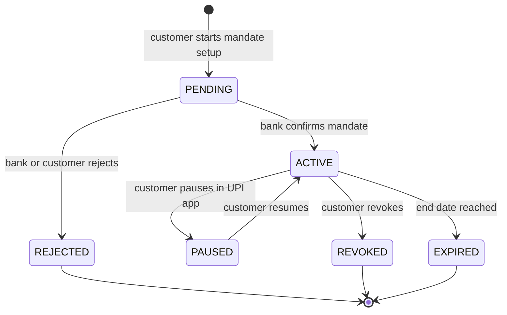
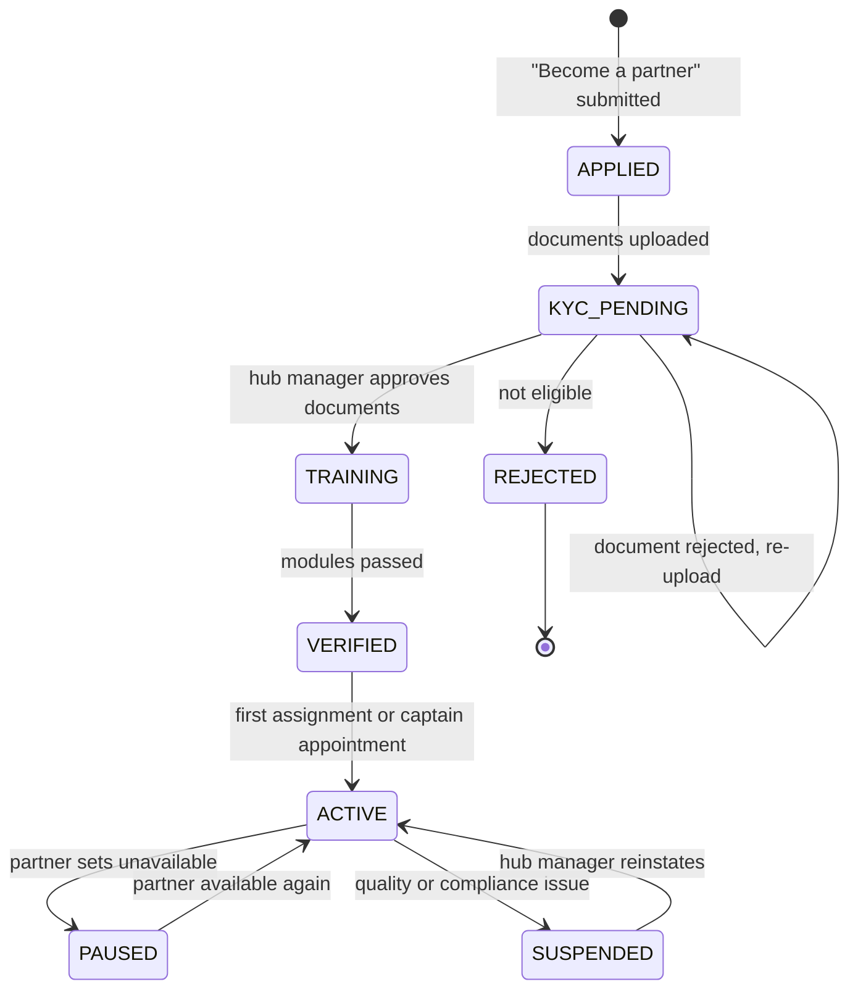
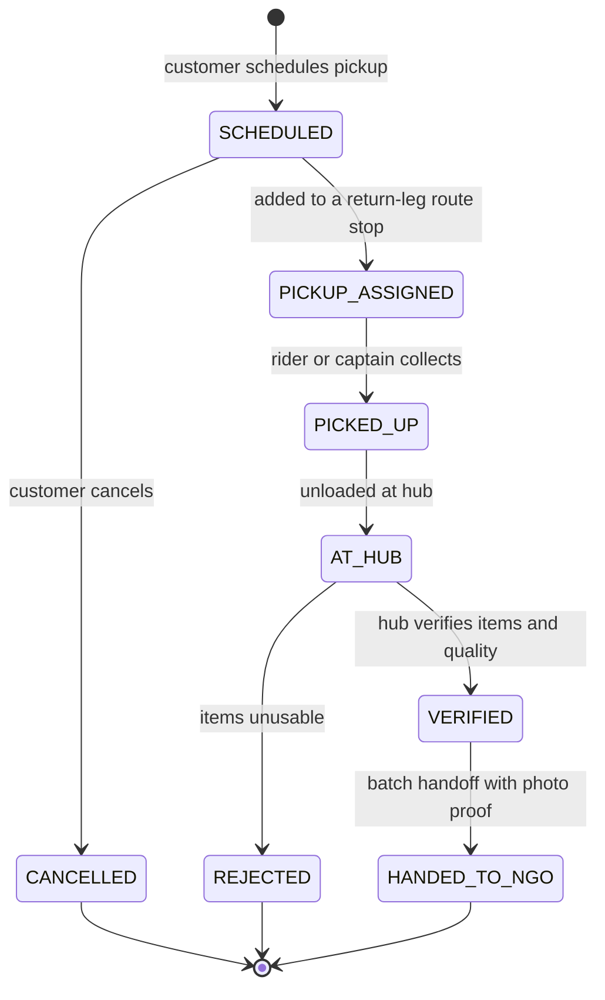

# Chapter 06 — Domain Lifecycles (State Machines)

> **In short:**
> - Six core objects have explicit state machines: **weekly box / order**, **tiffin order**, **subscription**, **payment / mandate**, **partner (KYC)** and **donation**.
> - State machines are enforced in code (python-statemachine) inside the owning module. No other module can change a status directly.
> - Every transition is recorded (for example, in `orders.order_events`) and emits a domain event through the transactional outbox.
> - Money only moves on specific transitions (lock, delivered, refund), always through the ledger (Chapter 05).
> - Customers can freely change or cancel anything **before cut-off**; after cut-off, changes go through operations (substitution, refund).

---

## 6.1 Conventions

- **Trigger** = who or what causes the transition: Customer, Autopilot job, Cut-off job, Packer, Rider, Captain, Kitchen partner, Hub manager, Payment webhook, or System timer.
- **Event** = the domain event written to `platform.outbox` in the same database transaction.
- Invalid transitions raise `409 Conflict` with a problem code such as `orders.invalid_transition`.
- All times are IST. **T** is the delivery day; the standard cut-off is **T-1 21:00**.

## 6.2 Weekly box / order (M3 → M4)

A weekly cycle starts as a draft produced by Autopilot. Once locked at cut-off it becomes an order that moves through the hub and out for delivery.

*Figure 6.1 — State machine: weekly box / order*

| From → To | Trigger | Rule / guard | Event emitted | Money |
|---|---|---|---|---|
| — → DRAFT | Autopilot job (T-3 18:00) | Active subscription, not paused | `subscriptions.cycle_generated` | — |
| DRAFT → AWAITING_APPROVAL | System | Box-ready notification and pre-debit notice sent | — | — |
| AWAITING_APPROVAL → AWAITING_APPROVAL | Customer edit | `If-Match` version equals current version | — (feedback signals stored for ML) | — |
| AWAITING_APPROVAL → APPROVED | Customer | Before cut-off; the M4 order is created in the same transaction (`orders.api.create_from_cycle`) | `subscriptions.box_approved` | — |
| APPROVED → APPROVED | Customer edit | Before cut-off; M4 replaces the order's box lines | `subscriptions.box_approved` (again) | — |
| AWAITING_APPROVAL → APPROVED (auto) | Cut-off job | `auto_approve = true` and pre-debit notice sent ≥ 24 h earlier | `subscriptions.box_approved` | — |
| AWAITING_APPROVAL or APPROVED → SKIPPED | Customer | Before cut-off; an existing order is cancelled (`orders.cancelled`, reason `skipped`) | `subscriptions.box_skipped` | — |
| SKIPPED → AWAITING_APPROVAL | Customer (`POST /v1/cycles/{id}/unskip`) | Before cut-off, `If-Match`, subscription not paused that week (`draft` if the box-ready notice never went out); approving again creates a new order (`orders.cycle_id` is unique only among orders that are not cancelled) | `subscriptions.box_unskipped` | — |
| APPROVED → LOCKED | Cut-off job (T-1 21:00) | Wallet balance sufficient or Autopay capture succeeded | `orders.locked` | wallet → unearned_revenue |
| APPROVED → PAYMENT_FAILED | Cut-off job | Insufficient balance (`orders.payment_failed`) or an Autopay capture failed (`billing.payment_failed`, pilot) | `orders.payment_failed` | — |
| PAYMENT_FAILED → LOCKED | Customer (`POST /v1/orders/{id}/pay`) or a top-up (`billing.wallet_topped_up` consumer, system) | Before the grace ends (T-1 23:00 IST); the same debit key as the cut-off (`box:<order id>`), so it is charged once | `orders.locked` | wallet → unearned_revenue |
| PAYMENT_FAILED → SKIPPED (cycle) | Customer | Before the grace ends; the order is cancelled (reason `skipped`) | `subscriptions.box_skipped` | — |
| PAYMENT_FAILED → CANCELLED | System timer | 2 h grace expired | `orders.cancelled` | — |
| LOCKED → PICKING → PACKED | Packer | All lines scanned; shortages substituted or refunded | `orders.shortage_substituted`, `orders.packed` | partial refund if needed |
| PACKED → DISPATCHED | Rider | Route started | `orders.dispatched` | — |
| DISPATCHED → AT_SOCIETY | Captain | Crate QR scanned, bag count matches | `orders.at_society` | captain commission accrues |
| AT_SOCIETY → DELIVERED | Captain or rider | OTP, photo or captain confirmation | `orders.delivered` | unearned → sales revenue |
| AT_SOCIETY → UNDELIVERED | Captain | Held until evening window, still unreachable | `orders.delivery_failed` | — |
| UNDELIVERED → REFUNDED | Customer | — | `billing.refund_issued` | unearned → wallet |

## 6.3 Tiffin order (M4 + M8)

*Figure 6.2 — State machine: tiffin order*

| From → To | Trigger | Rule / guard | Event emitted |
|---|---|---|---|
| SCHEDULED → LOCKED | Cut-off job | Payment captured | `orders.locked` |
| LOCKED → ASSIGNED | `assign_kitchens` job (T-1 21:30) | Capacity, menu skill, rating floor, distance, fairness penalty | `partners.assignment_created` |
| ASSIGNED → ASSIGNED | Kitchen partner declines | Re-solve for remaining capacity | `partners.assignment_created` |
| PREPARING → READY | Kitchen partner | Hygiene checklist ticked | `orders.packed` |
| READY → PICKED_UP | Rider | QR scan at kitchen | `orders.dispatched` |
| PICKED_UP → DELIVERED | Rider or captain | Proof captured | `orders.delivered` (kitchen earning accrues) |
| FAILED → REFUNDED | System | — | `billing.refund_issued` |

Leftover portions after the lunch window are listed in the evening "Bachat Box" (surplus cascade, Chapter 07, W9).

## 6.4 Subscription (M3)

*Figure 6.3 — State machine: subscription*

| From → To | Trigger | Rule | Event |
|---|---|---|---|
| ACTIVE → PAUSED | Customer | `paused_until` set; no cycles generated while paused | `subscriptions.paused` |
| PAUSED → ACTIVE | System timer or customer | — | `subscriptions.resumed` |
| ACTIVE → PAST_DUE | Billing | Plan fee charge failed | `billing.payment_failed` |
| PAST_DUE → CANCELLED | System | 3 failed retries over 7 days | `subscriptions.cancelled` |
| ACTIVE → CANCELLED | Customer | Takes effect after current locked orders | `subscriptions.cancelled` |

## 6.5 Payment and mandate (M5)

*Figure 6.4 — State machine: payment (top-up or capture)*

*Figure 6.5 — State machine: UPI Autopay mandate*

| Rule | Detail |
|---|---|
| Idempotency | Webhooks are stored first (`payment_webhooks.event_id` unique) and processed by a job; replays have no effect. |
| Pre-debit notice | Every Autopay capture must be preceded by a notice at least 24 h earlier (sent at T-3 18:30). |
| Posting | Only `CAPTURED → POSTED` writes to the ledger; `POSTED` is when the wallet balance changes. |
| Reconciliation | Hourly job compares local payments with the Razorpay API and raises alerts on mismatch. |
| Refund | Wallet refunds are instant ledger entries; refunds to source go through Razorpay and reach `REFUNDED` by webhook. |

## 6.6 Partner and KYC (M8)

*Figure 6.6 — State machine: partner onboarding and KYC*

| From → To | Trigger | Rule | Event |
|---|---|---|---|
| APPLIED → KYC_PENDING | Partner | ID (masked), bank penny drop (simulated), FSSAI registration for kitchens, PAN where applicable | — |
| KYC_PENDING → TRAINING | Hub manager | All documents approved; decision written to `platform.audit_log` | — |
| TRAINING → VERIFIED | System | Required training modules passed (hygiene, app usage, role-specific) | `partners.verified` → identity adds the role |
| ACTIVE → SUSPENDED | Hub manager | Rating below floor, hygiene complaint, or compliance issue | `partners.suspended` |

## 6.7 Donation (M9 Kindness)

*Figure 6.7 — State machine: Kindness donation*

| From → To | Trigger | Rule | Event | Points |
|---|---|---|---|---|
| SCHEDULED → PICKUP_ASSIGNED | Route solver | Society has a route that day; pickup added as a return-leg stop | — | — |
| PICKED_UP → AT_HUB | Rider | — | `logistics.pickup_completed` | — |
| AT_HUB → VERIFIED | Hub manager | Points = item rules × drive multiplier | `community.donation_verified` | kindness_expense → kindness:customer |
| VERIFIED → HANDED_TO_NGO | NGO coordinator | Photo proof; impact counter updated | — | — |

Kindness points expire (daily expiry job) and are never convertible to cash (D4).

## Decisions & open questions

- **D2** single mobile app with field roles ([ADR-0002](../adr/0002-react-capacitor-mobile-nextjs-console.md)) — roles drive who may trigger each transition.
- **D4** closed-loop wallet and UPI Autopay rules ([ADR-0004](../adr/0004-closed-loop-wallet-and-upi-autopay.md)) — pre-debit notice and posting rules.
- **D8** `data_source` on orders ([ADR-0008](../adr/0008-simulator-first-data-source-tagging.md)).
- Open: confirm cut-off time (21:00) and the 2-hour payment grace window against real APMC Vashi buying times during Phase P0 interviews.
- Open: decide whether to keep a `TRIAL` subscription state or handle trials as a promotion only (Prathamesh Relekar, M3 spec).

Related: [05 — Data architecture](05-data-architecture.md) · [07 — Workflows](07-workflows.md) · [10 — API and integration](10-api-and-integration.md)
