# Chapter 07 — Workflows

> **In short:**
> - GharBasket runs on a **weekly rhythm per society**: plan at T-3, edit until the **T-1 21:00 cut-off**, buy at 04:00 on T, pack, route, deliver through the Society Captain, and collect crates and donations on the return trip.
> - This chapter describes the **12 core workflows (W1–W12)** step by step, with UML sequence diagrams for the critical interactions and activity diagrams for decision-heavy processes.
> - Heavy AI runs in batch jobs and writes results to `intel.*` tables. Customer-facing calls never wait on a long ML job, and every ML call has a rule-based fallback.
> - Every money-changing step is idempotent and goes through the ledger. Every status change goes through the state machines in Chapter 06.

---

## 7.1 The weekly rhythm

Each society has fixed delivery days (for example, Sunrise Towers: Tuesday, Friday and Sunday mornings). **T** is the delivery day.

| When (IST) | Job / activity | Module | Workflow |
|---|---|---|---|
| T-3 18:00 | `generate_weekly_plans` — meal plan → box draft | intel → subscriptions | W2 |
| T-3 18:30 | Box-ready notification + pre-debit notice | notify, billing | W2, W3 |
| T-3 → T-1 21:00 | Customer views, edits, approves, skips | subscriptions | W2 |
| T-1 19:00 | Reminder for unapproved boxes | notify | W2 |
| T-1 20:55 | `apply_auto_approve` — approve for households that asked (notice ≥ 24 h before) | subscriptions | W2 |
| **T-1 21:00** | **`cutoff_lock`** — lock orders, debit wallet / capture Autopay; unpaid → `payment_failed` with a 2 h grace | orders, billing | W2, W3 |
| T-1 23:00 | `payment_grace_expiry` — still unpaid → cancelled (reason `payment`); the cycle mirrors it | orders → subscriptions | W3 |
| T-1 23:15 | `solve_routes` per hub (M10 solver, or M7's fallback when ML is down) → plan published when its check is clean; vans leave at 06:30 | logistics ← intel | W5 |
| T-1 21:10 | `forecast_uncommitted` → `build_procurement_plan` | intel → ops | W4 |
| T-1 21:30 | `assign_kitchens` for tiffins on T | intel → partners | W6 |
| T 04:00 | Buying at APMC Vashi / FPO, goods receipt, QC | ops | W4 |
| T 05:00 | `build_packing_tasks` → packing | ops | W4 |
| T 08:00–10:00 | Society handover to captain → doorstep delivery | logistics | W5 |
| T 09:35 | `solve_tiffin_routes` per hub (lunch; kitchens first, then societies, in M7 without ML) → plan published when its check is clean | logistics ← partners | W6 |
| T 10:00–12:00 | Return leg: crates + Kindness pickups | logistics, community | W5, W8 |
| T 11:30–13:30 | Tiffin ready, collected by the rider's scan, handed to the captain, delivered | partners, logistics | W6 |
| T 12:30 | `surplus_cascade` | ops | W9 |

Scheduled jobs run without a broker (D21): each one is an internal endpoint, `POST /v1/internal/jobs/<name>`, called by a GitHub Actions schedule. Jobs are idempotent, take a PostgreSQL advisory lock and use the *scheduled* time, so a schedule that starts a few minutes late changes nothing. Events between modules go through the Postgres outbox, which the API relays after each commit.

*Figure 7.1 — Weekly rhythm from T-3 to T*

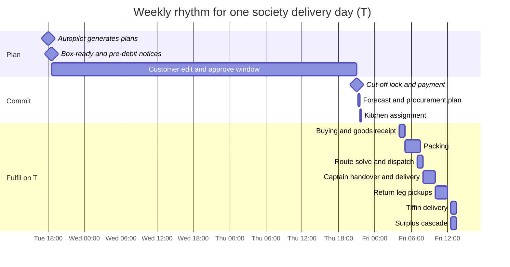

---

## W1 — Customer onboarding (target under 2 minutes)

1. Open the app (PWA or Android) and choose a language: English, Hindi or Marathi.
2. Enter a phone number → Firebase OTP → the app exchanges the Firebase ID token for GharBasket tokens (`POST /v1/auth/exchange`).
3. Pick the society from a searchable list. If it is missing, drop a map pin, which creates a "society request" for the hub.
4. Enter tower and flat.
5. Household setup: size, diet, cuisine, fasting / Jain toggles, health tags (after an explicit consent screen), weekday cooking time, no-cook days, optional Budget Lock.
6. Preview the **first Autopilot week**, based on the cohort prior (cold start).
7. Choose payment mode: wallet top-up or UPI Autopay mandate.
8. Done. A society-unlock progress bar shows how many neighbours are needed for free delivery.

*Figure 7.2 — Activity: customer onboarding*

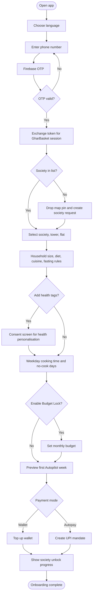

*Figure 7.3 — Sequence: login and role switch*

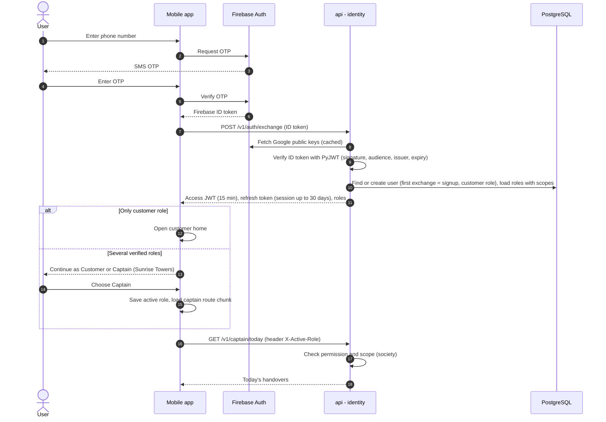

---

## W2 — Weekly Autopilot cycle

1. **T-3 18:00:** job `generate_weekly_plans` (internal job endpoint, scheduled by GitHub Actions) runs for each hub. The ML service loads the household profile, pantry twin estimates, festival calendar, prices and Budget Lock, then runs the CP-SAT meal planner and the basket ranker.
2. Plans are written to `intel.predictions`. The subscriptions module turns each plan into a `weekly_cycle` with `box_lines` and a `reason_code` per line.
3. If the ML service fails or times out, the fallback is **last week's box adjusted by family-size rules** (reason code `FALLBACK_RULES`).
4. **T-3 18:30:** box-ready notification (push + WhatsApp) and, for Autopay users, the pre-debit notice.
5. **T-3 → T-1 21:00:** the customer views the Thali week and the Parchi box. They can swap items (substitute sheet), change quantities, skip the week, add add-ons and book tiffins. Each edit uses optimistic locking (`If-Match: version`) and records feedback signals for the models.
6. **T-1 19:00:** reminder for unapproved boxes.
7. **T-1 21:00:** cut-off locks approved boxes (and auto-approves those with `auto_approve = true` whose notice was sent at least 24 h earlier), then takes payment (W3).

*Figure 7.4 — Sequence: Autopilot weekly plan generation*

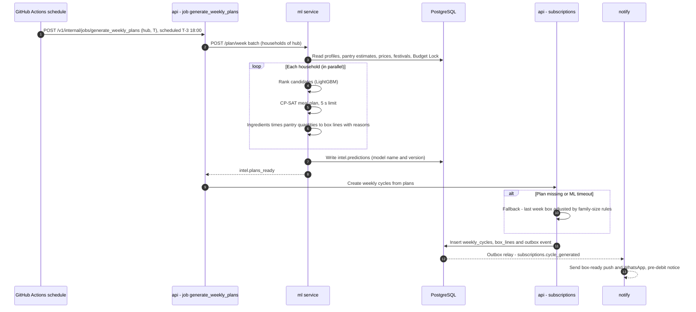

*Figure 7.5 — Sequence: box edit and approve with optimistic locking*

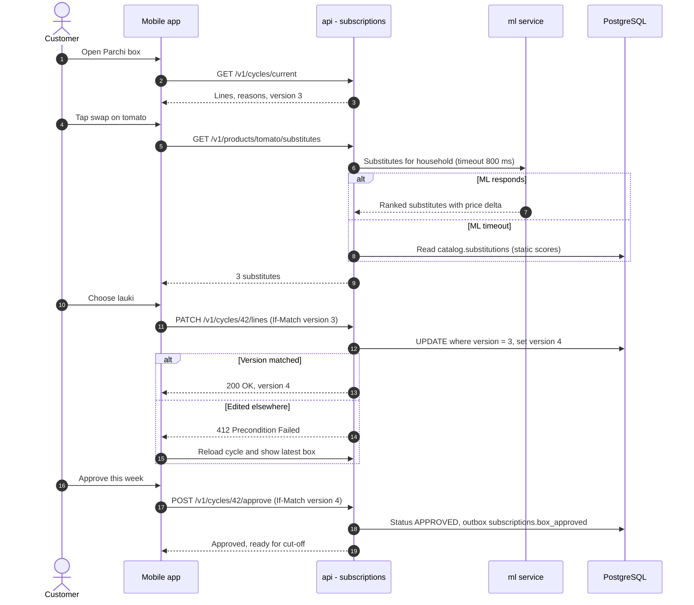

---

## W3 — Payments

1. **Wallet top-up:** the app asks the API to create a Razorpay order (our own thin async Razorpay client on httpx2) → Razorpay Checkout runs inside the WebView → Razorpay sends a webhook → the webhook is stored, then processed idempotently → ledger entry → push notification.
2. **Autopay (from the pilot phase; MS-A uses prepaid wallet top-ups only):** the mandate is created once. Each cycle sends a pre-debit notice at T-3 18:30 and captures at cut-off.
3. **At cut-off:** after 21:00 IST the API itself refuses box edits; the `cutoff_lock` job (internal job endpoint, scheduled by GitHub Actions) then locks the orders. The wallet is debited (`wallet → unearned_revenue`) or Autopay is captured. Failure → `PAYMENT_FAILED` → 2-hour grace notification → cancel.
4. **Refunds:** shortages and undelivered orders are refunded to the wallet instantly, unless that would take the wallet over ₹10,000: then the same refund goes to the original payment source (M5 §3.3). Other refunds to the original source happen on request.
5. **Reconciliation:** an hourly job (internal job endpoint, scheduled by GitHub Actions) compares local payments with the Razorpay API.

*Figure 7.6 — Sequence: cut-off lock and payment*

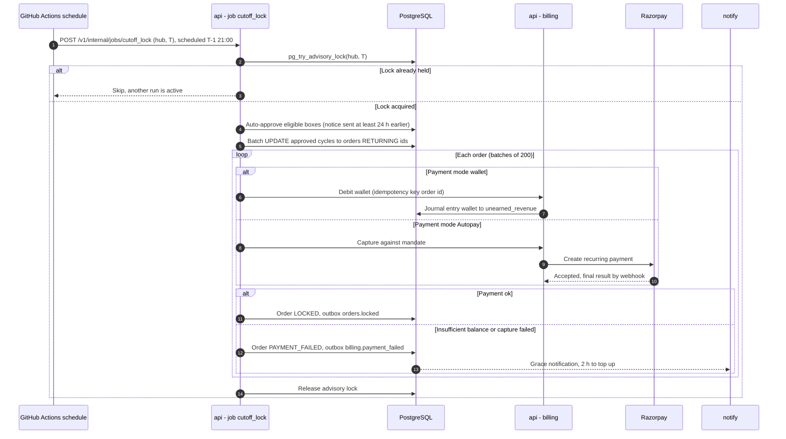

*Figure 7.7 — Sequence: wallet top-up and idempotent Razorpay webhook*

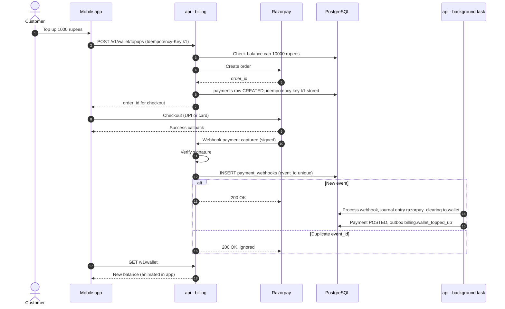

---

## W4 — Hub morning operations

1. **T-1 21:15:** the procurement plan is ready. For each item: committed quantity + the forecast quantile of uncommitted demand (newsvendor rule). The hub manager reviews and adjusts it in the console, and purchase orders go to vendors (WhatsApp or PDF).
2. **T 04:00:** goods receipt. Weigh, grade (QC), create inventory lots with expiry, record vendor-score inputs.
3. **T 05:00:** packing tasks are generated per order and sorted by route stop. The packer scans the bag QR and picks each line by scan or weight. Shortages are flagged → the customer's substitution preference is applied, or a partial refund is issued.
4. Bags are grouped into crates per society, ready for 07:00 dispatch.

*Figure 7.8 — Sequence: procurement planning (forecast + newsvendor)*

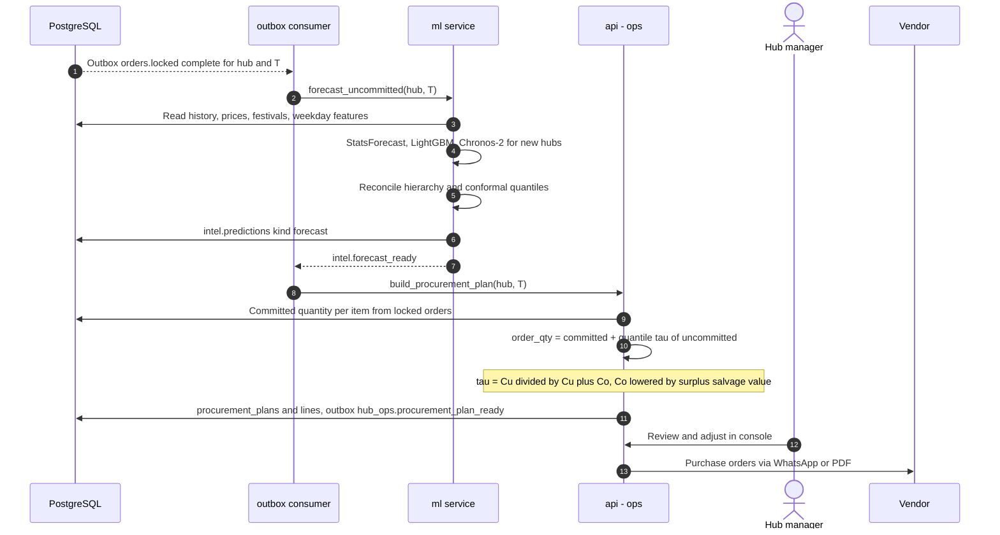

*Figure 7.9 — Sequence: packing and shortage substitution*

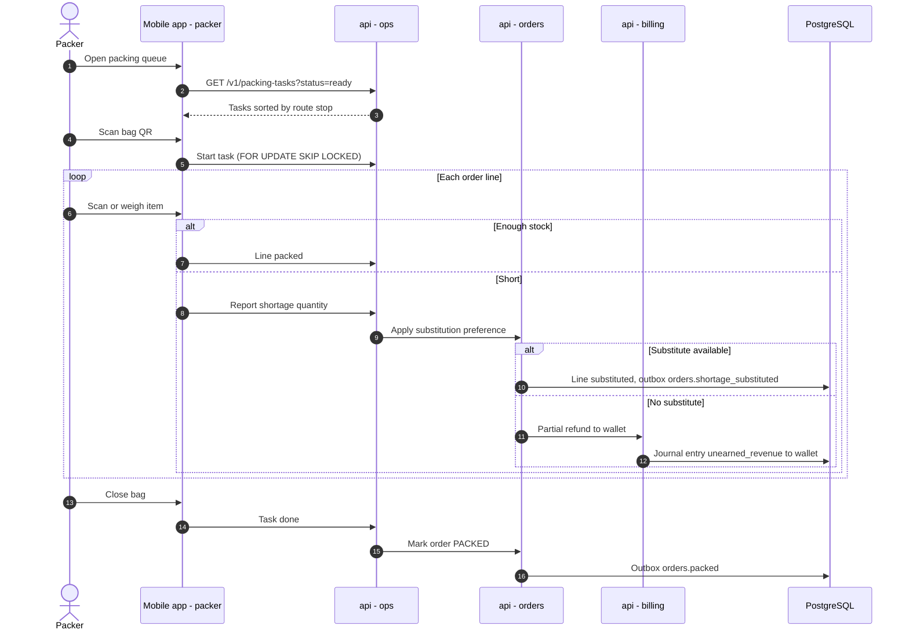

*Figure 7.10 — Activity: hub morning operations*

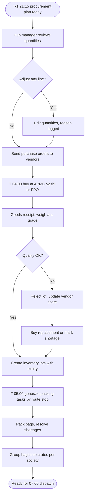

---

## W5 — Routing and delivery

1. **T 07:00:** the route solver (OR-Tools CVRPTW with pickup-and-delivery, OSRM travel times, 30-second limit) publishes routes. If the solver fails, the fallback is a nearest-neighbour route.
2. The rider sees stops, crates per stop and a map.
3. At each society: handover to the **Society Captain**. She scans the crate QR and counts bags; the handover is confirmed by OTP or photo.
4. The captain app lists flats. Each bag is scanned at the door or at lobby pickup → `DELIVERED` → push notification to the customer.
5. Exceptions: if the customer is not home, the captain holds the bag until the evening window. Otherwise it becomes `UNDELIVERED`, followed by redelivery or refund.
6. **Return leg:** crates and Kindness donation pickups are already part of the route as pickup stops.

*Figure 7.11 — Sequence: route solve, captain handover and delivery proof*

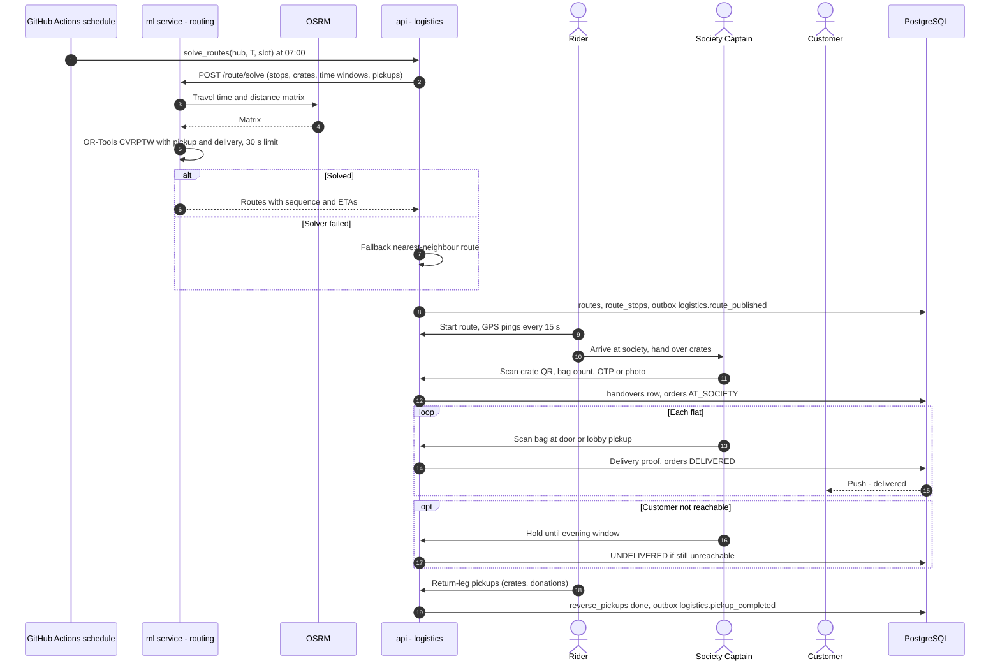

---

## W6 — Tiffin day

1. Kitchens publish weekly menus; the hub manager approves them.
2. Cut-off at **T-1 21:00**, then `assign_kitchens` at 21:30 runs the fairness-aware CP-SAT assignment. Kitchens accept their counts.
3. At **T 09:35** `solve_tiffin_routes` plans each hub's lunch run (M7 §3.7): kitchens first, then the societies, on two-wheelers filled by portions.
4. Kitchens cook in the morning and mark READY by 11:30.
5. The rider scans each kitchen's `GB1A:` code (`POST /v1/stops/{id}/collect`): its ready tiffins go `packed → dispatched`. At a society with a captain she takes them by count and the handover code and proves each door with the tiffin's short code and the household's code (or a photo); where there is no captain the rider does the doors. A tiffin that does not reach its door is refunded in full at once; one never collected (or on a route nobody started) waits for the hub's triage at 16:00. The captain settles only the tiffins she took, and neither she nor the customer sees the rider's position while he is bound for a kitchen or near one. Delivery between 12:30 and 13:30.
6. A rating prompt goes out at 14:30.
7. Leftover portions are listed in the evening "Bachat Box".

*Figure 7.12 — Sequence: tiffin fair assignment and kitchen flow*

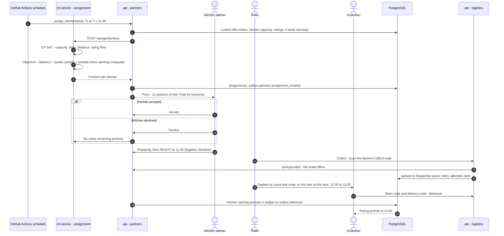

---

## W7 — Partner onboarding and payouts

1. In the customer app, "Become a partner" → choose a role: kitchen, captain, rider or packer.
2. Upload documents: ID (masked), FSSAI registration for kitchens, PAN where applicable, bank verification by penny drop (simulated in the prototype).
3. The hub manager reviews documents in the console (decision written to the audit log).
4. Complete training modules (video + quiz): hygiene, app usage, role-specific.
5. VERIFIED → the new role appears in the role switcher.
6. Earnings accrue per event in the ledger → weekly payout statement (Razorpay Route / RazorpayX in test mode) → downloadable income certificate.

*Figure 7.13 — Activity: partner onboarding and KYC*

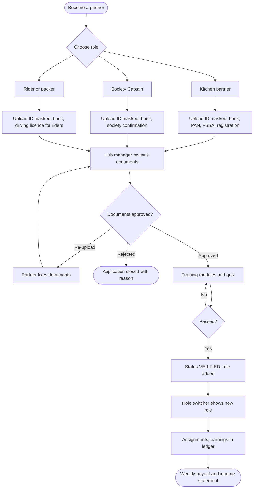

---

## W8 — Kindness donation

1. The customer schedules a pickup (items and photos).
2. The pickup is attached as a return-leg stop on the next route serving that society.
3. The hub verifies the items → Kindness points are credited (item rules × drive multiplier).
4. A batch is handed to an NGO with photo proof → the impact counter updates.

*Figure 7.14 — Sequence: Kindness donation to points*

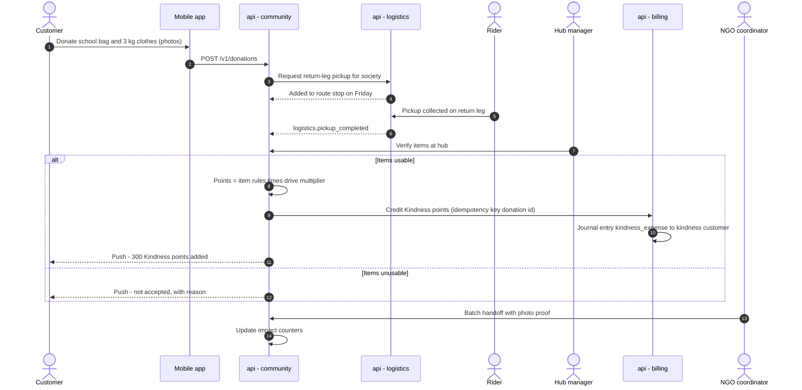

---

## W9 — Surplus cascade (daily, 12:30)

1. Unsold or near-expiry lots are listed as "Imperfect Sabzi" add-ons for the next day at a discount.
2. What remains goes to kitchens as ingredient credit (used in curries and dals).
3. What remains goes to an NGO partner.
4. Only unusable items go to compost.

Every step is recorded in `hub_ops.waste_logs.cascade_to`, which feeds the **kg wasted per 100 kg sold** KPI.

*Figure 7.15 — Activity: surplus cascade*

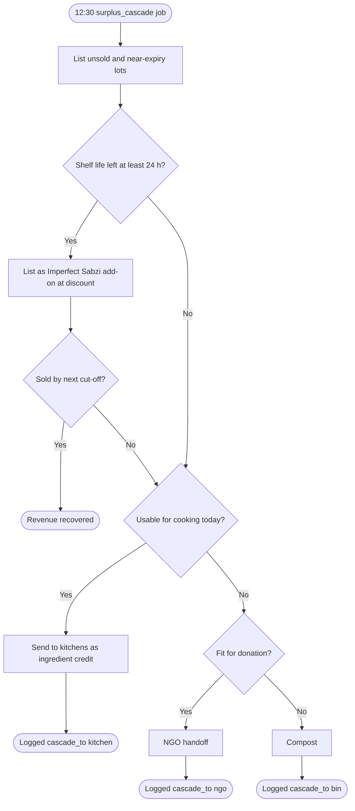

---

## W10 — Society onboarding and unlock

1. The hub draws the society polygon in the console → status `prospect`.
2. A Society Captain is recruited (through W7).
3. The unlock threshold **N** is computed from the route-cost model: the number of households at which a stop becomes cheaper than the delivery fee.
4. A referral campaign runs through the captain and WhatsApp groups.
5. When N households have joined → status `live`, free-delivery badge, fixed delivery days assigned.
6. Before that, once the hub assigns the society delivery days, households can already get boxes, paying the hub's pre-live delivery fee on each box (`pre_live_box_fee_paise`, default ₹30, set by an admin). The fee is debited with the box at cut-off and stops from the first cut-off after the society goes live (M9 §3.6, M4 §11).

*Figure 7.16 — Activity: society unlock*

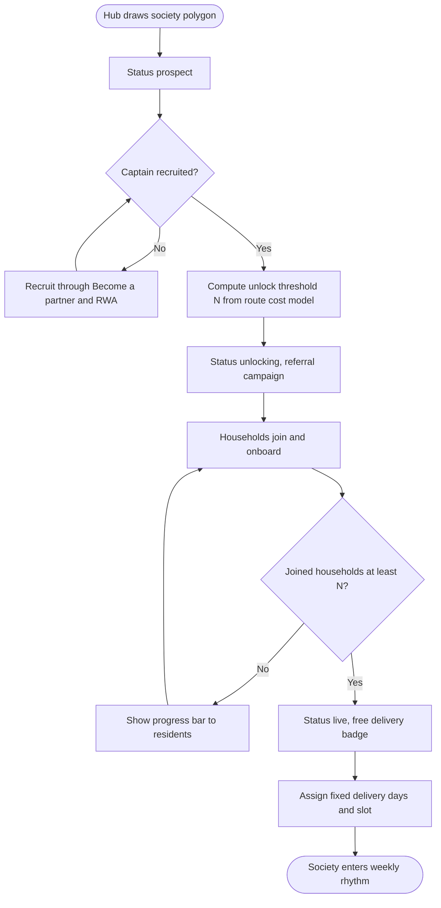

---

## W11 — ML lifecycle

1. **02:00 daily:** `export_snapshots` reads PostgreSQL with DuckDB and writes Parquet to object storage (S3 API: Cloudflare R2 when deployed, SeaweedFS locally); pandera validates the schema. Snapshots and training run in `backend/training` on GitHub Actions, never inside the ML service or an API request (D21, D25).
2. Point-in-time features are built as of each cut-off (no leakage).
3. **Sunday 03:00:** a challenger model is trained and evaluated on a time-based holdout (last 2–4 weeks).
4. If it beats the current model on the primary metric and passes guardrails, the new version is promoted: its `latest.json` pointer on R2 moves to it (manual `just promote` in v1, D25).
5. The ML service polls `latest.json` every 10 minutes and hot-reloads.
6. A daily monitor compares forecast vs actual (WAPE), plan acceptance and waste %, and alerts on drift.

*Figure 7.17 — Sequence: training, evaluation, champion promotion and hot reload*

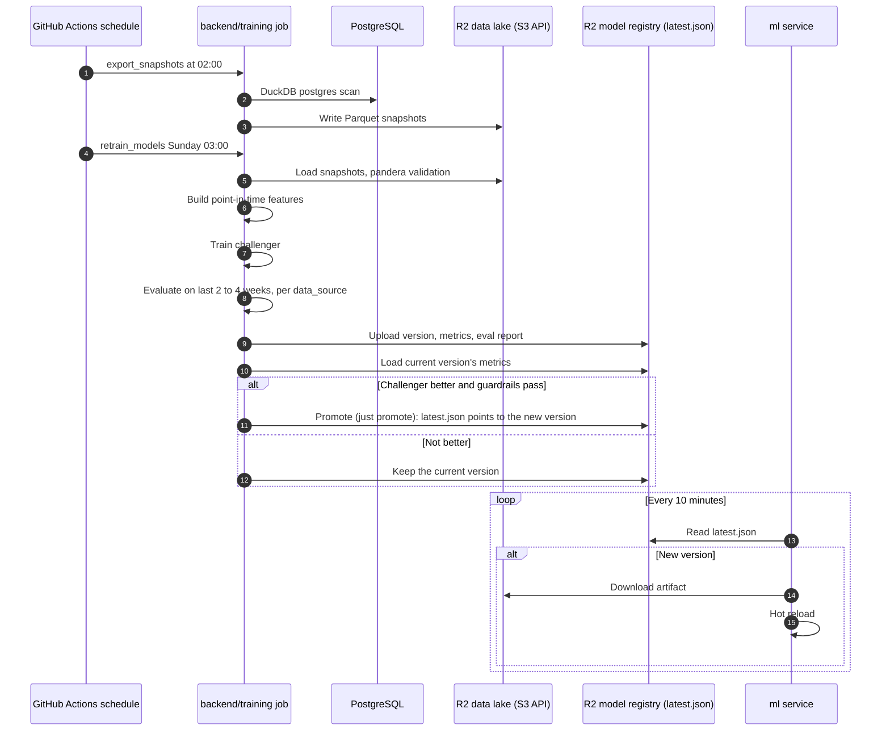

---

## W12 — Assistant (text MVP) with confirmation

The assistant ("Ghar Saathi" chat) uses Claude in the ML service, which never calls our API: the API sends it the scrubbed conversation and a trimmed week, the model reads that week and names the changes it wants, and the API turns them into **proposed changes** that the user must confirm in the UI (M13 §3). The LLM never calculates prices or quantities.

*Figure 7.18 — Sequence: assistant turn with user confirmation*

```mermaid
sequenceDiagram
    autonumber
    actor C as Customer
    participant APP as Mobile app - chat
    participant API as api - assistant
    participant AS as ml service - assistant
    participant LLM as Claude API
    C->>APP: Kal aloo 2 kilo extra bhejna aur paneer hata do
    APP->>API: POST /v1/assistant/messages (JSON in v0; SSE later)
    API->>API: Reserve the turn under the daily cap, scrub the text, store it, commit
    API->>AS: POST /assistant/turn (scrubbed history, trimmed week with line handles)
    AS->>LLM: System prompt and tools (cached), messages
    LLM-->>AS: Tool call get_my_week
    AS->>LLM: Tool result from the trimmed week
    LLM-->>AS: Tool calls edit_box_line - qty L4 (aloo), remove L7 (paneer)
    AS->>LLM: Tool results - noted, the app shows cards
    LLM-->>AS: Reply summarising the request
    AS-->>API: Reply and intents (no ids, no prices from the model)
    API->>API: Resolve intents - line, catalog product, steps, week - into proposals p7, p8
    API-->>APP: Message and confirm cards with prices from the API
    alt Customer confirms
        C->>APP: Confirm
        APP->>API: POST /v1/assistant/confirm/p7 (Idempotency-Key)
        API->>API: M3 facade at the card's version (412 if the week changed)
        API-->>APP: Box updated, version 5
    else Customer cancels
        C->>APP: Cancel
        APP->>API: POST /v1/assistant/proposals/p7/reject
    end
```

---

## Workflow-to-module map

| Workflow | Modules | Primary owner |
|---|---|---|
| W1 Onboarding | M1, M5, M9 | Prathamesh Relekar (backend), Yash Salunkhe (screens) |
| W2 Weekly Autopilot | M3, M4, M10, M11 | Prathamesh Relekar (backend, models), Yash Salunkhe (screens) |
| W3 Payments | M5 | Prathamesh Relekar (backend), Yash Salunkhe (screens) |
| W4 Hub morning ops | M6, M10 | Prathamesh Relekar |
| W5 Routing and delivery | M7, M10 | Prathamesh Relekar |
| W6 Tiffin day | M8, M7, M10 | Prathamesh Relekar |
| W7 Partner onboarding | M8, M1, M5 | Prathamesh Relekar |
| W8 Kindness | M9, M7, M5 | Prathamesh Relekar (backend), Yash Salunkhe (screens) |
| W9 Surplus cascade | M6 | Prathamesh Relekar |
| W10 Society unlock | M9, M7 | Prathamesh Relekar |
| W11 ML lifecycle | M10 | Prathamesh Relekar |
| W12 Assistant | M13, M3 | Prathamesh Relekar |

End-to-end tests (Playwright) for W1, W2, W3, W5 and W8 are owned by Rhythm Thakur and Manish Raje.

## Decisions & open questions

- **D1** Kitchen Autopilot and Society Captain are the headline flows ([ADR-0001](../adr/0001-headline-usps-autopilot-and-society-captain.md)).
- **D3** batch ML with rule-based fallbacks ([ADR-0003](../adr/0003-python-fastapi-backend-and-ml-service.md)).
- **D4** wallet default, UPI Autopay with 24-hour pre-debit notice ([ADR-0004](../adr/0004-closed-loop-wallet-and-upi-autopay.md)); for MS-A the wallet is topped up through Razorpay Checkout in test mode and Autopay mandates move to the pilot phase.
- **D21** jobs without a broker: Postgres outbox relayed after each commit, scheduled jobs as internal endpoints called by GitHub Actions; Taskiq returns at the pilot ([ADR-0021](../adr/0021-jobs-without-a-broker.md)).
- **D5 / D13** assistant: text MVP, model chosen after the Sprint 8 evaluation ([ADR-0005](../adr/0005-text-assistant-mvp-voice-stretch.md), [ADR-0013](../adr/0013-assistant-model-chosen-by-eval.md)).
- Open: validate the timings (T-1 21:00 cut-off, 04:00 buying, 08:00–10:00 delivery) with hub operators and the UX interviews in Phase P0.
- Open: how long the captain holds undelivered bags (evening window length) — decide in the M7 spec.

Related: [06 — Domain lifecycles](06-domain-lifecycles.md) · [08 — AI and ML](08-ai-and-ml.md) · [10 — API and integration](10-api-and-integration.md) · [14 — Project plan](14-project-plan.md)
