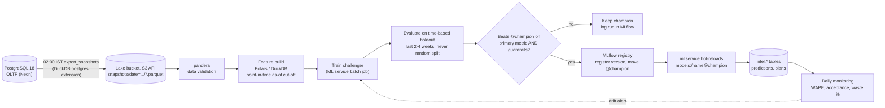
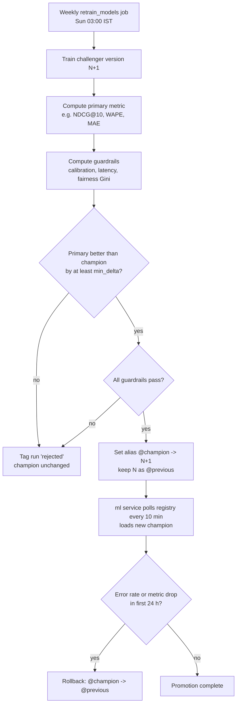
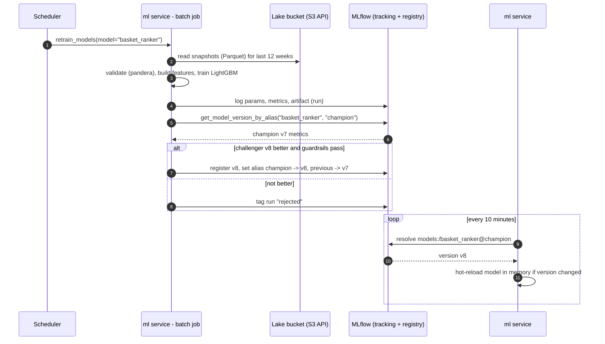
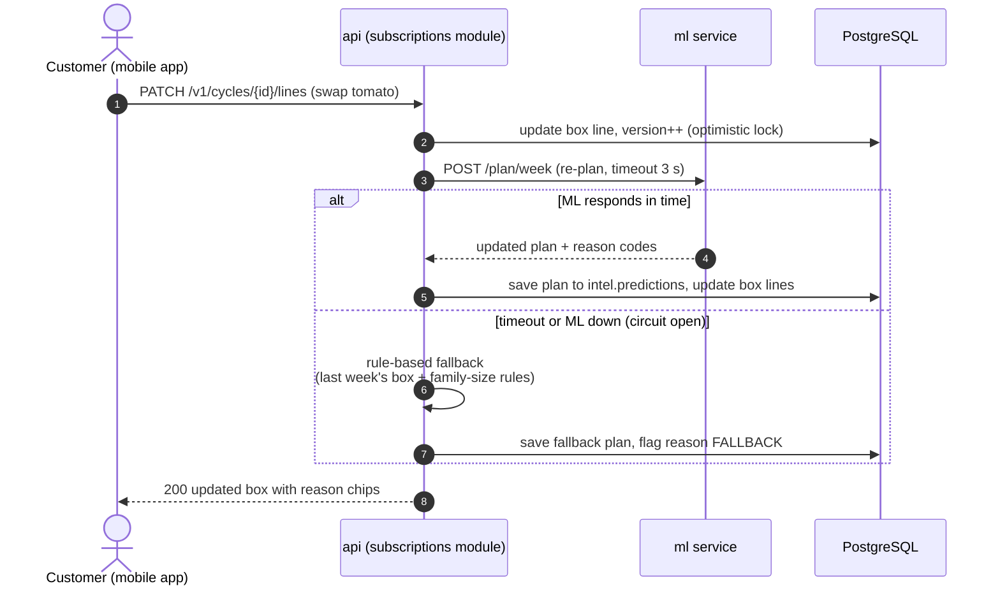

# Chapter 08 — AI and Machine Learning

> **In short:**
> - GharBasket's intelligence is mostly **statistics, tabular ML and optimisation solvers**. **No GPU is needed** for v1. Everything trains on CPU in seconds to minutes. The ML service runs on a Hugging Face Space, training runs in GitHub Actions and models live on R2 (ADR-0025); locally everything runs in Docker Compose and on laptops.
> - Rule: **solvers decide, statistics predict, LLMs talk.** The LLM never computes money or quantities.
> - Heavy AI runs in **batch** and writes into `intel.*` tables. Online calls have timeouts and **rule-based fallbacks**, so ML never blocks a customer.
> - Four algorithms form the research contribution (D7): **CP-SAT meal planner** and **pantry digital twin** (deepest), **fair kitchen assignment**, and **forecast + newsvendor procurement**.
> - The assistant model is chosen **after the Sprint 8 eval** (D13), comparing Claude Opus 5.5, Sonnet 5.5 and Haiku 4.5.

---

## 8.1 Where the AI is trained

| Model / engine | Type | Where it trains | How often | Typical time |
|---|---|---|---|---|
| M-A Pantry digital twin | Hierarchical Bayesian (NumPyro) + closed-form online updates | `backend/training` job in GitHub Actions (CPU); the online update runs in the API with plain arithmetic; development on laptops | Weekly full fit; online update after every delivery / feedback | 1–5 min |
| M-B Next-basket ranker | LightGBM LambdaRank | ML service batch job (CPU) | Weekly | < 2 min |
| M-E Demand forecast | StatsForecast + MLForecast (LightGBM) + MinT reconciliation | ML service batch job (CPU) | Nightly | < 5 min |
| Chronos-2 | Pretrained foundation model, **zero-shot** (no training) | Inference on CPU in an ML service batch job | Nightly, only for hubs with < 8 weeks of data | seconds–minutes |
| M-C Meal planner, M-D Budget Lock, M-F Routing, M-G Kitchen assignment, kit selection | OR-Tools CP-SAT / Routing — **solvers, no training** | `ml` service at request/batch time | Per cycle / per slot | 1–30 s |
| M-I Churn + uplift | LightGBM + T-learner | ML service batch job | Monthly | < 1 min |
| Embeddings (bge-m3) | Pretrained, no training | One-off batch on a laptop, or Google Colab / Kaggle free GPU; re-run on catalog change | On change | minutes |
| Assistant | Claude API — prompting + tool use, **no fine-tuning** | Anthropic API | — | — |
| (Optional, research) Chronos fine-tune | Fine-tune | Kaggle / Colab free GPU (T4/P100) | Once, for the paper | ~1 h |

Until there is a paid worker (the pilot), long ML jobs run in GitHub Actions (`backend/training`, D25) or offline, never inside an API request (D21, [ADR-0021](../adr/0021-jobs-without-a-broker.md)). The serving service (`backend/ml`, a Hugging Face Space) is stateless and installs only solvers and inference libraries.

Experiments happen in **marimo** notebooks (stored as `.py`, so git diffs are clean) and are logged to a **local MLflow** (Docker Compose). The registry of record is simpler: models go to `s3://gb-mlflow/models/<name>/<version>/` on R2 with a `latest.json` pointer per model; promotion is a manual `just promote <model> <version>` in v1 (`backend/training/jobs/promote.py`; it refuses a version that is not in the registry, keeps `previous` in the pointer, and rolling back is the same command with the older version) and the Space polls the pointer every 10 minutes (ADR-0025). Where the figures below say "MLflow registry", read "the R2 pointer".

---

## 8.2 Training pipeline (MLOps-lite)

*Figure 8.1 — ML data pipeline from the operational database to served models*

**Rules of the pipeline**
- **Data mix:** train on `synthetic + pilot + live` data (D8). **Report** metrics separately for `pilot`/`live` rows. This is the paper's honesty guarantee.
- **Point-in-time features:** features are computed *as of the cut-off time*, stored in `intel.feature_snapshots`, so future information never leaks into training.
- **Time-based splits only.** Random splits on time-series data overstate accuracy.
- **Monitoring:** a daily job compares forecast vs actual (WAPE), plan acceptance rate and waste %. Results appear on the console **AI health** page, with an alert when drift exceeds a threshold. *Built (5 Oct 2026, F25):* `monitor_drift` (M10 §6) writes live WAPE per hub, delivery day and data source and acceptance per data source to `intel.model_metrics`, with a `drift` flag (more than 10 points worse than the same hub and source's backtest); `GET /v1/analytics/ai-health` (M12, admin) serves the table per hub; waste joins when M6 counts it.

*Figure 8.2 — Champion/challenger promotion with rollback*

*Figure 8.3 — Training, evaluation, promotion and hot reload*

*Figure 8.4 — Online re-plan request with timeout and rule-based fallback*

---

## 8.3 Model specifications

### M-A Pantry digital twin (research, deepest)
- **Goal:** estimate each household's per-item consumption rate λ (kg/day) with uncertainty → predicted depletion date and "how much to put in the box".
- **Model:** λhi ~ Gamma(αc,i, βc,i), where *c* is the cohort (family size × diet × region).
  Observations: quantity purchased, corrected by feedback taps ("some got wasted", "ran out early"), over the interval between deliveries.
- **Online:** conjugate Gamma–Poisson posterior update after each delivery (instant, SciPy).
- **Weekly:** NumPyro re-fits the cohort hyper-priors.
- **Cold start:** a new household starts at its cohort prior. We measure how many weeks until error drops below a threshold.
- **Metrics:** quantity MAE (kg), calibration of 80% intervals, "ran out / wasted" rate. Baseline: a family-size rule table.
- **Fallback:** rule table (family size → kg/week per category).
- **Status (7 Oct 2026, v0):** the conjugate update serves at `POST /pantry/quantities` with Negative Binomial predictive intervals (SciPy) and the same closed form in the gateway's fallback. v0 covers the perishable daily-use items only (milk, curd) and learns their daily-use share (delivered minus the week's recipe need); staples stay on the rule table until v1 models stock. M3 drafts from it only with `PANTRY_TWIN_ENABLED` on, which stays off until the eval target holds; the eval harness scores it on that scope next to the rule table and a running mean, with 80 % interval coverage (`just eval`). The NumPyro cohort refit is v1 (P4).

### M-B Next-basket candidate ranker
- **Candidates:** TIFU-KNN personal and neighbour repeat items ∪ meal-plan ingredients ∪ seasonal/festival items.
- **Features:** recency, frequency, last accept/reject, price delta vs 4-week average, season, festival flag, cohort popularity, substitution-acceptance history.
- **Model:** LightGBM LambdaRank. Label = kept in final box vs removed.
- **Metrics:** Recall@10, NDCG@10, box acceptance rate, edits per box. Baselines: "repeat last week", top-frequency.
- **Status (5 Oct 2026, v0; leakage fixes 8 Oct):** `train_ranker` in `backend/training` (LambdaRank on approved and locked boxes and their edits, one model per data source, leave-last-basket-out against both baselines, model and card to the registry, promotion manual) and `POST /basket/rank` on the Space with a frequency fallback and a 10-minute reload (M10 §3.7). v0 features are computed as of the cut-off: prices from the price list, not the final box; `drafted_rule` is dropped until a draft snapshot exists. Recall is reported as Recall@|basket| beside Recall@10 (eval protocol §7). SHAP and the planner's preference term are v1.

### M-C Meal planner — CP-SAT (research, deepest; core of Kitchen Autopilot)
- **Variables:** `x[d,s,r]` ∈ {0,1} (day, meal slot, recipe); `t[d,s]` = tiffin on no-cook slots.
- **Hard constraints:**
  - exactly one choice per slot;
  - fasting / Jain / diabetic rules from the household and `catalog.festival_calendar`;
  - weekday cook-time ≤ household limit;
  - no recipe repeated within *k* days;
  - budget: Σ ingredient cost ≤ weekly budget (from Budget Lock when active).
- **Objective (soft):**
  - maximise preference score (from M-B and feedback);
  - closeness to nutrition targets per member;
  - **ingredient-reuse bonus** (shared perishables across meals → less waste);
  - variety bonus;
  - penalty on price-spiked items.
- **Output:** plan → aggregated ingredients × M-A quantities → `subscriptions.box_lines` with `reason_code`. Busy days → kit suggestions.
- **Performance:** at most 5 s per household (`time_limit_s`, 1 s by default for the whole request; the gateway caps it at half its 3 s timeout); v1 warm-starts from a v0 plan (M10 §3.2); the weekly batch runs in parallel across CPU cores.
- **Spike S-4 (4 Oct 2026, passed):** optimal week plans in 10 to 50 ms for the seed households, and 0.07 s with 126 recipes. When strict households (e.g. diabetic with 20-minute meals, or Jain during Navratri) leave too few dishes, the planner relaxes comfort rules only (repeats, then cook time, then budget), never diet, Jain, diabetic or fasting rules. See [S-4 note](../spikes/S-4-meal-plan.md).
- **Metrics:** constraint satisfaction 100%, nutrition adherence, variety index, ingredient-reuse ratio, plan acceptance. Baselines: random valid plan, greedy.
- **Status (5 Oct 2026, v1):** the nutrition term (ICMR-NIN targets per member, days within ±20 % of kcal and protein), the price-spike penalty from `intel.price_index`, sides paired per meal and reason codes are served; M3 sends members, nutrition and spikes. First five-seed numbers (eval harness v0, v0 objective): acceptance 0.80, 3.7 distinct perishables a week against 6.2 greedy and 11.3 random, no hard-rule violation. Pre-registered M-C primary target (acceptance above greedy) does not hold in the v0 eval (cpsat − greedy −0.031 ± 0.009); reported as a finding, no tuning (decided 8 Oct 2026).

### M-D Budget Lock optimiser
- The M-C model with the monthly Budget Lock as a hard constraint, plus a substitution penalty using `catalog.substitutions`.
- Produces explanation chips such as `PRICE_SWAP{from: tomato, to: lauki, pct: 62}`.

### M-E Demand forecast + newsvendor procurement (research)
- **Insight:** committed demand is known exactly at cut-off. We forecast only the **uncommitted** part (add-ons, tiffin walk-ins, new households), per hub × item × day.
- **Models:**
  - StatsForecast AutoETS, CrostonOptimized / TSB / ADIDA for intermittent items, with conformal prediction intervals;
  - MLForecast LightGBM with festival, weekday, price and weather features;
  - Chronos-2 zero-shot for hubs with < 8 weeks of data;
  - HierarchicalForecast MinT reconciliation (item → category → hub).
- **Procurement:** `order_qty = committed + Q_τ(uncommitted)`, where τ = Cu / (Cu + Co).
  Co = cost − salvage value from the surplus cascade. Shelf life caps the buffer.
- **Metrics:** WAPE, MASE, pinball loss; downstream waste kg per 100 kg sold, stock-out %. Baselines: seasonal naive, "buy last week".
- **Status (8 Oct 2026, v0 + v1 LightGBM):** the `forecast` job in `backend/training` (StatsForecast AutoETS / Croston / SeasonalNaive / Naive and a global LightGBM, direct multi-step with one booster per step and festival, fast-day and as-of-origin price-index features, a rolling-origin backtest with weekly origins and a 2-week horizon, scaled split-conformal q_tau, newsvendor `order_qty`) stores a hub's lines per delivery day in `intel.predictions` and announces them with `intel.forecast_ready`; M6 reads them through `intel_gateway.api.hub_forecast(hub, delivery_date)`. WAPE, q_tau coverage, pinball and MASE per model go to `intel.model_metrics` per data source (M10 §3.6). The simulator's uncommitted demand is sparse until the add-on behaviour lands, so the first WAPE numbers wait for that.

### M-F Routing (OR-Tools)
- **Problem:** capacitated vehicle routing with time windows and pickups/deliveries.
  - Capacity in kg and crates; society time windows; service time per stop.
  - Donation and crate pickups on the return leg (same-vehicle constraint).
- **Data:** distance/time matrix from self-hosted **OSRM** (Mumbai Metropolitan Region extract).
- **Solver:** guided local search within the request's `time_limit_s` for both waves together (default 10 s, at most 20 s); OSRM gets 2.5 s before haversine prices the slot instead, and the gateway waits `time_limit_s` + 6 s.
- **Metrics:** ₹ per order, km per order, on-time %. Baselines: one trip per order, nearest-neighbour.
- **Status (5 Oct 2026, v0):** `POST /route/solve` serves the two-wave CVRPTW from S-3 with the independent checker, OSRM from the Space image (haversine when it is down or slow, nearest neighbour within the fleet when no plan is found); `intel_gateway.api.solve_routes` records the plan for the hub and returns None when the service is down, so M7 keeps the previous day's sequence. M7's tables and endpoints come with the M7 product PR (January).
- **Spike S-3 (4 Oct 2026, passed):** 50 societies are routed in under 5 s, all on time, at ₹6.87 an order against ₹7.93 for nearest neighbour and ₹76.57 for one trip per order. Vans do **two trips** by solving one window wave at a time (07–09, then 08–10, with vans carried over). That cuts the fleet by 40–45 % at 50 to 200 societies, while a single chained model stops scaling after about 50. See [S-3 note](../spikes/S-3-routing.md).

### M-G Fair kitchen assignment (research)
- **Problem:** CP-SAT assignment of tiffin portions to home kitchens.
  - Constraints: capacity, menu skills, rating floor, distance ≤ X km.
- **Objective:** minimise distance + quality penalty + **λ × earnings inequality**. The inequality term is the maximum deviation from the fair share over a rolling 4 weeks (a linear proxy for the Gini coefficient).
- **Metrics:** Gini of weekly partner earnings, cost per portion, rating. Compared with a greedy nearest-kitchen baseline. A λ-sweep produces a Pareto curve (paper figure).
- **Status (5 Oct 2026, v0):** `POST /assign/kitchens` serves the CP-SAT model with the λ term and greedy nearest as baseline and fallback; the gateway records the plan per hub. The λ sweep is in the eval harness (`just eval`, RQ4 table): per seed one simulated week of 7 evenings with each kitchen's earnings carried forward from 0, greedy and every λ paired by seed, and the target judged on 95 % CI upper bounds (eval protocol §7, 8 Oct); M8's tables and job come with the January product PR. λ is in paise per portion of imbalance among the kitchens that can cook tonight (default 300); orders no kitchen can take come back in `unassigned` with `status: partial` (M10 §3.5).

### M-H Slot pricing ("green slots")
- The marginal insertion cost of an address into existing tentative routes → slot discount ranking.
- Shown in the app as: "Neighbours already get delivery Tue 8–10, save ₹15".

### M-I Churn and uplift
- Survival-style features → LightGBM churn probability.
- T-learner uplift on simulated retention offers. An offer is shown only where uplift > 0.

### M-J Trust and safety
- Rules + Isolation Forest on refund and donation-credit patterns.
- Complaint photo triage with a vision-capable LLM, in batch; auto-credit under a ₹ threshold, otherwise human review.

---

## 8.4 Explainability

- Every AI output stores a `reason_code` plus parameters, for example `SEASONAL`, `PRICE_SWAP{from:tomato,pct:62}`, `PANTRY_LOW{days:2}`, `FESTIVAL{code:navratri}`.
- The app renders **localised chips** from these codes (`en-IN`, `hi-IN`, `mr-IN`), not LLM-written text. Explanations are therefore deterministic and testable.
- For ranker decisions, the top SHAP features are stored for paper analysis.

---

## 8.5 Evaluation protocol (`backend/training/src/gharbasket_training/eval/`)

| Algorithm | Protocol | Primary metric | Baselines |
|---|---|---|---|
| Pantry twin (M-A) | Weekly rolling evaluation against simulator ground truth and pilot feedback | Quantity MAE, 80% interval coverage | Family-size rule table |
| Ranker (M-B) | Leave-last-basket-out | NDCG@10, acceptance rate | Repeat last week, top-frequency |
| Meal planner (M-C) | Simulator A/B: Autopilot plan vs baseline plan | Acceptance, nutrition adherence, ingredient reuse | Random valid, greedy |
| Forecast + procurement (M-E) | Rolling-origin backtest | WAPE, MASE, pinball; waste %, stock-out % | Seasonal naive, buy-last-week |
| Routing (M-F) | Fixed-seed benchmark set | ₹/order, km/order, on-time % | One trip per order, nearest-neighbour |
| Fair assignment (M-G) | λ-sweep on simulated weeks | Gini vs cost Pareto curve | Greedy nearest kitchen |

`just eval` runs every protocol and writes a report to `docs/eval/<date>-<commit>` (HTML and JSON) and rows to `intel.model_metrics`, each with the simulator version and the sha256 of the cohorts file and the seed catalog. v0 reports are HTML tables: the planner arms against each baseline as per-seed paired differences (mean ± 95 % t-CI, acceptance first) and hard rules re-checked with `planner.check()`; the paper-ready marimo figures come later. Figures are versioned with the model version that produced them.

**Pre-registered targets (hypotheses, 4 Oct 2026; the full protocol, seeds, ablations and change log are in [`docs/research/eval-protocol.md`](../research/eval-protocol.md)):**

| Algorithm | Target | Guardrails |
|---|---|---|
| M-A pantry twin | quantity MAE ≤ 15 % of weekly quantity after 4 weeks (rule table ≈ 30 %); cold start < 4 weeks | 80 % interval coverage in 75–85 % |
| M-B basket ranker | NDCG@10 ≥ repeat-last-week + 0.05; Recall@10 ≥ 0.6 | edits per box; calibration |
| M-C meal planner | simulator acceptance ≥ 70 %; score ≥ +30 % vs greedy; ≥ 25 % fewer distinct perishables | 100 % hard constraints; ≤ 5 s |
| M-E forecast + newsvendor | WAPE ≤ 25 %, ≥ 10 points better than seasonal naive; stock-out ≤ 3 %; waste ≤ 5 % | MASE; pinball loss |
| M-F routing | on-time ≥ 95 %; ₹/order ≥ 10 % below nearest neighbour | ≤ 10 s per wave |
| M-G kitchen assignment | Gini ≤ 0.25 at ≤ +5 % cost vs greedy | rating floor kept |
| M13 assistant | intent accuracy ≥ 90 %; slot F1 ≥ 0.85; ≤ $0.01 per turn | no unauthorised action on injection fixtures |
| M-C planner v2 (liking from M-B) | acceptance ≥ v1's on the same seeds (hypothesis, 5 Oct 2026) | hard rules 100 %, perishables no worse than v1 + 1 |
| Monitoring | alert when WAPE worsens by > 10 points against the last report | — |

Every experiment runs on at least 5 simulator seeds and reports mean ± 95 % CI; synthetic and pilot results are always separate tables.

---

## 8.6 LLM usage

### Assistant "Ghar Saathi" (text MVP, D5)

**Built 5 Oct 2026 (F23/F24):** the loop in `backend/ml/src/gharbasket_ml/assistant.py` (`POST /assistant/turn`, four tools, strict schemas, caching, refusal fallback, four tool rounds a turn), the API module `assistant` (sessions, scrubbed messages, 15-minute proposals, `usage_daily` cap, `expire_proposals`), and `just eval-assistant` (intent accuracy, slot F1, the injection rule, cost a turn) on `data/eval/assistant_utterances.jsonl`. The Space needs the secret `ANTHROPIC_API_KEY`; without it the API answers with a fixed fallback reply (`source: fallback`).
- Built with the Anthropic Python SDK. **The Space never calls our API** (decided 8 Oct 2026, M13 §3): the API sends the scrubbed conversation and a trimmed week (no household or user id, name, address or token), the read tools answer from that week, and the write tools come back as intents that the API resolves into proposals:
  - `get_my_week`, `edit_box_line`, `skip_week`, `explain_item` (S8); `book_tiffin`, `track_order` later.
- Tools use `strict: true` schemas (no numeric bounds; ranges are in the descriptions and the API checks them) with `tool_choice: auto` (current Claude models reject forced tool choice); low effort, thinking blocks echoed unchanged between tool rounds.
- Every write returns a **proposed change** that the user must confirm in the UI; the LLM never commits changes on its own.
- **Prompt caching** on the system prompt and tool definitions.
- **Guardrails:**
  - per-user daily token cap;
  - the server-side refusal fallback (`fallbacks: "default"`), then a canned reply;
  - conversation logs stored with PII scrubbed, by the API, before anything leaves it.
- **Eval set:** 200 labelled Hinglish / Marathi / English utterances, written by Rhythm Thakur and Manish Raje. Metrics: intent accuracy and slot-filling F1.

### Model choice and cost (decided after the S8 eval, D13)

Anthropic list prices, per 1M tokens (input / output):

| Model | Price | Estimated cost per turn* | 50 demo users | 500 pilot users |
|---|---|---|---|---|
| Claude Opus 5.5 (`claude-opus-5-5`) | $4 / $20 | ~$0.015 | ~$15 / week | ~$150 / week |
| Claude Sonnet 5.5 (`claude-sonnet-5-5`) | $2 / $10 | ~$0.008 | ~$8 / week | ~$75 / week |
| Claude Haiku 4.5 (`claude-haiku-4-5`) | $1 / $5 | ~$0.004 | ~$4 / week | ~$40 / week |

\*Assumptions: about 6k input tokens per turn (mostly cached tools and system prompt) and about 400 output tokens; 5 chats per user per week × 4 turns. Real usage is measured in Sprint 8.

**Process:** build against Claude Opus 5.5 first. Run the 200-utterance eval on all three models. Choose on accuracy versus cost.

### Other LLM jobs (batch)
- Complaint-photo triage (M-J).
- Drafting Hindi/Marathi catalog and recipe text. This text is **always human-reviewed** by Rhythm Thakur and Manish Raje before publishing.

---

## 8.7 Roadmap and tiers (4 Oct 2026)

One person builds every model next to the backend, so the work is tiered. A product PR on the current milestone path always goes before an ML PR.

| Tier | Meaning | Items |
|---|---|---|
| 1 | Needed for a milestone demo (MS-A 13 Dec, MS-B 24 Jan, MS-C 21 Feb) | jobs runner and outbox consumers; `intel.*` tables; Agmarknet collector (history only accrues from the day collection starts); IFCT nutrition; verified festival calendar; ≥ 120 recipes; simulator v1; eval harness v0; pantry twin v0; planner v1; snapshots; the ML Space; forecast v0 (StatsForecast + newsvendor); `/route/solve`; greedy kitchen assignment; the assistant with four tools; thin AI health |
| 2 | Needed for the paper (S7–S8) | pantry twin v1 (NumPyro); basket ranker + SHAP; fair assignment λ sweep; planner v2; forecast v1 (MLForecast) |
| 3 | Stretch: only after MS-C or if ahead | Chronos-2 zero-shot; MinT reconciliation; bge-m3 embeddings and learned substitutes; Instacart benchmark; M-I churn and uplift; kits on busy days; slot pricing (S9); Dakshina spellings |
| cut | — | M-J trust and safety (a rules-only refund flag in M12, later) |

**Status (5 Oct 2026):** done — jobs runner and outbox consumers, `intel.*` tables, the Agmarknet collector, IFCT nutrition, the generated festival calendar (verification pending), 120 recipes, simulator v1 (box, pantry, price shocks, `--write-db` through M3–M5), eval harness v0 (`just eval`, reports in `docs/eval`). Next: pantry twin v0, planner v1, snapshots, the ML Space.

Data sources (all free; fetch dates recorded with every run): IFCT 2017 and ICMR-NIN RDA 2020 (nutrition); data.gov.in daily mandi prices plus the India Data Portal 2019–2025 history (Vashi APMC); Open-Meteo (weather); the `kalagana` panchang (fasts); NSSO HCES 2022–23 (simulator realism); OpenStreetMap (roads).

## 8.8 Ownership

| Item | Owner |
|---|---|
| `backend/ml`, models M-A…M-J, eval harness, MLflow | Prathamesh Relekar |
| Autopilot UX: reason chips, thali calendar, assistant UI | Yash Salunkhe |
| Assistant eval set, translation review, paper writing support | Rhythm Thakur, Manish Raje |

---

## Decisions & open questions

- **D3** — Python-only backend; separate ML service ([ADR-0003](../adr/0003-python-fastapi-backend-and-ml-service.md) in [`docs/adr/`](../adr/)).
- **D5** — Assistant is a text MVP; voice is a stretch goal ([ADR-0005](../adr/0005-text-assistant-mvp-voice-stretch.md)).
- **D7** — Research covers all four algorithms; meal planner and pantry twin are deepest ([ADR-0007](../adr/0007-research-scope-four-algorithms.md)).
- **D8** — Simulator first; `data_source` tagging ([ADR-0008](../adr/0008-simulator-first-data-source-tagging.md)).
- **D13** — Assistant model chosen after the S8 eval ([ADR-0013](../adr/0013-assistant-model-chosen-by-eval.md)).
- **D21** — Jobs without a broker until the pilot; long ML jobs run in the ML service or offline ([ADR-0021](../adr/0021-jobs-without-a-broker.md)).
- **D25** — ML runtime: Hugging Face Space for serving, GitHub Actions for training, R2 for the lake and registry, cron-job.org for minute-level jobs ([ADR-0025](../adr/0025-ml-runtime-spaces-actions-r2.md)).
- **Open:** confirm bge-m3 CPU embedding speed in the S7 spike; decide whether to attempt the optional Chronos fine-tune for the paper.

Related: [Chapter 05 — Data architecture](05-data-architecture.md) · [Chapter 07 — Workflows](07-workflows.md) · [Chapter 10 — API and integration](10-api-and-integration.md) · Module specs M10 and M13 in [`docs/modules/`](../modules/)
