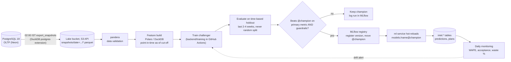
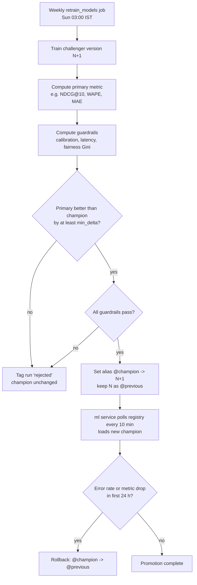
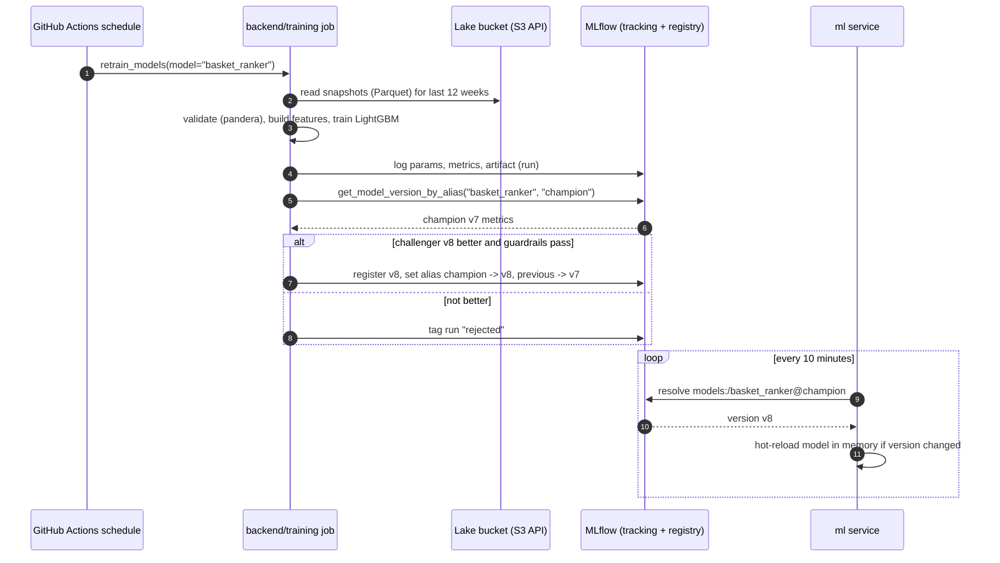
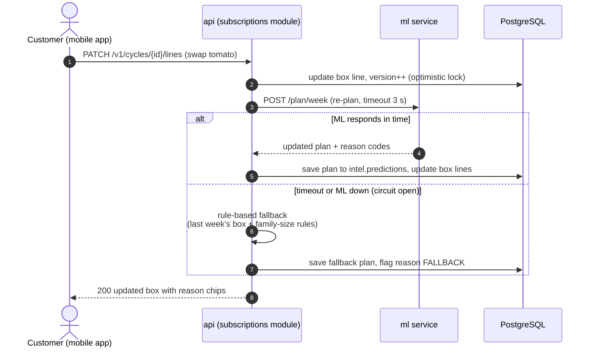

# Chapter 08 — AI and Machine Learning

> **In short:**
> - GharBasket's intelligence is mostly **statistics, tabular ML and optimisation solvers**. **No GPU is needed** for v1. Everything trains on CPU in seconds to minutes. On staging the ML service runs as a free Render web service without OSRM (ADR-0030, which replaced ADR-0025's Hugging Face Space), training runs in GitHub Actions and models live on R2 (ADR-0025); locally everything runs in Docker Compose and on laptops.
> - Rule: **solvers decide, statistics predict, LLMs talk.** The LLM never computes money or quantities.
> - Heavy AI runs in **batch** and writes into `intel.*` tables. Online calls have timeouts and **rule-based fallbacks**, so ML never blocks a customer.
> - Four algorithms form the research contribution (D7): **CP-SAT meal planner** and **pantry digital twin** (deepest), **fair kitchen assignment**, and **forecast + newsvendor procurement**.
> - The assistant model is chosen **after the Sprint 8 eval** (D13), comparing Claude Opus 5.5, Sonnet 5.5 and Haiku 4.5.

---

## 8.1 Where the AI is trained

| Model / engine | Type | Where it trains | How often | Typical time |
|---|---|---|---|---|
| M-A Pantry digital twin | Hierarchical Bayesian (NumPyro) + closed-form online updates | `backend/training` job in GitHub Actions (CPU); the online update runs in the API with plain arithmetic; development on laptops | Weekly full fit; online update after every delivery / feedback | 1–5 min |
| M-B Next-basket ranker | LightGBM LambdaRank | `backend/training` job in GitHub Actions (CPU) | Weekly | < 2 min |
| M-E Demand forecast | StatsForecast + LightGBM (native booster) + MinT reconciliation | `backend/training` job in GitHub Actions (CPU) | Nightly | < 5 min |
| Chronos-2 | Pretrained foundation model, **zero-shot** (no training) | Inference on CPU in a `backend/training` job in GitHub Actions (optional torch extra) | Nightly, only for hubs with < 8 weeks of data | seconds–minutes |
| M-C Meal planner, M-D Budget Lock, M-F Routing, M-G Kitchen assignment, kit selection | OR-Tools CP-SAT / Routing — **solvers, no training** | `ml` service at request/batch time | Per cycle / per slot | 1–30 s |
| M-I Churn + uplift | LightGBM + T-learner | `backend/training` job in GitHub Actions | Monthly | < 1 min |
| Embeddings (bge-m3) | Pretrained, no training | One-off batch on a laptop, or Google Colab / Kaggle free GPU; re-run on catalog change | On change | minutes |
| Assistant | Claude API — prompting + tool use, **no fine-tuning** | Anthropic API | — | — |
| (Optional, research) Chronos fine-tune | Fine-tune | Kaggle / Colab free GPU (T4/P100) | Once, for the paper | ~1 h |

Until there is a paid worker (the pilot), long ML jobs run in GitHub Actions (`backend/training`, D25) or offline, never inside an API request (D21, [ADR-0021](../adr/0021-jobs-without-a-broker.md)). The serving service (`backend/ml`; on staging a free Render web service, ADR-0030) is stateless and installs only solvers and inference libraries.

Experiments happen in **marimo** notebooks (stored as `.py`, so git diffs are clean) and are logged to a **local MLflow** (Docker Compose). The registry of record is simpler: models go to `s3://gb-mlflow/models/<name>/<version>/` on R2 with a `latest.json` pointer per model; promotion is a manual `just promote <model> <version>` in v1 (`backend/training/jobs/promote.py`) and nothing else moves the pointer: the weekly jobs only upload candidate versions (`<version>-<data_source>`) with their out-of-sample metrics. `promote` reads the registry the jobs write (`models/` in `gb-mlflow`, or `--out` with the same layout), refuses a version that is not there, and is a champion/challenger gate: a candidate that does not beat its baseline out of sample (the ranker: NDCG@10 above both baselines; the pantry priors: MAE below the rule table's) is refused unless `--force`, which the pointer records next to `previous`. Rolling back is the same command with the older version. Serving follows the pointer: the ML service on Render (ADR-0030) reads each served model's `latest.json` from R2 in the background every 10 minutes and downloads a newly promoted version before it serves it (`backend/ml/src/gharbasket_ml/model_sync.py`, read-only, M10 §3.7; ADR-0025); for the pantry priors, which M3 reads from `intel.pantry_priors`, `promote` first pushes the version's priors to the API (replacing the stored ones) and moves the pointer only once they are taken. Where the figures below say "MLflow registry", read "the R2 pointer".

---

## 8.2 Training pipeline (MLOps-lite)

*Figure 8.1 — ML data pipeline from the operational database to served models*

**Rules of the pipeline**
- **Data mix:** train on `synthetic + pilot + live` data (D8). **Report** metrics separately for `pilot`/`live` rows. This is the paper's honesty guarantee.
- **Point-in-time features:** features are computed *as of the cut-off time*, stored in `intel.feature_snapshots`, so future information never leaks into training.
- **Time-based splits only.** Random splits on time-series data overstate accuracy.
- **Monitoring:** a daily job compares forecast vs actual (WAPE), plan acceptance rate and waste %. Results appear on the console **AI health** page, with an alert when drift exceeds a threshold. *Built (5 Oct 2026, F25; alert 2 Nov 2026, C1):* `monitor_drift` (M10 §6) writes live WAPE per hub, delivery day and data source and acceptance per data source to `intel.model_metrics`, with a `drift` flag (more than 10 points worse than the same hub and source's backtest); `GET /v1/analytics/ai-health` (M12, admin) serves the table per hub; waste joins when M6 counts it. The alert is real and goes out once per episode: when a hub, data source and metric begins to drift (the previous scored day was not drifting) it is published as `intel.drift_detected`, and M11 pushes it to every admin with a link to the AI health page (M10 §3.10); the same page shows whether the ML service is up and which model versions it serves (`ml_service`), with the recovery steps in `docs/runbooks/ml-service-down.md`.

*Figure 8.2 — Champion/challenger promotion with rollback*

*Figure 8.3 — Training, evaluation, promotion and hot reload*

*Figure 8.4 — Online re-plan request with timeout and rule-based fallback*

**Hardening of the API-to-ML path (1 Nov 2026, M10 §3.9).** Staging's ML service sleeps after 15 idle minutes, wakes in about a minute and has 0.1 CPU (ADR-0030), so the gateway does not simply retry a call that cannot succeed:
- **Two timeouts and a budget.** A customer's call waits `ML_TIMEOUT_S` (3 s). A call from a scheduled job (the daily T-3 18:00 plan generation: `plan_week`, `rank_basket`, `pantry_quantities`) waits `ML_JOB_TIMEOUT_S` (30 s), and the planner's solver gets half of it, up to the planner's own 5 s limit. This is the answer to ADR-0030's note that the CP-SAT planner never fits in 3 s: the customer preview still falls back to the rules, the job's plans can be CP-SAT. A run spends at most `ML_JOB_BUDGET_S` (20 s) of ML time on those long calls; after that its remaining calls use the customer timeout and solver limit, so the run is not held up by a slow service (M10 §3.9 has the arithmetic and the pilot-scale follow-up). If a job call times out or cannot connect, the run's later ML calls (all paths) fall back without a request, so a cold start costs a run one 30 s wait.
- **Circuit breaker, one per ML path.** After `ML_BREAKER_THRESHOLD` (3) failed calls in a row to a path (a timeout, a connection error or a 5xx; a 4xx or a bad body is not one) the gateway stops calling that path for `ML_BREAKER_COOLDOWN_S` (60 s) and answers with the rule fallback at once (log `ml_fallback`, reason `circuit_open`; the stored prediction says `source: fallback`, as for any fallback). The paths are separate, so staging's preview planner, which always times out, does not stop the green-slot quotes. Then one call goes through as a probe: its success closes the breaker, its failure opens it for another cool-down. While its budget lasts, a job run may probe an open breaker once per cool-down, before the cool-down ends too; its other calls fall back at once. A job's success closes the breaker, so a job that wakes the service lets customers through again. The breaker is in memory, per API process.
- **The shared token** is required on staging and prod whenever `ML_SERVICE_URL` is set, and both services refuse one under 32 bytes. The deployed ML service serves no `/docs`, `/redoc` or `/openapi.json`.
- **Smoke.** `smoke-ml.yml` runs daily at 06:40 IST and by hand: health, models and one minimal request to each of the six solver endpoints.

---

## 8.3 Model specifications

### M-A Pantry digital twin (research, deepest)
- **Goal:** estimate each household's per-item consumption rate λ (kg/day) with uncertainty → predicted depletion date and "how much to put in the box".
- **Model:** λhi ~ Gamma(αc,i, βc,i), where *c* is the cohort (family size × diet × region).
  Observations: quantity purchased, corrected by feedback taps ("some got wasted", "ran out early"), over the interval between deliveries.
- **Online:** a Bayesian update after each delivery (instant, plain `math`): v0 was a conjugate Gamma–Poisson update; since 1 Nov 2026 (v0.2) the taps are interval-censored observations of a lognormal weekly use, on a grid (M10 §3.3).
- **Weekly:** NumPyro re-fits the cohort hyper-priors.
- **Cold start:** a new household starts at its cohort prior. We measure how many weeks until error drops below a threshold.
- **Metrics:** quantity MAE (kg), calibration of 80% intervals, "ran out / wasted" rate. Baseline: a family-size rule table.
- **Fallback:** rule table (family size → kg/week per category).
- **Status (7 Oct 2026, v0):** the conjugate update serves at `POST /pantry/quantities` with Negative Binomial predictive intervals (SciPy) and the same closed form in the gateway's fallback. v0 covers the perishable daily-use items only (milk, curd) and learns their daily-use share (delivered minus the week's recipe need); staples stay on the rule table until v1 models stock. M3 drafts from it only with `PANTRY_TWIN_ENABLED` on, which stays off until the eval target holds; the eval harness scores it on that scope next to the rule table and a running mean, with 80 % interval coverage (`just eval`). **v1 (8 Oct 2026):** the weekly NumPyro refit of the cohort priors (`refit_pantry`) learns from exactly what the twin observes (the daily-use share of milk and curd and the taps, through M3's own `daily_use_history`), per adult equivalent (M3 scales by the household) and per data source, with an out-of-sample card against the rule table; its priors reach M3 only through `just promote pantry_priors` (M10 §3.3 v1). On the simulator they do not beat the rule prior (the eval's reference arm), because the simulator draws daily use around the rule table itself; the pilot's data decides. **Stability (28 Oct 2026):** the sampler starts from the data (each household at its own mean, each cohort at its households' mean per adult equivalent), and `refit_pantry` rejects a chain whose mean acceptance is below 0.5 or whose parameters never moved; the rule table then stays, and the card says why. A frozen chain was seen only under amd64 emulation, but production had no check against it. **Learning fix (1 Nov 2026, v0.2):** the twin got worse with more weeks (eval MAE 0.204 → 0.227 after 1 → 4 weeks, coverage 0.98) because it read each box's daily-use share as the week's use, while that share is the app's own choice (rule table rounded up to a step: +8 % for milk, +38 % for curd on seed 7, uncorrelated with the household's real use) and the Poisson on step counts set the interval by the pack size. Now a box without a tap says nothing, a tap is an interval (ran out: more than the share; wasted: a quarter of the box left; just right: in between), the week's spread is lognormal (σ 0.1, chosen by coverage) and the rule prior weighs 0.25 weeks (chosen by MAE at that σ; both on seeds 23/29/31 only, by a rule corrected after the first, "lowest MAE", had picked 0.05 / 0.125 with coverage 0.55–0.59); the eval harness also subtracts a swapped meal's need, as M3 does, and past boxes are scaled to today's household. Two assumptions come from the simulator: "wasted" means a quarter of the box was left (the app's button says only "Wasted"), and households tap independently of what happened. Eval on the five seeds: 0.178, 0.161, 0.142, 0.139 after 1–4 weeks: the ≤ 15 % target holds on the mean, with a 95 % CI upper bound of 0.154, on a correctly specified simulator; coverage 0.77–0.80; a misread "wasted" costs 2–3 points (sensitivity in M10 §3.3). `PANTRY_TWIN_ENABLED` stays off until the owner decides. The v1 refit still fits the old observation (its learned arm 0.28–0.31); it moves to the same tap likelihood next. **v1 on the same likelihood (1 Nov 2026):** the NumPyro refit now fits the serving model itself (cohort typical use per adult equivalent and household spread, from the taps as intervals; `prior_weeks = σ_w² / s_c²`), and the promotion gate is the held-out taps' log-likelihood, pooled and per product × cohort (none may be worse than the rule table), instead of an MAE against the very box shares the fit learned from. A cohort whose taps are almost all one kind, or whose typical use the fit leaves uncertain, keeps the rule table: unchecked, large-cohort milk fitted +53 % above the table on one seed. The fit runs in float64; near the gate's threshold its decision can still differ between x86_64 and arm64, and then the cohort keeps the rule table with its reason. The learned-priors reference arm: 0.181, 0.163, 0.143, 0.140 after 1–4 weeks (was 0.310 → 0.300), level with the rule prior on the simulator, whose households are drawn around the rule table.

### M-B Next-basket candidate ranker
- **Candidates:** TIFU-KNN personal and neighbour repeat items ∪ meal-plan ingredients ∪ seasonal/festival items.
- **Features:** recency, frequency, last accept/reject, price delta vs 4-week average, season, festival flag, cohort popularity, substitution-acceptance history.
- **Model:** LightGBM LambdaRank. Label = kept in final box vs removed.
- **Metrics:** Recall@10, NDCG@10, box acceptance rate, edits per box. Baselines: "repeat last week", top-frequency.
- **Status (5 Oct 2026, v0; leakage fixes 8 Oct):** `train_ranker` in `backend/training` (LambdaRank on approved and locked boxes and their edits, one model per data source, leave-last-basket-out against both baselines, model and card to the registry, promotion manual) and `POST /basket/rank` on the ML service with a frequency fallback and a 10-minute reload (M10 §3.7). v0 features are computed as of the cut-off: prices from the price list, not the final box; `drafted_rule` is dropped until a draft snapshot exists. Recall is reported as Recall@|basket| beside Recall@10 (eval protocol §7). SHAP explanations are built (§8.4); the planner's preference term is v1.

### M-C Meal planner — CP-SAT (research, deepest; core of Kitchen Autopilot)
- **Variables:** `x[d,s,r]` ∈ {0,1} (day, meal slot, recipe); `t[d,s]` = tiffin on no-cook slots.
- **Hard constraints:**
  - exactly one choice per slot;
  - fasting / Jain / diabetic rules from the household and `catalog.festival_calendar`;
  - weekday cook-time ≤ household limit;
  - no recipe repeated within *k* days;
  - budget: Σ ingredient cost ≤ weekly budget (from Budget Lock when active).
- **Objective (soft):**
  - maximise preference score (from M-B and feedback);
  - closeness to nutrition targets per member;
  - **ingredient-reuse bonus** (shared perishables across meals → less waste);
  - variety bonus;
  - penalty on price-spiked items.
- **Output:** plan → aggregated ingredients × M-A quantities → `subscriptions.box_lines` with `reason_code`. Busy days → kit suggestions.
- **Performance:** at most 5 s per household (`time_limit_s`, 1 s by default for the whole request; the gateway caps it at half the call's timeout: 3 s for a customer's preview, `ML_JOB_TIMEOUT_S` (30 s) for the generation job, so the solver gets its 5 s there); v1 warm-starts from a v0 plan (M10 §3.2); the weekly batch runs in parallel across CPU cores.
- **Spike S-4 (4 Oct 2026, passed):** optimal week plans in 10 to 50 ms for the seed households, and 0.07 s with 126 recipes. When strict households (e.g. diabetic with 20-minute meals, or Jain during Navratri) leave too few dishes, the planner relaxes comfort rules only (repeats, then cook time, then budget), never diet, Jain, diabetic or fasting rules. See [S-4 note](../spikes/S-4-meal-plan.md).
- **Metrics:** constraint satisfaction 100%, nutrition adherence, variety index, ingredient-reuse ratio, plan acceptance. Baselines: random valid plan, greedy.
- **Status (5 Oct 2026, v1):** the nutrition term (ICMR-NIN targets per member, days within ±20 % of kcal and protein), the price-spike penalty from `intel.price_index`, sides paired per meal and reason codes are served; M3 sends members, nutrition and spikes. First five-seed numbers (eval harness v0, v0 objective): acceptance 0.80, 3.7 distinct perishables a week against 6.2 greedy and 11.3 random, no hard-rule violation. Pre-registered M-C primary target (acceptance above greedy) does not hold in the v0 eval (cpsat − greedy −0.031 ± 0.009); reported as a finding, no tuning (decided 8 Oct 2026).

### M-D Budget Lock optimiser
- The M-C model with the monthly Budget Lock as a hard constraint, plus a substitution penalty using `catalog.substitutions`.
- Produces explanation chips such as `PRICE_SWAP{from: tomato, to: lauki, pct: 62}`.

### M-E Demand forecast + newsvendor procurement (research)
- **Insight:** committed demand is known exactly at cut-off. We forecast only the **uncommitted** part (add-ons, tiffin walk-ins, new households), per hub × item × day.
- **Models:**
  - StatsForecast AutoETS, CrostonOptimized / TSB / ADIDA for intermittent items, with conformal prediction intervals;
  - a global LightGBM (native booster, one booster per step) with festival, weekday, price and weather features;
  - Chronos-2 zero-shot for hubs with < 8 weeks of data;
  - HierarchicalForecast MinT reconciliation (item → category → hub).
- **Procurement:** `order_qty = committed + Q_τ(uncommitted)`, where τ = Cu / (Cu + Co).
  Co = cost − salvage value from the surplus cascade. Shelf life caps the buffer.
- **Metrics:** WAPE, MASE, pinball loss; downstream waste kg per 100 kg sold, stock-out %. Baselines: seasonal naive, "buy last week".
- **Status (8 Oct 2026, v0 + v1 LightGBM):** the `forecast` job in `backend/training` (StatsForecast AutoETS / Croston / SeasonalNaive / Naive and a global LightGBM, direct multi-step with one booster per step and festival, fast-day and as-of-origin price-index features, a rolling-origin backtest with weekly origins and a 2-week horizon, scaled split-conformal q_tau, newsvendor `order_qty`) stores a hub's lines per delivery day in `intel.predictions` and announces them with `intel.forecast_ready`; M6 reads them through `intel_gateway.api.hub_forecast(hub, delivery_date)`. WAPE, q_tau coverage, pinball and MASE per model go to `intel.model_metrics` per data source (M10 §3.6). The simulator draws no uncommitted orders, so the eval harness derives them (add-ons from pantry shortfalls, tiffins on no-cook slots; RQ3, 28 Oct 2026, M10 §3.6): over five seeds LightGBM's WAPE is 0.015 ± 0.008 worse than v0's best model and the champion stays a v0 model on every seed; its newsvendor cost was 0.021 ± 0.052 lower (not significant) under the unweighted margin; since the 2 Nov calibration fix it is 0.010 ± 0.005 higher (LightGBM is significantly costlier, 0.081 against 0.071). The demand is synthetic, so this is not a pilot claim; the RQ3 table is in the reports in `docs/eval`. **M-E verdict (2 Nov 2026):** seasonal naive and "buy last week" are now RQ3 arms (same backtest, same conformal q_tau), paired with the champion by seed. **The M-E target does not hold**: the champion's WAPE is 0.188 ± 0.007 (≤ 25 %: holds), but only 0.033 ± 0.013 better than seasonal naive (CI lower bound 0.020, at most 0.045 on any seed; target 0.10). Reported beside the target, not part of it: its newsvendor cost (0.146) is higher than both baselines' (0.088, 0.091), because the conformal margin is an unweighted quantile of scaled residuals: on sparse add-on series it is strongly negative for the smooth champion (q_tau stocks out 45 % of the units) and ≈ 0 for the baselines, which repeat past values; the cost-optimal margin is a scale-weighted quantile. **Calibration fix (2 Nov 2026):** the job and the backtest now use the scale-weighted tau-quantile (eval protocol §7, second 2026-11-02 entry; no target, tau or cost changed): the champion's newsvendor cost falls from 0.146 to 0.071 ± 0.001, below seasonal naive (0.086; paired −0.015 ± 0.006, every seed) and naive (0.091), with stock-out 13 % and waste 6 %; WAPE, and so the M-E target's failure on the gap to seasonal naive, are unchanged. Stock-out and waste are reported, not judged: the registered "stock-out ≤ 3 %" contradicts the registered costs (tau = 0.375 puts q_tau below the median), and the owner kept the costs (eval protocol §7, 2026-11-02). Splitting the weekly forecast over delivery days by weekday shares gives a daily WAPE of about 0.50 for every model (0.44 for the split of the actual week alone), so at the day level the split dominates (M10 §3.6).

### M-F Routing (OR-Tools)
- **Problem:** capacitated vehicle routing with time windows and pickups/deliveries.
  - Capacity in kg and crates; society time windows; service time per stop.
  - Donation and crate pickups on the return leg (same-vehicle constraint).
- **Data:** distance/time matrix from self-hosted **OSRM** (Mumbai Metropolitan Region extract).
- **Solver:** guided local search within the request's `time_limit_s` for both waves together (default 10 s, at most 20 s); OSRM gets 2.5 s before haversine prices the slot instead, and the gateway waits `time_limit_s` + 6 s.
- **Metrics:** ₹ per order, km per order, on-time %. Baselines: one trip per order, nearest-neighbour.
- **Status (5 Oct 2026, v0):** `POST /route/solve` serves the two-wave CVRPTW from S-3 with the independent checker, OSRM from the full image (`backend/ml/Dockerfile`; staging runs without OSRM, ADR-0030, so it prices with haversine; haversine also when OSRM is down or slow, nearest neighbour within the fleet when no plan is found); `intel_gateway.api.solve_routes` records the plan for the hub and returns None when the service is down, so M7 keeps the previous day's sequence. M7's tables and endpoints come with the M7 product PR (January).
- **Evaluation (2 Nov 2026):** the eval harness has an M-F arm (`eval/routing.py`, `just eval`; `--no-routing` skips it). Per protocol seed it builds a delivery morning in S-3's layout on haversine distances (staging has no OSRM) as M7 sends it (20 s for both waves), and scores production's `plan()` and `nearest_neighbour()` with the same `check()`. Over the 5 seeds, at 50 societies (the headline) the plan costs ₹6.05 an order against ₹8.54, a paired −29 % ± 6 %, 100 % on time against 95.6 %, with 7 vans against 9.6. **The M-F target holds** (on-time CI lower bound ≥ 95 %, paired cost CI upper bound ≤ −10 %); it also holds at 100 and 200 societies (−37 %, −40 %, opt-in) and at a fifth of the budget (2 s a wave, −27 %). The guardrail is judged on the setting, 10 s a wave, since the solver always spends it. The saving is rider time (about 56 %) and the van fee (44 %), not km: nearest neighbour mixes the two windows on a trip, so its vans wait. The reviewer's sensitivity runs keep it against a wave-aware nearest neighbour (−23 %), without the van fee (−15 %) and with the seed world's hub (−23 %). Plans vary run to run (wall-time limit). Synthetic and haversine on S-3's hub, not a road or pilot figure (eval protocol §7, 2026-11-02; M10 §3.4 has the table).
- **Spike S-3 (4 Oct 2026, passed):** 50 societies are routed in under 5 s, all on time, at ₹6.87 an order against ₹7.93 for nearest neighbour and ₹76.57 for one trip per order. Vans do **two trips** by solving one window wave at a time (07–09, then 08–10, with vans carried over). That cuts the fleet by 40–45 % at 50 to 200 societies, while a single chained model stops scaling after about 50. See [S-3 note](../spikes/S-3-routing.md).

### M-G Fair kitchen assignment (research)
- **Problem:** CP-SAT assignment of tiffin portions to home kitchens.
  - Constraints: capacity, menu skills, rating floor, distance ≤ X km.
- **Objective:** minimise distance + quality penalty + **λ × earnings inequality**. The inequality term is the maximum deviation from the fair share over a rolling 4 weeks (a linear proxy for the Gini coefficient).
- **Metrics:** Gini of weekly partner earnings, cost per portion, rating. Compared with a greedy nearest-kitchen baseline. A λ-sweep produces a Pareto curve (paper figure).
- **Status (5 Oct 2026, v0):** `POST /assign/kitchens` serves the CP-SAT model with the λ term and greedy nearest as baseline and fallback; the gateway records the plan per hub. The λ sweep is in the eval harness (`just eval`, RQ4 table): per seed one simulated week of 7 evenings with each kitchen's earnings carried forward from 0, greedy and every λ paired by seed, and the target judged on 95 % CI upper bounds (eval protocol §7, 8 Oct); M8's tables and job come with the January product PR. λ is in paise per portion of imbalance among the kitchens that can cook tonight; orders no kitchen can take come back in `unassigned` with `status: partial` (M10 §3.5). **Update (1 Nov 2026):** the harness now lives production's evenings (5 weeks per seed, the preferred cook first through `matching.preferred_first`, 28-day rolling earnings, 5 km, the last week scored; eval protocol §7, 2026-11-01) over a refined grid (§5's plus 400–1200). On the 5 seeds the **M-G target does not hold at any λ**, under any of the preference models tried: on the default one greedy's weekly Gini is 0.37 ± 0.09 and the CP-SAT Gini levels off near 0.28 (the preferred cooks take 74 % of the portions first; the lowest Gini upper bound is 0.38). The mean-cost budget rule fixed before the sweep picks 900, but its answer moves between 500 and 1200 with the preference model and 900's gain over 600 is not significant (one seed), so production runs **λ = 600** (Gini 0.32 ± 0.08 at +2.6 % ± 2.2 % cost against greedy), a disclosed departure from the rule (eval protocol §7, 2026-11-01), in `PARTNERS_FAIRNESS_LAMBDA` and the ML and gateway defaults; revisit with pilot data (M10 §3.5 has both tables).

### M-H Slot pricing ("green slots")
- The marginal insertion cost of an address into existing tentative routes → slot discount ranking.
- Shown in the app as: "Neighbours already get delivery Tue 8–10, save ₹15".
- **Contract (drafted 28 Oct 2026, M10 §3.8; Tier 3, MS-D):**
  - **The address is the society's point.** A van stop is a society and slot (M7), so the household's choice is the time slot of this week's box on its delivery date.
  - **The tentative routes** are what M7's fallback would publish now over the boxes expected that day, since the real plan is solved at T-1 23:15, after the cut-off.
  - **`POST /slots/price`** does cheapest feasible insertion on the OSRM matrix, replayed by the routing checker. It returns route cost only, with reason codes `SAME_SOCIETY`, `NEIGHBOUR_STOP`, `NEW_STOP`, `NEW_TRIP` and `INFEASIBLE`, and never a price.
  - **Fallback:** twice the distance to the nearest stop in the slot.
  - **The saving** is computed by M3: half the route saving, at most ₹15 (hub settings), in whole rupees and never below 0. It applies only where moving removes a stop that exists for that household alone. M4 records it as `discount_paise` at approval, honoured from a 15-minute quote.
  - **M9** uses the same cost, for a whole society, against the past week's published plans as its unlock-threshold stop cost.
  - **Built (28 Oct 2026, three PRs):** the ML endpoint, the gateway with its rule fallback, and M3's `POST /v1/cycles/{id}/slot-quotes` and `PUT /v1/cycles/{id}/slot`. The two M3 endpoints are behind `GREEN_SLOTS_ENABLED`, which is off by default (404). The deviations are listed in M10 §3.8's "As built".
- **Metric:** top-1 slot agreement and Spearman ρ of the insertion estimate against the CVRPTW re-solve difference (with − without), on S-3's synthetic mornings. The rule fallback is the baseline.

### M-I Churn and uplift
- Survival-style features → LightGBM churn probability.
- T-learner uplift on simulated retention offers. An offer is shown only where uplift > 0.

### M-J Trust and safety
- Rules + Isolation Forest on refund and donation-credit patterns.
- Complaint photo triage with a vision-capable LLM, in batch; auto-credit under a ₹ threshold, otherwise human review.

---

## 8.4 Explainability

- Every AI output stores a `reason_code` plus parameters, for example `SEASONAL`, `PRICE_SWAP{from:tomato,pct:62}`, `PANTRY_LOW{days:2}`, `FESTIVAL{code:navratri}`.
- The app renders **localised chips** from these codes (`en-IN`, `hi-IN`, `mr-IN`), not LLM-written text. Explanations are therefore deterministic and testable.
- For ranker decisions, the top SHAP features are stored for paper analysis. As built (28 Oct 2026): the ranker's weekly run stores `explanations.json` (mean |SHAP| per feature and 50 sampled decisions with their top three features) next to the model in the registry, the eval report shows it, and `POST /basket/rank` returns `top_features` per ranked item (M10 §3.7). The API does not yet pass them on or store them in `intel.predictions`.

---

## 8.5 Evaluation protocol (`backend/training/src/gharbasket_training/eval/`)

| Algorithm | Protocol | Primary metric | Baselines |
|---|---|---|---|
| Pantry twin (M-A) | Weekly rolling evaluation against simulator ground truth and pilot feedback | Quantity MAE, 80% interval coverage | Family-size rule table |
| Ranker (M-B) | Leave-last-basket-out | NDCG@10, acceptance rate | Repeat last week, top-frequency |
| Meal planner (M-C) | Simulator A/B: Autopilot plan vs baseline plan | Acceptance, nutrition adherence, ingredient reuse | Random valid, greedy |
| Forecast + procurement (M-E) | Rolling-origin backtest | WAPE, MASE, pinball; waste %, stock-out % | Seasonal naive, buy-last-week |
| Routing (M-F) | Fixed-seed benchmark set | ₹/order, km/order, on-time % | One trip per order, nearest-neighbour |
| Fair assignment (M-G) | λ-sweep on simulated weeks | Gini vs cost Pareto curve | Greedy nearest kitchen |
| Slot pricing (M-H, Tier 3) | S-3 synthetic mornings, 20 candidates per instance, 5 seeds | Top-1 slot agreement, Spearman ρ, ₹ MAE vs re-solve difference | Nearest-stop rule (the fallback) |

`just eval` runs every protocol and writes a report to `docs/eval/<date>-<commit>` (HTML and JSON) and rows to `intel.model_metrics`, each with the simulator version and the sha256 of the cohorts file and the seed catalog. v0 reports are HTML tables: the planner arms against each baseline as per-seed paired differences (mean ± 95 % t-CI, acceptance first) and hard rules re-checked with `planner.check()`; the paper-ready marimo figures come later. Figures are versioned with the model version that produced them.

**Pre-registered targets (hypotheses, 4 Oct 2026; the full protocol, seeds, ablations and change log are in [`docs/research/eval-protocol.md`](../research/eval-protocol.md)):**

| Algorithm | Target | Guardrails |
|---|---|---|
| M-A pantry twin | quantity MAE ≤ 15 % of weekly quantity after 4 weeks (rule table ≈ 30 %); cold start < 4 weeks | 80 % interval coverage in 75–85 % |
| M-B basket ranker | NDCG@10 ≥ repeat-last-week + 0.05; ~~Recall@10 ≥ 0.6~~ *(superseded: Recall@\|basket\|, no numeric target; eval protocol §4 and §7, 2026-10-08)* | edits per box; calibration |
| M-C meal planner | simulator acceptance ≥ 70 %; score ≥ +30 % vs greedy; ≥ 25 % fewer distinct perishables | 100 % hard constraints; ≤ 5 s |
| M-E forecast + newsvendor | WAPE ≤ 25 %, ≥ 10 points better than seasonal naive; stock-out ≤ 3 %; waste ≤ 5 % (stock-out and waste reported, not judged; the newsvendor cost against both baselines reported beside it: eval protocol §7, 2026-11-02) | MASE; pinball loss |
| M-F routing | on-time ≥ 95 %; ₹/order ≥ 10 % below nearest neighbour | ≤ 10 s per wave |
| M-G kitchen assignment | Gini ≤ 0.25 at ≤ +5 % cost vs greedy | rating floor kept |
| M-H slot pricing (hypothesis, 28 Oct 2026) | top-1 agreement ≥ 80 %; Spearman ρ ≥ 0.7; both above the nearest-stop rule | ≤ 0.5 s per customer quote (100 stops × 6 slots) |
| M13 assistant | intent accuracy ≥ 90 %; slot F1 ≥ 0.85; ≤ $0.01 per turn | no unauthorised action on injection fixtures |
| M-C planner v2 (liking from M-B) | acceptance ≥ v1's on the same seeds (hypothesis, 5 Oct 2026) | hard rules 100 %, perishables no worse than v1 + 1 |
| Monitoring | alert when WAPE worsens by > 10 points against the last report | — |

Every experiment runs on at least 5 simulator seeds and reports mean ± 95 % CI; synthetic and pilot results are always separate tables.

---

## 8.6 LLM usage

### Assistant "Ghar Saathi" (text MVP, D5)

**Built 5 Oct 2026 (F23/F24):** the loop in `backend/ml/src/gharbasket_ml/assistant.py` (`POST /assistant/turn`, four tools, strict schemas, caching, refusal fallback, four tool rounds a turn), the API module `assistant` (sessions, scrubbed messages, 15-minute proposals, `usage_daily` cap, `expire_proposals`), and `just eval-assistant` (intent accuracy, slot F1, the injection rule, cost a turn) on `data/eval/assistant_utterances.jsonl`. The ML service needs the secret `ANTHROPIC_API_KEY` (not set on staging, ADR-0030); without it the API answers with a fixed fallback reply (`source: fallback`).
- Built with the Anthropic Python SDK. **The ML service never calls our API** (decided 8 Oct 2026, M13 §3): the API sends the scrubbed conversation and a trimmed week (no household or user id, name, address or token), the read tools answer from that week, and the write tools come back as intents that the API resolves into proposals:
  - `get_my_week`, `edit_box_line`, `skip_week`, `explain_item` (S8); `book_tiffin`, `track_order` later.
- Tools use `strict: true` schemas (no numeric bounds; ranges are in the descriptions and the API checks them) with `tool_choice: auto` (current Claude models reject forced tool choice); low effort, thinking blocks echoed unchanged between tool rounds.
- Every write returns a **proposed change** that the user must confirm in the UI; the LLM never commits changes on its own.
- **Prompt caching** on the system prompt and tool definitions.
- **Guardrails:**
  - per-user daily token cap;
  - the server-side refusal fallback (`fallbacks: "default"`), then a canned reply;
  - conversation logs stored with PII scrubbed, by the API, before anything leaves it.
- **Eval set:** 200 labelled Hinglish / Marathi / English utterances, written by Rhythm Thakur and Manish Raje. Metrics: intent accuracy and slot-filling F1.

### Model choice and cost (decided after the S8 eval, D13)

Anthropic list prices, per 1M tokens (input / output):

| Model | Price | Estimated cost per turn* | 50 demo users | 500 pilot users |
|---|---|---|---|---|
| Claude Opus 5.5 (`claude-opus-5-5`) | $4 / $20 | ~$0.015 | ~$15 / week | ~$150 / week |
| Claude Sonnet 5.5 (`claude-sonnet-5-5`) | $2 / $10 | ~$0.008 | ~$8 / week | ~$75 / week |
| Claude Haiku 4.5 (`claude-haiku-4-5`) | $1 / $5 | ~$0.004 | ~$4 / week | ~$40 / week |

\*Assumptions: about 6k input tokens per turn (mostly cached tools and system prompt) and about 400 output tokens; 5 chats per user per week × 4 turns. Real usage is measured in Sprint 8.

**Process:** build against Claude Opus 5.5 first. Run the 200-utterance eval on all three models. Choose on accuracy versus cost.

### Other LLM jobs (batch)
- Complaint-photo triage (M-J).
- Drafting Hindi/Marathi catalog and recipe text. This text is **always human-reviewed** by Rhythm Thakur and Manish Raje before publishing.

---

## 8.7 Roadmap and tiers (4 Oct 2026)

One person builds every model next to the backend, so the work is tiered. A product PR on the current milestone path always goes before an ML PR.

| Tier | Meaning | Items |
|---|---|---|
| 1 | Needed for a milestone demo (MS-A 13 Dec, MS-B 24 Jan, MS-C 21 Feb) | jobs runner and outbox consumers; `intel.*` tables; Agmarknet collector (history only accrues from the day collection starts); IFCT nutrition; verified festival calendar; ≥ 120 recipes; simulator v1; eval harness v0; pantry twin v0; planner v1; snapshots; the ML service; forecast v0 (StatsForecast + newsvendor); `/route/solve`; greedy kitchen assignment; the assistant with four tools; thin AI health |
| 2 | Needed for the paper (S7–S8) | pantry twin v1 (NumPyro); basket ranker + SHAP; fair assignment λ sweep; planner v2; forecast v1 (LightGBM, native booster; mlforecast needs pandas < 3) — built (#122, M10 §3.6) |
| 3 | Stretch: only after MS-C or if ahead | Chronos-2 zero-shot; MinT reconciliation; bge-m3 embeddings and learned substitutes; Instacart benchmark; M-I churn and uplift; kits on busy days; slot pricing (S9; built, behind `GREEN_SLOTS_ENABLED`, off by default); Dakshina spellings |
| cut | — | M-J trust and safety (a rules-only refund flag in M12, later) |

**Status (5 Oct 2026):** done — jobs runner and outbox consumers, `intel.*` tables, the Agmarknet collector, IFCT nutrition, the generated festival calendar (verification pending), 120 recipes, simulator v1 (box, pantry, price shocks, `--write-db` through M3–M5), eval harness v0 (`just eval`, reports in `docs/eval`). **Update (28 Oct 2026):** the rest of tiers 1 and 2 is built too, except the festival calendar's verification (each model's status line above has its date), and so is slot pricing, which is off by default. Reports: `docs/eval` (the latest is `2026-10-28-77bf7d87`).

Data sources (all free; fetch dates recorded with every run): IFCT 2017 and ICMR-NIN RDA 2020 (nutrition); data.gov.in daily mandi prices plus the India Data Portal 2019–2025 history (Vashi APMC); Open-Meteo (weather); the `kalagana` panchang (fasts); NSSO HCES 2022–23 (simulator realism); OpenStreetMap (roads).

## 8.8 Ownership

| Item | Owner |
|---|---|
| `backend/ml`, models M-A…M-J, eval harness, MLflow | Prathamesh Relekar |
| Autopilot UX: reason chips, thali calendar, assistant UI | Yash Salunkhe |
| Assistant eval set, translation review, paper writing support | Rhythm Thakur, Manish Raje |
| Review and test of every ML/AI PR before merge (§11.3) | Claude Opus agent; findings settled by the PR owner |

---

## Decisions & open questions

- **D3** — Python-only backend; separate ML service ([ADR-0003](../adr/0003-python-fastapi-backend-and-ml-service.md) in [`docs/adr/`](../adr/)).
- **D5** — Assistant is a text MVP; voice is a stretch goal ([ADR-0005](../adr/0005-text-assistant-mvp-voice-stretch.md)).
- **D7** — Research covers all four algorithms; meal planner and pantry twin are deepest ([ADR-0007](../adr/0007-research-scope-four-algorithms.md)).
- **D8** — Simulator first; `data_source` tagging ([ADR-0008](../adr/0008-simulator-first-data-source-tagging.md)).
- **D13** — Assistant model chosen after the S8 eval ([ADR-0013](../adr/0013-assistant-model-chosen-by-eval.md)).
- **D21** — Jobs without a broker until the pilot; long ML jobs never run inside an API request ([ADR-0021](../adr/0021-jobs-without-a-broker.md)); D25 puts them in GitHub Actions (`backend/training`).
- **D25** — ML runtime: GitHub Actions for training, R2 for the lake and registry, cron-job.org for minute-level jobs ([ADR-0025](../adr/0025-ml-runtime-spaces-actions-r2.md)); its serving host, a Hugging Face Space, is replaced by a free Render web service without OSRM (D30, [ADR-0030](../adr/0030-ml-service-on-render-free.md)).
- **Open:** confirm bge-m3 CPU embedding speed in the S7 spike; decide whether to attempt the optional Chronos fine-tune for the paper.

Related: [Chapter 05 — Data architecture](05-data-architecture.md) · [Chapter 07 — Workflows](07-workflows.md) · [Chapter 10 — API and integration](10-api-and-integration.md) · Module specs M10 and M13 in [`docs/modules/`](../modules/)
