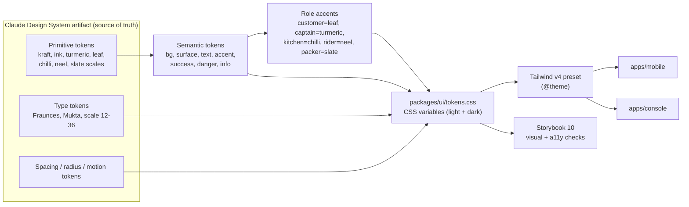
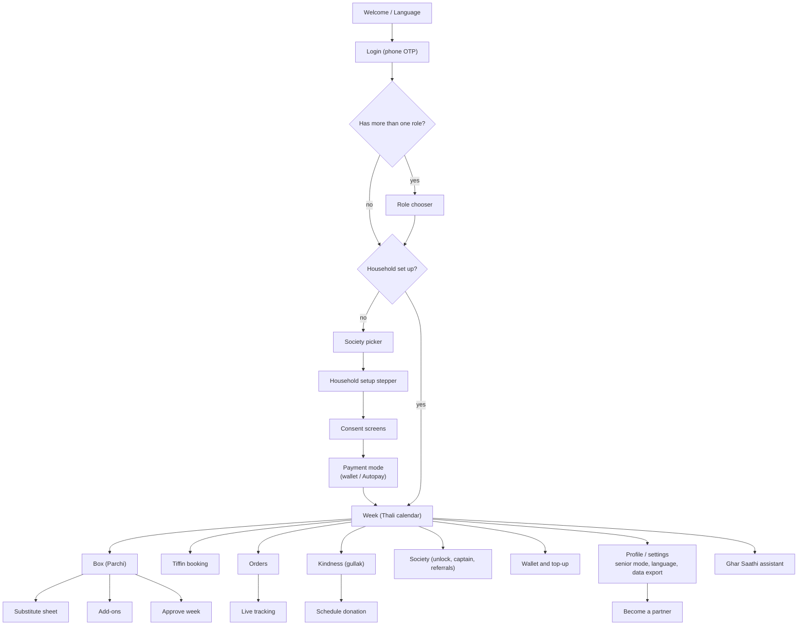
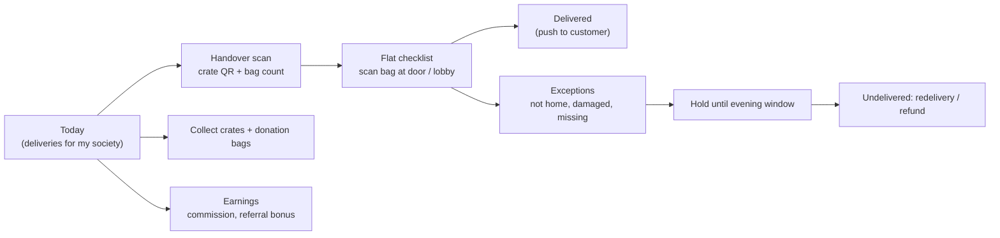
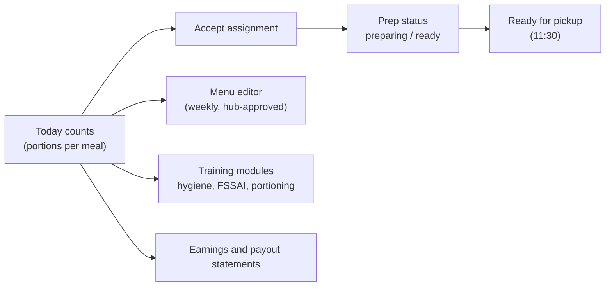
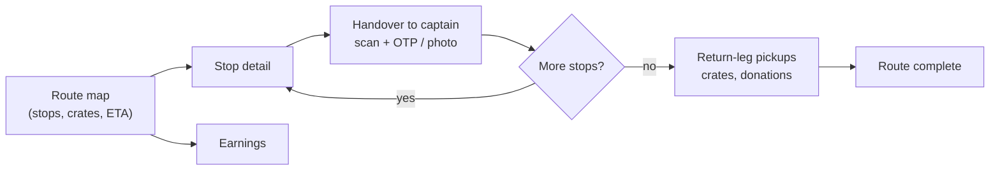
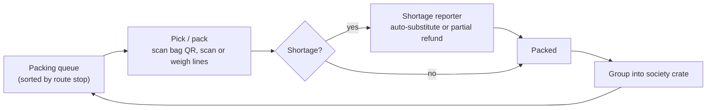
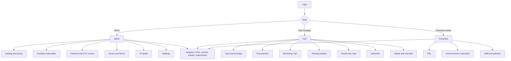
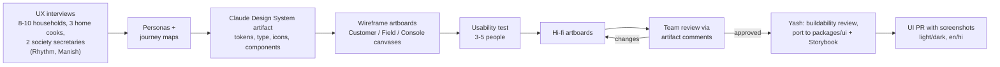

# Chapter 09 — Frontend and Design

> **In short:**
> - **One TypeScript/React codebase:** a Vite + React mobile app (PWA + Capacitor 8, Android) for field roles, and a Next.js 16 console for admin/hub/franchise users (D2, D12).
> - The look is **"Indian kitchen, editorial"**: kraft paper, turmeric, curry-leaf, handwritten parchi, thali calendar. It deliberately avoids the generic "AI-generated" look.
> - All UI design happens in **Claude Design** (D16): one GharBasket Design System artifact plus canvases for Customer, Field roles and Console. Done in **Phase 0, before code** (D17).
> - The component library lives in `packages/ui`, built on **React Aria Components**, styled with our tokens, and documented in **Storybook 10**.
> - Accessibility and language are first-class: WCAG 2.2 AA, senior mode, `en-IN` / `hi-IN` / `mr-IN`.

---

## 9.1 Design principles

1. **Plan-first, not shop-first.** Home shows "your family's week", not a catalog grid.
2. **Indian kitchen warmth.** Kraft paper, turmeric, the handwritten *parchi* and the *thali* feel familiar, not like a tech startup.
3. **Trust through transparency.** Every AI choice carries a reason chip. Every tiffin shows who cooked it ("Know your cook").
4. **Inclusive by default.** The app works for a 68-year-old Marathi speaker and a 27-year-old gym-goer: senior mode, large targets, voice later.
5. **Field roles are tools, not apps.** Captain, rider and packer screens are scan-first, one-handed, offline-tolerant, with big buttons and haptic feedback.

## 9.2 Brand

- **Logotype:** bilingual wordmark **"घरBasket"**. "घर" is set in Mukta Bold and "Basket" in Fraunces. The icon is a basket formed by a handwritten tick (the "approve" gesture). Drafted on the Claude Design canvas with explicit art direction.
- **Voice:** warm, neighbourly Hinglish/Marathi; never pushy or salesy.
  - Good: "Aapka hafte ka khana ready hai — ek baar dekh lijiye."
  - Avoid: loud "huge deals" banners and emoji spam.
- **Taglines:** "Ghar ka khana, bina tension." / "Your kitchen, planned."

## 9.3 Colour system

| Token | Hex | Use |
|---|---|---|
| `kraft-50` / `kraft-100` | `#FBF7F0` / `#F3EBDD` | App background, cards |
| `ink-900` / `ink-700` / `ink-500` | `#1E1B16` / `#4A443B` / `#7A7266` | Text hierarchy |
| `turmeric-500` | `#E8A33D` | Primary accent, highlights |
| `leaf-700` | `#2F5D3A` | Primary actions, success |
| `chilli-600` | `#C8442B` | Errors, price-spike warnings |
| `neel-600` | `#2E4A7D` | Info, links (Indian indigo) |
| `slate-500` | `#5E6B73` | Neutral UI |

**Role accents.** A thin top bar and the tab-icon tint show which role is active. This matters because one person can hold several roles (e.g. Meena is both customer and captain).

| Role | Accent |
|---|---|
| Customer | leaf |
| Society Captain | turmeric |
| Kitchen partner | chilli |
| Rider | neel |
| Packer | slate |

**Dark mode:** warm charcoal surfaces `#1A1714`, accents desaturated about 10%. All colour pairs are checked for WCAG AA contrast.

*Figure 9.1 — Design-token map: from the Claude Design System to both apps*

## 9.4 Typography

- **Fraunces** (variable; "SOFT" axis for friendly curves) for display headings and hero numbers.
- **Mukta** for all UI text. Latin and Devanagari are designed together, so Hindi and Marathi never look like a fallback font.
- Prices use `font-variant-numeric: tabular-nums`.
- Scale (px): 12 · 14 · 16 (body) · 18 · 22 · 28 · 36. **Senior mode** adds two steps and uses line-height 1.6 for Devanagari.
- Fonts are self-hosted via **Fontsource**, so they work offline inside Capacitor (no runtime Google Fonts call). Subset to Latin + Devanagari.

## 9.5 Iconography, illustration and imagery

- **Phosphor Icons** (`@phosphor-icons/react`): `regular` weight for UI, `duotone` for category tiles (turmeric/leaf second tone). Chosen over Lucide, which is the default in most AI-generated interfaces.
- **Custom GharBasket icon set (~40 SVGs)** on the same 1.5 px stroke grid: sabzi types, thali, tiffin dabba, kadai, gullak, crate, society tower, captain badge, weighing scale. Drafted on the Claude Design canvas, exported as SVG, imported as React components with `vite-plugin-svgr`.
- **No emoji as icons** in product UI.
- **Photography:** real produce shot by the team (natural light, kraft-paper backdrop, top-down) for a consistent catalog. Real partner portraits **with written consent**.
- **Spot illustrations** (onboarding, empty states): hand-drawn ink line + turmeric fill. **Not allowed:** unDraw, Storyset, 3D blobs, AI-generated stock art.
- **Image delivery:** AVIF/WebP from S3 via resize-on-upload thumbnails; **thumbhash** placeholders for smooth loading.

## 9.6 Motion

- Purposeful, ≤ 250 ms, spring-based; honours `prefers-reduced-motion`.
- **Motion** (formerly framer-motion) for layout transitions, e.g. an item being swapped in the parchi. **View Transitions** for page navigation (TanStack Router `viewTransition`).
- **NumberFlow** for money and counters: wallet balance, bill total, society unlock progress, Kindness points.
- **Rive** for exactly three brand moments: the gullak filling when Kindness points arrive, the basket "packing" loader, and the society-unlock celebration.
- Haptics (Capacitor) on scan success/failure and on approve.

## 9.7 Navigation and screen flows

| Role | Bottom tabs | Extras |
|---|---|---|
| Customer | Week · Box · Orders · Kindness · Profile | Floating "Ghar Saathi" assistant button |
| Society Captain | Today · Scan · Flats · Earnings | Offline queue indicator |
| Kitchen partner | Today · Menu · Prep · Earnings | Training modules |
| Rider | Route · Stop · Pickups · Earnings | Background location while on route |
| Packer | Queue · Pick/Pack · Shortages | Scanner-first |

Editing uses **bottom sheets** (Vaul) with snap points instead of full-page forms. The console uses a left sidebar (Admin / Hub / Franchise / Analytics groups), a top bar with a hub switcher, and a ⌘K command palette (cmdk).

*Figure 9.2 — Customer screen flow*

*Figure 9.3 — Society Captain screen flow*

*Figure 9.4 — Kitchen partner screen flow*

*Figure 9.5 — Rider screen flow*

*Figure 9.6 — Packer screen flow*

*Figure 9.7 — Console navigation map*

## 9.8 Component inventory (`packages/ui`)

| Group | Components |
|---|---|
| Base (React Aria) | Button, IconButton, TextField, NumberField, Select / ComboBox, Checkbox, Switch, RadioCards, Slider, QtyStepper, Tabs, SegmentedControl, Sheet (Vaul), Dialog, Toast (Sonner), Tooltip, Popover, Badge, StatusPill, Avatar, Skeleton, ProgressBar, Chip, DatePicker (Indian locale), EmptyState, ErrorState, OfflineBanner |
| Signature (domain) | `ParchiList` / `ParchiLine` (handwritten-slip box with reason chips), `ThaliWeek` (7-day meal calendar), `MealCard`, `SubstituteSheet` (3 ranked substitutes + price delta), `PriceSwapChip`, `MoneyText`, `WalletCard`, `GullakMeter`, `SocietyUnlockBar`, `KnowYourCookCard`, `OrderTimeline`, `RoleSwitcher`, `ConsentCard` |
| Field roles | `ScanButton` (full-width, haptic), `BagLabel`, `CrateCounter`, `RouteStopCard`, `FlatChecklist`, `ShortageReporter` |
| Console | `DataTable` (TanStack Table + Virtual), `FilterBar` (nuqs), `KpiTile`, `ChartCard` (ECharts theme), `MapPanel` (MapLibre + deck.gl), `PolygonEditor` (terra-draw), `KanbanBoard`, `PrintableLabels` (bag QR sheets) |

## 9.9 Screen inventory (v1, about 40 screens)

- **Customer (18):** Welcome/Language, Login OTP, Society picker, Household setup, Consent, Payment mode, Week (Thali), Box (Parchi), Substitute sheet, Add-ons, Tiffin booking, Orders + live tracking, Wallet & top-up, Kindness, Society, Profile/Settings, Become a partner, Assistant chat.
- **Captain (5):** Today, Handover scan, Flat checklist, Exceptions, Earnings.
- **Kitchen (5):** Today counts, Menu editor, Prep status, Training, Earnings.
- **Rider (4):** Route map, Stop detail + proof, Pickups, Earnings.
- **Packer (3):** Queue, Pick/Pack scanner, Shortages.
- **Console (~15):** Login, Ops board, Procurement, Receiving/QC, Packing kanban, Routes live map, Deliveries, Waste & cascade, Catalog & prices, Societies map editor, Partners & KYC review, Drives & NGO, Analytics/KPIs, Unit economics, AI health, Settings.

## 9.10 Interaction patterns

- **One primary action per screen** (e.g. "Approve this week").
- **Undo snackbars** instead of "are you sure?" dialogs, except for anything involving money.
- Optimistic updates with rollback on error.
- **Skeletons**, never spinners, for content loading.
- Pull-to-refresh on lists.
- **Explain before asking:** consent screens say *why* each data point is needed.
- Field roles are **scan first**, with manual entry as a fallback and an offline queue indicator ("3 actions waiting to sync").
- **Errors:** a human-readable message, a retry button and a support link. Never raw error codes.

## 9.11 Content, localisation and accessibility

- All copy lives in i18n files (`en-IN`, `hi-IN`, `mr-IN`). Rhythm Thakur and Manish Raje own translations and copy review.
- Indian number and date formats: ₹1,23,456; "Shukravar, 9 Oct". Local units, e.g. "1 judi methi".
- WCAG 2.2 AA:
  - 48 px touch targets;
  - React Aria labels;
  - colour never the only signal;
  - senior mode;
  - reduced motion;
  - tested with TalkBack on Android.
- Must run well on a ₹8,000 Android phone (Android 9+, 3 GB RAM). Initial JS ≤ 250 KB gzipped; LCP < 2.5 s.

## 9.12 Design workflow (Claude Design only — D16, D17)

*Figure 9.8 — Design workflow from research to code*

1. **Research:** UX interviews → personas and journey maps (Rhythm Thakur, Manish Raje).
2. **Design System artifact:** the single source of truth for tokens and components. Token changes happen there first, then sync to `packages/ui/tokens.css`.
3. **Canvases:** Customer, Field roles, Console. Wireframes → usability test → high-fidelity.
4. **Phase-0 scope (D17):** Design System + customer core screens (onboarding, Week/Thali, Box/Parchi, Substitute sheet, Wallet, Society unlock). Field-role screens at the start of P3; console screens at the start of P2/P3.
5. **Build:** Yash Salunkhe ports approved designs into `packages/ui`, documented in **Storybook 10** with the a11y addon and Playwright screenshot tests.
6. **Review:** every UI PR includes screenshots (light/dark, English/Hindi) checked against the canvas.

## 9.13 Frontend libraries (final)

| Purpose | Library | Where |
|---|---|---|
| Framework | React 19; Vite (mobile); Next.js 16 (console) | both |
| Routing | TanStack Router (mobile); App Router (console) | |
| Server state | TanStack Query + Hey API generated hooks | both |
| Client state | Zustand | mobile |
| Forms / validation | react-hook-form + zod | both |
| Styling | Tailwind CSS v4, tailwind-variants, tailwind-merge, clsx | both |
| Accessible primitives | React Aria Components (+ @internationalized/date) | both |
| Icons | @phosphor-icons/react + custom SVG set | both |
| Bottom sheets / toasts | Vaul / Sonner | mobile / both |
| Animation | Motion, @number-flow/react, @rive-app/react-canvas, View Transitions | mobile (light on console) |
| Carousel | Embla Carousel | mobile |
| Lists / tables | TanStack Virtual, TanStack Table | both / console |
| Command palette, URL state | cmdk, nuqs | console |
| Charts | Apache ECharts | console |
| Maps | maplibre-gl, react-map-gl (MapLibre), deck.gl, terra-draw | both / console |
| Images | thumbhash | both |
| QR / labels | qrcode.react, @react-pdf/renderer | console |
| Fonts | Fontsource (Fraunces variable, Mukta) | both |
| i18n | i18next + react-i18next + ICU | both |
| Native | Capacitor 8 + plugins (push, camera, geolocation, network, preferences, haptics; Capawesome barcode scanner and background geolocation) | mobile |
| Offline / PWA | Dexie; vite-plugin-pwa | mobile |
| Component workshop | Storybook 10 + addon-a11y | packages/ui |
| Testing / monitoring | Vitest, Testing Library, Playwright; Sentry, PostHog | both |

**Note on shadcn/ui:** we do not install shadcn components as-is, because that is the "AI-made" look. We take the idea instead: we own our component code in `packages/ui`, built on React Aria and styled with our tokens.

## 9.14 Ownership

| Area | Owner |
|---|---|
| Mobile app, `packages/ui`, Storybook, buildability review | Yash Salunkhe |
| Console (Next.js) | Prathamesh Relekar |
| UX research, copy, translations, usability tests, design review comments | Rhythm Thakur, Manish Raje |

## Decisions & open questions

- **D2** — One React codebase: Vite + Capacitor mobile, Next.js 16 console ([ADR-0002](../adr/0002-react-capacitor-mobile-nextjs-console.md) in [`docs/adr/`](../adr/)).
- **D12** — Android + PWA only; no iOS build in v1 ([ADR-0012](../adr/0012-android-and-pwa-platforms.md)).
- **D16** — UI designed only in Claude Design ([ADR-0016](../adr/0016-ui-design-in-claude-design.md)).
- **D17** — Design in Phase 0, before code ([ADR-0017](../adr/0017-design-before-code-in-phase-0.md)).
- **Open:** confirm OpenFreeMap vs MapTiler tiles; check that the logo and icon drafts from the canvas are distinctive enough (art-direction iterations in P0).

Related: [Chapter 03 — Product and features](03-product-and-features.md) · [Chapter 04 — System architecture](04-system-architecture.md) · [`docs/FRONTEND_DESIGN.md`](../FRONTEND_DESIGN.md)
