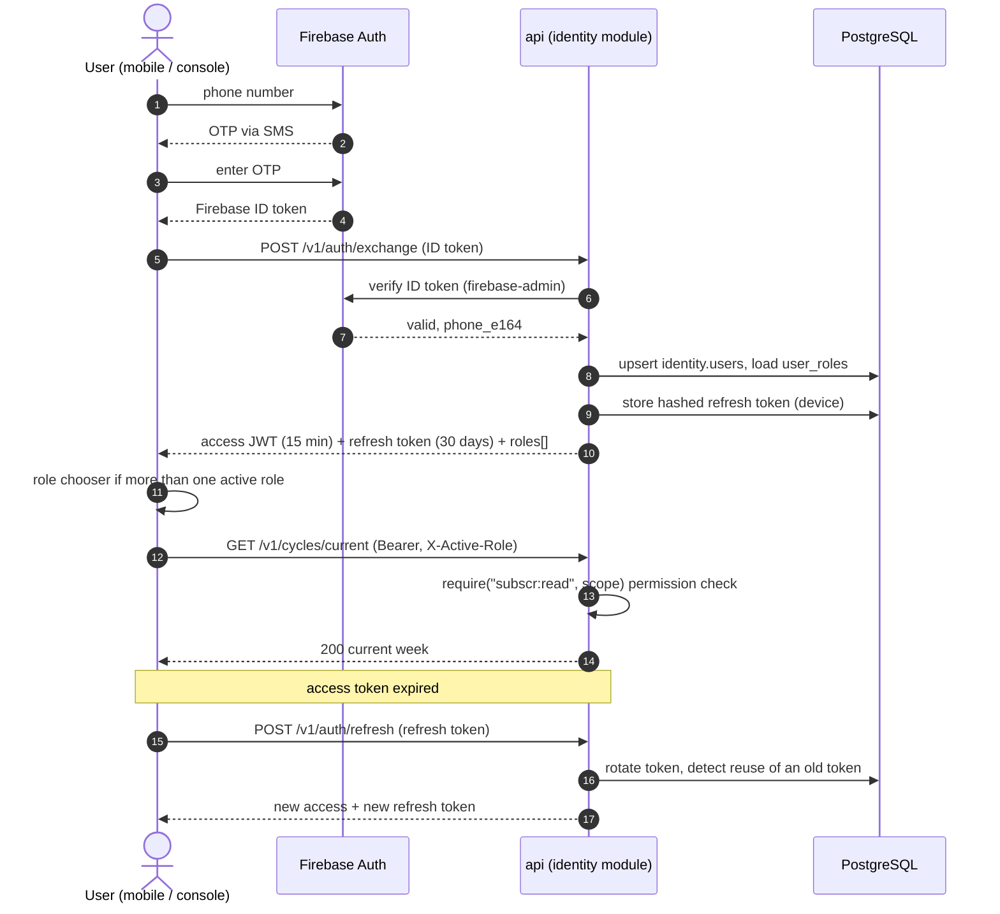
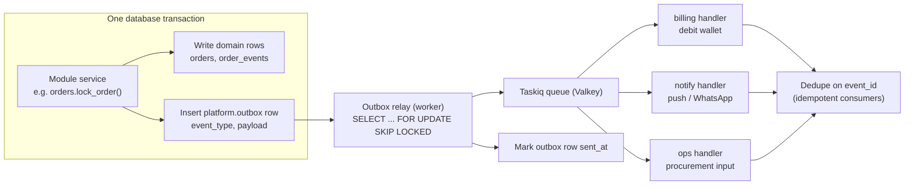
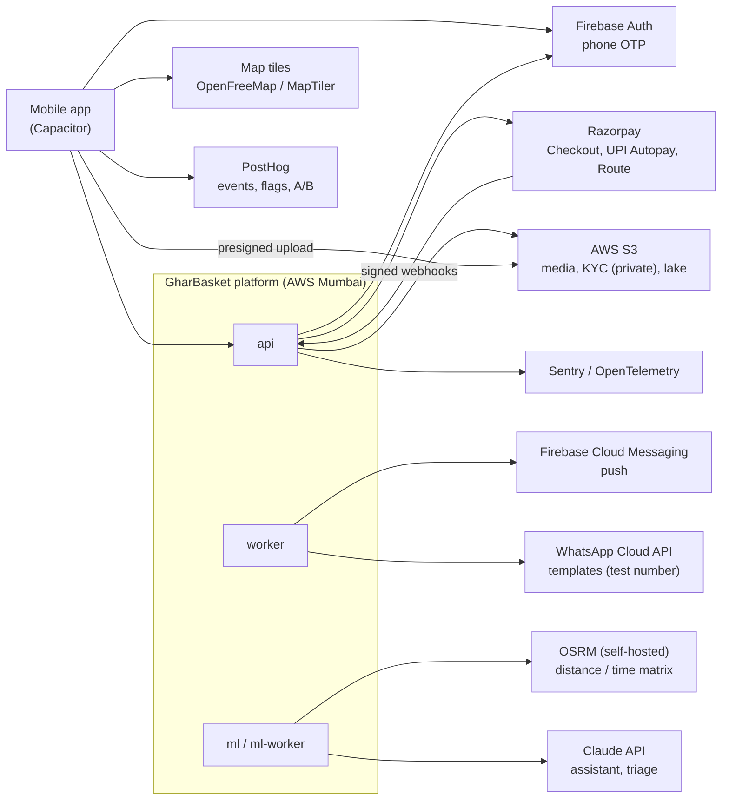

# Chapter 10 — API and Integration

> **In short:**
> - A REST API under `/v1`, described by **OpenAPI**. TypeScript clients are **generated** (Hey API) and never hand-written. This contract is the boundary between teammates.
> - Every POST that creates money or orders requires an **`Idempotency-Key`**. Money is always **integer paise**. Errors follow **RFC 9457** problem+json.
> - Auth: Firebase phone OTP → our own short-lived JWT + rotating refresh token. **Roles carry scopes** (society, hub), and the server checks permissions on every request.
> - Modules talk through a **transactional outbox**: a domain change and its event are written in one database transaction, then a relay dispatches the event to Taskiq handlers.
> - External integrations: Razorpay, Firebase, WhatsApp Cloud API, OSRM, map tiles, Claude API, AWS S3.

---

## 10.1 API conventions

| Topic | Rule |
|---|---|
| Style | REST under `/v1`. OpenAPI tags = module names. Plural nouns (`/v1/households/{id}/members`). |
| Errors | RFC 9457 `application/problem+json` with `type`, `title`, `status`, `detail`, `code`, `errors[]`. Codes are namespaced: `orders.cutoff_passed`, `billing.insufficient_balance`. |
| Pagination | Cursor-based: `?cursor=…&limit=…` → `next_cursor`. |
| Idempotency | `Idempotency-Key` header **required** on every POST that creates money or orders. Stored in `platform.idempotency_keys` (key, user, request hash, response, 24 h TTL). |
| Concurrency | `version` column + `If-Match` header for editing boxes, plans and prices (optimistic locking). |
| Headers | `Authorization: Bearer <access>`, `X-Active-Role: captain:society_123`, `Accept-Language: hi-IN`. |
| Money | Integer paise (`amount_paise`), never floats. The UI formats Indian style (₹1,23,456). |
| Time | ISO-8601 with offset. Business dates as `YYYY-MM-DD` in Asia/Kolkata. |
| Webhooks in | Signature verified → raw payload stored (`billing.payment_webhooks`) → processed idempotently by a job. |
| Realtime | Server-Sent Events: `GET /v1/orders/{id}/events`, `GET /v1/routes/{id}/live`. |
| Files | `POST /v1/files/presign` → direct upload to S3. The API stores only the key and metadata. |

**Contract-first workflow.** FastAPI generates `openapi.json`. `just gen-api` regenerates `packages/api-client` (Hey API: fetch client + TanStack Query hooks + zod schemas). CI runs `oasdiff` to block breaking changes unless the PR is labelled `breaking`, and fails if the generated client is stale.

## 10.2 Authentication, roles and permissions

*Figure 10.1 — Login, token exchange, role selection and refresh*

- **Storage:** mobile keeps the refresh token in secure storage; the console keeps it in an httpOnly, SameSite=Lax cookie that Next.js `proxy.ts` refreshes.
- **Roles with scopes:** `identity.user_roles(user_id, role, scope_type, scope_id, status)`.

| Role | Scope | Status flow |
|---|---|---|
| customer | — | active |
| captain | society | applied → kyc_pending → verified → suspended |
| kitchen_partner, rider, packer | hub | applied → kyc_pending → verified → suspended |
| hub_manager, franchise_owner | hub | assigned by admin |
| ngo_coordinator | ngo | assigned by admin |
| admin | global | assigned |

- **Permissions:** a code-level matrix `permission → roles`, enforced by a FastAPI dependency (`require("orders:read", scope=hub_id)`). The role switch in the app is only UX.
- **Defence in depth:** Postgres Row-Level Security on hub-scoped tables. The API sets `SET LOCAL app.hub_ids = '…'` per transaction.

## 10.3 Events: transactional outbox

*Figure 10.2 — Outbox event flow (at-least-once, idempotent consumers)*

**Event catalog (v1)**

| Module | Events |
|---|---|
| identity | `identity.household_created` |
| subscr | `subscr.cycle_generated`, `subscr.box_approved`, `subscr.box_skipped` |
| orders | `orders.locked`, `orders.shortage_substituted`, `orders.packed`, `orders.dispatched`, `orders.at_society`, `orders.delivered`, `orders.delivery_failed` |
| billing | `billing.wallet_topped_up`, `billing.payment_failed`, `billing.refund_issued` |
| ops | `ops.procurement_plan_ready`, `ops.waste_logged` |
| logistics | `logistics.route_published`, `logistics.pickup_completed` |
| partners | `partners.verified`, `partners.assignment_created` |
| community | `community.donation_verified` |
| intel | `intel.plans_ready`, `intel.forecast_ready` |

## 10.4 Scheduled jobs (IST, per hub; T = delivery day)

| When | Job | Module |
|---|---|---|
| T-3 18:00 | `generate_weekly_plans` (meal plan → box drafts) | intel → subscr |
| T-3 18:30 | `send_box_ready_and_pre_debit_notices` | notify / billing |
| T-1 19:00 | `remind_unapproved` | notify |
| **T-1 21:00** | **`cutoff_lock`** (Postgres advisory lock; idempotent) | orders / billing |
| T-1 21:10 | `forecast_uncommitted` → `build_procurement_plan` | intel → ops |
| T-1 21:30 | `assign_kitchens` (tiffin for day T) | intel → partners |
| T 05:00 | `build_packing_tasks` | ops |
| T 07:00 | `solve_routes` (per slot) | intel → logistics |
| T 12:30 | `surplus_cascade` | ops |
| Daily 02:00 | `export_snapshots` (Postgres → Parquet in S3) + data-quality checks | intel |
| Sun 03:00 | `retrain_models` (champion/challenger) | ml |
| Hourly / daily | `reconcile_payments` (hourly); `expire_kindness_points` (daily) | billing |

## 10.5 Key endpoints per module (v1)

| Module | Endpoints |
|---|---|
| M1 identity | `POST /auth/exchange`, `/auth/refresh`, `GET/PATCH /me`, `/households`, `/households/{id}/members`, `/addresses`, `/consents`, `/me/roles`, `GET /me/data-export`, `DELETE /me` |
| M2 catalog | `/products`, `/search?q=`, `/products/{id}/substitutes`, `/recipes`, `/prices?hub=`, `/festivals` |
| M3 subscr | `/subscriptions`, `/cycles/current`, `PATCH /cycles/{id}/lines`, `POST /cycles/{id}/approve`, `/skip`, `/budget-lock` |
| M4 orders | `/orders`, `/orders/{id}`, `/orders/{id}/events` (SSE), `/slots`, `/addons` |
| M5 billing | `/wallet`, `/wallet/topups`, `/mandates`, `/payments/webhook/razorpay`, `/kindness/balance`, `/statements` |
| M6 ops | `/hubs/{id}/procurement-plans`, `/purchase-orders`, `/grn`, `/packing-tasks`, `/waste-logs`, `/vendors` |
| M7 logistics | `/routes?date&slot`, `/routes/{id}/live` (SSE), `/stops/{id}/handover`, `/deliveries/{order}/proof`, `/pickups` |
| M8 partners | `/partner-applications`, `/kyc-documents`, `/trainings`, `/kitchen-capacity`, `/assignments`, `/earnings`, `/payouts` |
| M9 community | `/societies`, `/societies/{id}/unlock`, `/referrals`, `/donations`, `/drives`, `/ngo-handoffs`, `/impact` |
| M10 intel (ml, internal) | `/plan/week`, `/basket/rank`, `/substitutes`, `/forecast/run`, `/route/solve`, `/assign/kitchens`, `/slots/price`; admin `/models`, `/health/ai` |
| M11 notify | `/notifications` (inbox), `/preferences`, `/devices` |
| M12 analytics | `/analytics/*` (KPIs, unit economics, impact) |
| M13 assistant | `/assistant/messages` (SSE stream), `/assistant/confirm/{proposal}` |

## 10.6 External integrations

*Figure 10.3 — Integration map*

| Integration | Purpose | Prototype mode | Notes |
|---|---|---|---|
| Firebase Auth | Phone OTP | Free tier | Avoids TRAI DLT SMS registration in the prototype |
| FCM | Push notifications | Free | Device tokens in `notify` |
| WhatsApp Cloud API | Order/box notifications | Test number | Template messages only |
| Razorpay | Top-ups, UPI Autopay, partner payouts (Route) | Test mode | Webhook signatures verified; hourly reconciliation |
| OSRM | Road distance/time matrix | Self-hosted (MMR extract) | No Google Maps bills |
| Map tiles | Map display | OpenFreeMap / MapTiler free | MapLibre GL |
| Claude API | Assistant, complaint triage | Pay-as-you-go, capped | Model chosen after S8 eval |
| AWS S3 | Media, KYC docs, data lake, MLflow artifacts | Student credits | Private bucket + signed reads for KYC |

## Decisions & open questions

- **D3** — FastAPI modular monolith; OpenAPI as the contract ([ADR-0003](../adr/0003-python-fastapi-backend-and-ml-service.md) in [`docs/adr/`](../adr/)).
- **D4** — Closed-loop wallet + UPI Autopay; KYC only for people we pay ([ADR-0004](../adr/0004-closed-loop-wallet-and-upi-autopay.md)).
- **D15** — AWS Mumbai + Neon; S3 replaces R2 ([ADR-0015](../adr/0015-aws-mumbai-topology-with-neon-postgres.md)).
- **Open:** confirm Razorpay Checkout behaviour inside the Capacitor WebView and Firebase phone auth on Capacitor (Sprint 0 spikes).

Related: [Chapter 06 — Domain lifecycles](06-domain-lifecycles.md) · [Chapter 07 — Workflows](07-workflows.md) · [Chapter 13 — Security and compliance](13-security-and-compliance.md)
