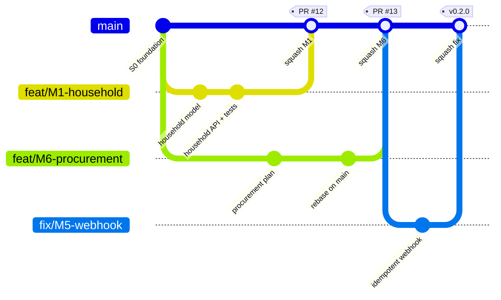
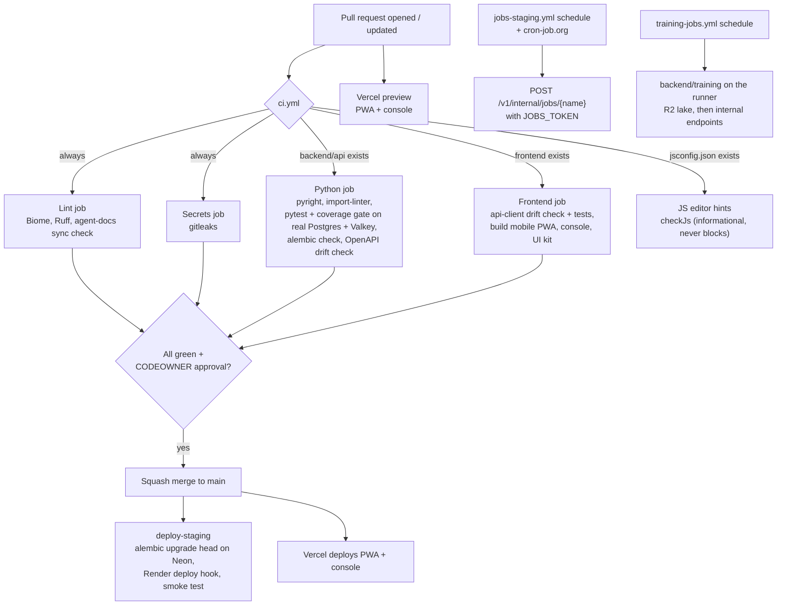

# Chapter 11 — Engineering Process

> **In short:**
> - **One monorepo**: apps, shared packages, Python services, simulator data, infra and docs.
> - **Module boundaries are enforced by tools, not trust:** import-linter in CI, one Postgres schema per module, CODEOWNERS approvals, and the OpenAPI contract.
> - **Trunk-based Git:** short-lived branches, squash merge into a protected `main`, Conventional Commits with module scope, PRs of about 400 hand-written lines.
> - **CI/CD on GitHub Actions:** lint, Python types, tests, migration, OpenAPI and api-client drift checks, frontend builds, informational JS editor hints; on merge, migrations on Neon and the Render deploy hook (planned). The pilot production setup is decided before P6.
> - **Clear Definitions of Ready and Done**, with testing ownership shared across all four members.

---

## 11.1 Monorepo layout

```
gharbasket/
├─ frontend/
│  ├─ mobile/            Vite + React + Capacitor (Android) + PWA
│  ├─ console/           Next.js 16 (admin, hub, franchise, public site)
│  └─ packages/
│     ├─ ui/             design tokens, Tailwind preset, components, Storybook
│     ├─ api-client/     GENERATED from the backend's OpenAPI — never hand-edited
│     └─ domain/         shared enums, role keys, feature-flag keys
├─ backend/
│  ├─ api/
│  │  ├─ src/gharbasket/
│  │  │  ├─ platform/    db, auth, outbox, config, errors
│  │  │  └─ modules/     identity, catalog, subscriptions, orders, billing, hub_ops,
│  │  │                  logistics, partners, community, intel_gateway,
│  │  │                  notifications, analytics, assistant
│  │  │                  (each: api.py, router.py, service.py, models.py,
│  │  │                   schemas.py, events.py)
│  │  ├─ migrations/     Alembic (one head; YYYYMMDD_HHMM_<module>_<desc>.py)
│  │  └─ tests/          per module (tests/<module>/) and for the platform
│  ├─ ml/                FastAPI ML/optimisation service: stateless solvers and inference (D25)
│  └─ training/          data, training and forecasting jobs run in GitHub Actions (D25)
├─ data/                 simulator/, seeds/
├─ e2e/                  Playwright tests (Rhythm, Manish)
├─ infra/                postgres/, compose/, mlflow/, osrm/ (spike S-3)
├─ docs/                 handbook/, TDD.md, FRONTEND_DESIGN.md, SETUP.md, adr/, modules/, research/, spikes/
                         (runbooks/ planned, written before the pilot in S10)
├─ .github/              workflows/, CODEOWNERS, pull_request_template.md, ISSUE_TEMPLATE/
├─ AGENTS.md             canonical AI-tool instructions (synced copies)
├─ justfile  turbo.json  pnpm-workspace.yaml  pyproject.toml (uv workspace)
```

**One command vocabulary (`justfile`):** `just up` (start infra), `just dev` (run everything), `just test`, `just gen-api`, `just migrate`, `just sim` (seed simulator data), `just eval` (ML evaluation report).

**Toolchain:**
- JavaScript (D18): Node 24 LTS, pnpm 12, Turborepo, Biome; JSDoc + `jsconfig.json` (`checkJs`) for editor hints.
- Python: 3.13, uv, Ruff, pyright.
- Git hooks: lefthook (Biome, Ruff, gitleaks on staged files).
- Dependency updates: Renovate (weekly, grouped).

## 11.2 Module boundaries

1. **Code:** a module imports another module **only** through its `api.py` facade. An import-linter *independence contract* over `gharbasket.modules.*` fails CI on any violation.
2. **Data:** each module owns one Postgres schema and writes only to it. Foreign keys are allowed only to stable IDs (users, households, hubs, products).
3. **Events:** cross-module side effects go through the transactional outbox (Chapter 10).
4. **People:** CODEOWNERS makes the module owner's approval mandatory.
5. **Contract:** API changes show up as an OpenAPI diff. Breaking changes are blocked unless labelled `breaking`.

**CODEOWNERS**

| Path | Owner |
|---|---|
| `backend/` (every module), `infra/`, `data/`, `.github/`, `scripts/`, root configs (default owner) | Prathamesh Relekar |
| `frontend/` (mobile, console, `packages/ui`, `packages/domain`) | Yash Salunkhe |
| `frontend/packages/api-client` (generated from the backend's OpenAPI) | Prathamesh Relekar |
| `docs/` | Prathamesh Relekar, Yash Salunkhe (shared) |
| `e2e/` | Rhythm Thakur, Manish Raje (added once they are collaborators) |

Ownership follows D23 ([ADR-0023](../adr/0023-ownership-backend-and-frontend.md)): one backend owner, one frontend owner.

## 11.3 Git workflow


*Figure 11.1 — Trunk-based branching with squash merges and sprint tags*

| Rule | Detail |
|---|---|
| `main` | Protected: PR only, CI green, 1 CODEOWNER approval, squash merge, linear history |
| Branch names | `feat/M4-cutoff-lock`, `fix/M5-webhook-idempotency`, `docs/…`, `test/…`, `chore/…`; live ≤ 3 days |
| Commits | Conventional Commits with module scope: `feat(orders): lock orders at cut-off` |
| PR size | About 400 changed lines of hand-written code per PR, not counting tests and generated files (`openapi.json`, `uv.lock`, lockfiles, generated api-client); split larger work into PRs that each leave `main` working |
| PR template | Module, what/why, screenshots (UI), migration note, test evidence, handbook chapter updated? |
| Cross-review | Each owner reviews the other's contract changes: module specs §3 and the generated api-client (ADR-0023), which also keeps shared understanding for the viva. Rhythm and Manish review docs/tests and run the QA checklist on feature PRs. |
| ML review | Every ML/AI PR (`backend/ml`, `backend/training`, `intel.*`, the simulator, the eval harness, M13 assistant, ML deploy) is reviewed and tested by a Claude Opus agent before merge: the diff against its module spec, ADR-0025 and the pre-registered evaluation protocol (`docs/research/eval-protocol.md`), plus pyright, ruff, import-linter, the touched pytest suites, the OpenAPI drift check and the PR's entry point in its smallest configuration. Findings are fixed, or accepted by the owner in the PR, before merge; green CI alone is not enough for an ML PR. The review runs locally, so it costs no Actions minutes |
| Migrations | One Alembic migration per PR, named `YYYYMMDD_HHMM_<module>_<desc>`. CI fails if there is more than one head. Downgrade always written. |
| Releases | Tag per sprint `v0.<sprint>.0`; changelog generated from commits |

## 11.4 CI/CD (GitHub Actions)



*Figure 11.2 — CI/CD pipeline*

**Local CI (a fallback since Oct 2026).** GitHub Actions stopped starting jobs for a while ("recent account payments have failed"). The repository is now public, so Actions runs free again and CI, the staging deploy and the scheduled workflows run there. When Actions is unavailable again, `just ci-local <pr-number|ref>` (`scripts/ci-local.sh`) runs the same four jobs on a developer machine (lint, secrets, python, frontend) against the local stack, each run in its own worktree with a fresh test database, and posts each job as a GitHub commit status `local-ci/<job>` on the PR head. A PR is green when its four `local-ci/*` statuses are; the full log stays in `.ci-local/<sha>.log`. It needs `just up`, uv, corepack, gitleaks and `gh auth login`. The scheduled workflows (`jobs-staging.yml`, `training-jobs.yml`) do not run without Actions.

| Workflow | Trigger | Steps |
|---|---|---|
| `ci.yml` | PR, push to main | Lint, secrets, Python, frontend build and JS editor hints jobs (above) |
| `claude.yml` | `@claude` in an issue, PR comment or review | On-demand Claude Code; no automatic review on every PR (the Opus review of ML PRs above runs locally, not here) |
| `deploy-staging.yml` | CI passed on a push to main (or "Run workflow") | `alembic upgrade head` on Neon (`GB_ALLOW_REMOTE_MIGRATIONS=1`), then the Render deploy hook for that commit (Render's pre-deploy step is paid-only), then waits until `/v1/health` reports the commit and runs `scripts/smoke-staging.sh`. Skips with a notice until its secrets exist |
| `jobs-staging.yml` | GitHub Actions schedule (daily and weekly) or "Run workflow" with a job name | Calls `POST /v1/internal/jobs/<name>` with `JOBS_TOKEN` and the scheduled time (D21). Minute-level jobs (the 21:00 cut-off, the outbox sweep every few minutes) are called the same way by cron-job.org, since a private repository has 2,000 free Actions minutes a month. Skips with a notice until the secrets exist |
| `training-jobs.yml` | GitHub Actions schedule (daily, 18:33 IST) or "Run workflow" with a job module | Runs `python -m gharbasket_training.jobs.<name>` from `backend/training` on the runner (D25): reads and writes the lake on R2 and hands results to the API's internal endpoints with `JOBS_TOKEN`. Today it runs `collect_mandi`. Skips with a notice until its secrets exist |

Later, when their features arrive: a Playwright e2e workflow (label `e2e`, nightly), Android builds (debug APK; signed AAB on tag), `deploy-ml.yml` for the ML service on its Hugging Face Space and, before P6, a pilot production deploy.

## 11.5 Environments

```mermaid
flowchart LR
    subgraph LOCAL["Local (each laptop)"]
        L1["Docker: Postgres 18 + PostGIS + pgvector,<br/>Valkey, SeaweedFS (S3), MLflow"]
        L2["api / ml with reload,<br/>vite, next dev, Android emulator"]
    end
    subgraph PREVIEW["Preview (per PR)"]
        P1["Vercel preview<br/>(PWA + console)"]
        P2["Uses the staging API"]
    end
    subgraph STAGING["Staging (free tiers)"]
        S1["Render API + Key Value<br/>(Singapore)"]
        S2["Neon shared<br/>dev + staging database"]
        S3["R2 gb-staging-* buckets"]
    end
    subgraph PROD["Pilot (decided before P6)"]
        R1["Paid plans to be chosen"]
        R2["Neon Singapore or<br/>paid Mumbai Postgres"]
    end
    LOCAL -->|"git push, PR"| PREVIEW
    PREVIEW -->|"merge to main"| STAGING
    STAGING -->|"before P6"| PROD
```


*Figure 11.3 — Environments and promotion path*

| Env | Database | API / ML | Console and PWA | Mobile |
|---|---|---|---|---|
| local | Docker Postgres (tests and `just seed` refuse any other database) | `just dev` | `next dev`, `vite` | `vite` / Android emulator |
| preview (PR) | No database of its own; uses staging | Shared staging API | Vercel preview | Debug APK (later) |
| staging | Neon, one database shared by Infisical `dev` and `staging` | Render free web service; the ML service and OSRM on a Hugging Face Space (D25) | Vercel | Internal testing track |
| prod (pilot) | Decided before P6 (Q3) | Paid plans decided before P6 | Vercel | Internal / closed testing |

## 11.6 Testing strategy

| Layer | Tooling | Owner |
|---|---|---|
| Unit (Python / JS) | pytest + anyio, Vitest, Testing Library | Feature author |
| Integration (real PostGIS) | pytest against the local `gharbasket_test` database (the same Postgres image in CI). API tests share one rolled-back session across requests, so the commit guard (`tests/commit_guard.py`) fails any request that returns successfully with a write it never committed (production rolls such writes back) | Feature author |
| Property tests (ledger, state machines) | hypothesis (planned) | Prathamesh Relekar |
| Contract / API fuzz | schemathesis on OpenAPI (`tests/test_api_fuzz.py`, own throwaway database): no 500s, every answer documented and schema-shaped | CI |
| Solver golden tests (routing, CP-SAT, fixed seeds) | pytest | Prathamesh Relekar |
| Model quality gates | Metric thresholds on fixture datasets | Prathamesh Relekar |
| End-to-end | Playwright: onboarding, approve box, cut-off, pack, deliver, donate | **Rhythm Thakur, Manish Raje** |
| End-to-end (backend) | `just e2e-day` (`e2e/backend`): a fresh database, the seed and two simulated weeks, then one delivery day through every job at its IST time over HTTP with real commits, the outbox relay and a fake FCM, ending with reusable invariants (ledger, wallets, order state machine, outbox, messages, stock); product bugs it finds stay `xfail(strict=True)` until fixed | Prathamesh Relekar; Rhythm Thakur, Manish Raje |
| Load | k6: cut-off with 2,000 orders; 200 concurrent box edits | Rhythm Thakur, Manish Raje |
| Device / manual | Low-end Android checklist, accessibility audit (axe, TalkBack) | Rhythm Thakur, Manish Raje |
| Security | OWASP ASVS L1 checklist, gitleaks, pip-audit, pnpm audit, Trivy image scan | All |

**Parallel API tests.** `just test` and CI run the API suite with pytest-xdist (`-n 4`). Each worker gets a Postgres database of its own (`<TEST_DATABASE_URL's name>_gw0`, `_gw1` ..., created and migrated at the start, dropped at the end; `GB_KEEP_TEST_DBS=1` keeps them) and a Valkey database of its own (base index b becomes b + 16 * (n + 1), so Valkey needs `--databases 128`, which the compose file sets). The base database is not used under xdist: run `alembic upgrade head` on it before `alembic check`. A single file runs serially (`pytest tests/test_x.py`); add `-n 4` to a run of many files.

Formal test plan and test-case documents (IEEE 829 style) for the report are written by Rhythm Thakur and Manish Raje.

## 11.7 Definitions of Ready and Done

**Ready:**
- module spec exists in `docs/modules/`;
- endpoints drafted;
- acceptance criteria written;
- Claude Design screens approved (for UI work).

**Done:**
- code + tests (unit + at least one integration);
- OpenAPI updated and client regenerated;
- handbook chapter / ADR updated;
- works on the simulator seed;
- screenshot or demo in the PR;
- QA checklist passed (Rhythm Thakur / Manish Raje).

## 11.8 AI-assistant rules (AGENTS.md)

The team uses several AI coding tools (Claude Code, Cursor, Gemini, Kiro, Qoder, Windsurf, CodeBuddy). `AGENTS.md` is the single canonical file. `scripts/sync-agent-docs.sh` copies it to `CLAUDE.md`, `GEMINI.md`, `CODEBUDDY.md`, `QODER.md`, `.cursorrules` and `.windsurfrules` (copies, not symlinks, for Windows teammates). CI checks that they are identical.

Core rules in `AGENTS.md`:
1. Read `docs/handbook/00-README.md` first.
2. Respect module boundaries (`api.py` only; own schema only).
3. Money in paise; every POST that creates money or orders is idempotent.
4. Never hand-edit generated clients.
5. One migration per PR.
6. Update the relevant handbook chapter in the same PR.
7. Keep the code-review-graph section (graph tools first, then verify in source).

## 11.9 Team rituals

- **Monday:** 30-minute sprint planning on the GitHub Projects board (labels = module IDs, milestones = sprints).
- **Thursday:** 20-minute demo to each other.
- **End of milestone:** demo to Prof. Kranti Bade.
- **Big decisions:** a one-page ADR in `docs/adr/` (MADR template).

## Decisions & open questions

- **D3** — Python-only backend, modular monolith ([ADR-0003](../adr/0003-python-fastapi-backend-and-ml-service.md) in [`docs/adr/`](../adr/)); Taskiq deferred by D21 ([ADR-0021](../adr/0021-jobs-without-a-broker.md)).
- **D14** — Final tech stack; changes need an ADR ([ADR-0014](../adr/0014-final-stack-and-service-based-architecture.md)); amended by D18 (JavaScript frontend, [ADR-0018](../adr/0018-javascript-not-typescript-frontend.md)) and D22 (generated API client, [ADR-0022](../adr/0022-api-client-openapi-fetch.md)).
- **D20** — Free-tier environments: Render, Vercel, Neon, R2 ([ADR-0020](../adr/0020-free-tier-hosting-render-vercel-neon-r2.md); supersedes ADR-0015).
- **D23** — Ownership: one backend owner, one frontend owner ([ADR-0023](../adr/0023-ownership-backend-and-frontend.md); supersedes the code ownership in ADR-0009).
- **D25** — ML runtime: the ML service and OSRM on one Hugging Face Space, training in GitHub Actions (`backend/training`), models and the lake on R2, MLflow local only, cron-job.org for minute-level jobs ([ADR-0025](../adr/0025-ml-runtime-spaces-actions-r2.md); settles the ML hosting left open in ADR-0020).
- **Open:** the pilot production setup (before P6).

Related: [Chapter 04 — System architecture](04-system-architecture.md) · [Chapter 12 — Deployment and operations](12-deployment-and-operations.md) · [Chapter 14 — Project plan](14-project-plan.md)
