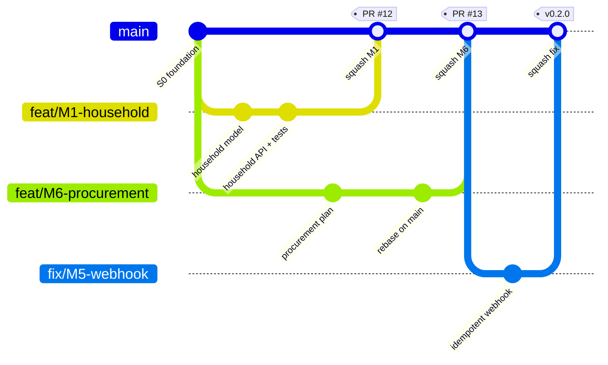
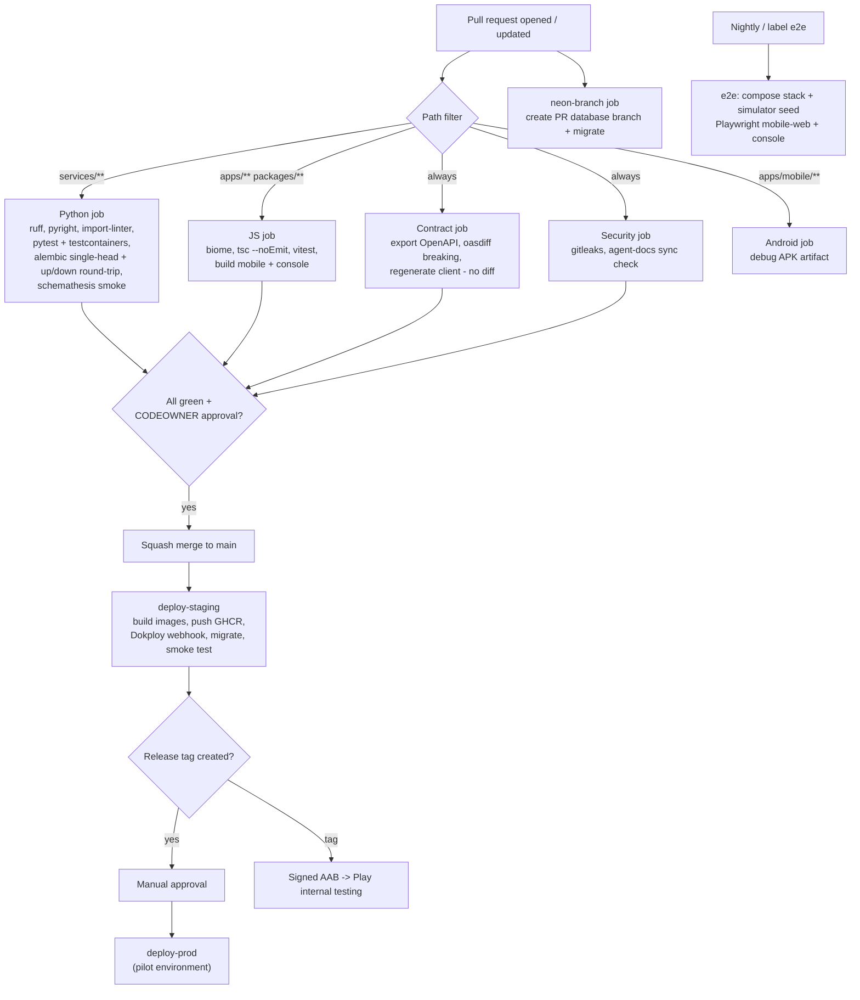

# Chapter 11 — Engineering Process

> **In short:**
> - **One monorepo**: apps, shared packages, Python services, simulator data, infra and docs.
> - **Module boundaries are enforced by tools, not trust:** import-linter in CI, one Postgres schema per module, CODEOWNERS approvals, and the OpenAPI contract.
> - **Trunk-based Git:** short-lived branches, squash merge into a protected `main`, Conventional Commits with module scope, PRs of ≤ ~400 lines.
> - **CI/CD on GitHub Actions:** lint, types, tests, contract diff, migration checks, Android builds, staging deploy on merge, production deploy by tag with approval.
> - **Clear Definitions of Ready and Done**, with testing ownership shared across all four members.

---

## 11.1 Monorepo layout

```
gharbasket/
├─ apps/
│  ├─ mobile/            Vite + React + Capacitor (Android) + PWA
│  └─ console/           Next.js 16 (admin, hub, franchise, public site)
├─ packages/
│  ├─ ui/                design tokens, Tailwind preset, components, Storybook
│  ├─ api-client/        GENERATED by Hey API from OpenAPI — never hand-edited
│  ├─ domain/            shared enums, role keys, feature-flag keys
│  └─ config/            shared tsconfig, Biome config
├─ services/
│  ├─ api/src/gharbasket/
│  │  ├─ platform/       db, auth, outbox, config, errors
│  │  └─ modules/        identity, catalog, subscr, orders, billing, ops,
│  │                     logistics, partners, community, notify, intel_gateway
│  │                     (each: api.py, router.py, service.py, models.py,
│  │                      schemas.py, events.py, tests/)
│  └─ ml/                FastAPI ML service, training pipelines, eval/, marimo notebooks
├─ data/                 simulator/, seeds/
├─ e2e/                  Playwright tests (Rhythm, Manish)
├─ infra/                postgres/, compose/, osrm/, caddy/
├─ docs/                 handbook/, TDD.md, FRONTEND_DESIGN.md, adr/, modules/, runbooks/, project/
├─ .github/              workflows/, CODEOWNERS, pull_request_template.md, ISSUE_TEMPLATE/
├─ AGENTS.md             canonical AI-tool instructions (synced copies)
├─ justfile  turbo.json  pnpm-workspace.yaml  pyproject.toml (uv workspace)
```

**One command vocabulary (`justfile`):** `just up` (start infra), `just dev` (run everything), `just test`, `just gen-api`, `just migrate`, `just sim` (seed simulator data), `just eval` (ML evaluation report).

**Toolchain:**
- JS/TS: Node 24 LTS, pnpm 10, Turborepo, Biome.
- Python: 3.13, uv, Ruff, pyright.
- Git hooks: lefthook (Biome, Ruff, gitleaks on staged files).
- Dependency updates: Renovate (weekly, grouped).

## 11.2 Module boundaries

1. **Code:** a module imports another module **only** through its `api.py` facade. An import-linter *independence contract* over `gharbasket.modules.*` fails CI on any violation.
2. **Data:** each module owns one Postgres schema and writes only to it. Foreign keys are allowed only to stable IDs (users, households, hubs, products).
3. **Events:** cross-module side effects go through the transactional outbox (Chapter 10).
4. **People:** CODEOWNERS makes the module owner's approval mandatory.
5. **Contract:** API changes show up as an OpenAPI diff. Breaking changes are blocked unless labelled `breaking`.

**CODEOWNERS**

| Path | Owner |
|---|---|
| `apps/mobile`, `packages/ui`, `services/api/**/modules/{identity,catalog,subscr,orders,billing,notify}` | Yash Salunkhe |
| `apps/console`, `services/api/**/modules/{ops,logistics,partners,community,intel_gateway}`, `services/ml`, `data/` | Prathamesh Relekar |
| `docs/`, `e2e/` | Rhythm Thakur, Manish Raje |

## 11.3 Git workflow


*Figure 11.1 — Trunk-based branching with squash merges and sprint tags*

| Rule | Detail |
|---|---|
| `main` | Protected: PR only, CI green, 1 CODEOWNER approval, squash merge, linear history |
| Branch names | `feat/M4-cutoff-lock`, `fix/M5-webhook-idempotency`, `docs/…`, `test/…`, `chore/…`; live ≤ 3 days |
| Commits | Conventional Commits with module scope: `feat(orders): lock orders at cut-off` |
| PR size | ≤ ~400 changed lines |
| PR template | Module, what/why, screenshots (UI), migration note, test evidence, handbook chapter updated? |
| Cross-review | Yash reviews Prathamesh's backend PRs and vice versa (shared understanding for the viva). Rhythm and Manish review docs/tests and run the QA checklist on feature PRs. |
| Migrations | One Alembic migration per PR, named `YYYYMMDD_HHMM_<module>_<desc>`. CI fails if there is more than one head. Downgrade always written. |
| Releases | Tag per sprint `v0.<sprint>.0`; changelog generated from commits |

## 11.4 CI/CD (GitHub Actions)


*Figure 11.2 — CI/CD pipeline*

| Workflow | Trigger | Steps |
|---|---|---|
| `ci.yml` | PR, push to main | Path-filtered Python / JS / contract / security jobs (above) |
| `neon-branch.yml` | PR opened / closed | Create or delete the Neon branch, run migrations, post the URL |
| `e2e.yml` | PR label `e2e`, nightly | Full Docker Compose stack + simulator seed → Playwright |
| `android.yml` | PR (mobile paths), tags | Debug APK artifact; on tag, signed AAB → internal testing |
| `deploy-staging.yml` | Push to main | Images → GHCR → Dokploy → migrations → smoke test |
| `deploy-prod.yml` | Manual (tag) | Same, with an approval gate |

## 11.5 Environments

```mermaid
flowchart LR
    subgraph LOCAL["Local (each laptop)"]
        L1["Docker: Postgres 18 + PostGIS + pgvector,<br/>Valkey, MinIO, MLflow"]
        L2["api / ml with reload,<br/>vite, next dev, Android emulator"]
    end
    subgraph PREVIEW["Preview (per PR)"]
        P1["Neon PR branch"]
        P2["Vercel preview (console)"]
        P3["Debug APK artifact"]
    end
    subgraph STAGING["Staging (AWS Mumbai)"]
        S1["EC2 compose stack 'stg'"]
        S2["Neon 'staging' branch"]
        S3["S3 staging buckets"]
    end
    subgraph PROD["Prod / pilot (AWS Mumbai)"]
        R1["EC2 compose stack 'prod'"]
        R2["Neon 'main'"]
        R3["S3 prod buckets"]
    end
    LOCAL -->|"git push, PR"| PREVIEW
    PREVIEW -->|"merge to main"| STAGING
    STAGING -->|"release tag + approval"| PROD
```


*Figure 11.3 — Environments and promotion path*

| Env | Database | API / ML | Console | Mobile |
|---|---|---|---|---|
| local | Docker Postgres (optional Neon dev branch) | `just dev` | `next dev` | `vite` / Android emulator |
| preview (PR) | Neon PR branch | Shared staging API | Vercel preview (non-commercial dev use) | Debug APK |
| staging | Neon `staging` | EC2 stack `stg` | EC2 | Internal testing track |
| prod (pilot) | Neon `main` | EC2 stack `prod` | EC2 | Internal / closed testing |

## 11.6 Testing strategy

| Layer | Tooling | Owner |
|---|---|---|
| Unit (Python / TS) | pytest, Vitest, Testing Library | Feature author |
| Integration (real PostGIS) | testcontainers | Feature author |
| Property tests (ledger, state machines) | hypothesis | Yash Salunkhe |
| Contract / API fuzz | schemathesis on OpenAPI | CI |
| Solver golden tests (routing, CP-SAT, fixed seeds) | pytest | Prathamesh Relekar |
| Model quality gates | Metric thresholds on fixture datasets | Prathamesh Relekar |
| End-to-end | Playwright: onboarding, approve box, cut-off, pack, deliver, donate | **Rhythm Thakur, Manish Raje** |
| Load | k6: cut-off with 2,000 orders; 200 concurrent box edits | Rhythm Thakur, Manish Raje |
| Device / manual | Low-end Android checklist, accessibility audit (axe, TalkBack) | Rhythm Thakur, Manish Raje |
| Security | OWASP ASVS L1 checklist, gitleaks, pip-audit, pnpm audit, Trivy image scan | All |

Formal test plan and test-case documents (IEEE 829 style) for the report are written by Rhythm Thakur and Manish Raje.

## 11.7 Definitions of Ready and Done

**Ready:**
- module spec exists in `docs/modules/`;
- endpoints drafted;
- acceptance criteria written;
- Claude Design screens approved (for UI work).

**Done:**
- code + tests (unit + at least one integration);
- OpenAPI updated and client regenerated;
- handbook chapter / ADR updated;
- works on the simulator seed;
- screenshot or demo in the PR;
- QA checklist passed (Rhythm Thakur / Manish Raje).

## 11.8 AI-assistant rules (AGENTS.md)

The team uses several AI coding tools (Claude Code, Cursor, Gemini, Kiro, Qoder, Windsurf, CodeBuddy). `AGENTS.md` is the single canonical file. `scripts/sync-agent-docs.sh` copies it to `CLAUDE.md`, `GEMINI.md`, `CODEBUDDY.md`, `QODER.md`, `.cursorrules` and `.windsurfrules` (copies, not symlinks, for Windows teammates). CI checks that they are identical.

Core rules in `AGENTS.md`:
1. Read `docs/handbook/README.md` first.
2. Respect module boundaries (`api.py` only; own schema only).
3. Money in paise; every POST that creates money or orders is idempotent.
4. Never hand-edit generated clients.
5. One migration per PR.
6. Update the relevant handbook chapter in the same PR.
7. Keep the code-review-graph section (graph tools first, then verify in source).

## 11.9 Team rituals

- **Monday:** 30-minute sprint planning on the GitHub Projects board (labels = module IDs, milestones = sprints).
- **Thursday:** 20-minute demo to each other.
- **End of milestone:** demo to Prof. Kranti Bade.
- **Big decisions:** a one-page ADR in `docs/adr/` (MADR template).

## Decisions & open questions

- **D3** — Python-only backend, modular monolith ([ADR-0003](../adr/0003-python-fastapi-backend-and-ml-service.md) in [`docs/adr/`](../adr/)).
- **D9** — Team split and ownership ([ADR-0009](../adr/0009-team-ownership-and-tracks.md)).
- **D14** — Final tech stack; changes need an ADR ([ADR-0014](../adr/0014-final-stack-and-service-based-architecture.md)).
- **D15** — AWS Mumbai + Neon environments ([ADR-0015](../adr/0015-aws-mumbai-topology-with-neon-postgres.md)).
- **Open:** whether to keep Vercel for PR previews or run previews on EC2 only.

Related: [Chapter 04 — System architecture](04-system-architecture.md) · [Chapter 12 — Deployment and operations](12-deployment-and-operations.md) · [Chapter 14 — Project plan](14-project-plan.md)
