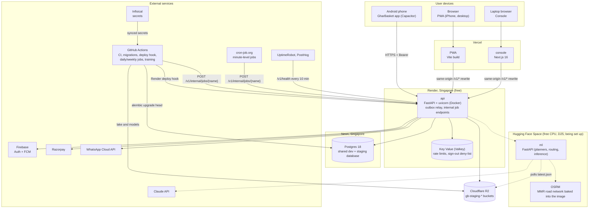

# Chapter 12 — Deployment and Operations

> **In short:**
> - Staging is **live** at `https://gharbasket-api.onrender.com` and runs on **free tiers only** (D20): the API on a **Render** free web service in Singapore (Docker image built by Render from the repo), **Render Free Key Value** (Valkey), the PWA and console on **Vercel**, files on **Cloudflare R2**. No server of our own to patch; TLS comes from the platforms.
> - **PostgreSQL 18 is on Neon** (Singapore): one shared database for the Infisical `dev` and `staging` environments, with guardrails. There is no database branch per PR. Daily work uses local Docker Postgres.
> - **Deploys:** every green CI run on `main` triggers `deploy-staging.yml`, which runs `alembic upgrade head` on Neon, calls the Render deploy hook and runs a smoke test. CI on `main` cancels a superseded run, so only the newest commit deploys. The repository is public, so Actions minutes are free. Scheduled jobs are internal endpoints called by a GitHub Actions schedule for daily and weekly jobs (D21) and by **cron-job.org** for minute-level ones (D25). Training and data jobs run in GitHub Actions (`training-jobs.yml`, `backend/training`). Secrets live in **Infisical**.
> - **Backups:** Neon's built-in point-in-time restore; a scheduled `pg_dump` to R2 can be added via the jobs workflow.
> - **Observability:** structlog JSON logs, UptimeRobot (which also keeps the free API awake), PostHog. Explicit SLOs; runbooks are planned and written before the pilot (S10).
> - **ML runtime (D25):** the ML service and OSRM run on one free **Hugging Face Space**; models and the data lake live on R2 with a `latest.json` pointer per model; MLflow stays local.
> - **Still open:** paid plans plus the pilot database location (Neon Singapore or a paid Mumbai Postgres), decided before P6.

---

## 12.1 Deployment topology

*Figure 12.1 — Deployment diagram (UML-style: nodes as subgraphs, containers inside)*

### What runs where

| Piece | Where | Purpose | Notes |
|---|---|---|---|
| api | Render free web service (Singapore) | FastAPI modular monolith; relays outbox rows after each commit; serves `POST /v1/internal/jobs/<name>` | Sleeps after 15 minutes idle; UptimeRobot calls `/v1/health` every 10 minutes (750 free hours a month cover 24×7). `/v1/health` never touches the database, so Neon can still go idle |
| valkey | Render Free Key Value (same region) | Rate-limit counters, sign-out deny-list | In-memory, may lose data on restart; the API keeps working without it |
| postgres | Neon (Singapore) | All module schemas, the outbox (the job queue, D21) | One shared database for `dev` and `staging` |
| files | Cloudflare R2 (S3 API, region `auto`) | Media, private KYC files and proofs | SeaweedFS locally; the code uses the S3 API only |
| PWA and console | Vercel | Static PWA build and the Next.js console | `/v1/*` rewrites to the API, so browser cookies are same-origin; preview deployment per PR |
| ml + OSRM | Hugging Face Space (free CPU, Docker; ADR-0025) | Planners, the pantry twin, routing, forecasts' serving | One container: uvicorn on 7860 and `osrm-routed` with the MMR network baked in; `deploy-ml.yml` mirrors `backend/ml` with dependencies exported from `uv.lock` after CI on `main` (no commit, so no rebuild, when nothing changed); `start.sh` exits when either process dies, so the Space restarts; UptimeRobot keeps it awake; the API's fallbacks cover cold starts |
| training and data jobs | GitHub Actions (`training-jobs.yml`, `backend/training`) | Data collection, training, forecasts, snapshots | Reads Neon (read-only role) and R2; hands results to the API's internal endpoints with `JOBS_TOKEN` |
| models and lake | Cloudflare R2 (`gb-lake`, `gb-mlflow`) | Snapshots, external data, model versions with a `latest.json` pointer per model | Promotion is manual (`just promote`, D25); the Space polls `latest.json` every 10 minutes |
| MLflow | Local only (Docker Compose) | Experiment tracking | Never hosted (D25) |
| worker | None until the pilot | — | No broker for now (D21): the outbox relay and the job endpoints do the work. Taskiq returns when a paid worker exists |

Production for the pilot is not set up yet. Before P6 we decide on paid plans (Render Starter for the API, a worker, Firebase Blaze for real OTPs) and on where the pilot database lives.

## 12.2 Hosted services used

| Need | Service | Notes |
|---|---|---|
| Compute (API) | Render free web service, Singapore | Docker image built by Render from the repo |
| Cache and short-lived data | Render Free Key Value | Not durable; only rate limits and the deny-list |
| Database | Neon (Postgres 18) | Shared `dev` + `staging` database; guardrails in §12.3 |
| Object storage | Cloudflare R2 | `gb-staging-*` buckets; private files are read through short-lived signed URLs |
| Web hosting | Vercel | PWA and console; PR previews |
| Secrets | Infisical (`dev`, `staging`, `prod`) | `infisical run --env=…`; synced to GitHub Actions secrets; never in the repo |
| Builds, migrations, schedules | GitHub Actions | CI, `alembic upgrade head` on Neon, Render deploy hook, daily and weekly job calls (`jobs-staging.yml`), training and data jobs (`training-jobs.yml`) |
| Minute-level schedules | cron-job.org | The 21:00 cut-off, the outbox sweep every few minutes, proposal expiry: `POST /v1/internal/jobs/<name>` with `JOBS_TOKEN` (D25) |
| ML serving | Hugging Face Space (free CPU) | The ML service and OSRM (D25) |
| DNS and TLS | Render and Vercel default URLs | No custom domain yet; TLS by the platforms |
| Cost | Free tiers only until the pilot | Nothing here can bill us during development. The repository is public, so GitHub Actions minutes are free |

### How a change reaches staging
1. A PR merges into `main`, and CI runs on the merge commit. CI's concurrency group is per ref with `cancel-in-progress`, so a newer push to `main` cancels the older run; a cancelled run never deploys, and only the newest commit does.
2. When CI passes (`workflow_run` on a push, never on a PR), `.github/workflows/deploy-staging.yml`:
   - runs `alembic upgrade head` on Neon (the direct URL);
   - calls the Render deploy hook with `?ref=<commit>`;
   - waits until `/v1/health` reports that commit;
   - runs the smoke test (`scripts/smoke-staging.sh`, also `just cloud <url>`).

   The workflow queues deploys (one at a time, no cancelling, so a migration is never cut off half-way) and skips with a notice while any of its four secrets is missing. It can also be started by hand (`workflow_dispatch`).
3. Render builds `backend/api/Dockerfile` (uv, Python 3.13, non-root) and starts uvicorn on `$PORT` with `--proxy-headers`. Render's own auto-deploy is off (`render.yaml`), so a commit is never deployed before its migrations.
4. Migrations are expand-then-contract (add first, remove a release later), so the old API keeps working while they apply.

**One-time setup (owner: Prathamesh Relekar):**
1. Add `APP_ENV`, `JWT_SIGNING_KEY`, `REFRESH_TOKEN_PEPPER`, `KYC_ENCRYPTION_KEY`, `KYC_HASH_PEPPER` (each `openssl rand -base64 48`) and `JOBS_TOKEN` to Infisical `staging`. `KYC_KEY_VERSION` (default 1) names the KYC key; raise it when the key is rotated.
2. Sign up to Render with GitHub and give it access to this repository only. Then Render → New → **Blueprint** → this repo, which reads `render.yaml`. Enter the `sync: false` values from Infisical.
3. Copy the API's deploy hook (Settings → Deploy Hook).
4. Add the GitHub Actions secrets `DATABASE_URL_DIRECT` (Neon, direct), `RENDER_DEPLOY_HOOK_URL`, `JOBS_TOKEN` and `STAGING_API_URL` (done; the deploy workflow needs exactly these four).
5. Add an UptimeRobot monitor on `/v1/health` every 10 minutes.
6. Add a cron-job.org job (timezone Asia/Kolkata) for every `runner: cron-job.org` entry of `infra/jobs/schedule.yaml`, the one schedule of every job (a list of crons is one cron-job.org job each; the minute-level ones run only in short windows around the events that need them, to let Neon sleep; set the Neon compute to a fixed 0.25 CU). Each calls `POST <STAGING_API_URL>/v1/internal/jobs/<name>` with `Authorization: Bearer <JOBS_TOKEN>`; the `actions` entries run from `jobs-staging.yml`.

## 12.3 Database hosting and the latency note

- **Neon** hosts one shared database for the Infisical `dev` and `staging` environments, with PostGIS and pgvector. There is no branch per PR.
- **Guardrails** on the shared database:
  - migrations reach Neon only from the GitHub Actions deploy workflow after merge (`GB_ALLOW_REMOTE_MIGRATIONS=1`);
  - downgrades on a remote database are refused;
  - tests and `just seed` refuse any non-local database;
  - synthetic rows carry `data_source='synthetic'`.
- **Latency:** Neon has no India region; it runs in Singapore, about 60 ms per round-trip from Mumbai. The API also runs in Singapore, so API-to-database calls are short; the user-to-API leg carries the distance. Mitigate by:
  - batching queries and avoiding N+1 ORM patterns;
  - connection pooling (Neon pooled endpoint);
  - caching hot reads (catalog, prices, slots) where it helps.
- **Decision before Phase 6 (pilot):** keep the pilot database on Neon (Singapore) or move it to a paid Postgres in Mumbai (open question Q3).

## 12.4 Backups and recovery

| What | How | Retention | Restore test |
|---|---|---|---|
| Postgres | Neon point-in-time restore (free tier); a scheduled `pg_dump` to R2 can be added via the jobs workflow | Neon's free-tier restore window | One restore drill before the pilot (Rhythm Thakur / Manish Raje run the checklist) |
| Valkey | Not backed up | — | Nothing to restore: it only holds rate-limit counters and the sign-out deny-list |
| R2 files | Staging holds test files only | — | Strategy decided with the pilot plans before P6 |
| Models, lake | R2 (`gb-mlflow`, `gb-lake`); MLflow runs stay local | Every promoted model version is kept | Point `latest.json` back at the previous version |
| OSRM | Baked into the ML Space image (D25) | — | Rebuilt from `infra/osrm/prepare.sh` |
| Config | Dockerfile, Compose files and workflows in git; secrets in Infisical | git history | Redeploy-from-scratch drill once before the pilot |

## 12.5 Observability

| Signal | Tool | What we watch |
|---|---|---|
| Errors and logs | structlog JSON logs (Render log view); OpenTelemetry → Grafana Cloud free tier, set up before the pilot | Errors and slow requests. Sentry is not used |
| Jobs | GitHub Actions run history; cron-job.org execution history | Scheduled job calls and training runs that failed or ran late |
| Uptime | UptimeRobot | `/v1/health` every 10 minutes (also keeps the free API awake); `/v1/ready` (operator token) checks the database and Valkey; the ML Space's `/health` every 10 minutes (keeps it awake) |
| Product | PostHog | Funnels (onboarding, approve week), feature flags, A/B experiments. No names or phone numbers in events |
| AI health | Console "AI health" page | Forecast WAPE vs actual, plan acceptance, waste %, model versions |

**Alerts:**
- cut-off job failed or late;
- payment webhook backlog;
- route solve failed;
- error-rate spike;
- API down (UptimeRobot);
- Neon storage or compute hours near the free-tier limits.

## 12.6 Service-level objectives (pilot)

| SLO | Target |
|---|---|
| API latency p95 | < 300 ms (reads), < 800 ms (writes) |
| Cut-off lock job | < 60 s for ~2,000 orders |
| Route solve | < 30 s per slot |
| Weekly plan batch | < 30 min for 5,000 households on 4 cores |
| Uptime | 99% during the pilot |
| Cut-off on time | 100% of delivery days |

## 12.7 Runbooks (planned)

These runbooks are not written yet. They are planned for `docs/runbooks/` and are written before the pilot starts (S10, P6):

| Runbook | Covers |
|---|---|
| `cutoff-failed.md` | Re-run the cut-off job safely through its internal job endpoint (advisory lock, idempotent), verify ledger totals, notify the hub |
| `razorpay-down.md` | Switch default to wallet, queue top-ups, reconcile later |
| `ml-service-down.md` | Confirm the rule-based fallback is active; restart the Space; point `latest.json` back at the previous version if a promotion caused it |
| `route-solve-failed.md` | Fall back to the previous day's route template or nearest-neighbour; manual adjustment in the console |
| `restore-from-backup.md` | Neon point-in-time restore steps; verification queries |
| `rotate-secrets.md` | Rotating API keys and JWT signing keys in Infisical, then redeploying |
| `deploy-rollback.md` | Roll back to the previous Render deploy; downgrades are refused on Neon, so schema mistakes are fixed forward with a new migration |

## 12.8 Ownership

| Area | Owner |
|---|---|
| Infra (Render, Neon, R2, Vercel projects, Infisical, Compose, the ML Space, OSRM, MLflow, cron-job.org), API, deploy, job and training workflows | Prathamesh Relekar |
| Mobile release builds (APK, AAB) | Yash Salunkhe |
| Backup restore tests, runbook drills, uptime checks, load tests | Rhythm Thakur, Manish Raje |

## Decisions & open questions

- **D6** — Postgres-centric data layer ([ADR-0006](../adr/0006-postgresql-centric-data-platform.md) in [`docs/adr/`](../adr/)).
- **D20** — Free-tier hosting: Render, Vercel, Neon, Cloudflare R2, Infisical ([ADR-0020](../adr/0020-free-tier-hosting-render-vercel-neon-r2.md); supersedes ADR-0011 and ADR-0015).
- **D21** — Jobs without a broker until the pilot ([ADR-0021](../adr/0021-jobs-without-a-broker.md)).
- **D25** — ML runtime: the ML service and OSRM on a Hugging Face Space, training in GitHub Actions, models and the lake on R2, MLflow local only, cron-job.org for minute-level jobs ([ADR-0025](../adr/0025-ml-runtime-spaces-actions-r2.md); settles the ML hosting left open in ADR-0020).
- **Open:** paid plans for the pilot and Neon Singapore vs a paid Mumbai Postgres (Q3, before Phase 6).

Related: [Chapter 04 — System architecture](04-system-architecture.md) · [Chapter 11 — Engineering process](11-engineering-process.md) · [Chapter 13 — Security and compliance](13-security-and-compliance.md)
