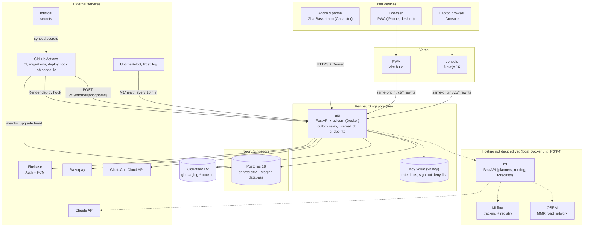

# Chapter 12 — Deployment and Operations

> **In short:**
> - Staging runs on **free tiers only** (D20): the API on a **Render** free web service in Singapore (Docker image built by Render from the repo), **Render Free Key Value** (Valkey), the PWA and console on **Vercel**, files on **Cloudflare R2**. No server of our own to patch; TLS comes from the platforms.
> - **PostgreSQL 18 is on Neon** (Singapore): one shared database for the Infisical `dev` and `staging` environments, with guardrails. There is no database branch per PR. Daily work uses local Docker Postgres.
> - **Deploys:** GitHub Actions on `main` after CI runs `alembic upgrade head` on Neon, then calls the Render deploy hook. Scheduled jobs are internal endpoints called by a GitHub Actions schedule (D21). Secrets live in **Infisical**.
> - **Backups:** Neon's built-in point-in-time restore; a scheduled `pg_dump` to R2 can be added via the jobs workflow.
> - **Observability:** structlog JSON logs, UptimeRobot (which also keeps the free API awake), PostHog. Explicit SLOs and runbooks.
> - **Still open:** hosting for the ML service, OSRM and MLflow (needed from P3/P4; local Docker until then), and paid plans plus the pilot database location (Neon Singapore or a paid Mumbai Postgres), decided before P6.

---

## 12.1 Deployment topology

*Figure 12.1 — Deployment diagram (UML-style: nodes as subgraphs, containers inside)*

### What runs where

| Piece | Where | Purpose | Notes |
|---|---|---|---|
| api | Render free web service (Singapore) | FastAPI modular monolith; relays outbox rows after each commit; serves `POST /v1/internal/jobs/<name>` | Sleeps after 15 minutes idle; UptimeRobot calls `/v1/health` every 10 minutes (750 free hours a month cover 24×7). `/v1/health` never touches the database, so Neon can still go idle |
| valkey | Render Free Key Value (same region) | Rate-limit counters, sign-out deny-list | In-memory, may lose data on restart; the API keeps working without it |
| postgres | Neon (Singapore) | All module schemas, the outbox (the job queue, D21) | One shared database for `dev` and `staging` |
| files | Cloudflare R2 (S3 API, region `auto`) | Media, private KYC files and proofs | SeaweedFS locally; the code uses the S3 API only |
| PWA and console | Vercel | Static PWA build and the Next.js console | `/v1/*` rewrites to the API, so browser cookies are same-origin; preview deployment per PR |
| ml, MLflow, OSRM | Not decided yet | Planners, routing, forecasts, assistant; model registry; road matrix | Run in Docker Compose locally; hosting is decided before P3/P4 |
| worker | None until the pilot | — | No broker for now (D21): the outbox relay and the job endpoints do the work. Taskiq returns when a paid worker exists |

Production for the pilot is not set up yet. Before P6 we decide on paid plans (Render Starter for the API, a worker, Firebase Blaze for real OTPs) and on where the pilot database lives.

## 12.2 Hosted services used

| Need | Service | Notes |
|---|---|---|
| Compute (API) | Render free web service, Singapore | Docker image built by Render from the repo |
| Cache and short-lived data | Render Free Key Value | Not durable; only rate limits and the deny-list |
| Database | Neon (Postgres 18) | Shared `dev` + `staging` database; guardrails in §12.3 |
| Object storage | Cloudflare R2 | `gb-staging-*` buckets; private files are read through short-lived signed URLs |
| Web hosting | Vercel | PWA and console; PR previews |
| Secrets | Infisical (`dev`, `staging`, `prod`) | `infisical run --env=…`; synced to GitHub Actions secrets; never in the repo |
| Builds, migrations, schedules | GitHub Actions | CI, `alembic upgrade head` on Neon, Render deploy hook, scheduled job calls |
| DNS and TLS | Render and Vercel default URLs | No custom domain yet; TLS by the platforms |
| Cost | Free tiers only until the pilot | Nothing here can bill us during development |

## 12.3 Database hosting and the latency note

- **Neon** hosts one shared database for the Infisical `dev` and `staging` environments, with PostGIS and pgvector. There is no branch per PR.
- **Guardrails** on the shared database:
  - migrations reach Neon only from the GitHub Actions deploy workflow after merge (`GB_ALLOW_REMOTE_MIGRATIONS=1`);
  - downgrades on a remote database are refused;
  - tests and `just seed` refuse any non-local database;
  - synthetic rows carry `data_source='synthetic'`.
- **Latency:** Neon has no India region; it runs in Singapore, about 60 ms per round-trip from Mumbai. The API also runs in Singapore, so API-to-database calls are short; the user-to-API leg carries the distance. Mitigate by:
  - batching queries and avoiding N+1 ORM patterns;
  - connection pooling (Neon pooled endpoint);
  - caching hot reads (catalog, prices, slots) where it helps.
- **Decision before Phase 6 (pilot):** keep the pilot database on Neon (Singapore) or move it to a paid Postgres in Mumbai (open question Q3).

## 12.4 Backups and recovery

| What | How | Retention | Restore test |
|---|---|---|---|
| Postgres | Neon point-in-time restore (free tier); a scheduled `pg_dump` to R2 can be added via the jobs workflow | Neon's free-tier restore window | One restore drill before the pilot (Rhythm Thakur / Manish Raje run the checklist) |
| Valkey | Not backed up | — | Nothing to restore: it only holds rate-limit counters and the sign-out deny-list |
| R2 files | Staging holds test files only | — | Strategy decided with the pilot plans before P6 |
| MLflow, OSRM | Local Docker until hosting is decided | — | Rebuild script for OSRM in `infra/osrm` (spike S-3) |
| Config | Dockerfile, Compose files and workflows in git; secrets in Infisical | git history | Redeploy-from-scratch drill once before the pilot |

## 12.5 Observability

| Signal | Tool | What we watch |
|---|---|---|
| Errors and logs | structlog JSON logs (Render log view); OpenTelemetry → Grafana Cloud free tier, set up before the pilot | Errors and slow requests. Sentry is not used |
| Jobs | GitHub Actions run history | Scheduled job calls that failed or ran late |
| Uptime | UptimeRobot | `/v1/health` every 10 minutes (also keeps the free API awake); `/v1/ready` (operator token) checks the database and Valkey |
| Product | PostHog | Funnels (onboarding, approve week), feature flags, A/B experiments. No names or phone numbers in events |
| AI health | Console "AI health" page | Forecast WAPE vs actual, plan acceptance, waste %, model versions |

**Alerts:**
- cut-off job failed or late;
- payment webhook backlog;
- route solve failed;
- error-rate spike;
- API down (UptimeRobot);
- Neon storage or compute hours near the free-tier limits.

## 12.6 Service-level objectives (pilot)

| SLO | Target |
|---|---|
| API latency p95 | < 300 ms (reads), < 800 ms (writes) |
| Cut-off lock job | < 60 s for ~2,000 orders |
| Route solve | < 30 s per slot |
| Weekly plan batch | < 30 min for 5,000 households on 4 cores |
| Uptime | 99% during the pilot |
| Cut-off on time | 100% of delivery days |

## 12.7 Runbooks (`docs/runbooks/`)

| Runbook | Covers |
|---|---|
| `cutoff-failed.md` | Re-run the cut-off job safely through its internal job endpoint (advisory lock, idempotent), verify ledger totals, notify the hub |
| `razorpay-down.md` | Switch default to wallet, queue top-ups, reconcile later |
| `ml-service-down.md` | Confirm the rule-based fallback is active; restart; roll back the model alias if a promotion caused it |
| `route-solve-failed.md` | Fall back to the previous day's route template or nearest-neighbour; manual adjustment in the console |
| `restore-from-backup.md` | Neon point-in-time restore steps; verification queries |
| `rotate-secrets.md` | Rotating API keys and JWT signing keys in Infisical, then redeploying |
| `deploy-rollback.md` | Roll back to the previous Render deploy; downgrades are refused on Neon, so schema mistakes are fixed forward with a new migration |

## 12.8 Ownership

| Area | Owner |
|---|---|
| Infra (Render, Neon, R2, Vercel projects, Infisical, Compose, OSRM, MLflow), API, deploy and job workflows | Prathamesh Relekar |
| Mobile release builds (APK, AAB) | Yash Salunkhe |
| Backup restore tests, runbook drills, uptime checks, load tests | Rhythm Thakur, Manish Raje |

## Decisions & open questions

- **D6** — Postgres-centric data layer ([ADR-0006](../adr/0006-postgresql-centric-data-platform.md) in [`docs/adr/`](../adr/)).
- **D20** — Free-tier hosting: Render, Vercel, Neon, Cloudflare R2, Infisical ([ADR-0020](../adr/0020-free-tier-hosting-render-vercel-neon-r2.md); supersedes ADR-0011 and ADR-0015).
- **D21** — Jobs without a broker until the pilot ([ADR-0021](../adr/0021-jobs-without-a-broker.md)).
- **Open:** hosting for the ML service, OSRM and MLflow (before P3/P4); paid plans for the pilot and Neon Singapore vs a paid Mumbai Postgres (Q3, before Phase 6).

Related: [Chapter 04 — System architecture](04-system-architecture.md) · [Chapter 11 — Engineering process](11-engineering-process.md) · [Chapter 13 — Security and compliance](13-security-and-compliance.md)
