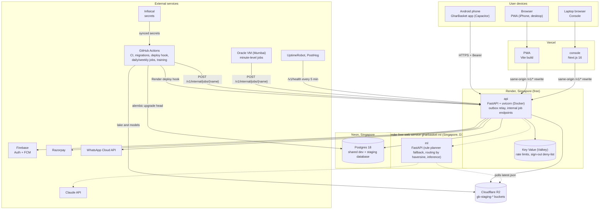

# Chapter 12 — Deployment and Operations

> **In short:**
> - Staging is **live** at `https://api.gharbasket.co.in` (D35; `https://gharbasket-api.onrender.com` still works) and runs on **free tiers only** (D20): the API on a **Render** free web service in Singapore (Docker image built by Render from the repo), **Render Free Key Value** (Valkey), the PWA and console on **Vercel**, files on **Cloudflare R2**. No server of our own to patch; TLS comes from the platforms.
> - **PostgreSQL 18 is on Neon** (Singapore): one shared database for the Infisical `dev` and `staging` environments, with guardrails. There is no database branch per PR. Daily work uses local Docker Postgres.
> - **Deploys:** every green CI run on `main` triggers `deploy-staging.yml`, which runs `alembic upgrade head` on Neon, calls the Render deploy hook and runs a smoke test. CI on `main` cancels a superseded run, so only the newest commit deploys. The repository is public, so Actions minutes are free. Scheduled jobs are internal endpoints called by a GitHub Actions schedule for daily and weekly jobs (D21) and by a scheduler on the staging **Oracle VM** for minute-level ones (D32). Training and data jobs run in GitHub Actions (`training-jobs.yml`, `backend/training`). Secrets live in **Infisical**.
> - **Backups:** staging is a Neon child branch with no point-in-time restore. Its restore points are the `before-demo-*` branches of `just staging-demo`, and a weekly `pg_dump` to a private R2 bucket (`backup-staging.yml`, §12.4).
> - **Observability:** structlog JSON logs, UptimeRobot (which also keeps the free API awake), PostHog. Explicit SLOs; runbooks are planned and written before the pilot (S10).
> - **ML runtime (D25, serving host amended by D30):** the ML service is a second free **Render web service** (`gharbasket-ml`) without OSRM (routing uses haversine; Hugging Face Docker Spaces now need a paid plan, [ADR-0030](../adr/0030-ml-service-on-render-free.md)); models and the data lake live on R2 with a `latest.json` pointer per model; MLflow stays local. No keep-alive pings: both free web services share the workspace's 750 instance hours a month.
> - **Still open:** paid plans plus the pilot database location (Neon Singapore or a paid Mumbai Postgres), decided before P6.

---

## 12.1 Deployment topology


*Figure 12.1 — Deployment diagram (UML-style: nodes as subgraphs, containers inside)*

### What runs where

| Piece | Where | Purpose | Notes |
|---|---|---|---|
| api | Render free web service (Singapore) | FastAPI modular monolith; relays outbox rows after each commit; serves `POST /v1/internal/jobs/<name>` | Sleeps after 15 minutes idle; UptimeRobot calls `/v1/health` every 5 minutes (750 free hours a month cover 24×7). `/v1/health` never touches the database, so Neon can still go idle |
| valkey | Render Free Key Value (same region) | Rate-limit counters, sign-out deny-list | In-memory, may lose data on restart; the API keeps working without it |
| postgres | Neon (Singapore) | All module schemas, the outbox (the job queue, D21) | One shared database for `dev` and `staging` |
| files | Cloudflare R2 (S3 API, region `auto`) | Media, private KYC files and proofs | SeaweedFS locally; the code uses the S3 API only |
| PWA and console | Vercel | Static PWA build and the Next.js console | `/v1/*` rewrites to the API, so browser cookies are same-origin; preview deployment per PR |
| ml | Render free web service `gharbasket-ml` (Singapore, Docker `backend/ml/Dockerfile.render`; ADR-0030) | The pantry twin, routing, kitchen assignment, slot pricing, the basket ranker; the CP-SAT weekly planner is too slow at 0.1 CPU, so staging plans come from the rule planner | No OSRM: `OSRM_URL` is unset and routing prices with haversine. 512 MB and 0.1 CPU; sleeps after 15 idle minutes and wakes in about a minute, and the API's fallbacks cover that. Render deploys it by itself for each commit on `main` that changes `backend/ml/**`, `pyproject.toml`, `uv.lock` or `.dockerignore` (`autoDeployTrigger: commit` in `render.yaml`; no deploy hook). No keep-alive pings: it shares the 750 free instance hours with the API. `Smoke ML` (`smoke-ml.yml`) checks every endpoint by hand and daily at 06:40 IST. The full image with OSRM (`backend/ml/Dockerfile`) is for local runs and a paid host |
| training and data jobs | GitHub Actions (`training-jobs.yml`, `backend/training`) | Data collection, training, forecasts, snapshots | Reads Neon (read-only role) and R2; hands results to the API's internal endpoints with `JOBS_TOKEN` |
| models and lake | Cloudflare R2 (`gb-lake`, `gb-mlflow`) | Snapshots, external data, model versions with a `latest.json` pointer per model | Promotion is manual (`just promote`, D25); the ML service on Render follows `latest.json` every 10 minutes with a read-only token (`S3_*` on `gharbasket-ml`) |
| MLflow | Local only (Docker Compose) | Experiment tracking | Never hosted (D25) |
| worker | None until the pilot | — | No broker for now (D21): the outbox relay and the job endpoints do the work. Taskiq returns when a paid worker exists |

Production for the pilot is not set up yet. Before P6 we decide on paid plans (Render Starter for the API, a worker, Firebase Blaze for real OTPs) and on where the pilot database lives.

## 12.2 Hosted services used

| Need | Service | Notes |
|---|---|---|
| Compute (API) | Render free web service, Singapore | Docker image built by Render from the repo |
| Cache and short-lived data | Render Free Key Value | Not durable; only rate limits and the deny-list |
| Database | Neon (Postgres 18) | Shared `dev` + `staging` database; guardrails in §12.3 |
| Object storage | Cloudflare R2 | `gb-staging-*` buckets; private files are read through short-lived signed URLs |
| Web hosting | Vercel | PWA and console; PR previews |
| Secrets | Infisical (`dev`, `staging`, `prod`) | `infisical run --env=…`; synced to GitHub Actions secrets; never in the repo |
| Builds, migrations, schedules | GitHub Actions | CI, `alembic upgrade head` on Neon, Render deploy hook, daily and weekly job calls (`jobs-staging.yml`), training and data jobs (`training-jobs.yml`) |
| Minute-level schedules | Oracle Cloud Always Free VM, Mumbai | `scripts/jobs_scheduler.py` (service `gharbasket-jobs`): the 21:00 cut-off, the outbox sweep every few minutes, proposal expiry: `POST /v1/internal/jobs/<name>` with `JOBS_TOKEN` (D32). The same VM runs the mandi collector |
| Alerts | healthchecks.io (free) and UptimeRobot (free) | Three healthchecks (`scheduler`, `cutoff`, `ops`) tell a team Telegram group and email when a job fails or the cut-off is missed; UptimeRobot watches `/v1/health` every 5 minutes (D33, §12.5) |
| ML serving | Render free web service, a second one next to the API | The ML service, without OSRM (D30) |
| DNS and TLS | Cloudflare DNS for `gharbasket.co.in` (D35) | Records are DNS only (not proxied); TLS by Render and Vercel. §12.2 "Pointing the domain" |
| Cost | Free tiers only until the pilot | Nothing here can bill us during development. The repository is public, so GitHub Actions minutes are free |

### How a change reaches staging
1. A PR merges into `main`, and CI runs on the merge commit. CI's concurrency group is per ref with `cancel-in-progress`, so a newer push to `main` cancels the older run; a cancelled run never deploys, and only the newest commit does.
2. When CI passes (`workflow_run` on a push, never on a PR), `.github/workflows/deploy-staging.yml`:
   - runs `alembic upgrade head` on Neon (the direct URL);
   - calls the Render deploy hook with `?ref=<commit>`;
   - waits until `/v1/health` reports that commit;
   - runs the smoke test (`scripts/smoke-staging.sh`, also `just cloud <url>`).

   The workflow queues deploys (one at a time, no cancelling, so a migration is never cut off half-way) and skips with a notice while any of its four secrets is missing. It can also be started by hand (`workflow_dispatch`).
3. Render builds `backend/api/Dockerfile` (uv, Python 3.13, non-root) and starts uvicorn on `$PORT` with `--proxy-headers`. Render's own auto-deploy is off (`render.yaml`), so a commit is never deployed before its migrations.
4. Migrations are expand-then-contract (add first, remove a release later), so the old API keeps working while they apply.

**One-time setup (owner: Prathamesh Relekar):**
1. Add `APP_ENV`, `JWT_SIGNING_KEY`, `REFRESH_TOKEN_PEPPER`, `KYC_ENCRYPTION_KEY`, `KYC_HASH_PEPPER` (each `openssl rand -base64 48`) and `JOBS_TOKEN` to Infisical `staging`. `KYC_KEY_VERSION` (default 1) names the KYC key; raise it when the key is rotated.
2. Sign up to Render with GitHub and give it access to this repository only. Then Render → New → **Blueprint** → this repo, which reads `render.yaml`. Enter the `sync: false` values from Infisical.
3. Copy the API's deploy hook (Settings → Deploy Hook).
4. Add the GitHub Actions secrets `DATABASE_URL_DIRECT` (Neon, direct), `RENDER_DEPLOY_HOOK_URL`, `JOBS_TOKEN` and `STAGING_API_URL` (done; the deploy workflow needs exactly these four).
5. Add an UptimeRobot monitor on `/v1/health` every 5 minutes (email alerts), and the three healthchecks.io checks of ADR-0033 (`scheduler`, `cutoff`, `ops`; §12.5) with a Telegram group and email as their notifications. Their ping URLs go into Infisical `staging` as `HC_PING_URL`, `HC_CUTOFF_URL` and `HC_OPS_URL`; `HC_OPS_URL` is also a GitHub Actions secret.
6. Minute-level jobs (ADR-0032): every `runner: vm` entry of `infra/jobs/schedule.yaml`, the one schedule of every job, is called by `scripts/jobs_scheduler.py` on the Oracle VM (the minute-level ones run only in short windows around the events that need them, to let Neon sleep; set the Neon compute to a fixed 0.25 CU). It reads the crons in IST and calls `POST <STAGING_API_URL>/v1/internal/jobs/<name>` with `Authorization: Bearer <JOBS_TOKEN>` and the minute as `scheduled_for`; a call that does not reach the app (429, 502–504, connection error, timeout) is tried again three times. Once per VM: `just jobs-vm setup <ip> <key>`, then `infisical run --env=staging -- just jobs-vm env <ip> <key>` (writes `API_URL` and `JOBS_TOKEN` to a mode-600 file and starts the service; the optional `HC_PING_URL`, `HC_CUTOFF_URL` and `HC_OPS_URL` turn on the healthchecks.io alerts, ADR-0033). The service pulls `main` every 15 minutes, so a merged schedule needs nothing more; run `env` again after a new `JOBS_TOKEN`. `just jobs-vm status <ip> <key>` shows the last calls, `just jobs-vm due <ip> <key> 2026-11-05T21:00` the jobs of a minute. The `actions` entries run from `jobs-staging.yml`.
7. Training jobs (`training-jobs.yml`, ADR-0025): add the GitHub Actions secrets `DATA_GOV_IN_API_KEY` (data.gov.in → My account → API key), `S3_ENDPOINT_URL`, `S3_ACCESS_KEY` and `S3_SECRET_KEY`: an R2 token that can read and write the staging buckets `gb-staging-lake` and `gb-staging-mlflow` (the `gb-lake` / `gb-mlflow` names are the local SeaweedFS defaults; staging's buckets are `gb-staging-*`, set in `training-jobs.yml`, `render.yaml` and `scripts/mandi-on-vm.sh` and `scripts/mandi-on-mac.sh`). Best its own token (Object Read & Write on those two buckets), kept in Infisical `staging` as `TRAINING_S3_ACCESS_KEY` / `TRAINING_S3_SECRET_KEY` and copied to the GitHub secrets without printing them; the VM and Mac collectors fall back to the API's `S3_*` keys when it is absent, and `DATABASE_URL_RO`: `infisical run --env=staging -- scripts/neon-ro-role.sh` creates the read-only role `gharbasket_ro` (SELECT on the catalog, subscriptions, orders and intel schemas and the two household tables only; every transaction read-only), checks it cannot write or read `identity.users`, and sets the secret without printing it. Running it again rotates the password. Until the secrets exist each job skips with a notice. `collect_mandi` cannot run on Actions (api.data.gov.in refuses connections from outside India): it runs on an Oracle Cloud Always Free VM in Mumbai (VM.Standard.E2.1.Micro, Ubuntu 24.04): `scripts/mandi-on-vm.sh setup <ip> <key>` installs it with a daily systemd timer at 18:45 IST (a run missed while the VM was down runs at boot; each run pulls `main` first), `infisical run --env=staging -- scripts/mandi-on-vm.sh env <ip> <key>` copies its secrets, and `run` and `status` show the log and the timer. A Mac in India with `scripts/mandi-on-mac.sh install` (launchd, daily 18:45; needs `infisical login`) is the fallback; it ran the job until the VM took over and is now uninstalled.

### Vercel projects (PWA and console)

Two Vercel projects are imported from this repository (Git integration, production branch `main`, a preview per PR). Prathamesh Relekar creates and owns them on his Vercel account (§12.8): Vercel connects a repository only through its owner's GitHub account, and the free Hobby plan has no team members, so a collaborator cannot create or join them. Yash Salunkhe supplies the settings below and checks each site after a deploy. Hobby is for non-commercial use, which covers staging on Razorpay test keys; taking real payments needs the Pro plan or another host (a pilot decision).

| Setting | PWA (`frontend/mobile`) | Console (`frontend/console`) |
|---|---|---|
| Framework preset | Vite | Next.js |
| Root Directory | `frontend/mobile` | `frontend/console` |
| Include source files outside the Root Directory | on (the default for new projects; needed for `frontend/packages/ui` and the pnpm workspace) | on |
| Install, build and output commands | the defaults. **Do not override the install command**: a plain `pnpm install` there makes Vercel use its oldest pnpm (6) | the defaults |
| Environment, both projects | `ENABLE_EXPERIMENTAL_COREPACK=1` (so the pinned `packageManager` pnpm is used) | the same |

The root `prepare` script installs the git hooks (`lefthook install`), which exits with an error where there is no `.git` directory; it now skips itself when `VERCEL` is set, as it is in every Vercel build. (`LEFTHOOK=0` does not help: it turns the hooks off, not their installation.)

**PWA.** `frontend/mobile/vercel.json` sends `/v1/*` to the API and every other path to `index.html` (the single-page app), so browsers use the API's cookies same-origin (ADR-0024). The destination is fixed in that file: moving to a production API means editing it. The service worker already keeps `/v1/` out of its navigation fallback. The `/v1/*` route also sets the request header `x-origin-secret` to the project's `ORIGIN_SECRET` (Production only, type Secret, never `VITE_`). `set` replaces any value the visitor sent, so the API can tell its own proxy from a direct caller when it picks the caller's address. Only `routes` can transform request headers, so the file uses `routes`: `/v1/(.*)` to the API, then `{ "handle": "filesystem" }` (static files), then `/(.*)` to `/index.html`. Environment (public values, from Infisical `staging`; `pnpm env:pull` in `frontend/mobile` prints them): the five `VITE_FIREBASE_*`, `VITE_FIREBASE_TEST_MODE` (`true` only while using Firebase's fictional test numbers), and `VITE_PUBLIC_WEB_URL` (the PWA's own address, used in neighbour invite links). Infisical keeps the Firebase values **without** the prefix (`FIREBASE_API_KEY`, `FIREBASE_AUTH_DOMAIN`, `FIREBASE_PROJECT_ID`, `FIREBASE_APP_ID`, `FIREBASE_MESSAGING_SENDER_ID`); `env:pull` adds `VITE_` for a local `.env.local`, but on Vercel each one is entered by hand under its `VITE_` name. Vercel refuses a `VITE_` name of type Secret (the prefix puts the value in the browser bundle), so these five are type **Config**: Firebase's web config is public by design. Nothing else from Infisical ever gets a `VITE_` name. Vite bakes the values into the build, so a value added after a deploy needs a redeploy (without the build cache), and an open tab keeps the old build until its "New version available" banner is accepted. A missing value shows as "We couldn't send the code" on every number (2026-11-13). Never set `VITE_API_MOCK`: builds drop the mocks anyway. Also add the PWA's domain under Firebase console → Authentication → Settings → Authorized domains, or phone sign-in is refused.

**Console.** It does **not** use a `/v1/*` rewrite, by design (`lib/auth-api.js`): its server calls the API and copies the cookies, and nothing in the browser calls the API, so a rewrite would only publish the whole API on the console's address. In real mode it needs `GB_API_MOCK=false` and `GB_API_URL=https://api.gharbasket.co.in`. **Its sign-in is not built yet**: the console accepts only the dev phone path, which the API allows only when `APP_ENV=dev`, so a console in real mode cannot be signed into on staging until Firebase phone sign-in is added to it. Until then a Vercel console can only show its demo data: leave `GB_API_MOCK` unset (mock mode is the default) and set `GB_DEV_LOGIN=1` so the seed staff buttons appear. Without `GB_API_MOCK=false` the console serves fake data, whatever API exists.

**After the first deploy:**
1. Point the domains at them ("Pointing the domain" below), then send both addresses (`https://gharbasket.co.in`, `https://app.gharbasket.co.in`) to Prathamesh to add to `WEB_ORIGINS` on Render. The API's origin check applies to browser requests, so the PWA needs it; the console's server calls carry no `Origin`, so it probably does not. A preview deployment has its own address that is not in `WEB_ORIGINS`, so signing in on a preview is expected to be refused until that address is added.
2. Smoke test the PWA: `curl https://<pwa-address>/v1/health` answers `{"status":"ok",...}` through the rewrite; deep links such as `/week` load; sign in with a Firebase test number and reload the page (the session survives).

### Pointing the domain (D35)

`gharbasket.co.in` is registered with its DNS on Cloudflare. Every record is **DNS only** (grey cloud): Render and Vercel issue their own certificates, and Cloudflare's proxy would sit in front of them. Cloudflare's SSL/TLS mode is Full (strict), so a record proxied by mistake still checks the certificate. The platform addresses (`*.onrender.com`, `*.vercel.app`) keep working, so a record can be removed at any time without an outage.

| Name | Serves | Record | State |
|---|---|---|---|
| `api.gharbasket.co.in` | The API (Render `gharbasket-api`) | CNAME `gharbasket-api.onrender.com`, added under Render → Settings → Custom Domains | Live since 2026-11-11 |
| `gharbasket.co.in`, `www` | The console: its public pages (`/s/<slug>`) and the staff console. `www` redirects to the bare name | The records Vercel shows under the console project → Settings → Domains | When the console is on Vercel |
| `app.gharbasket.co.in` | The PWA | The CNAME Vercel shows under the PWA project → Settings → Domains | When the PWA is on Vercel |

Both web names are already authorised in Firebase (Authentication → Settings → Authorized domains). When a name goes live, set the values that point at it:
- **Render:** `WEB_ORIGINS` (`https://gharbasket.co.in,https://app.gharbasket.co.in`), `PUBLIC_WEB_URL`, `APP_WEB_URL`, `CONSOLE_URL`.
- **Vercel:** `NEXT_PUBLIC_SITE_URL`, `NEXT_PUBLIC_APP_URL` and `GB_API_URL` on the console; `VITE_PUBLIC_WEB_URL` on the PWA. Redeploy after a change: Vite and `NEXT_PUBLIC_*` values are baked into the build.
- **Infisical `staging` and GitHub Actions:** `STAGING_API_URL` and `API_BASE_URL` (the Capacitor build) are `https://api.gharbasket.co.in`. After changing `STAGING_API_URL`, run `just jobs-vm env` and `scripts/mandi-on-vm.sh env` again so the Oracle VM uses it.
- **Outside the repo:** the Razorpay test webhook and the UptimeRobot monitor use `https://api.gharbasket.co.in`.

## 12.3 Database hosting and the latency note

- **Neon** hosts one shared database for the Infisical `dev` and `staging` environments, with PostGIS and pgvector. There is no branch per PR.
- **Guardrails** on the shared database:
  - migrations reach Neon only from the GitHub Actions deploy workflow after merge (`GB_ALLOW_REMOTE_MIGRATIONS=1`);
  - downgrades on a remote database are refused;
  - tests refuse any non-local database; `just seed` and `just sim` refuse one unless the run has both `--allow-remote` and `GB_ALLOW_REMOTE_SEED=<the database host>` (only `scripts/staging-demo.sh` does that, below);
  - synthetic rows carry `data_source='synthetic'`.
- **Latency:** Neon has no India region; it runs in Singapore, about 60 ms per round-trip from Mumbai. The API also runs in Singapore, so API-to-database calls are short; the user-to-API leg carries the distance. Mitigate by:
  - batching queries and avoiding N+1 ORM patterns;
  - connection pooling (Neon pooled endpoint);
  - caching hot reads (catalog, prices, slots) where it helps.
- **Decision before Phase 6 (pilot):** keep the pilot database on Neon (Singapore) or move it to a paid Postgres in Mumbai (open question Q3).

### Staging demo data (`just staging-demo`)

Staging has the seed (people, societies, hub, catalog; copied from a local database on 27 Oct) but no activity of its own. So the ranker and the pantry refit have nothing to learn from, and the app demos are empty. `scripts/staging-demo.sh` loads activity, all of it marked `data_source='synthetic'`.

**Before you run it.** The simulator drains staging's whole outbox (real users' events too) through the module consumers of your checkout. So:
- run it from the exact commit staging runs, after its deploy has finished. The script compares `git rev-parse HEAD` with `/v1/health`'s `commit` and refuses a mismatch or uncommitted changes (`--skip-commit-check` overrides, not recommended);
- merge nothing and run no migration while it runs. A deploy mid-run would put two versions of the code on one database.

```
infisical run --env=staging -- just staging-demo                                    # 1. host, counts, plan, unlock check; writes nothing
GB_ALLOW_REMOTE_SEED=<host it printed> infisical run --env=staging -- just staging-demo   # 2. loads it
```

Both steps need `NEON_PROJECT_ID` in Infisical `staging`, next to `NEON_API_KEY`. Without it the script lists the projects the key sees. A personal key does not list an organisation's projects, so the lookup fails unless the key is an organisation key.

What step 2 does, in order:
1. **Restore point.** A Neon branch `before-demo-<UTC time>` of the database's branch, made through the Neon API (`scripts/neon_restore_point.py create`). It has no compute, so it costs only the storage of what changes afterwards. The script prints how to roll back. `--no-backup` skips this; don't use it on staging.
   - First it deletes earlier `before-demo-*` points of the same branch that nothing hangs off: no child branch, no compute, not the default. Those are loads that were kept.
   - It refuses (exit 1, before writing anything) when the project would pass Neon's free 10 branches with this point plus a rollback from it.
2. **Seed, adds only.** On a shared database `just seed` only creates what is missing and leaves every existing row as it is: hub, societies, people (with their roles), categories, the price list, festival days and trainings. A role revoked in the console stays revoked. Products and recipes are only ever added, and `--refresh` is refused there, so nothing edited in the console is overwritten.
3. **Simulated weeks.** `just sim --write-db --pause-after` (M3 → M4 → M5, as in the simulator README).
   - Each week's add-ons go on the approved box as add-on lines through M4 (`set_addons`), before the cut-off, so the top-up and the debit cover them: the forecast's uncommitted demand ([ADR-0031](../adr/0031-uncommitted-demand-is-add-on-lines-and-tiffins.md)), from the same derivation as the eval harness (`gharbasket_sim.uncommitted`). `--no-uncommitted` leaves them out. Tiffins are not placed: no tiffin menus or products exist yet (M2 §3.4).
   - The weeks are the last `--weeks` full weeks before this IST week (default 8). Every simulated delivery is in the past, and the current week stays with staging's own jobs.
   - The households are a share of the seed societies' flats: `--adoption`, default 0.015, gives 13 households with phones +91 98001 00001 to 00013.
   - At the end their subscriptions are paused (until 2099), so staging's weekly job drafts no boxes for them: no ML calls and no box-ready or reminder messages. The next run resumes them for its weeks.
   - The ground truth goes to `data/sim_truth/staging-<UTC time>/` on the owner's machine.
4. **Counts.** Households, cycles, orders, add-on lines, box lines, edit feedback and pantry taps, before and after.

**Safety.**
- **Two confirmations.** `just seed` and `just sim` write to a non-local database only with both `--allow-remote` and `GB_ALLOW_REMOTE_SEED` equal to that database's host, so a URL pointing at the wrong database stops there. The tools print the host, never the URL or a password.
- **No double weeks.** A week the simulator already replayed (a locked, skipped or cancelled cycle of a +91 98001 household) is never simulated again. Such a window is refused, and `--add-weeks` simulates only the weeks after the latest one.
- **No society unlock.** Simulated households count towards their society's unlock (M9 §3.6). If a run would take an `unlocking` society to its threshold, that society would go live for its real households too: `community.society_live` to their owners, and the end of their pre-live fee. Step 1 prints joined + new against the threshold for every `unlocking` society the run adds to, and the script refuses such a run (exit 5). It checks again after the seed. This is a check at one point in time: the simulated households stay in the count after the run, so a later threshold recompute (the weekly stop-cost job) or new real households can still tip the society live.
- **No real account taken over.** On a shared database the simulator refuses a run in which a +91 98001 phone already belongs to a real account. That number may be a stranger's. The refusal comes before anything is committed.
- **Only its own boxes.** The simulator shows the household only its own draft (`send_box_ready_notices(cycle_ids=…)`), never another household's draft that happens to be in the window.
- **No pushes.** Simulated people are synthetic accounts. M11's `send_deliveries` skips push and WhatsApp for synthetic accounts outside dev and test (M11 §6), so their messages stay in their inbox and none reaches a phone. That includes a team phone signed in to a seed account.
- **Who else is touched.** The simulated events themselves are addressed to the simulated owners only: every hub move is the `hub` actor, so no captain or rider earns from them. But the relay also delivers any real event that is pending at the time (see "Before you run it").
- **Money.** The simulated wallet top-ups post to the platform accounts `razorpay_clearing` and `unearned_revenue` like real ones; only their reference (`sim:<household>:<date>`) tells them apart. Staging's reconciliation and M12's money figures include them, so subtract the `sim:` entries, or read staging's money figures as demo figures.
- **No false drift.** Staging's forecast job runs on synthetic orders, but the simulated weeks stop at the last full week. M10's `monitor_drift` does not score a hub, source and day that has no sold order of that source at all, so the days after a load raise no drift alert (no actuals is not a 100 % error, M10 §6).

**Size and cost.** One household-week is about 280 statements, 170 rows and 30 s, measured locally through a proxy that adds Neon's 60 ms round trip. On the direct (non-PgBouncer) URL the seed and the simulator keep their prepared statements (`create_engine(cache_statements=True)`), which makes them about three times faster.
- The defaults (13 households × 8 weeks = 104 household-weeks) are about 18,000 rows and 44 to 68 minutes from India. `--weeks 6` is about 33 to 51 minutes. The script prints its own estimate first.
- Neon's compute stays awake only for the run, inside the free plan's monthly compute hours.

**What it trains.**
- The ranker learns from the box edits.
- The pantry refit learns from the taps: at least 3 tapping households per cohort and product (`MIN_HOUSEHOLDS`). At the default `--adoption 0.015` that gives priors for 2 of the 3 cohorts (small and medium; the large cohort has 1 household). All 3 need about `--adoption 0.025`, which is about 1.7 times the rows and time.
- The **forecast** learns from the add-on lines (its uncommitted demand, ADR-0031; about 6 lines a household-week, mostly fruit, since a shortfall of a product already on the box is a box edit). Its backtest needs about 11 complete weeks: 7 before a series is modelled, then 3 origins with the 2-week horizon. A run meant to train it uses **`--weeks 12`**: 13 households × 12 weeks = 156 household-weeks, about 66 to 102 minutes against Neon (the add-ons add a few statements a household-week). On a local run of 8 households × 3 weeks (2 Nov) the job's data query read 151 add-on lines over 12 products, and `jobs.forecast` answered "buy last week" for them (no backtest yet).
- **Staging's load, 7 Nov 2026:** 12 weeks from 10 Aug at commit 7bb49d67, with add-ons: 156 weekly cycles, 147 orders, 770 add-on lines (restore point `before-demo-20261107T0758Z`). It replaced the 2 Nov load (box orders only, so the forecast had no data) and a 6 Nov load that placed no add-ons (#490). Both were rolled back from their restore points.

**If a run fails** part-way, households are left partly simulated: some committed weeks, some not. A rerun of that window is refused, and `--add-weeks` cannot fill a gap before the latest replayed week. The run also resumed the simulated subscriptions at its start, and did not reach the pause at its end, so staging's weekly job will draft their boxes again. Either restore from the branch and run again, or at least pause them:

```
infisical run --env=staging -- sh -c 'psql "$DATABASE_URL_DIRECT" -c "UPDATE subscriptions.subscriptions SET status = '\''paused'\'', paused_until = '\''2099-12-31'\'' WHERE status <> '\''ended'\'' AND household_id IN (SELECT h.id FROM identity.households h JOIN identity.users u ON u.id = h.owner_user_id WHERE u.phone_e164 LIKE '\''+9198001%'\'')"'
```

**To undo** the load, restore the database's branch from its restore point. The connection string stays the same, and anything written to staging after the point is lost, so check first:

```
GB_ALLOW_REMOTE_SEED=<host> infisical run --env=staging -- just staging-rollback before-demo-<UTC time>
```

It restores from the point's head, keeps the replaced state as `staging-with-demo-<UTC time>`, and waits until Neon has finished.
- **Each rollback leaves two branches for good.** Staging is a child branch, so Neon gives it no point-in-time restore or snapshots (root branches only). A restore makes the restore point staging's parent, and the replaced state is the restore point's parent. Neon cannot delete a branch with children, so the chain grows by these two with every rollback.
- **Keeping a load costs nothing.** Its restore point is a leaf, and the next load deletes it.
- **Branch count, 7 Nov 2026:** 8 of 10, from the rollbacks of 2 and 6 Nov. The two archived dev branches can be deleted if nobody uses them.

Delete old `before-demo-*` branches in the console; the free plan allows 10 branches.

## 12.4 Backups and recovery

| What | How | Retention | Restore test |
|---|---|---|---|
| Postgres | Staging is a Neon child branch, so it has **no point-in-time restore**. Two ways back: the `before-demo-*` restore points (`just staging-demo`, rolled back with `just staging-rollback`, §12.3), and a weekly `pg_dump` to R2 (`backup-staging.yml`, below) | The 8 newest weekly dumps (about two months); restore points until a rollback or the next demo load replaces them | One restore drill before the pilot (Rhythm Thakur / Manish Raje run the checklist in `docs/runbooks/restore-from-backup.md` (written with the second part of the runbooks)) |
| Valkey | Not backed up | — | Nothing to restore: it only holds rate-limit counters and the sign-out deny-list |
| R2 files | Staging holds test files only | — | Strategy decided with the pilot plans before P6 |
| Models, lake | R2 (`gb-mlflow`, `gb-lake`); MLflow runs stay local | Every promoted model version is kept | Point `latest.json` back at the previous version |
| OSRM | Baked into the full ML image (`backend/ml/Dockerfile`, local runs and a paid host); not on staging (ADR-0030) | — | Rebuilt from `infra/osrm/prepare.sh` |
| Config | Dockerfile, Compose files and workflows in git; secrets in Infisical | git history | Redeploy-from-scratch drill once before the pilot |

### Weekly staging dump (`backup-staging.yml`)

Neon on the free plan keeps no history of a child branch, so the workflow `.github/workflows/backup-staging.yml` takes one:
- **When:** Sunday 03:43 IST (cron `13 22 * * 6`, UTC) and by hand (`workflow_dispatch`). That is a minute the daily `purge_gps_pings` job already wakes Neon, so it adds a few minutes to an existing wake and keeps the compute-hours budget of `infra/jobs/schedule.yaml`.
- **What:** `pg_dump --format=custom --no-owner --no-acl` of the whole database through `DATABASE_URL_DIRECT` (the direct URL, as for migrations). The client is the official `postgres:18` image, so its major version matches Neon's Postgres 18; move the tag when Neon moves. The workflow checks that `pg_restore --list` reads the dump and finds `identity.users` before it uploads anything.
- **Where:** the R2 bucket `gb-staging-backups`, key `staging/YYYY-MM-DD.dump` (the IST date), uploaded with the S3 API. It keeps the newest 8 and deletes older keys of that form. Nothing else in the bucket is touched.
- **Secrets** (GitHub Actions, and Infisical `staging` for the restore): `BACKUP_S3_ENDPOINT_URL`, `BACKUP_S3_ACCESS_KEY`, `BACKUP_S3_SECRET_KEY`, plus the existing `DATABASE_URL_DIRECT`. They are separate from the training jobs' `S3_*` secrets so that the token covers this bucket alone. Until they exist, the workflow skips with a notice. When it fails, it pings the healthchecks `ops` alert (`HC_OPS_URL`, ADR-0033).
- **Privacy.** The dump holds the personal data of every staging user (handbook 13 §13.1). So the bucket must be **private**: no public access, no custom domain, no `r2.dev` URL. The token is Object Read & Write on that bucket only, and the access is limited to Prathamesh Relekar, with Rhythm Thakur and Manish Raje for the restore drill. Encryption at rest is R2's (handbook 13 §13.5). A downloaded dump is deleted after use.
- **Limits.** One dump a week means up to a week of data can be lost. Staging holds synthetic and test data, so that is accepted; the pilot database's backups are decided with Q3.

**One-time setup (owner: Prathamesh Relekar):**
1. Cloudflare → R2 → create the bucket `gb-staging-backups`. Leave public access off.
2. R2 → Manage API tokens → a token with Object Read & Write on `gb-staging-backups` only. Keep the three values (endpoint, access key, secret) in Infisical `staging` as `BACKUP_S3_ENDPOINT_URL`, `BACKUP_S3_ACCESS_KEY` and `BACKUP_S3_SECRET_KEY`.
3. Copy them to the GitHub Actions secrets of the same names without printing them: `infisical run --env=staging -- sh -c 'printf %s "$BACKUP_S3_ACCESS_KEY" | gh secret set BACKUP_S3_ACCESS_KEY'`, and the same for the other two.
4. Run the workflow once by hand (Actions → Backup staging → Run workflow). Check the key in the bucket and the byte count in the log.
5. Do the restore drill below once, so the first real need is not the first try.

**Restoring a dump** (details and checks in `docs/runbooks/restore-from-backup.md` (written with the second part of the runbooks)): download the file, make a new empty database in a **new Neon branch** (never the live staging branch), and run `pg_restore --no-owner --no-acl --dbname "$RESTORE_URL" <file>` with a `pg_restore` of version 18 or newer (the `postgres:18` image has one). Check it, and only then decide whether it replaces anything. A restore goes into the live staging branch only through the rollback procedure of §12.3, which keeps the replaced state as a branch.

## 12.5 Observability

| Signal | Tool | What we watch |
|---|---|---|
| Errors and logs | structlog JSON logs (Render log view) | Errors. Every line inside a span carries `trace_id` and `span_id`. Sentry is not used |
| Traces | OpenTelemetry (API and ML service) → Grafana Cloud free tier over OTLP/HTTP (M0 §6.2), on when `OTEL_EXPORTER_OTLP_ENDPOINT` is set on Render | Slow and failing requests (`<METHOD> <route template>`), database calls, outgoing calls (ML, Razorpay, FCM, Firebase, WhatsApp, R2) and job and consumer runs; one trace across the API and the ML service. Traces only: no OpenTelemetry metrics or logs |
| Jobs | healthchecks.io (below); GitHub Actions run history; the VM scheduler's journal (`just jobs-vm status <ip> <key>`); `just job-runs` (the runs endpoint, M0 §3) | Scheduled job calls and training runs that failed or ran late |
| Uptime | UptimeRobot | `/v1/health` every 5 minutes (also keeps the free API awake); `/v1/ready` (operator token) checks the database and Valkey. The ML service is not pinged (ADR-0030: a keep-alive would starve the API of the shared 750 free hours); the daily `Smoke ML` run (06:40 IST) checks `/health` and every endpoint |
| Product | PostHog | Funnels (onboarding, approve week), feature flags, A/B experiments. No names or phone numbers in events |
| AI health | Console "AI health" page | Forecast WAPE vs actual, plan acceptance, waste %, model versions |

**Alerts, as built ([ADR-0033](../adr/0033-ops-alerts-healthchecks-and-uptimerobot.md)).** They go to a team Telegram group and email through healthchecks.io (free plan), because the thing that raises the alarm must live outside the API. UptimeRobot sends email. Each alert names its runbook (`docs/runbooks/README.md`):

| Alert | Raised by | Fires when | Runbook |
|---|---|---|---|
| healthchecks `cutoff` | The VM scheduler pings `HC_CUTOFF_URL` after `cutoff_lock` answers ok | No ok ping by 21:10 IST (cron `0 21 * * *` Asia/Kolkata, 10 minutes of grace): the cut-off was missed or late | [`cutoff-failed.md`](../runbooks/cutoff-failed.md) |
| healthchecks `scheduler` | The VM scheduler pings `HC_PING_URL` every full hour | No ping for 1 hour and 15 minutes: the VM or its service is dead | [`jobs-scheduler-down.md`](../runbooks/jobs-scheduler-down.md) |
| healthchecks `ops` | `/fail` on `HC_OPS_URL`, with the error as the body: a VM job that fails or gives up after four tries; a failed `jobs-staging.yml` or `training-jobs.yml` run (and `backup-staging.yml`). A clean `ops_check` pings ok | At once on `/fail`; or no ok in 12 hours plus 1 hour of grace | The one the body names |
| `ops_check` probes (06:30, 12:30, 21:15 and 23:45 IST, inside windows that already wake Neon) | Each module registers probes; the job fails with one line per problem | Any probe in the table below finds a problem | The probe's runbook, README "Reading an `ops` alert" |
| UptimeRobot | `GET /v1/health` every 5 minutes | The API does not answer | [`deploy-rollback.md`](../runbooks/deploy-rollback.md) |
| Admin message "Payment check: N to look at" | Reconciliation (M5), routed by M11 | A run opened items | [`razorpay-down.md`](../runbooks/razorpay-down.md) |
| Hub manager and admin message "Routes for <hub> need a look" | Route planning (M7), routed by M11 | A plan has problems and was not published | [`route-solve-failed.md`](../runbooks/route-solve-failed.md) |
| `smoke-ml.yml` red; AI health page `down` | GitHub Actions (daily 06:40 IST); the console | The ML service is asleep, failing or gone | [`ml-service-down.md`](../runbooks/ml-service-down.md) |

**Probes registered, as built (`@platform.ops.probe`, M0 §6.1).** Each returns one line per problem, naming what is wrong; a probe reads only its own module's schema. A probe that raises counts as a problem and the others still run. A problem goes away when its cause does (the next clean `ops_check` brings the `ops` check back up).

| Probe | Module | Detects | Runbook |
|---|---|---|---|
| `platform.failed_jobs` | M0 | A `failed` job run in the last 24 hours with no later `ok` run of the same job (`ops_check` itself is left out) | [`cutoff-failed.md`](../runbooks/cutoff-failed.md) for the cut-off; the job's own runbook; else README "Any other failed job" |
| `platform.jobs_with_failed_hubs` | M0 | A per-hub job (`assign_kitchens`, `assignment_acceptance_timeout`, `refund_unassigned_tiffins`, `surplus_cascade`, `generate_weekly_plans`) that ended `ok` but listed `failed_hubs` in its summary, with no later clean run; names the hub ids | README "Any other failed job": the failed hub's error is in the API log (Render); once fixed, run the job again for the same `scheduled_for` (each hub's work is idempotent) |
| `platform.jobs_with_failed_households` | M0 | A job (today `generate_weekly_plans`) that ended `ok` but listed `failed_households` in its summary, with no later run clean of that key; names up to 10 household ids | README "Any other failed job": the household's error is in the API log (Render); once fixed, run the job again for the same `scheduled_for` |
| `platform.outbox_stuck` | M0 | An outbox event unsent for 30 minutes after 3 or more attempts, counted by event type | README "Any other failed job" (step 4: a consumer keeps failing; the error is in `platform.outbox.last_error`) |
| `platform.database_size` | M0 | `pg_database_size` above 80 % of `OPS_DB_LIMIT_MB` (default 512, Neon's free tier) | README "Reading an `ops` alert": delete old demo branches and data, or plan the paid database (Q3) |
| `billing.webhook_backlog` | M5 | A payment webhook unprocessed for more than 15 minutes (normally impossible: the endpoint stores and processes in one transaction) | [`razorpay-down.md`](../runbooks/razorpay-down.md) |
| `billing.reconciliation_open` | M5 | A reconciliation item open for more than 24 hours, counted by kind | [`razorpay-down.md`](../runbooks/razorpay-down.md) "Reconciliation items" |
| `billing.refunds_stuck` | M5 | Refund parts still pending after 3 tries, with the total in rupees | [`razorpay-down.md`](../runbooks/razorpay-down.md) "Stuck refunds" |
| `logistics.plans_failed` | M7 | A `failed` route plan for the delivery day being prepared (tomorrow from the 23:15 solve, today until the routes close at 16:00) that no published plan replaced | [`route-solve-failed.md`](../runbooks/route-solve-failed.md) |
| `logistics.plans_unreviewed` | M7 | A plan left `solved` for a manager's review (it had problems) at 06:30 on its day | [`route-solve-failed.md`](../runbooks/route-solve-failed.md) |
| `orders.revenue_unrecognised` | M4 (reads `orders.*`; money through `billing.api`) | An order delivered more than an hour ago, within 7 days, that still holds money in `unearned_revenue` (M5 recognises it on `orders.delivered`) | Run `recognise_delivered_revenue` by hand (`just job recognise_delivered_revenue`, M5 §3.9; idempotent), then README "Run a job by hand" |
| `partners.kyc_key_missing` | M8 | A stored KYC row whose `key_version` or `hash_version` has no configured key or pepper (its number cannot be read, or matched as a duplicate), or a configured key or pepper that fails on a sample row of its version (does not decrypt, does not reproduce the hash); names the versions and row counts, never a number | [`rotate-secrets.md`](../runbooks/rotate-secrets.md) "KYC_ENCRYPTION_KEY and KYC_HASH_PEPPER" |

**Not built yet:** the error-rate alert. The traces it needs are built (M0 §6.2); the owner makes the rule in Grafana Cloud (the share of request spans with a 5xx status over 15 minutes, to the same Telegram group and email), and it is written down here when it exists. Also not watched: Neon compute hours near the free limit (only storage is watched, by the `database_size` probe; watch the hours in the Neon console, see the budget in `infra/jobs/schedule.yaml`).

## 12.6 Service-level objectives (pilot)

| SLO | Target |
|---|---|
| API latency p95 | < 300 ms (reads), < 800 ms (writes) |
| Cut-off lock job | < 60 s for ~2,000 orders |
| Route solve | < 30 s per slot |
| Weekly plan batch | < 30 min for 5,000 households on 4 cores |
| Uptime | 99% during the pilot |
| Cut-off on time | 100% of delivery days |

## 12.7 Runbooks

Start at [`docs/runbooks/README.md`](../runbooks/README.md): which runbook goes with which alert, how to read an `ops` alert, and how to run a job by hand. All are written: `ml-service-down.md` (2 Nov 2026) and the other eight (11 Nov 2026). Rhythm Thakur and Manish Raje walk through `cutoff-failed.md` and `restore-from-backup.md` on staging as the pre-pilot drill (§12.4), and file fixes as PRs:

| Runbook | Covers |
|---|---|
| [`cutoff-failed.md`](../runbooks/cutoff-failed.md) (written) | Re-run `cutoff_lock` through the staging jobs workflow with that evening's 21:00 as `scheduled_for` (advisory lock, debits keyed per order), check the Cut-off page, repair procurement, kitchen offers and routes that ran before it, tell the hub |
| [`razorpay-down.md`](../runbooks/razorpay-down.md) (written) | Boxes go on from the wallet; top-ups answer 503 until Razorpay is back; run `reconcile_payments` and `send_refunds` after it; what each reconciliation item needs; stuck refunds |
| [`ml-service-down.md`](../runbooks/ml-service-down.md) (written) | Confirm the rule-based fallback is active (`ml_fallback` log lines; `circuit_open` means the API's breaker is skipping the service for 60 s, handbook 08 §8.2); restart the service; point `latest.json` back at the previous version if a promotion caused it. `smoke-ml.yml` runs daily at 06:40 IST and names the endpoint that broke |
| [`route-solve-failed.md`](../runbooks/route-solve-failed.md) (written) | A `failed` plan is a data problem (no vehicle, no society location); a `solved` one has problems to review; fix, solve again from the console, publish (accepting problems is audited) |
| [`jobs-scheduler-down.md`](../runbooks/jobs-scheduler-down.md) (written) | The Oracle VM's `gharbasket-jobs` service: status, restart, secrets, a stopped or lost VM; run the missed evening jobs by hand (missed minutes are not replayed) |
| [`restore-from-backup.md`](../runbooks/restore-from-backup.md) (written) | The honest version: staging is a Neon child branch with no point-in-time restore. Roll back to a `before-demo-*` restore point with `just staging-rollback`, or restore the weekly dump from R2 into a new database (never into the live branch); what to redo afterwards (sessions, erasures, the day's jobs, reconciliation); verification queries |
| [`rotate-secrets.md`](../runbooks/rotate-secrets.md) (written) | Every secret, where it lives and how to rotate it. The JWT key rotates without sign-outs (`JWT_RETIRED_KEYS`); `JOBS_TOKEN` and `ML_SERVICE_TOKEN` have several homes; `KYC_ENCRYPTION_KEY` and `KYC_HASH_PEPPER` are never rotated until re-encryption exists; `REFRESH_TOKEN_PEPPER` only on a leak (everyone signs in again) |
| [`deploy-rollback.md`](../runbooks/deploy-rollback.md) (written) | Roll back to the previous Render deploy (code only); downgrades are refused on Neon, so schema mistakes are fixed forward with a new migration; never re-run the deploy workflow on an older ref; smoke test with `just cloud <url>` |
| [`dpdp-breach.md`](../runbooks/dpdp-breach.md) (written) | The breach process of handbook 13 §13.6: contain, assess, notify the Data Protection Board and the affected people as the current DPDP Rules require; it states no deadline |

## 12.8 Ownership

| Area | Owner |
|---|---|
| Infra (Render, Neon, R2, Vercel projects, Infisical, Compose, the ML service, OSRM, MLflow, the Oracle VM), API, deploy, job and training workflows | Prathamesh Relekar |
| Mobile release builds (APK, AAB) | Yash Salunkhe |
| Backup restore tests, runbook drills, uptime checks, load tests | Rhythm Thakur, Manish Raje |

## Decisions & open questions

- **D6** — Postgres-centric data layer ([ADR-0006](../adr/0006-postgresql-centric-data-platform.md) in [`docs/adr/`](../adr/)).
- **D20** — Free-tier hosting: Render, Vercel, Neon, Cloudflare R2, Infisical ([ADR-0020](../adr/0020-free-tier-hosting-render-vercel-neon-r2.md); supersedes ADR-0011 and ADR-0015).
- **D21** — Jobs without a broker until the pilot ([ADR-0021](../adr/0021-jobs-without-a-broker.md)).
- **D25** — ML runtime: training in GitHub Actions, models and the lake on R2, MLflow local only, cron-job.org for minute-level jobs ([ADR-0025](../adr/0025-ml-runtime-spaces-actions-r2.md); settles the ML hosting left open in ADR-0020). Its minute-level trigger moved to the Oracle VM by D32.
- **D30** — the ML service on a second free Render web service, without OSRM, replacing the Hugging Face Space of D25 ([ADR-0030](../adr/0030-ml-service-on-render-free.md)).
- **D32** — staging's minute-level jobs are called by a scheduler on the Oracle VM, not cron-job.org, whose calls Render's edge turned away ([ADR-0032](../adr/0032-scheduled-jobs-from-the-oracle-vm.md)).
- **D35** — the custom domain `gharbasket.co.in` on Cloudflare DNS: `api.` for the API, the bare name for the console, `app.` for the PWA ([ADR-0035](../adr/0035-custom-domain-gharbasket-co-in.md)).
- **Open:** paid plans for the pilot and Neon Singapore vs a paid Mumbai Postgres (Q3, before Phase 6).

Related: [Chapter 04 — System architecture](04-system-architecture.md) · [Chapter 11 — Engineering process](11-engineering-process.md) · [Chapter 13 — Security and compliance](13-security-and-compliance.md)
