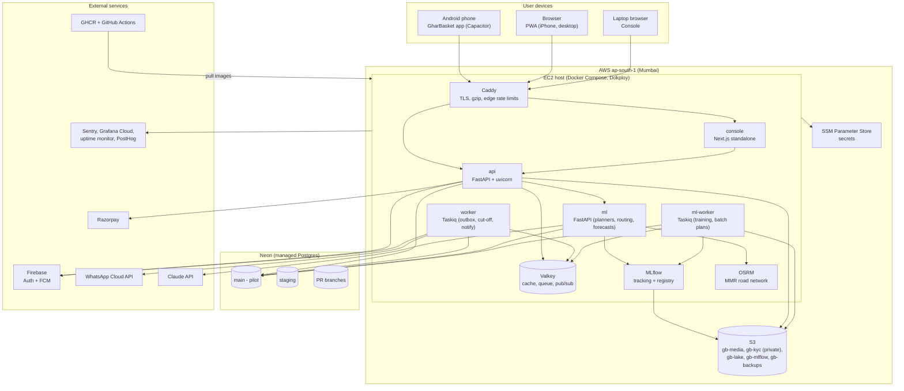

# Chapter 12 — Deployment and Operations

> **In short:**
> - Production and staging run on **AWS Mumbai (ap-south-1)**: one EC2 (or Lightsail) host with ~2–4 vCPU / 8 GB, running **Docker Compose** managed by Dokploy, behind **Caddy** (automatic HTTPS).
> - **PostgreSQL is on Neon** (D15): `main` (pilot), `staging`, and a branch per PR. Files, the data lake and MLflow artifacts are in **AWS S3**. Container images are in GHCR.
> - **Backups:** Neon point-in-time restore **plus** our own nightly `pg_dump` to S3 (30-day retention).
> - **Observability:** Sentry, OpenTelemetry → Grafana Cloud, uptime checks, PostHog. Explicit SLOs and runbooks.
> - **Known risk:** Neon has no India region (nearest is likely Singapore, ~60 ms per round-trip). Decide before the pilot whether to move the production database to Mumbai.

---

## 12.1 Deployment topology

*Figure 12.1 — Deployment diagram (UML-style: nodes as subgraphs, containers inside)*

### Containers on the EC2 host

| Container | Image | Purpose | Approx. RAM |
|---|---|---|---|
| caddy | caddy | TLS termination, reverse proxy, edge rate limits | 50 MB |
| console | `ghcr.io/…/console` | Next.js standalone server | 300 MB |
| api | `ghcr.io/…/api` | FastAPI modular monolith | 400 MB |
| worker | `ghcr.io/…/api` (worker command) | Taskiq: outbox relay, cut-off, notifications | 300 MB |
| ml | `ghcr.io/…/ml` | Planners, routing, forecasts, assistant | 1–1.5 GB |
| ml-worker | `ghcr.io/…/ml` (worker command) | Training, weekly batch plans | 1–2 GB (bursty) |
| valkey | valkey 8 | Cache, queue, pub/sub, live location | 200 MB |
| mlflow | mlflow | Tracking server (SQLite/Postgres backend, S3 artifacts) | 300 MB |
| osrm | osrm-backend | Road distance/time matrix for the MMR extract | < 1 GB |

The total fits an 8 GB instance with headroom. Staging and production are separate Compose projects (`stg`, `prod`); staging can be paused to save credits.

## 12.2 AWS services used

| Need | AWS service | Notes |
|---|---|---|
| Compute | EC2 (or Lightsail) in ap-south-1 | ~2–4 vCPU / 8 GB; Ubuntu LTS; Docker + Dokploy |
| Object storage | S3 | Buckets: `gb-media`, `gb-kyc` (private, short-lived signed reads), `gb-lake` (Parquet snapshots), `gb-mlflow`, `gb-backups` (30-day lifecycle) |
| Secrets | SSM Parameter Store | Loaded into Compose env at deploy time |
| DNS | Cloudflare DNS or Route 53 | `gharbasket.in`, `api.`, `console.`, `stg.` |
| Images | GHCR (free); ECR optional | Built by GitHub Actions |
| Credits | AWS Educate / AWS Academy (SIES) or GitHub Student Pack offers | Billing alarms at 50% / 80% of credits |

## 12.3 Database hosting and the latency note

- **Neon** gives us a database branch per PR, `staging` and `main`, with PostGIS and pgvector.
- **Latency:** Neon has no India region (nearest is likely Singapore, about 60 ms per round-trip; verify). This is fine for development, PR branches and staging. For the pilot, mitigate by:
  - batching queries and avoiding N+1 ORM patterns;
  - connection pooling (Neon pooled endpoint);
  - caching hot reads (catalog, prices, slots) in Valkey.
- **Decision before Phase 6 (pilot):** keep Neon, or move only the production database to Postgres on the Mumbai EC2 host / RDS, keeping Neon for dev and PR branches.

## 12.4 Backups and recovery

| What | How | Retention | Restore test |
|---|---|---|---|
| Postgres | Neon point-in-time restore + nightly `pg_dump` → `s3://gb-backups/pg/` | PITR window + 30 days | Monthly restore into a Neon branch (Rhythm Thakur / Manish Raje run the checklist) |
| S3 media / KYC | Versioning on buckets | 30 days of versions | Spot check |
| MLflow | Artifacts in S3; backend DB dumped nightly | 30 days | With Postgres test |
| OSRM data | Prebuilt `.osrm` files stored in S3 | Latest + previous | Rebuild script in `infra/osrm` |
| Config | Compose files and Caddyfile in git; secrets in SSM | git history | Redeploy from scratch drill once before the pilot |

## 12.5 Observability

| Signal | Tool | What we watch |
|---|---|---|
| Errors | Sentry (mobile, console, api, ml) | New issues, regressions per release |
| Traces / metrics / logs | OpenTelemetry → Grafana Cloud (free tier); structlog JSON logs | API latency and errors, job durations, queue depth, DB connections, ML job status |
| Uptime | Better Stack / UptimeRobot | `/health` and `/ready` endpoints for api, ml, console |
| Product | PostHog | Funnels (onboarding, approve week), feature flags, A/B experiments |
| AI health | Console "AI health" page | Forecast WAPE vs actual, plan acceptance, waste %, model versions |

**Alerts:**
- cut-off job failed or late;
- payment webhook backlog;
- route solve failed;
- error-rate spike;
- disk > 80%;
- AWS credit burn above threshold.

## 12.6 Service-level objectives (pilot)

| SLO | Target |
|---|---|
| API latency p95 | < 300 ms (reads), < 800 ms (writes) |
| Cut-off lock job | < 60 s for ~2,000 orders |
| Route solve | < 30 s per slot |
| Weekly plan batch | < 30 min for 5,000 households on 4 cores |
| Uptime | 99% during the pilot |
| Cut-off on time | 100% of delivery days |

## 12.7 Runbooks (`docs/runbooks/`)

| Runbook | Covers |
|---|---|
| `cutoff-failed.md` | Re-run `cutoff_lock` safely (advisory lock, idempotent), verify ledger totals, notify the hub |
| `razorpay-down.md` | Switch default to wallet, queue top-ups, reconcile later |
| `ml-service-down.md` | Confirm the rule-based fallback is active; restart; roll back the model alias if a promotion caused it |
| `route-solve-failed.md` | Fall back to the previous day's route template or nearest-neighbour; manual adjustment in the console |
| `restore-from-backup.md` | Neon PITR or `pg_dump` restore steps; verification queries |
| `rotate-secrets.md` | Rotating API keys and JWT signing keys via SSM |
| `deploy-rollback.md` | Redeploy the previous image tag via Dokploy; downgrade migration rules |

## 12.8 Ownership

| Area | Owner |
|---|---|
| Infra (EC2, Compose, Caddy, OSRM, MLflow), deploy pipelines | Prathamesh Relekar |
| API and mobile release builds | Yash Salunkhe |
| Backup restore tests, runbook drills, uptime checks, load tests | Rhythm Thakur, Manish Raje |

## Decisions & open questions

- **D6** — Postgres-centric data layer ([ADR-0006](../adr/0006-postgresql-centric-data-platform.md) in [`docs/adr/`](../adr/)).
- **D11 / D15** — AWS Mumbai hosting + Neon; S3 replaces R2 ([ADR-0011](../adr/0011-hosting-on-aws-student-credits.md), [ADR-0015](../adr/0015-aws-mumbai-topology-with-neon-postgres.md)).
- **Open:** EC2 vs Lightsail; which credit programme (AWS Educate / AWS Academy) the team uses; Neon vs Mumbai Postgres for the pilot (decide before Phase 6).

Related: [Chapter 04 — System architecture](04-system-architecture.md) · [Chapter 11 — Engineering process](11-engineering-process.md) · [Chapter 13 — Security and compliance](13-security-and-compliance.md)
