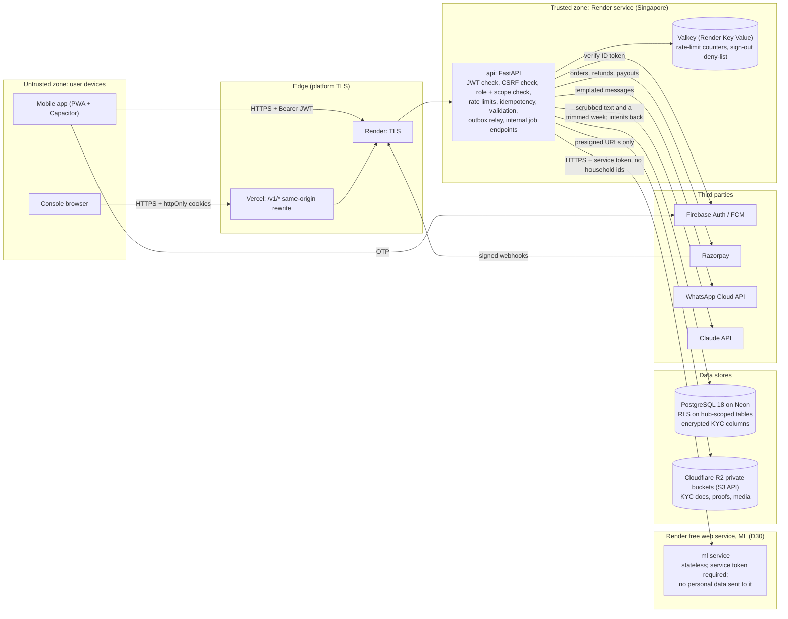

# Chapter 13 — Security and Compliance

> **In short:** GharBasket handles phone numbers, home addresses, family diet and health preferences, money (wallet, payments, partner payouts) and partner identity documents. We protect them with short-lived tokens, scoped roles enforced on the server and in Postgres, encryption of sensitive fields, a double-entry ledger, and a full audit log. Legally we design to India's DPDP Act 2023, RBI's rules for closed-system prepaid instruments and e-mandates, FSSAI food-safety registration, and TRAI SMS rules. Customers never go through KYC; everyone we *pay* (partners, captains, riders, franchisees) does.

---

## 13.1 What we protect

| Asset | Examples | Sensitivity | Where it lives |
|---|---|---|---|
| Identity | phone (E.164), name, locale, device list | Personal data | `identity.users`, `identity.devices` |
| Home location | society, tower, flat, geo point | Personal data | `identity.addresses` |
| Household profile | family size, age bands, diet, fasting rules | Personal data | `identity.households`, `household_members` |
| Health tags | diabetic, low-salt, PCOS-friendly | **Sensitive** (opt-in consent only) | `household_members.health_tags` |
| Money | wallet balance, payments, refunds, mandates | Financial | `billing.*` (ledger) |
| Partner KYC | ID document (masked), PAN, bank reference, FSSAI number | **Sensitive** | `partners.kyc_documents` (private R2 bucket, S3 API), encrypted columns |
| Location trail | rider GPS pings | Personal data | `logistics.gps_pings` (partitioned, 90-day retention) |
| Operational secrets | API keys (Razorpay, Firebase, Claude, WhatsApp), JWT keys, refresh-token pepper, `JOBS_TOKEN` | Secret | Infisical (`dev`, `staging`, `prod`), synced to GitHub Actions secrets only |

## 13.2 Trust boundaries and data flow


*Figure 13.1 — Trust boundaries and main data flows. Everything before the platform TLS edge (Vercel, Render) is untrusted; the data stores are never exposed publicly. The ML service runs on a free Render web service (D30): it answers only calls that carry the service token, and no household ids or other personal data are sent to it.*

## 13.3 Authentication

Details are in D24 ([ADR-0024](../adr/0024-sign-in-firebase-otp-own-tokens.md)).

1. The app performs **Firebase Phone Auth** (OTP only). Firebase handles SMS delivery, which avoids TRAI DLT registration during the prototype.
2. The app sends the Firebase ID token to `POST /v1/auth/exchange`. The API verifies it itself with PyJWT against Google's published keys (audience, issuer, expiry; no `firebase-admin`). The first exchange for a number creates the account with the `customer` role (that is signup). The API then issues **our own** tokens:
   - access JWT: 15 minutes, HS256 with a `kid` for key rotation (key in Infisical), carries `sub`, `sid` (session), `roles[]`, `jti`;
   - refresh token: opaque, **stored only as an HMAC-SHA256 with a server pepper**, in a session that lasts at most 30 days, **rotated on every use**. If a used token comes back within 2 minutes while its child is unused (a lost response), the child is replaced; any other reuse revokes the whole session (`auth.refresh_reused`, theft detection).
3. Storage: the Capacitor app sends `Authorization: Bearer` and keeps the refresh token in secure storage (Android Keystore). Browsers (PWA and console) send `X-GB-Client: web` and never see a token: the API sets httpOnly cookies `__Host-gb_at` (Path=/, 15 minutes) and `gb_rt` (Path=/v1/auth). Vercel rewrites `/v1/*` to the API, so the cookies are same-origin.
4. **CSRF:** a cookie-authenticated POST, PATCH, PUT or DELETE without `X-GB-Client: web`, or from an Origin outside `WEB_ORIGINS`, gets 403 `auth.csrf_rejected`.
5. **Instant sign-out:** logout, logout-all, device sign-out and refresh reuse put the session on a Valkey deny-list for the access token's remaining life. A refresh always checks the session in Postgres.
6. `GET /v1/me/devices` lists sessions; any device can be revoked.
7. **Rate limits:** fixed windows in Valkey (our own code). Exchange: 30 per 10 minutes per address and 10 per 10 minutes per phone (the key is a hash, never the number). Refresh: 300 per minute per address. If Valkey is down, requests are allowed (Firebase also limits OTPs).
   - **The address** comes only from `platform/client_ip.py` (M0 §6.3), never from the leftmost `X-Forwarded-For` entry, which the caller writes; uvicorn runs with `--no-proxy-headers`. Direct callers of `api.gharbasket.co.in` are identified by `CLIENT_IP_SOURCE` (Render: `header:true-client-ip`, which Cloudflare sets). The PWA's requests come through Vercel's `/v1/*` route, which adds `x-origin-secret`. Only with that secret (`ORIGIN_SECRET`, or `ORIGIN_SECRET_PREVIOUS` during a rotation) is the visitor read from `PROXY_CLIENT_IP_HEADER` (`x-real-ip`). A wrong or repeated secret is logged as `client_ip_proxy_secret_mismatch`, and the request is counted by Vercel's address. An IPv6 address is counted by its /64.
   - **Check after each deploy that changes `CLIENT_IP_SOURCE`, `PROXY_CLIENT_IP_HEADER`, `ORIGIN_SECRET`, `ORIGIN_SECRET_PREVIOUS` or either proxy.** The checks use a society that does not exist; a 404 counts against the limit, which allows 60 a minute.
     1. **Both paths count your own address.** This check does not depend on Vercel's addresses. Start right after a minute boundary, fill your counter through the PWA's proxy, then call the API directly from the same machine. `-4` keeps both on IPv4, so they share one counter.
        ```sh
        APP=https://app.gharbasket.co.in/v1/public/societies/client-ip-check
        API=https://api.gharbasket.co.in/v1/public/societies/client-ip-check
        sleep $((60 - $(date +%s) % 60))
        seq 1 70 | xargs -P 10 -I{} curl -4 -s -o /dev/null -w '%{http_code}\n' "$APP" | sort | uniq -c   # some 429
        curl -4 -s -o /dev/null -w '%{http_code}\n' "$API"                                                  # must be 429
        ```
        The direct call must give **429**. A 404 means the proxy path is counting Vercel's address, not yours. The secret or `X-Real-IP` did not arrive: look for `client_ip_proxy_secret_mismatch` or `client_ip_fallback` in Render's logs.
     2. **Spoofed headers are ignored.** Each run sends 125 requests and **must show some 429s**. Wait a minute between runs, so each starts with an empty counter.
        ```sh
        run() { seq 1 125 | xargs -P 10 -I{} curl -s -o /dev/null -w '%{http_code}\n' "$@" "$URL" | sort | uniq -c; }
        # Direct, on the custom domain and on Render's own
        for URL in https://api.gharbasket.co.in/v1/public/societies/client-ip-check \
                   https://gharbasket-api.onrender.com/v1/public/societies/client-ip-check; do
          run;                                         sleep 61   # baseline
          run -H 'X-Forwarded-For: 198.51.100.{}';     sleep 61   # spoofed X-Forwarded-For
          run -H 'True-Client-IP: 198.51.100.{}';      sleep 61   # spoofed True-Client-IP
        done
        # Through the PWA's proxy
        URL=https://app.gharbasket.co.in/v1/public/societies/client-ip-check
        run;                                           sleep 61   # baseline
        run -H 'X-Real-IP: 198.51.100.{}';             sleep 61   # spoofed X-Real-IP
        run -H 'X-Forwarded-For: 198.51.100.{}';       sleep 61   # spoofed X-Forwarded-For
        run -H 'x-origin-secret: forged-{}' -H 'X-Real-IP: 198.51.100.{}'   # spoofed secret
        ```
     3. **Extra: a second network.** Right after a run that gave 429s, one request to the same `URL` from another network, such as a phone hotspot, should give 404: `curl -s -o /dev/null -w '%{http_code}\n' "$URL"`. A 429 means every caller on that path shares one counter. This check alone cannot tell Vercel's address from yours, so check 1 is the one that counts.
8. Locally only (`APP_ENV=dev`), `dev_phone` signs in without an OTP.

## 13.4 Authorisation (roles with scopes)

- `identity.user_roles(user_id, role, scope_type, scope_id, status)`.
- Roles: `customer`, `captain` (society), `kitchen_partner` (hub), `rider` (hub), `packer` (hub), `hub_manager` (hub), `franchise_owner` (hub), `ngo_coordinator` (ngo), `admin` (global).
- A permission matrix in code maps `permission → roles`. Every endpoint declares its permission: `Depends(require("orders:read", scope=hub_id))`.
- The mobile app's role switch sends `X-Active-Role`, which narrows a request to one of the caller's roles; it never adds a role. The server re-checks the role and scope on every request.
- Each grant counts only within its own scope, with or without `X-Active-Role`: a hub or society role covers that one hub or society, `admin` covers every scope, and `customer` covers no scope at all, only the customer's own household, orders and wallet (checked by ownership). A person who is both a customer and staff of hub A therefore cannot read hub B's orders.
- Partner roles stay inactive until status is `verified` (KYC gate, §13.7).
- **Defence in depth — Postgres Row-Level Security** on hub-scoped tables (`orders`, `inventory_lots`, `partners`, `routes`). The API runs `SET LOCAL app.hub_ids = '…'` per transaction, so a missed check in application code still cannot leak another franchise's data.

## 13.5 Data protection

| Control | Implementation |
|---|---|
| Encryption in transit | TLS everywhere, terminated by the platforms (Render, Vercel, Neon, R2, third parties) |
| Encryption at rest | Neon and R2 default encryption |
| Field-level encryption | KYC numbers (PAN, ID number, bank account) encrypted with pgcrypto (`pgp_sym_encrypt`) under a versioned key from Infisical, sent to Postgres only as a bind parameter, and hashed (HMAC-SHA256 with a versioned pepper) for duplicate checks; only a masked value (`XXXX-1234`) is shown, and only the payout account read decrypts (audit-logged). Key and pepper are rotatable: the old one stays as retired until the job `rekey_kyc_documents` has moved every row inside Postgres (M8 §3.1, runbook `rotate-secrets.md`) |
| No Aadhaar storage | We never store Aadhaar numbers or images. Identity is verified, then only a "verified" flag + masked reference is kept |
| Private files | KYC documents and delivery proofs in a private bucket; reads use signed URLs valid for 5 minutes. When a module accepts an uploaded photo, the API removes its location (GPS) and other EXIF/XMP metadata (M0 §3.1) |
| Payment card data | Never touches our servers (Razorpay hosted checkout) |
| Logs | structlog with a PII scrubber (phone, address, names masked); assistant messages scrubbed in the API (phones, e-mails, Aadhaar, PIN codes, addresses, the household's own names) before they are stored or sent to the ML service |
| Backups | Staging is a Neon child branch with no point-in-time restore: `before-demo-*` restore points, and a weekly `pg_dump` to the private R2 bucket `gb-staging-backups` (handbook 12 §12.4). The dump holds personal data, so the bucket stays private and its token covers that bucket only |
| Retention | GPS pings 90 days; webhook payloads 180 days; audit log 3 years; deleted accounts purged within 30 days |

## 13.6 Privacy — DPDP Act 2023 and DPDP Rules 2025

| DPDP obligation | GharBasket design |
|---|---|
| Notice and consent | Plain-language notice in English, Hindi and Marathi. Consent is recorded per purpose and version in `identity.consents` |
| Purpose limitation | Purposes: `service_delivery`, `personalisation`, `health_personalisation` (separate opt-in), `marketing` (opt-in), `research_anonymised`, `whatsapp` (opt-in to WhatsApp updates) |
| Data minimisation | Age bands, not birth dates. No Aadhaar. Health tags optional. Uploaded photos lose their GPS and other metadata when accepted |
| Right to access / correction | `POST /v1/me/data-export`, then `GET` for a 5-minute download link to one JSON file kept 7 days (M1 §3.3); editable profile |
| Right to erasure | `DELETE /v1/me` → every device signed out at once and the wallet refunded to its source; signing in again within 30 days cancels; after 30 days `purge_deleted_users` hard-deletes personal data module by module, and keeps orders and the append-only ledger under ids that no longer lead to a person (legal record keeping; M1 §3.5). A partner's KYC documents and files go too, once she has been paid what she is owed; her partner record stays, nameless, for the payouts. Assistant chats are deleted |
| Children | No direct collection from children; only age bands entered by the adult account holder |
| Breach handling | Runbook [`dpdp-breach.md`](../runbooks/dpdp-breach.md): contain, assess, notify the Data Protection Board and affected users as required |
| Academic data | Per the accepted proposal, demonstrations use **synthetic** or **consented** pilot data only (`data_source` tag) |

## 13.7 Money and payments rules (RBI)

**Closed-loop wallet (default payment mode).** Under RBI's framework for prepaid payment instruments, a closed-system PPI — usable only to buy the issuer's own goods and services, with no cash withdrawal — does not need RBI authorisation, and customers need no KYC. We keep the wallet strictly closed-loop:
- spend only on GharBasket orders;
- no cash-out and no user-to-user transfers;
- unused balance is refunded to the original payment source on request;
- self-imposed limits: ₹10,000 maximum balance and a monthly top-up cap;
- Kindness points are a separate ledger currency (`KINDNESS_PTS`) with expiry — loyalty points, not money.

**UPI Autopay (optional mode).** RBI's e-mandate rules require a **pre-debit notification at least 24 hours before** each recurring debit. The weekly cycle sends the box and the pre-debit notice at T-3 18:00 and captures at the T-1 21:00 cut-off. Mandate KYC is done by the customer's bank.

**Ledger integrity.** Every money movement is a double-entry journal entry. A deferred constraint checks that postings sum to zero per currency. Idempotency keys prevent double posting. Razorpay webhooks are signature-verified and processed once per `event_id`. An hourly job reconciles our records with Razorpay.

## 13.8 KYC for people we pay

| Payee | KYC collected | Gate |
|---|---|---|
| Kitchen partner | Masked government ID, PAN (for TDS where applicable), bank account via ₹1 penny-drop, **FSSAI basic registration number**, kitchen hygiene checklist + photos | `kyc_pending → training → verified` |
| Society Captain | Masked ID, PAN, bank penny-drop, society confirmation | same |
| Rider | ID, driving licence, vehicle details, bank penny-drop | same |
| Franchise owner | Business KYC: PAN, GST (if registered), FSSAI licence for the hub | admin approval |

In the prototype, KYC checks are **simulated** (no real document verification APIs). Partners are treated as independent partners; India's Labour Codes recognise gig/platform workers, so before any real payouts the obligations are reviewed with the guide.

## 13.9 Food safety (FSSAI)

- GharBasket as an e-commerce food business needs an FSSAI licence; each home kitchen needs at least basic FSSAI registration. Kitchen registration numbers are captured, verified and shown on the "Know your cook" card.
- Traceability: every bag links packing task → inventory lot → vendor; every tiffin links to the kitchen and batch.
- Hygiene training modules are mandatory before a kitchen becomes `verified`.

## 13.10 Application and supply-chain security

| Area | Control |
|---|---|
| Input validation | Pydantic v2 on every request; zod on the client |
| SQL injection | SQLAlchemy parameterised queries only |
| Web | CSP and security headers on the console; Capacitor navigation locked to our origins |
| Android WebView bridge | `android.useLegacyBridge: true` (needed by background geolocation) lets any frame call plugins, not only our page: the third-party frames are Razorpay Checkout and Firebase reCAPTCHA. Plugin results go only to the main frame. Accepted in ADR-0034; revisit when the plugin no longer needs it or a new third-party frame is added |
| Secrets | In Infisical, synced to GitHub Actions secrets; never in the client bundle or the repo; gitleaks in CI and pre-commit |
| Dependencies | Renovate updates, `pip-audit`, `pnpm audit`, Trivy image scan (planned) |
| LLM | The assistant never calls our API and holds no token: the API sends it scrubbed text and a trimmed week (no household or user id, name or address), it returns intents, and the API resolves them for the caller's own household; every write is a proposal the user confirms; per-user daily token cap; no prices computed by the LLM (M13 §3) |
| Standard | OWASP ASVS Level 1 checklist reviewed before the pilot (Rhythm Thakur and Manish Raje) |

## 13.11 Audit log

`platform.audit_log` records every privileged action: price changes, KYC decisions, refunds and manual ledger adjustments, role grants, data exports and deletions. Each row stores actor, role, scope, action, before/after summary and timestamp. Rows are append-only.

## Decisions & open questions

- Decided: closed-loop wallet with no customer KYC ([ADR-0004](../adr/0004-closed-loop-wallet-and-upi-autopay.md)); no Aadhaar storage; Firebase OTP then our own rotating tokens, cookies + CSRF checks for browsers ([ADR-0024](../adr/0024-sign-in-firebase-otp-own-tokens.md)); secrets in Infisical ([ADR-0020](../adr/0020-free-tier-hosting-render-vercel-neon-r2.md)); RLS as defence in depth.
- Open: confirm with Prof. Kranti Bade (or a CA) the exact legal wording before any real-money pilot; decide whether the pilot database stays on Neon (Singapore) or moves to a paid Postgres in Mumbai (data-residency preference), before Phase P6.

Related: [Chapter 10 — API and Integration](10-api-and-integration.md) · [Chapter 12 — Deployment and Operations](12-deployment-and-operations.md) · [ADR-0004](../adr/0004-closed-loop-wallet-and-upi-autopay.md) · [ADR-0006](../adr/0006-postgresql-centric-data-platform.md)
