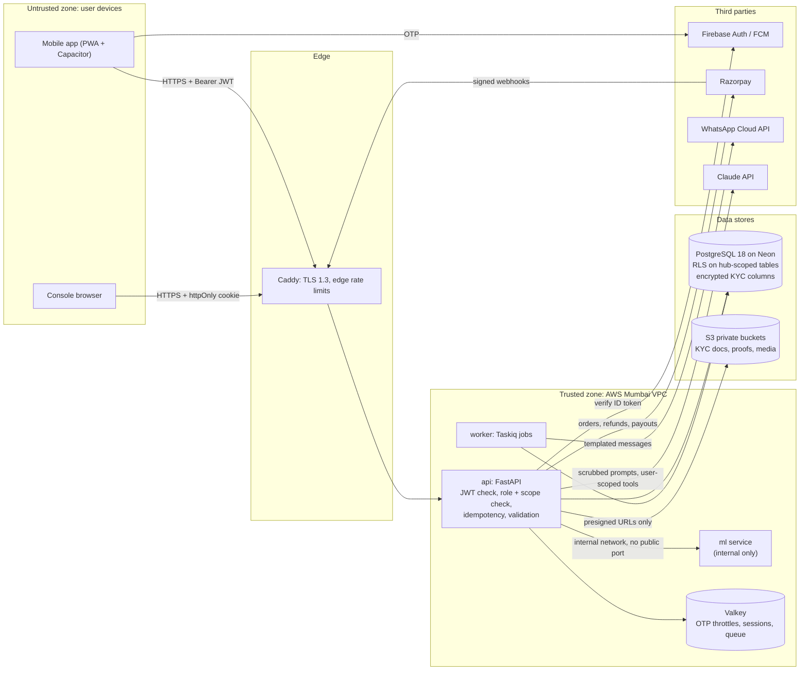

# Chapter 13 — Security and Compliance

> **In short:** GharBasket handles phone numbers, home addresses, family diet and health preferences, money (wallet, payments, partner payouts) and partner identity documents. We protect them with short-lived tokens, scoped roles enforced on the server and in Postgres, encryption of sensitive fields, a double-entry ledger, and a full audit log. Legally we design to India's DPDP Act 2023, RBI's rules for closed-system prepaid instruments and e-mandates, FSSAI food-safety registration, and TRAI SMS rules. Customers never go through KYC; everyone we *pay* (partners, captains, riders, franchisees) does.

---

## 13.1 What we protect

| Asset | Examples | Sensitivity | Where it lives |
|---|---|---|---|
| Identity | phone (E.164), name, locale, device list | Personal data | `identity.users`, `identity.devices` |
| Home location | society, tower, flat, geo point | Personal data | `identity.addresses` |
| Household profile | family size, age bands, diet, fasting rules | Personal data | `identity.households`, `household_members` |
| Health tags | diabetic, low-salt, PCOS-friendly | **Sensitive** (opt-in consent only) | `household_members.health_tags` |
| Money | wallet balance, payments, refunds, mandates | Financial | `billing.*` (ledger) |
| Partner KYC | ID document (masked), PAN, bank reference, FSSAI number | **Sensitive** | `partners.kyc_documents` (private S3 bucket), encrypted columns |
| Location trail | rider GPS pings | Personal data | `logistics.gps_pings` (partitioned, 90-day retention) |
| Operational secrets | API keys (Razorpay, Firebase, Claude, WhatsApp) | Secret | AWS SSM Parameter Store / GitHub secrets only |

## 13.2 Trust boundaries and data flow

*Figure 13.1 — Trust boundaries and main data flows. Everything left of Caddy is untrusted; the ML service and data stores are never exposed publicly.*

## 13.3 Authentication

1. The app performs **Firebase Phone Auth** (OTP). Firebase handles SMS delivery, which avoids TRAI DLT registration during the prototype.
2. The app sends the Firebase ID token to `POST /v1/auth/exchange`. The API verifies it with `firebase-admin`, upserts the user and issues **our own** tokens:
   - access JWT: 15 minutes, signed (HS256 in prototype, key in SSM), carries `sub`, `roles[]`, `jti`;
   - refresh token: 30 days, opaque, **stored hashed**, bound to a device, **rotated on every use**. Reuse of an already-rotated token revokes the whole device session (theft detection).
3. Storage: mobile keeps the refresh token in Capacitor secure storage (Android Keystore). The console keeps it in an `httpOnly; Secure; SameSite=Lax` cookie, refreshed by `proxy.ts`.
4. `GET /v1/me/devices` lists sessions; any device can be revoked.
5. OTP exchange and login are rate-limited per phone and per IP (Valkey token bucket + Caddy).

## 13.4 Authorisation (roles with scopes)

- `identity.user_roles(user_id, role, scope_type, scope_id, status)`.
- Roles: `customer`, `captain` (society), `kitchen_partner` (hub), `rider` (hub), `packer` (hub), `hub_manager` (hub), `franchise_owner` (hub), `ngo_coordinator` (ngo), `admin` (global).
- A permission matrix in code maps `permission → roles`. Every endpoint declares its permission: `Depends(require("orders:read", scope=hub_id))`.
- The mobile app's role switch (`X-Active-Role`) only changes the UI. The server re-checks the role and scope on every request.
- Partner roles stay inactive until status is `verified` (KYC gate, §13.7).
- **Defence in depth — Postgres Row-Level Security** on hub-scoped tables (`orders`, `inventory_lots`, `partners`, `routes`). The API runs `SET LOCAL app.hub_ids = '…'` per transaction, so a missed check in application code still cannot leak another franchise's data.

## 13.5 Data protection

| Control | Implementation |
|---|---|
| Encryption in transit | TLS 1.3 everywhere (Caddy, Neon, S3, third parties) |
| Encryption at rest | Neon and S3 default encryption |
| Field-level encryption | KYC numbers (PAN, ID number) encrypted in the application with a key from SSM; only a masked value (`XXXX-1234`) is shown |
| No Aadhaar storage | We never store Aadhaar numbers or images. Identity is verified, then only a "verified" flag + masked reference is kept |
| Private files | KYC documents and delivery proofs in a private bucket; reads use signed URLs valid for 5 minutes |
| Payment card data | Never touches our servers (Razorpay hosted checkout) |
| Logs | structlog with a PII scrubber (phone, address, names masked); LLM conversation logs scrubbed before storage |
| Backups | Neon point-in-time restore + our own nightly `pg_dump` to S3 (30-day retention, encrypted) |
| Retention | GPS pings 90 days; webhook payloads 180 days; audit log 3 years; deleted accounts purged within 30 days |

## 13.6 Privacy — DPDP Act 2023 and DPDP Rules 2025

| DPDP obligation | GharBasket design |
|---|---|
| Notice and consent | Plain-language notice in English, Hindi and Marathi. Consent is recorded per purpose and version in `identity.consents` |
| Purpose limitation | Purposes: `service_delivery`, `personalisation`, `health_personalisation` (separate opt-in), `marketing` (opt-in), `research_anonymised` |
| Data minimisation | Age bands, not birth dates. No Aadhaar. Health tags optional |
| Right to access / correction | `GET /v1/me/data-export` (JSON), editable profile |
| Right to erasure | `DELETE /v1/me` → personal data hard-deleted; ledger rows kept with the owner anonymised (legal record keeping) |
| Children | No direct collection from children; only age bands entered by the adult account holder |
| Breach handling | Runbook: contain, assess, notify the Data Protection Board and affected users as required |
| Academic data | Per the accepted proposal, demonstrations use **synthetic** or **consented** pilot data only (`data_source` tag) |

## 13.7 Money and payments rules (RBI)

**Closed-loop wallet (default payment mode).** Under RBI's framework for prepaid payment instruments, a closed-system PPI — usable only to buy the issuer's own goods and services, with no cash withdrawal — does not need RBI authorisation, and customers need no KYC. We keep the wallet strictly closed-loop:
- spend only on GharBasket orders;
- no cash-out and no user-to-user transfers;
- unused balance is refunded to the original payment source on request;
- self-imposed limits: ₹10,000 maximum balance and a monthly top-up cap;
- Kindness points are a separate ledger currency (`KINDNESS_PTS`) with expiry — loyalty points, not money.

**UPI Autopay (optional mode).** RBI's e-mandate rules require a **pre-debit notification at least 24 hours before** each recurring debit. The weekly cycle sends the box and the pre-debit notice at T-3 18:00 and captures at the T-1 21:00 cut-off. Mandate KYC is done by the customer's bank.

**Ledger integrity.** Every money movement is a double-entry journal entry. A deferred constraint checks that postings sum to zero per currency. Idempotency keys prevent double posting. Razorpay webhooks are signature-verified and processed once per `event_id`. An hourly job reconciles our records with Razorpay.

## 13.8 KYC for people we pay

| Payee | KYC collected | Gate |
|---|---|---|
| Kitchen partner | Masked government ID, PAN (for TDS where applicable), bank account via ₹1 penny-drop, **FSSAI basic registration number**, kitchen hygiene checklist + photos | `kyc_pending → training → verified` |
| Society Captain | Masked ID, PAN, bank penny-drop, society confirmation | same |
| Rider | ID, driving licence, vehicle details, bank penny-drop | same |
| Franchise owner | Business KYC: PAN, GST (if registered), FSSAI licence for the hub | admin approval |

In the prototype, KYC checks are **simulated** (no real document verification APIs). Partners are treated as independent partners; India's Labour Codes recognise gig/platform workers, so before any real payouts the obligations are reviewed with the guide.

## 13.9 Food safety (FSSAI)

- GharBasket as an e-commerce food business needs an FSSAI licence; each home kitchen needs at least basic FSSAI registration. Kitchen registration numbers are captured, verified and shown on the "Know your cook" card.
- Traceability: every bag links packing task → inventory lot → vendor; every tiffin links to the kitchen and batch.
- Hygiene training modules are mandatory before a kitchen becomes `verified`.

## 13.10 Application and supply-chain security

| Area | Control |
|---|---|
| Input validation | Pydantic v2 on every request; zod on the client |
| SQL injection | SQLAlchemy parameterised queries only |
| Web | CSP and security headers on the console; Capacitor navigation locked to our origins |
| Secrets | Never in the client bundle or the repo; gitleaks in CI and pre-commit |
| Dependencies | Renovate updates, `pip-audit`, `pnpm audit`, Trivy image scan in CI |
| LLM | The assistant calls our API **as the user** (same permissions); every write is a proposal the user confirms; per-user daily token cap; no prices computed by the LLM |
| Standard | OWASP ASVS Level 1 checklist reviewed before the pilot (Rhythm Thakur and Manish Raje) |

## 13.11 Audit log

`platform.audit_log` records every privileged action: price changes, KYC decisions, refunds and manual ledger adjustments, role grants, data exports and deletions. Each row stores actor, role, scope, action, before/after summary and timestamp. Rows are append-only.

## Decisions & open questions

- Decided: closed-loop wallet with no customer KYC ([ADR-0004](../adr/0004-closed-loop-wallet-and-upi-autopay.md)); no Aadhaar storage; Firebase OTP in the prototype; RLS as defence in depth.
- Open: confirm with Prof. Kranti Bade (or a CA) the exact legal wording before any real-money pilot; decide whether the pilot database stays on Neon (Singapore) or moves to Mumbai (data-residency preference), before Phase P6.

Related: [Chapter 10 — API and Integration](10-api-and-integration.md) · [Chapter 12 — Deployment and Operations](12-deployment-and-operations.md) · [ADR-0004](../adr/0004-closed-loop-wallet-and-upi-autopay.md) · [ADR-0006](../adr/0006-postgresql-centric-data-platform.md)
