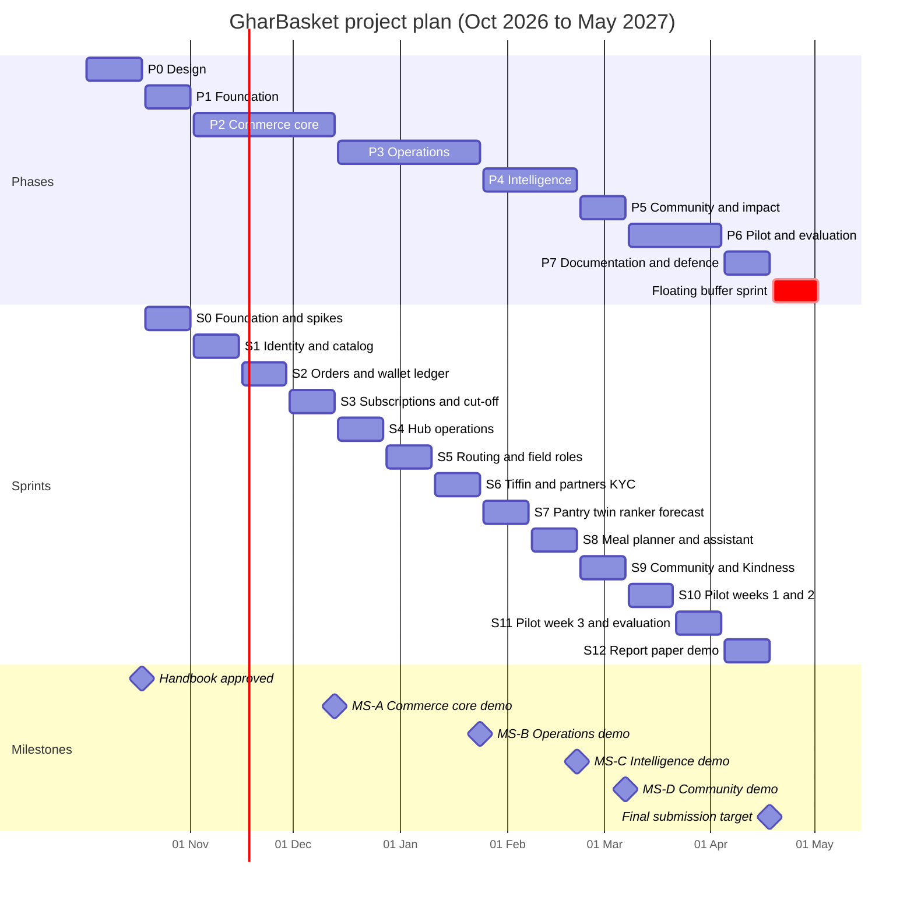
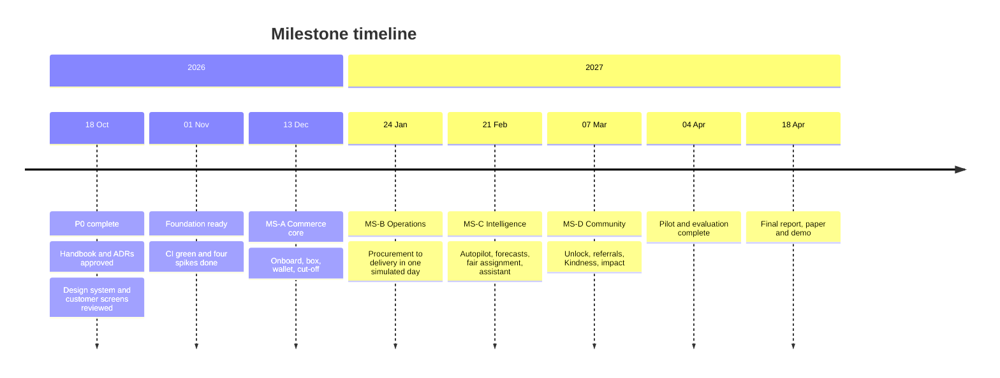

# Chapter 14 — Project Plan

> **In short:** GharBasket is built in eight phases (P0–P7) over about 28 weeks, from 2 October 2026 to mid-April 2027. Phase 0 is design (handbook, ADRs, module specs, Claude Design system and customer screens) — no code. Sprint 0 starts on 19 October 2026; after that, two-week sprints S0–S12 deliver four demo milestones (MS-A to MS-D), a real pilot and the final report and paper. One floating buffer sprint absorbs exams and slips. Prathamesh Relekar owns all backend, infrastructure and ML; Yash Salunkhe owns all frontend (D23); Rhythm Thakur and Manish Raje own documentation, testing/QA, pilot operations and the presentation. **Status on 11 November 2026:** the backend product scope of S0–S9 was built from 2 to 28 October, ahead of the sprint dates, and staging has been live since 27 October; §14.3.1 gives what was done and when, from the commit dates. The sprint dates and the demo, pilot and defence milestones below stay as the plan.

---

## 14.1 Phases at a glance

| Phase | Sprints | Dates | Goal | Exit gate (must be true to move on) |
|---|---|---|---|---|
| **P0 Design** | — | 2 Oct → 18 Oct 2026 | Agree what we build and how | Handbook, TDD, ADRs, module specs M1–M5 approved by the team and Prof. Kranti Bade; Claude Design System + customer core screens reviewed; ERD v1; simulator spec |
| **P1 Foundation** | S0 | 19 Oct → 1 Nov | Working skeleton everyone builds on | Monorepo, CI green, Docker Compose stack, auth skeleton, design tokens in `frontend/packages/ui`, baseline migrations, simulator v0; the four risk spikes done |
| **P2 Commerce core** | S1–S3 | 2 Nov → 13 Dec | Customers can subscribe and order | **MS-A** demo passes |
| **P3 Operations** | S4–S6 | 14 Dec → 24 Jan 2027 | A full delivery day works | **MS-B** demo passes |
| **P4 Intelligence** | S7–S8 | 25 Jan → 21 Feb | The AI is real | **MS-C** demo passes; evaluation harness produces reports |
| **P5 Community & impact** | S9 | 22 Feb → 7 Mar | Social features live | **MS-D** demo passes |
| **P6 Pilot & evaluation** | S10–S11 | 8 Mar → 4 Apr | Real households, real numbers | ≥ 3 weeks of pilot in 1–2 societies; all evaluation reports generated; security and performance pass |
| **P7 Documentation & defence** | S12 + buffer | 5 Apr → 18 Apr (buffer to 2 May) | Submit and defend | Final report, IEEE paper draft, demo video, viva deck |

### Demo milestones

| Milestone | End of | Demo script |
|---|---|---|
| **MS-A** Commerce core | S3 (13 Dec) | A customer onboards, receives a rule-based weekly box, edits it, pays from the wallet; the 21:00 cut-off locks orders and posts ledger entries |
| **MS-B** Operations | S6 (24 Jan) | Simulated day end-to-end: procurement plan → receiving → packing → OR-Tools routes → captain handover → delivered; a tiffin day; a partner completes KYC |
| **MS-C** Intelligence | S8 (21 Feb) | Autopilot produces an explained meal plan and box under Budget Lock; forecast-driven procurement; fair kitchen assignment; text assistant edits a box with confirmation |
| **MS-D** Community | S9 (7 Mar) | Society unlock, referrals, Kindness pickup on a return leg, NGO handoff, impact dashboard, green-slot pricing |

Every milestone ends with a demo to Prof. Kranti Bade.

## 14.2 Timeline

*Figure 14.1 — Gantt chart of phases, sprints and milestones. The buffer sprint moves to wherever exams fall once dates are known.*

*Figure 14.2 — Milestone timeline.*

## 14.3 Sprint calendar and scope

| Sprint | Dates | Scope (modules) | Key deliverables |
|---|---|---|---|
| S0 | 19 Oct → 1 Nov | M0 platform | Monorepo, CI, Compose, auth skeleton, `frontend/packages/ui` tokens, migrations baseline, simulator v0, AGENTS.md. **Spikes:** Razorpay checkout inside Capacitor; Firebase phone OTP inside Capacitor; OR-Tools + OSRM on a Mumbai Metropolitan Region sample; CP-SAT meal plan on 20 recipes |
| S1 | 2 Nov → 15 Nov | M1 identity, M2 catalog | OTP login, roles, household setup, society picker, catalog + prices, Hinglish search; console catalog/prices/societies |
| S2 | 16 Nov → 29 Nov | M4 orders, M5 billing | Order state machine, slots, cart/add-ons, double-entry ledger, wallet top-up (Razorpay test), webhooks; Partner app shell |
| S3 | 30 Nov → 13 Dec | M3 subscriptions, M11 notify | Weekly cycle jobs, rule-based box v0, approve/edit/skip, 21:00 cut-off lock, push + WhatsApp templates. *Likely exam period — kept light* |
| S4 | 14 Dec → 27 Dec | M6 ops | Procurement plan, purchase orders, receiving/QC, packing queue with scanning, waste log; console ops board |
| S5 | 28 Dec → 10 Jan | M7 logistics | OSRM + OR-Tools routes, rider mode, captain handover and flat checklist, delivery proofs, offline outbox |
| S6 | 11 Jan → 24 Jan | M8 partners, tiffin | Partner onboarding + simulated KYC + training, kitchen menus and capacity, tiffin day flow, earnings and payout statements |
| S7 | 25 Jan → 7 Feb | M10 intel v1 | Pantry digital twin, next-basket ranker, uncommitted-demand forecast + newsvendor procurement, evaluation harness |
| S8 | 8 Feb → 21 Feb | M10, M13 | CP-SAT meal planner, Budget Lock, reason chips, fair kitchen assignment, text assistant; model choice from the 200-utterance eval |
| S9 | 22 Feb → 7 Mar | M9 community, M12 | Society unlock, referrals, Kindness pickups on return legs, NGO handoff, impact dashboard, green-slot pricing |
| S10 | 8 Mar → 21 Mar | Pilot | 1–2 Panvel societies live; churn model; bug fixes |
| S11 | 22 Mar → 4 Apr | Evaluation | Pilot week 3, retrain on pilot data, all evaluation reports, OWASP ASVS L1 pass, k6 load test, accessibility audit |
| S12 | 5 Apr → 18 Apr | Defence | Final report, IEEE paper, demo video, viva deck |
| Buffer | floating (default 19 Apr → 2 May) | — | Absorbs exams or a slipped milestone |

The dates above are the plan. The work ran ahead of them; §14.3.1 is what git shows.

### 14.3.1 Status against the sprint scope (main on 11 November 2026)

Dates are the dates of the merged commits on `main` (`git log --date=short`); `#n` is the pull request. A sprint is "built" when the scope in its row exists on `main` with tests. A demo to Prof. Kranti Bade is not in git, so no demo is marked done here.

| Sprint | Status | What was done, and when | Not done, or not in git |
|---|---|---|---|
| S0 Foundation | Built 2–4 Oct | Monorepo, CI, Compose stack, API skeleton (2 Oct, #2, #4–#6, #8); module folders with import rules, outbox, idempotency keys, audit log (3 Oct, #10, #12); UI components (3 Oct); simulator v0 (4 Oct, #89); spikes S-3 (OR-Tools and OSRM) and S-4 (CP-SAT meal plan) passed (4 Oct, #88, #86); deploy to Render after CI (4 Oct, #77) | Spikes S-1 (Razorpay) and S-2 (Firebase OTP) in Capacitor were committed "ready to run" on 2 Oct; no result is recorded in git |
| S1 Identity and catalog | Built 3–16 Oct | M1 sign-in, sessions, households, consents (3–4 Oct, #13, #14, #59); M9 society search and unlock request (4 Oct, #58); M2 products, multilingual search, prices, recipes and festivals (4 Oct, #81, #84, #85); catalog and recipe batches to 120 recipes (8–9 Oct); the console edits catalog, recipes, prices and festivals (16 Oct, #162, #163, #263) | |
| S2 Orders and wallet | Built 4–16 Oct | M5 double-entry ledger and wallet (4 Oct, #91); Razorpay test top-ups with signed webhooks (4 Oct, #92); M4 slots, box orders, add-ons, cancel (4 Oct); the cut-off handshake and payment grace (8–9 Oct); refunds to the payment source and hourly reconciliation (16 Oct) | |
| S3 Subscriptions and notify | Built 4–9 Oct | M3 plans, delivery days and the weekly cycle (4 Oct); edit, approve, skip, auto-approve (8 Oct); M11 send pipeline, inbox, templates and WhatsApp (9 Oct) | |
| S4 Hub operations | Built 9–25 Oct | M6 hubs and vendors (9 Oct, #148); packing tasks and the packer's flow (10 Oct, #154); procurement, purchase orders and receiving with QC (16 Oct); inventory and lot counts (19 Oct); waste log (25 Oct, #368); the 12:30 surplus cascade (25 Oct, #374) | |
| S5 Routing and field roles | Built 15–26 Oct | M7 vehicles and route plans solved at T-1 23:15 (15 Oct, #282, #287); rider routes, GPS, live tracking, captain handover, proofs, triage, hold and redelivery (20 Oct, #321–#330); return-leg pickups (26 Oct, #381) | |
| S6 Partners and tiffin | Built 19–29 Oct | M8 applications, training and KYC (19–20 Oct); kitchens, offers and the 21:30 assignment round (20 Oct); direct tiffin orders (20 Oct, #317–#319); earnings (21 Oct), weekly payouts (25 Oct, #377); income certificate (28 Oct, #396); tiffin routes and kitchen collect (29 Oct, #416, #417) | |
| S7 Pantry twin, ranker, forecast | Built 9–15 Oct | Evaluation harness v0 and pantry twin v0 (9 Oct); ranker v0 (#119), forecast v0 and v1, drift monitor, pantry twin v1 (15 Oct) | |
| S8 Meal planner and assistant | Built 9–15 Oct | Planner v1 (9 Oct) and v2 (15 Oct); fair kitchen assignment (14 Oct); the λ sweep (15 Oct); Ghar Saathi v1 with its utterance scorer (15 Oct, #121) | The labelled 200-utterance result and the final assistant model choice are not recorded in git |
| S9 Community and Kindness | Built 9–28 Oct | Society captains (9 Oct); unlock, referrals, Kindness points, donations and pickups (16 Oct); NGOs and surplus hand-offs (25 Oct, #376); impact views (28 Oct, #382); green-slot pricing (28 Oct, #394, #398–#400) | |
| S10–S12 | Not started | Pilot, evaluation, report, paper and defence stay as planned | The whole phase P6–P7 |

The backend product scope was complete on **28 October** (#382–#404). The demo scripts exist as end-to-end tests: the MS-A golden week in the browser on 20 October (#344), the MS-B operations day and tiffin day through the API on 28 October (#409, #410), and the MS-C evaluation report on 28 October (#404). The two apps were built on mocks from 3 to 14 October, then moved onto the real backend between 14 October and 1 November (the console and mobile contract syncs of 14 October, #246–#315, and 30 October, #346–#352, #418–#439). Vercel configuration for the PWA and the console landed on 30 October (#436). Not in git yet: the Capacitor Android build and the Play internal-testing track, and the pilot itself.

### 14.3.2 What was added beyond the sprint table

| When | What |
|---|---|
| 27–28 Oct | Staging live on Render (API), Neon and R2; the repository made public ([ADR-0029](../adr/0029-public-repository.md)); the ML service on a free Render web service ([ADR-0030](../adr/0030-ml-service-on-render-free.md), #413, #414); the simulated day runs in CI (#407) |
| 1–2 Nov | Served models load from the R2 registry (#457); the ML path hardened for the free host (#462); the mandi price collector moved to the Oracle VM (#477); the pantry twin switched on in staging (#470); drift alerts to admins and the ML service on AI health (#479); a guarded loader for demo data on staging (#480) |
| 3–6 Nov | Add-on lines count as uncommitted demand ([ADR-0031](../adr/0031-uncommitted-demand-is-add-on-lines-and-tiffins.md), 3 Nov, #483); minute-level jobs called from the Oracle VM ([ADR-0032](../adr/0032-scheduled-jobs-from-the-oracle-vm.md), 5 Nov, #487); the final 5-seed evaluation (6 Nov, #488) |
| 10 Nov | Ops alerts: [ADR-0033](../adr/0033-ops-alerts-healthchecks-and-uptimerobot.md) (#505), the job runs endpoint, ops probes and alert pings (#506), billing and logistics probes (#507), admin messages for reconciliation and routes to review (#508) |
| 11 Nov | Runbooks (#510, #513); a weekly `pg_dump` of staging to R2 (#514); the audit fixes (#516, #517, #520, #521, #522); revenue recognised on delivery (#518, #519); specs synced with what is built (#512); the console's staff-only sign-in (#509). The custom domain `gharbasket.co.in` was bought the same day ([ADR-0035](../adr/0035-custom-domain-gharbasket-co-in.md)) |

**Cut order if a milestone slips:** (UPI Autopay is already planned for the pilot phase; MS-A uses the wallet only.) Voice assistant → OTA live updates → UPI Autopay (wallet stays) → green-slot pricing → churn/uplift model. MVP flows are never cut.

## 14.4 Responsibilities

### Who owns what

| Person | Area | Owns |
|---|---|---|
| **Yash Salunkhe** | Frontend and design | All of `frontend/`: the mobile app for every role (customer and field roles), the console UI, `frontend/packages/ui` and `frontend/packages/domain`; design in Claude Design; buildability review of designs |
| **Prathamesh Relekar** | Backend, infrastructure, ML | All of `backend/` (every module M0–M13, including M1–M5 and M11), `backend/ml`, `infra/`, `data/simulator`, CI/CD, ML and the research results |
| **Rhythm Thakur** | Docs, QA, pilot | Handbook upkeep, report chapters, UML, UX interviews and design review comments, Hinglish/Marathi copy, Playwright E2E, test plans, pilot operations |
| **Manish Raje** | Docs, QA, pilot | IEEE paper writing, assistant eval labelling (200 utterances), translations review, k6 load tests, accessibility audit, device testing, presentation |
| **Prof. Kranti Bade** | Guide | Reviews at each milestone; approves scope changes |

### RACI by deliverable

R = Responsible, A = Accountable, C = Consulted, I = Informed.

| Deliverable | Yash | Prathamesh | Rhythm | Manish | Guide |
|---|---|---|---|---|---|
| Handbook, TDD, ADRs (P0) | C | A | R | R | I |
| Claude Design System + screens | A | C | R (review, copy) | R (review, research) | I |
| Mobile app (all roles) | A/R | C (contract review) | C (QA) | C (QA) | I |
| Console UI | A/R | C (contract review) | C (QA) | I | I |
| Commerce backend M1–M5 | C (contract review) | A/R | I | I | I |
| Operations backend M6–M8 | C (contract review) | A/R | C (QA) | I | I |
| ML models, simulator, evaluation | I | A/R | C | C | C |
| E2E, load and accessibility testing | C | C | A/R | R | I |
| Pilot operations | C | C | A/R | R | C |
| Final report | C | C | A/R | R | C |
| IEEE paper | C | R (results) | C | A/R (writing) | C |
| Viva presentation and demo | R | R | R | A/R | I |

### Per-phase responsibilities

| Phase | Yash | Prathamesh | Rhythm & Manish |
|---|---|---|---|
| P0 | Wireframe and screen review in Claude Design, screen sections of the M1–M5 specs | Backend sections of the M1–M10 specs, simulator spec | UX interviews (8–10 households), SRS update, UML refresh, guide meeting |
| P1 | Mobile and console shells, UI tokens, sign-in screens | API platform and auth, ML skeleton, simulator, infrastructure | AGENTS.md rules, test plan, Playwright setup |
| P2 | Customer screens for M1–M5; console catalog/prices/societies screens | M1–M5 backend, outbox and jobs, OSRM preparation | E2E for onboarding/approve/cut-off; ledger test cases |
| P3 | Packer, rider, captain, kitchen screens; console ops screens | M6, M7 (OR-Tools), M8, M11 backend | Operations E2E, device testing, pilot operations plan |
| P4 | Autopilot UX (thali, parchi, reasons), assistant UI | M10 models + evaluation harness, M13 | Label 200 assistant utterances, review catalog translations, paper sections |
| P5 | M9 screens, wallet/Kindness UI | M9 backend, slot pricing, analytics | NGO tie-up, drive content |
| P6 | Fixes and polish | Evaluation, retraining on pilot data | Pilot operations, surveys, k6, accessibility, bug bash |
| P7 | Demo build | Paper results | Report, paper writing, slides |

**Workload note:** Prathamesh carries all backend, ML, simulator and research work, and Yash every screen for every role plus the console (risk R1). To protect the timeline, Rhythm and Manish take all E2E tests, content and translations, assistant labelling and pilot operations, research spikes are scheduled in S0, and stretch items are cut first.

## 14.5 Ways of working

- Two-week sprints. Monday planning (30 min) on the GitHub Projects board; Thursday 20-minute internal demo.
- **Spec-first:** each phase begins by writing its module specs in `docs/modules/`.
- Definition of Done: code + tests, OpenAPI updated and clients regenerated, docs/handbook updated, works on simulator seed, screenshot/demo in the PR, QA checklist passed.
- Sprint tags `v0.<sprint>.0` with a generated changelog.

## 14.6 Budget

| Item | Cost (approx.) | Notes |
|---|---|---|
| Render (API, Key Value), Neon, Vercel, Cloudflare R2, Infisical, PostHog, UptimeRobot, Firebase (test numbers) | ₹0 | Free tiers that cannot bill us; free tiers only until the pilot (D20) |
| Render free web service (ML service, no OSRM), GitHub Actions (training), an Oracle Cloud Always Free VM (minute-level jobs, mandi collector; D32) | ₹0 | Free tier, no card; MLflow stays local (Docker Compose), never hosted; decided in D25 ([ADR-0025](../adr/0025-ml-runtime-spaces-actions-r2.md)), the ML host moved from a Hugging Face Space to Render by D30 ([ADR-0030](../adr/0030-ml-service-on-render-free.md)) |
| Paid plans for the pilot (Render Starter for the API, a worker, Firebase Blaze for real OTPs; the pilot database, Q3) | To be decided before P6 | |
| Domain name | ≈ ₹800/year | `gharbasket.co.in`, bought on 2026-11-11 ([ADR-0035](../adr/0035-custom-domain-gharbasket-co-in.md)) |
| Claude API (assistant) | ≈ ₹350–1,300/week at demo scale | Model chosen after the S8 eval; per-user caps |
| Razorpay, WhatsApp | ₹0 | Test mode / test number |
| Google Play Console | ≈ ₹2,100 one-time | Internal testing track |
| Pilot packaging and materials | ₹2,000–4,000 | As in the accepted proposal |
| **Total (prototype + pilot)** | **≈ ₹3,800–18,000, plus the pilot's paid plans** | Within the proposal's envelope with sensible model and pilot size; paid plans are sized before P6 |

## Decisions & open questions

- Decided: P0 is design-only; UI design happens in Claude Design during P0 ([ADR-0016](../adr/0016-ui-design-in-claude-design.md), [ADR-0017](../adr/0017-design-before-code-in-phase-0.md)); plan targets April 2027 with one floating buffer sprint ([ADR-0010](../adr/0010-timeline-april-2027-floating-buffer.md)); one backend owner and one frontend owner ([ADR-0023](../adr/0023-ownership-backend-and-frontend.md)); free tiers until the pilot ([ADR-0020](../adr/0020-free-tier-hosting-render-vercel-neon-r2.md)); the ML service on a second free Render web service (no OSRM on staging, [ADR-0030](../adr/0030-ml-service-on-render-free.md)), training in GitHub Actions, models and the lake on R2 ([ADR-0025](../adr/0025-ml-runtime-spaces-actions-r2.md)).
- Open: semester exam dates and the final submission deadline (moves the buffer and possibly S3/S4); United Brothers Global's involvement in the pilot; paid plans and the pilot database location (before P6).

Related: [Chapter 15 — Risks and Decisions](15-risks-and-decisions.md) · [Chapter 11 — Engineering Process](11-engineering-process.md) · [Chapter 01 — Vision and Scope](01-vision-and-scope.md) · [ADR index](../adr/README.md)
