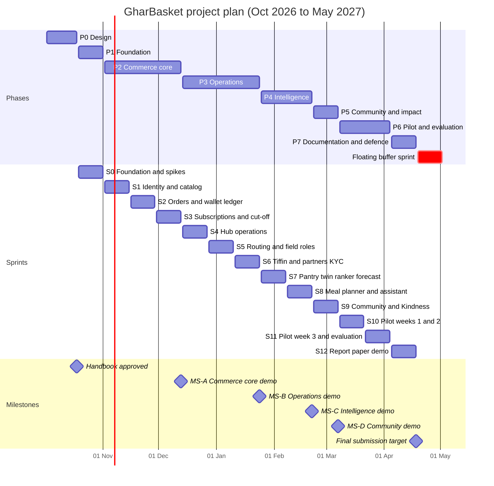
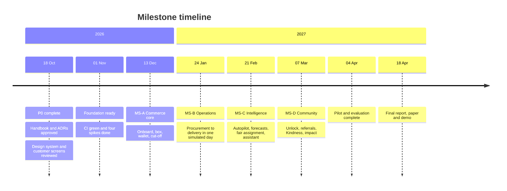

# Chapter 14 — Project Plan

> **In short:** GharBasket is built in eight phases (P0–P7) over about 28 weeks, from 2 October 2026 to mid-April 2027. Phase 0 is design (handbook, ADRs, module specs, Claude Design system and customer screens) — no code. Sprint 0 starts on 19 October 2026; after that, two-week sprints S0–S12 deliver four demo milestones (MS-A to MS-D), a real pilot and the final report and paper. One floating buffer sprint absorbs exams and slips. Yash Salunkhe and Prathamesh Relekar own the code tracks; Rhythm Thakur and Manish Raje own documentation, testing/QA, pilot operations and the presentation.

---

## 14.1 Phases at a glance

| Phase | Sprints | Dates | Goal | Exit gate (must be true to move on) |
|---|---|---|---|---|
| **P0 Design** | — | 2 Oct → 18 Oct 2026 | Agree what we build and how | Handbook, TDD, ADRs, module specs M1–M5 approved by the team and Prof. Kranti Bade; Claude Design System + customer core screens reviewed; ERD v1; simulator spec |
| **P1 Foundation** | S0 | 19 Oct → 1 Nov | Working skeleton everyone builds on | Monorepo, CI green, Docker Compose stack, auth skeleton, design tokens in `frontend/packages/ui`, baseline migrations, simulator v0; the four risk spikes done |
| **P2 Commerce core** | S1–S3 | 2 Nov → 13 Dec | Customers can subscribe and order | **MS-A** demo passes |
| **P3 Operations** | S4–S6 | 14 Dec → 24 Jan 2027 | A full delivery day works | **MS-B** demo passes |
| **P4 Intelligence** | S7–S8 | 25 Jan → 21 Feb | The AI is real | **MS-C** demo passes; evaluation harness produces reports |
| **P5 Community & impact** | S9 | 22 Feb → 7 Mar | Social features live | **MS-D** demo passes |
| **P6 Pilot & evaluation** | S10–S11 | 8 Mar → 4 Apr | Real households, real numbers | ≥ 3 weeks of pilot in 1–2 societies; all evaluation reports generated; security and performance pass |
| **P7 Documentation & defence** | S12 + buffer | 5 Apr → 18 Apr (buffer to 2 May) | Submit and defend | Final report, IEEE paper draft, demo video, viva deck |

### Demo milestones

| Milestone | End of | Demo script |
|---|---|---|
| **MS-A** Commerce core | S3 (13 Dec) | A customer onboards, receives a rule-based weekly box, edits it, pays from the wallet; the 21:00 cut-off locks orders and posts ledger entries |
| **MS-B** Operations | S6 (24 Jan) | Simulated day end-to-end: procurement plan → receiving → packing → OR-Tools routes → captain handover → delivered; a tiffin day; a partner completes KYC |
| **MS-C** Intelligence | S8 (21 Feb) | Autopilot produces an explained meal plan and box under Budget Lock; forecast-driven procurement; fair kitchen assignment; text assistant edits a box with confirmation |
| **MS-D** Community | S9 (7 Mar) | Society unlock, referrals, Kindness pickup on a return leg, NGO handoff, impact dashboard, green-slot pricing |

Every milestone ends with a demo to Prof. Kranti Bade.

## 14.2 Timeline

*Figure 14.1 — Gantt chart of phases, sprints and milestones. The buffer sprint moves to wherever exams fall once dates are known.*

*Figure 14.2 — Milestone timeline.*

## 14.3 Sprint calendar and scope

| Sprint | Dates | Scope (modules) | Key deliverables |
|---|---|---|---|
| S0 | 19 Oct → 1 Nov | M0 platform | Monorepo, CI, Compose, auth skeleton, `frontend/packages/ui` tokens, migrations baseline, simulator v0, AGENTS.md. **Spikes:** Razorpay checkout inside Capacitor; Firebase phone OTP inside Capacitor; OR-Tools + OSRM on a Mumbai Metropolitan Region sample; CP-SAT meal plan on 20 recipes |
| S1 | 2 Nov → 15 Nov | M1 identity, M2 catalog | OTP login, roles, household setup, society picker, catalog + prices, Hinglish search; console catalog/prices/societies |
| S2 | 16 Nov → 29 Nov | M4 orders, M5 billing | Order state machine, slots, cart/add-ons, double-entry ledger, wallet top-up (Razorpay test), webhooks; Partner app shell |
| S3 | 30 Nov → 13 Dec | M3 subscriptions, M11 notify | Weekly cycle jobs, rule-based box v0, approve/edit/skip, 21:00 cut-off lock, push + WhatsApp templates. *Likely exam period — kept light* |
| S4 | 14 Dec → 27 Dec | M6 ops | Procurement plan, purchase orders, receiving/QC, packing queue with scanning, waste log; console ops board |
| S5 | 28 Dec → 10 Jan | M7 logistics | OSRM + OR-Tools routes, rider mode, captain handover and flat checklist, delivery proofs, offline outbox |
| S6 | 11 Jan → 24 Jan | M8 partners, tiffin | Partner onboarding + simulated KYC + training, kitchen menus and capacity, tiffin day flow, earnings and payout statements |
| S7 | 25 Jan → 7 Feb | M10 intel v1 | Pantry digital twin, next-basket ranker, uncommitted-demand forecast + newsvendor procurement, evaluation harness |
| S8 | 8 Feb → 21 Feb | M10, M13 | CP-SAT meal planner, Budget Lock, reason chips, fair kitchen assignment, text assistant; model choice from the 200-utterance eval |
| S9 | 22 Feb → 7 Mar | M9 community, M12 | Society unlock, referrals, Kindness pickups on return legs, NGO handoff, impact dashboard, green-slot pricing |
| S10 | 8 Mar → 21 Mar | Pilot | 1–2 Panvel societies live; churn model; bug fixes |
| S11 | 22 Mar → 4 Apr | Evaluation | Pilot week 3, retrain on pilot data, all evaluation reports, OWASP ASVS L1 pass, k6 load test, accessibility audit |
| S12 | 5 Apr → 18 Apr | Defence | Final report, IEEE paper, demo video, viva deck |
| Buffer | floating (default 19 Apr → 2 May) | — | Absorbs exams or a slipped milestone |

**Cut order if a milestone slips:** voice assistant → OTA live updates → UPI Autopay (wallet stays) → green-slot pricing → churn/uplift model. MVP flows are never cut.

## 14.4 Responsibilities

### Who owns what

| Person | Tracks | Owns |
|---|---|---|
| **Yash Salunkhe** | A — Customer experience; B — Commerce core | `frontend/mobile`, `frontend/packages/ui`, modules M1–M5, M11, customer and field-role screens, M9 screens, buildability review of designs |
| **Prathamesh Relekar** | C — Operations; D — Intelligence | `frontend/console`, modules M6–M10, M12, M13, `backend/ml`, `data/simulator`, infrastructure, research results |
| **Rhythm Thakur** | Docs, QA, pilot | Handbook upkeep, report chapters, UML, UX interviews and design review comments, Hinglish/Marathi copy, Playwright E2E, test plans, pilot operations |
| **Manish Raje** | Docs, QA, pilot | IEEE paper writing, assistant eval labelling (200 utterances), translations review, k6 load tests, accessibility audit, device testing, presentation |
| **Prof. Kranti Bade** | Guide | Reviews at each milestone; approves scope changes |

### RACI by deliverable

R = Responsible, A = Accountable, C = Consulted, I = Informed.

| Deliverable | Yash | Prathamesh | Rhythm | Manish | Guide |
|---|---|---|---|---|---|
| Handbook, TDD, ADRs (P0) | C | A | R | R | I |
| Claude Design System + screens | A | C | R (review, copy) | R (review, research) | I |
| Mobile app (all roles) | A/R | C | C (QA) | C (QA) | I |
| Commerce backend M1–M5 | A/R | C (review) | I | I | I |
| Operations backend M6–M8, console | C (review) | A/R | C (QA) | I | I |
| ML models, simulator, evaluation | I | A/R | C | C | C |
| E2E, load and accessibility testing | C | C | A/R | R | I |
| Pilot operations | C | C | A/R | R | C |
| Final report | C | C | A/R | R | C |
| IEEE paper | C | R (results) | C | A/R (writing) | C |
| Viva presentation and demo | R | R | R | A/R | I |

### Per-phase responsibilities

| Phase | Yash | Prathamesh | Rhythm & Manish |
|---|---|---|---|
| P0 | Wireframe and screen review in Claude Design, M1–M5 specs | M6–M10 specs, simulator spec | UX interviews (8–10 households), SRS update, UML refresh, guide meeting |
| P1 | Mobile and console shells, UI tokens, auth | API platform, ML skeleton, simulator, infrastructure | AGENTS.md rules, test plan, Playwright setup |
| P2 | M1–M5 + customer screens | Console catalog/prices/societies, outbox, OSRM preparation | E2E for onboarding/approve/cut-off; ledger test cases |
| P3 | Packer, rider, captain, kitchen screens; M11 | M6, M7 (OR-Tools), M8, console ops | Operations E2E, device testing, pilot operations plan |
| P4 | Autopilot UX (thali, parchi, reasons), assistant UI | M10 models + evaluation harness, M13 | Label 200 assistant utterances, review catalog translations, paper sections |
| P5 | M9 screens, wallet/Kindness UI | M9 backend, slot pricing, analytics | NGO tie-up, drive content |
| P6 | Fixes and polish | Evaluation, retraining on pilot data | Pilot operations, surveys, k6, accessibility, bug bash |
| P7 | Demo build | Paper results | Report, paper writing, slides |

**Workload note:** Yash and Prathamesh each carry two tracks. To protect the timeline, Rhythm and Manish take all E2E tests, content and translations, assistant labelling and pilot operations, and stretch items are cut first.

## 14.5 Ways of working

- Two-week sprints. Monday planning (30 min) on the GitHub Projects board; Thursday 20-minute internal demo.
- **Spec-first:** each phase begins by writing its module specs in `docs/modules/`.
- Definition of Done: code + tests, OpenAPI updated and clients regenerated, docs/handbook updated, works on simulator seed, screenshot/demo in the PR, QA checklist passed.
- Sprint tags `v0.<sprint>.0` with a generated changelog.

## 14.6 Budget

| Item | Cost (approx.) | Notes |
|---|---|---|
| AWS Mumbai EC2/Lightsail (≈4 vCPU / 8 GB) | ₹0 with student credits; otherwise ₹1,500–3,000/month | Runs api, workers, ml, MLflow, OSRM, Valkey, console |
| Neon, Sentry, Grafana Cloud, PostHog, Firebase (low volume), Vercel previews | ₹0 | Free tiers |
| S3 storage and transfer | ₹0–300/month | Within credits at prototype scale |
| Domain name | ≈ ₹800/year | |
| Claude API (assistant) | ≈ ₹350–1,300/week at demo scale | Model chosen after the S8 eval; per-user caps |
| Razorpay, WhatsApp | ₹0 | Test mode / test number |
| Google Play Console | ≈ ₹2,100 one-time | Internal testing track |
| Pilot packaging and materials | ₹2,000–4,000 | As in the accepted proposal |
| **Total (prototype + pilot)** | **≈ ₹3,800–18,000** | Within the proposal's envelope with sensible model and pilot size |

## Decisions & open questions

- Decided: P0 is design-only; UI design happens in Claude Design during P0 ([ADR-0016](../adr/0016-ui-design-in-claude-design.md), [ADR-0017](../adr/0017-design-before-code-in-phase-0.md)); plan targets April 2027 with one floating buffer sprint ([ADR-0010](../adr/0010-timeline-april-2027-floating-buffer.md)).
- Open: semester exam dates and the final submission deadline (moves the buffer and possibly S3/S4); United Brothers Global's involvement in the pilot.

Related: [Chapter 15 — Risks and Decisions](15-risks-and-decisions.md) · [Chapter 11 — Engineering Process](11-engineering-process.md) · [Chapter 01 — Vision and Scope](01-vision-and-scope.md) · [ADR index](../adr/README.md)
