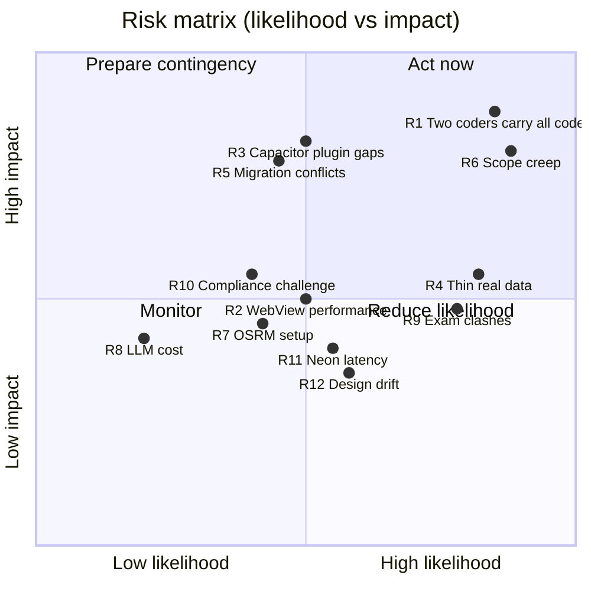

# Chapter 15 — Risks and Decisions

> **In short:** This chapter is the project's memory. It lists the risks we track, how likely and how damaging each one is, and what we do about it; the 25 decisions taken so far — 17 during planning and eight more since (each backed by an Architecture Decision Record in `docs/adr/`), plus any proposed decision still awaiting agreement; and the questions still open. Any change to a decision must go through a new ADR and be discussed with the team and Prof. Kranti Bade.

---

## 15.1 Risk register

Likelihood (L) and impact (I) are rated High / Medium / Low. Owners watch their risks and raise them at the Monday planning meeting.

| ID | Risk | L | I | Mitigation | Owner |
|---|---|---|---|---|---|
| R1 | Two people carry all the code: Prathamesh Relekar all backend, ML, simulator and research; Yash Salunkhe all frontend (D23) | H | H | Strict MVP; cut stretch items first (Chapter 14 cut order); research spikes scheduled in S0; Rhythm and Manish own testing, content, translations and pilot operations | Prathamesh |
| R2 | WebView performance on low-end Android phones | M | M | Performance budget (≤ 250 KB initial JS, LCP < 2.5 s), list virtualisation, test on a real ₹8,000 phone from S1 | Yash |
| R3 | Capacitor plugin gaps (Razorpay checkout and Firebase OTP inside the WebView) | M | H | S0 spikes prove both before feature work; fallbacks: hosted payment link, WhatsApp OTP | Yash |
| R4 | Not enough real data for the paper | H | M | Simulator with stored ground truth; pilot data reported separately (`data_source`); honest framing in the paper | Prathamesh |
| R5 | Migration conflicts and module coupling | M | H | Single Alembic head enforced in CI, import-linter contracts, CODEOWNERS reviews | Prathamesh |
| R6 | Scope creep from new ideas | H | H | Every change needs an ADR and guide agreement; ideas go to a "later" backlog | Rhythm |
| R7 | OSRM and maps setup pain | M | M | Mumbai Metropolitan Region clipped extract; prebuilt files kept in object storage; spike in S0 | Prathamesh |
| R8 | LLM cost overrun | L | M | Per-user daily caps, prompt caching, cheaper model chosen by eval if accuracy holds | Prathamesh |
| R9 | Exams collide with milestones | H | M | Floating buffer sprint; S3 kept light; dates confirmed as soon as published | Manish |
| R10 | Legal/compliance claims challenged in the viva | M | M | Closed-loop wallet design, simulated KYC, cite RBI, DPDP and FSSAI texts, guide sign-off | Rhythm |
| R11 | Neon latency from Mumbai (no India region; Neon runs in Singapore) | M | M | Batch queries and use pooling; decide before P6 whether the pilot database stays on Neon Singapore or moves to a paid Postgres in Mumbai (Q3) | Prathamesh |
| R12 | Design drift between Claude Design screens and code | M | M | Tokens copied from the design system into `frontend/packages/ui`; Storybook review; PR screenshots compared with the canvas | Yash |

*Figure 15.1 — Risk matrix. Top-right items (R1, R6) are reviewed every sprint.*

## 15.2 Decision log

D1–D17 were agreed on 2 October 2026 during planning; D18–D25 were decided between 2 and 4 October 2026. A decision marked **Proposed** has an ADR under review and is not in force yet. Each has an ADR with context, alternatives and consequences.

| ID | Decision | ADR |
|---|---|---|
| D1 | Headline USPs: Kitchen Autopilot + Society Captain ("Ghar Saathi"); Budget Lock, zero-waste loop and Kindness Wallet are supporting features | [ADR-0001](../adr/0001-headline-usps-autopilot-and-society-captain.md) |
| D2 | One TypeScript/React frontend codebase: Vite + React → PWA + Capacitor 8 mobile app for field roles; Next.js 16 console; replaces Flutter — language amended by D18 (JavaScript) | [ADR-0002](../adr/0002-react-capacitor-mobile-nextjs-console.md) |
| D3 | Python-only backend: FastAPI modular monolith + separate ML/optimisation service + Taskiq workers — amended by D21 (Taskiq deferred until the pilot) | [ADR-0003](../adr/0003-python-fastapi-backend-and-ml-service.md) |
| D4 | Closed-loop prepaid wallet (default) and UPI Autopay; no customer KYC; KYC for everyone we pay. MS-A uses the wallet only (Razorpay test-mode top-ups); Autopay mandates are built in the pilot phase | [ADR-0004](../adr/0004-closed-loop-wallet-and-upi-autopay.md) |
| D5 | Assistant: text MVP with tool calls and confirmation; voice is a stretch goal | [ADR-0005](../adr/0005-text-assistant-mvp-voice-stretch.md) |
| D6 | PostgreSQL 18-centric data platform (PostGIS, pgvector, pg_trgm, JSONB, RLS) + Valkey + S3 + DuckDB; no MongoDB/Firebase DB/Elasticsearch | [ADR-0006](../adr/0006-postgresql-centric-data-platform.md) |
| D7 | One systems paper covering all four algorithms (meal planner and pantry twin deepest) | [ADR-0007](../adr/0007-research-scope-four-algorithms.md) |
| D8 | Simulator first; real data added as it arrives; `data_source` tag on every household and order | [ADR-0008](../adr/0008-simulator-first-data-source-tagging.md) |
| D9 | Team tracks: Yash = A + B; Prathamesh = C + D; Rhythm and Manish = docs, QA, pilot, presentation — amended by D23 (code ownership superseded) | [ADR-0009](../adr/0009-team-ownership-and-tracks.md) |
| D10 | Plan for April 2027 with one floating buffer sprint | [ADR-0010](../adr/0010-timeline-april-2027-floating-buffer.md) |
| D11 | Hosting on AWS student credits — superseded by ADR-0020 | [ADR-0011](../adr/0011-hosting-on-aws-student-credits.md) |
| D12 | Platforms: Android (Capacitor) + PWA; no iOS build in v1 | [ADR-0012](../adr/0012-android-and-pwa-platforms.md) |
| D13 | Assistant model chosen after the S8 evaluation (build against Claude Opus 5.5 first) | [ADR-0013](../adr/0013-assistant-model-chosen-by-eval.md) |
| D14 | Final tech stack confirmed; service-based architecture, not microservices — amended by D18, D20, D21 and D22 | [ADR-0014](../adr/0014-final-stack-and-service-based-architecture.md) |
| D15 | AWS Mumbai (ap-south-1) topology with Neon for Postgres and S3 for files — superseded by ADR-0020 | [ADR-0015](../adr/0015-aws-mumbai-topology-with-neon-postgres.md) |
| D16 | UI design entirely in Claude Design (design system + canvases) | [ADR-0016](../adr/0016-ui-design-in-claude-design.md) |
| D17 | UI design happens in Phase 0, before any code (spec-first for later phases) | [ADR-0017](../adr/0017-design-before-code-in-phase-0.md) |
| D18 | Frontend in JavaScript (`.js` / `.jsx`), not TypeScript; JSDoc, `jsconfig.json` (`checkJs`) and the generated API types give editor hints only | [ADR-0018](../adr/0018-javascript-not-typescript-frontend.md) |
| D19 | Repository layout: `frontend/` and `backend/` at the top, one backend folder (and Postgres schema) per module | [ADR-0019](../adr/0019-repository-layout-frontend-backend.md) |
| D20 | Hosting on free tiers until the pilot: Render (API, Key Value), Vercel (PWA, console), Neon Postgres (Singapore), Cloudflare R2, Infisical, PostHog; supersedes D11 and D15 | [ADR-0020](../adr/0020-free-tier-hosting-render-vercel-neon-r2.md) |
| D21 | Jobs without a broker until the pilot: Postgres outbox relayed after each commit, plus a GitHub Actions schedule calling internal job endpoints; Taskiq returns at the pilot | [ADR-0021](../adr/0021-jobs-without-a-broker.md) |
| D22 | Generated API client: openapi-typescript + openapi-fetch + openapi-react-query in `frontend/packages/api-client`; replaces Hey API | [ADR-0022](../adr/0022-api-client-openapi-fetch.md) |
| D23 | Ownership: Prathamesh = all backend, infra, simulator and ML; Yash = all frontend and design; Rhythm and Manish unchanged; supersedes the code ownership in D9 | [ADR-0023](../adr/0023-ownership-backend-and-frontend.md) |
| D24 | Sign-in: Firebase phone OTP, then our own tokens (15-minute access JWT, rotating refresh token); httpOnly cookies and CSRF checks for browsers | [ADR-0024](../adr/0024-sign-in-firebase-otp-own-tokens.md) |
| D25 | ML runtime: serve on a Hugging Face Space (with OSRM), train and forecast in GitHub Actions (`backend/training`), Cloudflare R2 as lake and model registry, cron-job.org for minute-level jobs | [ADR-0025](../adr/0025-ml-runtime-spaces-actions-r2.md) |
| D26 | **Proposed.** Operations contract: one unit set (`g, kg, ml, l, piece, bunch, pack`); order actors `packer`, `rider`, `captain`, `kitchen` alongside `customer`, `system`, `hub`; tiffins reuse the order statuses and events; M9 is the source of truth for Society Captains; M6 owns `hub_ops.hubs` (hub ids elsewhere without foreign keys); crates counted, not tracked | [ADR-0026](../adr/0026-operations-contract.md) |

### How decisions change

1. Write a new ADR that **supersedes** the old one (never edit an accepted ADR's decision; mark it "Superseded by ADR-XXXX").
2. Discuss at the Monday meeting; get agreement from both code owners.
3. For scope or timeline changes, inform Prof. Kranti Bade.
4. Update the affected handbook chapters in the same pull request.

## 15.3 Open questions

| # | Question | Why it matters | Owner | Needed by |
|---|---|---|---|---|
| Q1 | Semester exam dates and the final submission deadline | Moves the buffer sprint and may lighten S3/S4 | Manish Raje | Before S1 |
| Q2 | United Brothers Global's role, involvement in the pilot and IP terms | The accepted proposal names them; affects pilot logistics and ownership | Rhythm Thakur | Before P6 |
| Q3 | Keep the pilot database on Neon (Singapore) or move it to a paid Postgres in Mumbai | Latency (~60 ms per round trip) and data-residency preference | Prathamesh Relekar | Before P6 |
| Q4 | Department confirmation of the switch from Flutter (in the proposal) to React + Capacitor | Avoids surprises at review | Yash Salunkhe | P0 guide meeting |
| Q5 | NGO partner for Kindness handoffs | Needed for MS-D | Rhythm Thakur | Before S9 |

## Decisions & open questions

This chapter *is* the decision and question register. Keep it current: every merged ADR adds a row to 15.2; every resolved question moves from 15.3 into an ADR or a chapter.

Related: [Chapter 14 — Project Plan](14-project-plan.md) · [ADR index](../adr/README.md) · [Chapter 04 — System Architecture](04-system-architecture.md)
